# Alert e-mail templates (ZCA_OPS)

> **First principle:** the code decides *what happened* and collects every fact it already holds; the wording and layout of the e-mail is a template that can be edited and enhanced without a code change.
> **Analogy:** a pre-printed form — the clerk fills the boxes (context keys) and staples the itemised list (table blocks) on; the form itself is redesigned by the print shop (the template, by transport), not by the clerk.

User decisions of 2026-11-10: every alert e-mail is a template that can be edited and enhanced; the template
technology is SAP e-mail templates (object type SMTG, ADT / Fiori *Maintain Email Templates*); templates
change in DV1 and move by transport only (never edited in production); whether alerts show amounts is
configuration per rule, default off. Nothing of this has run in an SAP system: the template API is not
verified in this landscape (section 8).

## 1. How an alert e-mail is built

```mermaid
flowchart LR
  P[ZCL_CA_OPS_ALERT_POLICY: findings of the rule] --> C[context: standard keys + table blocks with tokens]
  C --> B[built-in layout ZCL_CA_OPS_MAIL_TPL_BUILTIN]
  B --> M[message: subject, HTML, text]
  M --> R[ZCL_CA_OPS_ALERT_ROUTER: template = rule / section / channel / ALERT_TEMPLATE_DEFAULT]
  R --> CL[(claim in ZCA_OPS_ALLOG, committed)]
  CL --> S{ALERT_MAIL_RENDERER}
  S -- SMTG --> A[ZCL_CA_OPS_MAIL_TPL_SMTG: CL_SMTG_EMAIL_API]
  A -- rendered --> T[ZCL_CA_OPS_MAIL_COMPOSER: tables in place of the tokens]
  A -- not available / missing / failed --> F[built-in layout kept, reason in RENDER_INFO]
  S -- BUILTIN --> F
  T --> D[channel EMAIL: BCS]
  F --> D
  D --> L[(ZCA_OPS_ALLOG: status, TEMPLATE_ID, RENDERER, RENDER_INFO)]
```

1. The policy selects the findings of a rule (unchanged) and builds the message: the impact-first subject,
   the **standard context keys** (section 3) and the **table blocks** - the consumer section
   (`TABLE_SECTION`, `ZIF_CA_OPS_ALERT_SECTION`) and the findings table (`TABLE_MAIN`), each rendered by
   code with escaped cells and marked by a plain token. The built-in layout fills HTML and text of the
   message at once: it is the content whatever happens later.
2. The router picks the template: the **rule's** `TEMPLATE_ID`, else the consumer **section's**
   (`ZIF_CA_OPS_ALERT_SECTION=>TEMPLATE_ID` for messages with owned findings), else the **channel's**
   `TEMPLATE_ID` (`ZCA_OPS_ALCHN`), else the **generic template** (parameter `ALERT_TEMPLATE_DEFAULT`,
   delivered `ZCA_OPS_ALERT_DEFAULT`). The claim row is written and committed (unchanged; its intent key
   and subject are the code's, so a template change never makes a new alert).
3. For channel EMAIL and `ALERT_MAIL_RENDERER` = `SMTG` (default) the SMTG adapter renders the template
   with the context keys; the composer replaces each token by its HTML table in the HTML body and its text
   table in the text body. Placeholders carry plain text only, so this works whether or not the engine
   escapes placeholder values.
4. **Fallback, never silent, never blocking.** The API does not exist (070), the template is missing or
   inactive (071), rendering fails or returns nothing (072): the built-in layout of step 1 is sent and the
   reason is written to the alert log row (`RENDER_INFO`), `RENDERER` = `BUILTIN`. A customised template
   without a table placeholder still gets the table, appended at the end, and the row records it (073).
   `ALERT_MAIL_RENDERER` = `BUILTIN` switches templates off (075 on the row). The application log channel
   takes the text of the built-in layout.
5. `SEND( )` (prepared reports such as a daily report) takes an optional template: the report HTML is the
   block `TABLE_MAIN`, the subject the key `SUBJECT`; blank = the report as it is.

## 2. Objects

| Object | Role |
|---|---|
| `ZIF_CA_OPS_MAIL_TEMPLATE` | Renderer port: `IS_AVAILABLE`, `EXISTS`, `RENDER` (subject, HTML, text; blocks as tokens) |
| `ZCL_CA_OPS_MAIL_TPL_SMTG` | The only caller of `CL_SMTG_EMAIL_API` - dynamic calls, names as constants (VERIFY-ADT), test seams `SMTG_DESCRIBE`, `SMTG_INSTANCE`, `SMTG_RENDER_DATA`, `SMTG_RENDER_KEY` |
| `ZCL_CA_OPS_MAIL_TPL_BUILTIN` | Built-in layout: the content of `ZCA_OPS_ALERT_DEFAULT` without SMTG (labels: text symbols L01-L19) |
| `ZCL_CA_OPS_MAIL_COMPOSER` | Template order, tokens, tables in after rendering, missing placeholder, fallback note |
| `ZCL_CA_OPS_FACTORY=>GET_MAIL_TEMPLATE` / `ZCL_CA_OPS_INJECTOR=>INJECT_MAIL_TEMPLATE` | Renderer slot (tests inject a double; no test calls the API) |
| `ZI_CA_OPS_ALERTMAILCTX` | CDS data source of the templates: the placeholder catalogue (elements = context keys), key `ALERT_ID` for rendering by key |
| `ZCA_OPS_ALRULE-TEMPLATE_ID`, `-SHOW_AMOUNTS`; `ZCA_OPS_ALCHN-TEMPLATE_ID` | Configuration (app `ZUI_CA_OPS_CFG`, generated; check on save: message 436) |
| `ZCA_OPS_ALLOG-TEMPLATE_ID`, `-RENDERER`, `-RENDER_INFO` | Evidence per delivery |
| `ZIF_CA_OPS_ALERT_DAO=>GET_EXCEPTION_FACTS` | One read by the run key (open / assigned exceptions: occurrences, due date, owner) for new / repeated / overdue |
| `templates/zca_ops_alert_default.md` | The generic template as a documented source with the DV1 creation steps |

## 3. Standard context keys (`ZIF_CA_OPS_TYPES=>TY_MAIL_HEADER`)

Plain text, upper-case names = placeholders `{{NAME}}` = elements of `ZI_CA_OPS_ALERTMAILCTX`. Blank when
not known for the message (with rendering by key: blank unless stored, see section 6).

| Key | Content |
|---|---|
| `SUBJECT` | `[SYSID][AREA][severity] <what> : <how many / how much>` - what = the check code when all findings share it, else the rule; amounts per currency only with `SHOW_AMOUNTS`; a single finding: rule and its text; run-level: message 002; a consumer section may name its own |
| `HEADLINE` | The subject without the bracket prefixes |
| `SYSTEM_ID`, `CLIENT` | System of the run (SM37 link), client |
| `AREA`, `AREA_TEXT` | Area of the run; its description (data source by key only - ZCA_PARAM offers no read API for it yet) |
| `RULE_ID` | Alert rule |
| `SEVERITY`, `SEVERITY_TEXT` | Worst severity of the message (B / E / W / I) and its text |
| `CHECK_CODE`, `CHECK_TEXT` | Check code (blank when several), text of the most severe finding |
| `RUN_ID`, `RUN_VARIANT`, `RUN_STATUS`, `RUN_RAG`, `RUN_LINE` | Run (hex ID), variant, status, RAG, counts line (messages 004 / 005) |
| `JOB_NAME`, `JOB_COUNT` | Batch job (SM37) |
| `STARTED_AT`, `ENDED_AT`, `TIME_ZONE` | Run start / end in the time zone of `ALERT_TIME_ZONE` (default UTC) |
| `FINDINGS_TOTAL`, `FINDINGS_NEW`, `FINDINGS_REPEATED`, `FINDINGS_OVERDUE`, `FINDINGS_HELD_BACK` | Findings of the selection; new / repeated (carried forward) / overdue from the stored exceptions of the run; held back = above `MAX_ITEMS` |
| `DUE_DATE`, `OWNER` | Earliest SLA due date of the open exceptions of the message (ISO) and its owner |
| `EXCEPTIONS_LINK` | `ALERT_EXC_APP_LINK`, else the app's name |
| `REFERENCE_LINE` | Run, job and exceptions app (message 803) |
| `AMOUNT_TOTAL` | Totals per currency - only with `SHOW_AMOUNTS` |
| `RUNBOOK_URL`, `FIRST_ACTION` | Runbook link and first action of the check of the message (2026-11-11, `ZCA_OPS_RUNBOOK`: the most severe finding with a row; CHECK_CODE before GROUP2 before RULE_ID) |
| `CORRELATED_COUNT` | Open correlated children of the parents in the message - alerted with them only (2026-11-11, `ZCA_OPS_CORR`) |
| `ESCALATION` | Step of an escalation until acknowledged, `n / m` (2026-11-11, job `ZCA_OPS_ESCALATE`); blank on ordinary alerts |
| `TABLE_SECTION`, `TABLE_MAIN` | Tokens of the consumer section and of the findings table |

**Per finding** (columns of `TABLE_MAIN`, a column shown when a finding has a value): severity, rule,
check, object type / key, reference, business date, company code, account (a label that may be
e-mailed: house bank / account ID or a masked number - the producer masks, never a full number),
payment method, count, amount + currency (**only when the rule's `SHOW_AMOUNTS` = X**), message,
context / details: the finding's `CONTEXT` lines (labelled business context, never amounts - always
shown) and, **only with `SHOW_AMOUNTS`**, its `DETAILS` (the check's free text, which may carry amounts,
e.g. reconciliation differences). The fields business date, company code, account, payment method,
count and context are new components of `ZIF_CA_OPS_TYPES=>TY_FINDING` (not stored in
`ZCA_OPS_FINDING`): the producer fills what it knows at finding time. The text body lists the same,
labelled.

## 4. Configuration

| Where | Field / parameter | Meaning |
|---|---|---|
| `ZCA_OPS_ALRULE` | `TEMPLATE_ID` | Template of the rule's messages (blank = section, channel, generic) |
| `ZCA_OPS_ALRULE` | `SHOW_AMOUNTS` | X = amounts and totals per currency in the e-mail and the subject (default off) |
| `ZCA_OPS_ALCHN` | `TEMPLATE_ID` | Default template of the channel |
| `CA_OPS` | `ALERT_MAIL_RENDERER` | `SMTG` (default; built-in fallback) or `BUILTIN` |
| `CA_OPS` | `ALERT_TEMPLATE_DEFAULT` | Generic template (default `ZCA_OPS_ALERT_DEFAULT`) |
| `CA_OPS` | `ALERT_TIME_ZONE` | Time zone of the times shown (default `UTC`) |
| `CA_OPS` | `ALERT_EXC_APP_LINK` | Link to the exceptions app (blank = its name) |

The configuration app refuses a template ID that is not upper-case letters, digits, `_` or `/` (at most 30,
starting with a letter or `/`) and, where the SMTG API is available, a template that does not exist
(message 436); without the API only the syntax is checked.

## 5. Delivering templates

Templates are repository objects (SMTG) of the package of their owner, created in DV1 and transported.
abapGit support for object type SMTG and its file format are **not verified** in this landscape
(VERIFY-ADT V22): the templates are therefore delivered as **documented sources** - `templates/*.md` of
the framework (generic template) and of each consumer - with ID, description, data source, subject,
HTML body, text body, placeholders and the DV1 creation steps. If the abapGit version of DV1 serializes
SMTG, the created templates can afterwards be pulled into the repository by abapGit like any object; the
documented source stays the reference of the content.

## 6. Data source: two options, both in the adapter

| Option | Call (VERIFY-ADT) | Keys | Status |
|---|---|---|---|
| Data passed by code (preferred) | `GET_INSTANCE( IV_TEMPLATE_ID )`, `RENDER_W_DATA( IV_LANGUAGE, IR_DATA, EV_SUBJECT, EV_BODY_HTML, EV_BODY_TEXT )` | all keys of section 3 | used when the class has `RENDER_W_DATA` |
| CDS data source by key | `RENDER( IV_LANGUAGE, IT_DATA_KEY = ALERT_ID, ... )` over `ZI_CA_OPS_ALERTMAILCTX` | keys stored with the alert log row and its run (subject, system, area + text, rule, run, variant, status, RAG, job, start / end raw, findings count); others blank | used when only `RENDER` exists; the claim row is committed before rendering so the key resolves |

## 7. A consumer

- Own template per alert type: create it in the consumer's package with data source
  `ZI_CA_OPS_ALERTMAILCTX`, put `{{TABLE_MAIN}}` (and `{{TABLE_SECTION}}` when it has a section) where the
  tables go, deliver it as a documented source, set `TEMPLATE_ID` on its rules.
- A section plug-in (`ZIF_CA_OPS_ALERT_SECTION`) may name the template of the messages that hold its
  findings (`TEMPLATE_ID`, optional method) - used when the rule names none.
- Fill the business context of the findings where the data is at hand (`BUSINESS_DATE`, `COMPANY_CODE`,
  `ACCOUNT` masked, `PAY_METHOD`, `ITEM_COUNT`, labelled `CONTEXT` lines without amounts); no extra database
  reads for it. `DETAILS` reach the e-mail only on rules with `SHOW_AMOUNTS`.
- Amounts: set `SHOW_AMOUNTS` on the rules whose receivers are to see them.

## 8. VERIFY items (nothing has run in SAP)

| ID | What to confirm in DV1 |
|---|---|
| V17 | `CL_SMTG_EMAIL_API` exists (SE24); static `GET_INSTANCE` with importing `IV_TEMPLATE_ID` and returning `RO_INSTANCE` (constants `GC_API` / `GC_API_PARAM` of `ZCL_CA_OPS_MAIL_TPL_SMTG`) |
| V18 | `RENDER_W_DATA`: name, importing `IV_LANGUAGE`, data parameter (assumed `IR_DATA`, a reference to the structure; if it is a structure `IS_DATA`, change `GC_API_PARAM-DATA` and bind the structure), exporting `EV_SUBJECT`, `EV_BODY_HTML`, `EV_BODY_TEXT` (string); the API maps structure components to placeholders by name |
| V19 | `RENDER`: importing `IT_DATA_KEY` (table of `NAME` / `VALUE`, type read from the signature at run time), key element `ALERT_ID` of `ZI_CA_OPS_ALERTMAILCTX` |
| V20 | Exception classes of the API (caught broadly today) and whether `GET_INSTANCE` raises for an unknown or inactive template (then `EXISTS` is false and the configuration app refuses the ID) |
| V21 | Data element and length of the template ID (CHAR 30 assumed in `ZCA_OPS_ALRULE` / `_ALCHN` / `_ALLOG`) and its allowed characters (PCRE of `ZCL_CA_OPS_CFG_CHECKS=>TEMPLATE_VALID`) |
| V22 | abapGit support of object type SMTG in the DV1 abapGit version (else templates stay documented sources) |
| V23 | Placeholder syntax `{{NAME}}` and the case of element names offered by the template editor; a data source with `cast( ' ' as abap.char(n) )` elements is accepted |
| V24 | Rendered HTML with a token: the engine leaves letters / digits unchanged (the token is found and replaced) |
| V25 | E-mail with SMTG in QA1: one alert per seed rule; `ZCA_OPS_ALLOG` shows `RENDERER` = `SMTG`; a deleted template gives the built-in layout and `RENDER_INFO` 071 |

## 9. Tests

`ZCL_CA_OPS_MAIL_COMPOSER` (tokens, order, tables in place, missing placeholder appended and named,
fallbacks), `ZCL_CA_OPS_MAIL_TPL_SMTG` (test injections: not available, render with data, render by key,
071, 072), `ZCL_CA_OPS_MAIL_TPL_BUILTIN`, `ZCL_CA_OPS_ALERT_POLICY` (amounts only with `SHOW_AMOUNTS`, context
keys, finding context, new / repeated / overdue), `ZCL_CA_OPS_ALERT_ROUTER` (template rendered after the
claim and logged, fallback logged, rule > channel > generic, report in a template), `ZCL_CA_OPS_CFG_CHECKS`
(template ID), `ZCL_CA_OPS_ALERT_DAO` (exception facts, OSQL double). No test calls the SMTG API or reads the
database.
