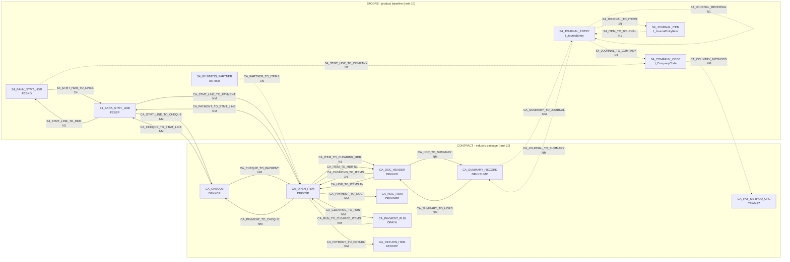

# Link registry of the product (S4CORE, CONTRACT) - lineage

> Generated by `tools/link_registry.py` from the layer specs - never edit, regenerate.

Solid arrow = active link, dotted arrow = inactive (VERIFY item open, switched off or replaced); label = link ID and cardinality. Pending links (a field still a placeholder) are not drawn; the table of links lists them.

## Links

| Link | Layer | From | To | Cardinality | Quality | Conditions | Fallback of / replaces | Status |
|---|---|---|---|---|---|---|---|---|
| S4_ITEM_TO_JOURNAL | S4CORE | S4_JOURNAL_ITEM | S4_JOURNAL_ENTRY | N1 | C | I_JournalEntry-CompanyCode = I_JournalEntryItem-CompanyCode; I_JournalEntry-FiscalYear = I_JournalEntryItem-FiscalYear; I_JournalEntry-AccountingDocument = I_JournalEntryItem-AccountingDocument | - | inactive (VERIFY) V110 |
| S4_JOURNAL_REVERSAL | S4CORE | S4_JOURNAL_ENTRY | S4_JOURNAL_ENTRY | N1 | C | I_JournalEntry-CompanyCode = I_JournalEntry-CompanyCode; I_JournalEntry-FiscalYear = I_JournalEntry-ReverseDocumentFiscalYear; I_JournalEntry-AccountingDocument = I_JournalEntry-ReverseDocument | - | inactive (VERIFY) V110 |
| S4_JOURNAL_TO_COMPANY | S4CORE | S4_JOURNAL_ENTRY | S4_COMPANY_CODE | N1 | C | I_CompanyCode-CompanyCode = I_JournalEntry-CompanyCode | - | inactive (VERIFY) V110 |
| S4_JOURNAL_TO_ITEMS | S4CORE | S4_JOURNAL_ENTRY | S4_JOURNAL_ITEM | 1N | C | I_JournalEntryItem-CompanyCode = I_JournalEntry-CompanyCode; I_JournalEntryItem-FiscalYear = I_JournalEntry-FiscalYear; I_JournalEntryItem-AccountingDocument = I_JournalEntry-AccountingDocument | - | inactive (VERIFY) V110 |
| S4_STMT_HDR_TO_COMPANY | S4CORE | S4_BANK_STMT_HDR | S4_COMPANY_CODE | N1 | C | I_CompanyCode-CompanyCode = FEBKO-BUKRS | - | inactive (VERIFY) V110 V117 |
| S4_STMT_HDR_TO_LINES | S4CORE | S4_BANK_STMT_HDR | S4_BANK_STMT_LINE | 1N | C | FEBEP-KUKEY = FEBKO-KUKEY | - | active |
| S4_STMT_LINE_TO_HDR | S4CORE | S4_BANK_STMT_LINE | S4_BANK_STMT_HDR | N1 | C | FEBKO-KUKEY = FEBEP-KUKEY | - | active |
| CA_CHEQUE_TO_PAYMENT | CONTRACT | CA_CHEQUE | CA_OPEN_ITEM | NM | C | DFKKOP-AUGBL = DFKKCR-DOC1R | - | active |
| CA_CHEQUE_TO_STMT_LINE | CONTRACT | CA_CHEQUE | S4_BANK_STMT_LINE | NM | C | FEBEP-CHECT = DFKKCR-ZTNUM (RIGHT 13) | - | active V117 |
| CA_CLEARING_TO_ITEMS | CONTRACT | CA_DOC_HEADER | CA_OPEN_ITEM | 1N | C | DFKKOP-AUGBL = DFKKKO-OPBEL | - | active |
| CA_CLEARING_TO_RUN | CONTRACT | CA_OPEN_ITEM | CA_PAYMENT_RUN | NM | C | DPAYH-DOC1R = DFKKOP-AUGBL | - | active |
| CA_COUNTRY_METHODS | CONTRACT | S4_COMPANY_CODE | CA_PAY_METHOD_CFG | NM | C | TFK042Z-LAND1 = I_CompanyCode-Country | - | inactive (VERIFY) V110 V117 |
| CA_HDR_TO_ITEMS | CONTRACT | CA_DOC_HEADER | CA_OPEN_ITEM | 1N | C | DFKKOP-OPBEL = DFKKKO-OPBEL | - | active |
| CA_HDR_TO_SUMMARY | CONTRACT | CA_DOC_HEADER | CA_SUMMARY_RECORD | NM | C | DFKKSUMC-FIKEY = DFKKKO-FIKEY | - | active |
| CA_ITEM_TO_CLEARING_HDR | CONTRACT | CA_OPEN_ITEM | CA_DOC_HEADER | N1 | C | DFKKKO-OPBEL = DFKKOP-AUGBL | - | active |
| CA_ITEM_TO_HDR | CONTRACT | CA_OPEN_ITEM | CA_DOC_HEADER | N1 | C | DFKKKO-OPBEL = DFKKOP-OPBEL | - | active |
| CA_JOURNAL_TO_SUMMARY | CONTRACT | S4_JOURNAL_ENTRY | CA_SUMMARY_RECORD | NM | C | DFKKSUMC-FIKEY = I_JournalEntry-OriginalReferenceDocument | - | inactive (VERIFY) V110 V117 |
| CA_PARTNER_TO_ITEMS | CONTRACT | S4_BUSINESS_PARTNER | CA_OPEN_ITEM | 1N | C | DFKKOP-GPART = BUT000-PARTNER | - | inactive (VERIFY) V117 |
| CA_PAYMENT_TO_CHEQUE | CONTRACT | CA_OPEN_ITEM | CA_CHEQUE | NM | C | DFKKCR-DOC1R = DFKKOP-AUGBL | - | active |
| CA_PAYMENT_TO_NOC | CONTRACT | CA_OPEN_ITEM | CA_NOC_ITEM | NM | P | DFKKNRP-INFOF = DFKKOP-AUGBL | - | active |
| CA_PAYMENT_TO_RETURN | CONTRACT | CA_OPEN_ITEM | CA_RETURN_ITEM | NM | C | DFKKRP-SELW1 = DFKKOP-AUGBL | - | active |
| CA_PAYMENT_TO_STMT_LINE | CONTRACT | CA_OPEN_ITEM | S4_BANK_STMT_LINE | NM | C | FEBEP-CHECT = DFKKOP-AUGBL | - | active |
| CA_RUN_TO_CLEARED_ITEMS | CONTRACT | CA_PAYMENT_RUN | CA_OPEN_ITEM | NM | C | DFKKOP-AUGBL = DPAYH-DOC1R | - | active |
| CA_STMT_LINE_TO_CHEQUE | CONTRACT | S4_BANK_STMT_LINE | CA_CHEQUE | NM | P | DFKKCR-ZTNUM = FEBEP-CHECT | - | active V117 |
| CA_STMT_LINE_TO_PAYMENT | CONTRACT | S4_BANK_STMT_LINE | CA_OPEN_ITEM | NM | C | DFKKOP-AUGBL = FEBEP-CHECT | - | active |
| CA_SUMMARY_TO_HDRS | CONTRACT | CA_SUMMARY_RECORD | CA_DOC_HEADER | NM | C | DFKKKO-FIKEY = DFKKSUMC-FIKEY | - | active |
| CA_SUMMARY_TO_JOURNAL | CONTRACT | CA_SUMMARY_RECORD | S4_JOURNAL_ENTRY | NM | C | I_JournalEntry-OriginalReferenceDocument = DFKKSUMC-FIKEY; I_JournalEntry-ReferenceDocumentType = 'FKKSU' | - | inactive (VERIFY) V110 V117 |
