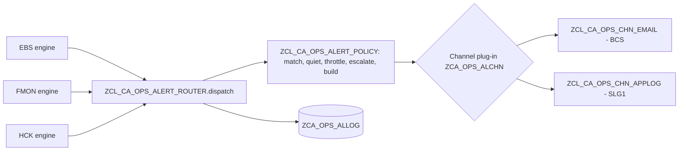

# Alerting — configurable across the whole suite

> **First principle:** who hears about a problem, how fast and through which channel is customizing; the code only decides *what* happened.
> **Analogy:** a building's fire panel — each zone (alert rule) is wired by the installer to sirens or the control room (channels); the sensors (checks) never dial anyone themselves.

> **Since 2026-11-10 the alert router is part of the operations framework ZCA_OPS** (`ops-framework/`): `ZCL_CA_OPS_ALERT_ROUTER`, `_ALERT_POLICY`, `_ALERT_DAO`, channels `ZCL_CA_OPS_CHN_EMAIL` / `_CHN_APPLOG`, tables `ZCA_OPS_ALRULE` / `_ALCHN` / `_ALLOG`, maintained in the framework app `ZUI_CA_OPS_CFG` (generated). Rules name an area of ZCA_PARAM (`CD_EBS`, `CD_FMON`, `CD_HCK`, `CD_OPS` or `*`); recipients `ALERT_<route>` / `ALERT_DEFAULT` and `ALERT_ESCALATION_WINDOW_H` are parameters of area `CA_OPS`; the bank ACK table of the e-mail is the suite's alert section `ZCL_CD_OPS_ACK_MAIL` (`ZIF_CA_OPS_ALERT_SECTION`, parameter `ALERT_SECTION_CLASS`); messages are class ZCA_OPS (same numbers). Behaviour is unchanged.

## Part A — Business & Operations

1. Every payment engine area (EBS validation, file monitoring, health checks) finishes a run and hands **all its findings** to one alert router.
2. The router reads the **alert rules** for that payment engine area and decides, rule by rule:
   - does any finding reach the rule's minimum severity and match its patterns (rule, check, grouping)?
   - or did the run as a whole end red/amber, or stop on the circuit breaker?
3. It then applies the rule's **quiet hours** (a *blocked* item — money that must not move — always alerts, even at night), **throttling** (no repeat within N minutes) and **escalation** (after N consecutive alerting runs the escalation list is added).
4. It delivers through the rule's **channel**: e-mail to SAPoffice shared distribution lists (SO23) or the application log (SLG1). The suite makes no outbound call to another system (read-only scope, 2026-11-07).
5. Every decision — sent, failed, throttled, held for quiet hours — is written to the **alert log**. Nothing is silently dropped; the morning report shows failed deliveries.

The morning report itself is sent as a report (route `MORNING`), not as an alert.

| Status in log | Meaning | Action |
|---|---|---|
| S | **Submitted** — the channel accepted the alert: e-mail send request accepted by BCS and committed to SAPconnect, application log saved. For e-mail this is not proof of delivery to the mailbox (audit A99) | Delivery to the recipient is in SAPconnect (SOST); check SOST for payment-critical routes during QA1 and when the morning report shows send errors |
| C | Claimed — delivery in progress (written and committed before sending, audit A17) | A C row older than the run means the run ended during delivery (dump); review and re-send, then set it to F |
| R | Repeat suppressed — the exception was only carried forward from an earlier run and its severity did not change | None — by design; escalation rules still alert |
| P | Partially delivered (e.g. application log saved with fewer messages than requested) | Treat as failed for follow-up |
| F | Channel failed (address, destination, log object) | Fix the channel or destination; the morning report's alert-delivery check turns amber/red |
| T | Throttled (same rule alerted within the window) | None — by design |
| Q | Held: quiet hours | Appears in the next morning report |

Suite-level alert: **RUN_LOCKED** (check code, every payment engine area) — a scheduled run was refused because another run of the same payment engine area and variant still holds the run lock. Seed rule `RUN_LOCKED` routes it to RTB support (`config/alert_seed.md`).

**Suppressed findings are information.** A health-check finding under an active suppression becomes severity I — rules with a minimum severity of W or higher do not alert them (`RAP_Ops_Apps.md`).

### Alert e-mail layout (2026-11-10)

- **Subject** starts with the system ID: `[PS4][EBS][E] …` - a test-system alert is never mistaken for production.
- **Body** names the run ID, the batch job (name / count, SM37) and the exceptions app (message 803) under the run line.
- **Missing bank ACK** (file monitoring): impact-first subject and a dedicated table per file - see `config/alert_seed.md` (*Missing bank ACK mail*) and `FMON_FILE_MONITORING.md` §A3c.
- **Failures of the router itself** are findings ALERT_FAILED of the run (every area) and stuck claims are measured by `E_ALERT_DELIVERY` (`ALERT_CLAIM_STUCK`).

## Part B — Technical

| Object | Role | Test level |
|---|---|---|
| ZIF_CA_OPS_ALERT | Port: `dispatch( run, findings )`, `send( route, subject, html )` | — |
| ZCL_CA_OPS_ALERT_POLICY | Pure decisions (severity floor, PCRE patterns (complete value, case ignored), run-level RAG/abort, quiet hours incl. midnight wrap, throttle, escalation, digest/per-finding with cap, HTML escaping) | Domain, 14 tests |
| ZCL_CA_OPS_ALERT_ROUTER | Orchestration, logging, failure isolation | Application with doubles, 8 tests |
| ZCL_CA_OPS_ALERT_DAO | ZCA_OPS_ALRULE / _CHN / _LOG | OSQL (QA1) |
| ZCL_CA_OPS_CHN_EMAIL / _APPLOG | Thin wrappers over BCS, BAL | Integration (QA1); own unit tests of the message build |

### LUW rule
The router and its channels commit (BCS sends on commit, BAL saves to the database). They run at the end of a report run in its own LUW. **Never call `dispatch( )` or `send( )` from a RAP behaviour handler or inside an update task** — hand the request to bgPF instead.

### Customizing

`ZCA_OPS_ALRULE` (key RULE_ID): PE_AREA (`*` = all), MIN_SEVERITY, RULE/CHECK/GROUP1/GROUP2 patterns, MIN_RAG, ON_ABORT, CHANNEL, DESTINATION, DIGEST, MAX_ITEMS, THROTTLE_MIN, QUIET_FROM/TO, ESCALATE_AFTER, ESCALATION_DEST, ACTIVE.
`ZCA_OPS_ALCHN` (key CHANNEL): CLASS_NAME, default DESTINATION, ACTIVE — a new channel is a class implementing `ZIF_CA_OPS_ALERT_CHANNEL` plus one row.
Parameters (framework `ZCA_PARAM`, area `CD_OPS` — maintained in the app *Parameter areas* (`ZUI_CA_PARAM_O4`); definitions and delivered defaults: `config/param_definitions.csv`): `ALERT_<route>` and `ALERT_DEFAULT` recipient lists (LIST) for `send( )` — one definition per route in use (`ALERT_MORNING`; a new route in `HCK_MAIL_ROUTE` needs its own definition); `ALERT_ESCALATION_WINDOW_H` (INT, default 24).

Example rows: `config/alert_seed.md`.

### Rule patterns (PCRE, user decision 2026-11-06)

RULE_PATTERN, CHECK_PATTERN, GROUP1_PATTERN and GROUP2_PATTERN are PCRE matched to the **complete** rule ID / check code / group of the finding, case ignored; blank = any. `.*SLA.*` = every check code containing SLA; `NOC_AGING` = only that code (a partial pattern is no match). The alerting app refuses a pattern that does not compile (message 418). A rule whose stored pattern does not compile is **not applied and logged FAILED** in ZCA_OPS_ALLOG with message 742 — it shows in the morning report's alert-delivery check, never as a silent no-match. Check a pattern before saving it: `ZCD_OPS_PATTERN_CHECK`, areas ALERT_RULE / ALERT_CHK / ALERT_GRP1 / ALERT_GRP2 (values of the findings of the window).

### Extension guide

| Change | Customizing |
|---|---|
| Mail the on-call list for any blocked bank line | Rule: PE_AREA EBS, MIN_SEVERITY B, CHANNEL EMAIL, DESTINATION = SO23 list name (e.g. `ZCD_PAYOPS`) |
| Add or remove a person who receives alerts | SO23 only: maintain the shared distribution list — no rule change, no transport |
| Send NOC aging to compliance daily | Rule: PE_AREA FMON, CHECK_PATTERN `NOC_AGING*`, THROTTLE_MIN 1440 |
| Stop night e-mails for warnings | QUIET_FROM 22:00, QUIET_TO 06:00 on the rule (blocks still go out) |
| Escalate a persisting red health check | ESCALATE_AFTER 2, ESCALATION_DEST = SO23 lead list (`ZCD_RTBLEAD`) |
| Alert when a file is not processed by a clock time (e.g. BAI by 10:00, 2026-11-07) | DEADLINE row in ZCD_FMON_SLA (`FMON_FILE_MONITORING.md` §A3b) + rule: PE_AREA FMON, MIN_SEVERITY E, CHECK_PATTERN `STAGE_DEADLINE_MISSED`, GROUP1_PATTERN = interface(s), EMAIL to an SO23 list, ESCALATE_AFTER in 5-minute runs — seed `FMON_BAIDL`. New rows of both tables by customizing transport from DV1; in PS4 only existing rows are edited (`Operations_Runbook.md` §5h). GROUP2 of the finding = `NOT_RECEIVED` / `NOT_IMPORTED` / `NOT_POSTED` (a second rule may send one condition to another list) |
| Add a new channel type (later phase) | One class implementing ZIF_CA_OPS_ALERT_CHANNEL + ZCA_OPS_ALCHN row |

### Deadline alerts and repeat suppression (2026-11-07)

A deadline finding (`STAGE_DEADLINE_MISSED`) has the stable object key `<interface>/<business date>`: the 5-minute FMON runs after the due time raise the same key and check code, the store carries the open exception forward (same owner, due date, occurrences + 1) and the router logs such a carried-forward finding as **R (repeat)** without sending — one e-mail per interface and day, not one every 5 minutes. The rule's `ESCALATE_AFTER` (consecutive alerting runs) still sends the escalation to `ESCALATION_DEST`; `THROTTLE_MIN` 0 so the first raise is never held back. When the stage is reached the engine reconciles the key and the exception is resolved. No application-log rule is delivered for deadlines (SLG1 kept to a minimum, user rule 2026-11-07): findings are in ZCA_OPS_FINDING, mail goes to SO23 lists.

### Delivery guarantees (Phase 6 audit)

| Guarantee | How | Finding |
|---|---|---|
| One alert per intent, even with two dispatchers | Claim row (status C, SHA-1 intent key, unique index INT) committed before the send, completed after | A17 |
| A carried-forward exception is not re-alerted every run | Findings with occurrences > 1 are filtered (log R) unless the rule escalates | A17 |
| No silent success | No recipient / inactive channel raise; BCS send result checked; partly written SLG1 log = P | A45 |
| Recipients maintained once | E-mail destinations are SO23 shared lists; the configuration app refuses a name that is not one (419), the channel refuses the route before sending if the list is gone (027) | User decision 2026-11-07 |
| Escalation means "N runs in a row" | Counted over the area's run history; ESC_OVERRIDE passes the throttle | A46 |
| A blocker is never cut by the cap | Severity-ordered cap, digest severity from the full selection, held-back count shown | A63 |
| A misconfigured channel class never runs | Factory checks ZIF_CA_OPS_ALERT_CHANNEL by RTTI before CREATE OBJECT | A62 |
| SLG1 entries are findable | External ID `<area>/<run>/<rule>`; BAL_LOG_REFRESH after save | SLG1 |
| SLG1 kept to a minimum | No delivered rule uses the APPLOG channel; findings, alert attempts and parameter errors live in the suite's tables and the morning report. A rule that needs SLG1 should be E or higher, digest, small MAX_ITEMS | User decision 2026-11-07 |

A claim left in status C by a dump blocks that intent until the operator completes or deletes the row
(residual: the alert delivery health check counts F and T, not stale C rows yet). Residual: the index INT is a manual SE11 step (not serialized).

### Priority mapping (P1–P3)

Priority follows the rule's severity and the distribution list it mails; changing an acknowledgement target never needs an SAP transport. Proposed targets — to be confirmed by RTB operations before gate 3 (`Release_Readiness.md`):

| Priority | Severity | Meaning | Acknowledge within | Channel in the seeds |
|---|---|---|---|---|
| **P1** | B, or a run stopped on the circuit breaker (ON_ABORT) | Money must not move / control did not run | 15 min, 24×7 (quiet hours never hold B) | E-mail with escalation (`EBS_BLOCK`, `ALL_ABORT`) |
| **P2** | E | Exception needing action the same business day | 1 h in business hours | E-mail (`EBS_ERROR`, `FMON_PART`, `FMON_SLA`, `HCK_RED`, `RUN_LOCKED`, `NOC_AGING`) |
| **P3** | W | Review in the morning report | Next business day | Morning report and dashboards (no alert, no SLG1 entry) |
| — | I | Information (suppressed, carried forward) | No incident | Application log only |

Per seed rule: `config/alert_seed.md` (column *Priority*). The acknowledgement window is owned by RTB operations; the suite's own evidence is the alert log (status S with time) and the escalation rules (`ESCALATE_AFTER`).
