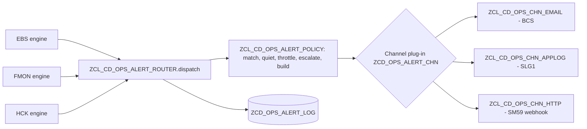

# Alerting — configurable across the whole suite

> **First principle:** who hears about a problem, how fast and through which channel is customizing; the code only decides *what* happened.
> **Analogy:** a building's fire panel — each zone (alert rule) is wired by the installer to sirens, pagers or the control room (channels); the sensors (checks) never dial anyone themselves.

## Part A — Business & Operations

1. Every module (EBS validation, file monitoring, health checks) finishes a run and hands **all its findings** to one alert router.
2. The router reads the **alert rules** for that module and decides, rule by rule:
   - does any finding reach the rule's minimum severity and match its patterns (rule, check, grouping)?
   - or did the run as a whole end red/amber, or stop on the circuit breaker?
3. It then applies the rule's **quiet hours** (a *blocked* item — money that must not move — always alerts, even at night), **throttling** (no repeat within N minutes) and **escalation** (after N consecutive alerting runs the escalation list is added).
4. It delivers through the rule's **channel**: e-mail, the application log (SLG1) or an HTTP webhook (Teams / ServiceNow / PagerDuty through an SM59 destination).
5. Every decision — sent, failed, throttled, held for quiet hours — is written to the **alert log**. Nothing is silently dropped; the morning report shows failed deliveries.

The morning report itself is sent as a report (route `MORNING`), not as an alert.

| Status in log | Meaning | Action |
|---|---|---|
| S | Delivered | — |
| F | Channel failed (address, destination, log object) | Fix the channel or destination; the morning report's alert-delivery check turns amber/red |
| T | Throttled (same rule alerted within the window) | None — by design |
| Q | Held: quiet hours | Appears in the next morning report |

## Part B — Technical

| Object | Role | Test level |
|---|---|---|
| ZIF_CD_OPS_ALERT | Port: `dispatch( run, findings )`, `send( route, subject, html )` | — |
| ZCL_CD_OPS_ALERT_POLICY | Pure decisions (severity floor, CP patterns, run-level RAG/abort, quiet hours incl. midnight wrap, throttle, escalation, digest/per-finding with cap, HTML escaping) | Domain, 14 tests |
| ZCL_CD_OPS_ALERT_ROUTER | Orchestration, logging, failure isolation | Application with doubles, 8 tests |
| ZCL_CD_OPS_ALERT_DAO | ZCD_OPS_ALERT_RULE / _CHN / _LOG | OSQL (QA1) |
| ZCL_CD_OPS_CHN_EMAIL / _APPLOG / _HTTP | Thin wrappers over BCS, BAL, CL_HTTP_CLIENT | Integration (QA1); `ZCL_CD_OPS_CHN_HTTP=>to_json` is pure |

### Customizing

`ZCD_OPS_ALERT_RULE` (key RULE_ID): MODULE (`*` = all), MIN_SEVERITY, RULE/CHECK/GROUP1/GROUP2 patterns, MIN_RAG, ON_ABORT, CHANNEL, DESTINATION, DIGEST, MAX_ITEMS, THROTTLE_MIN, QUIET_FROM/TO, ESCALATE_AFTER, ESCALATION_DEST, ACTIVE.
`ZCD_OPS_ALERT_CHN` (key CHANNEL): CLASS_NAME, default DESTINATION, ACTIVE — a new channel is a class implementing `ZIF_CD_OPS_ALERT_CHANNEL` plus one row.
`ZCD_OPS_PARAM`: `ALERT_<route>` and `ALERT_DEFAULT` recipient lists for `send( )`; `ALERT_ESCALATION_WINDOW_H` (default 24).

Example rows: `config/alert_seed.md`.

### Extension guide

| Change | Customizing |
|---|---|
| Page the on-call team for any blocked bank line | Rule: MODULE EBS, MIN_SEVERITY B, CHANNEL HTTP, DESTINATION = SM59 webhook |
| Send NOC aging to compliance daily | Rule: MODULE FMON, CHECK_PATTERN `NOC_AGING*`, THROTTLE_MIN 1440 |
| Stop night e-mails for warnings | QUIET_FROM 22:00, QUIET_TO 06:00 on the rule (blocks still go out) |
| Escalate a persisting red health check | ESCALATE_AFTER 2, ESCALATION_DEST = lead DL |
| Add Microsoft Teams | SM59 destination (Basis) + rule with CHANNEL HTTP |
| Add a new channel type (e.g. SMS gateway) | One class implementing ZIF_CD_OPS_ALERT_CHANNEL + ZCD_OPS_ALERT_CHN row |
