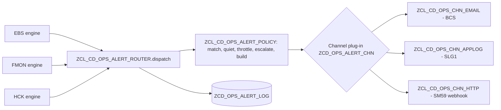

# Alerting — configurable across the whole suite

> **First principle:** who hears about a problem, how fast and through which channel is customizing; the code only decides *what* happened.
> **Analogy:** a building's fire panel — each zone (alert rule) is wired by the installer to sirens, pagers or the control room (channels); the sensors (checks) never dial anyone themselves.

## Part A — Business & Operations

1. Every payment engine area (EBS validation, file monitoring, health checks) finishes a run and hands **all its findings** to one alert router.
2. The router reads the **alert rules** for that payment engine area and decides, rule by rule:
   - does any finding reach the rule's minimum severity and match its patterns (rule, check, grouping)?
   - or did the run as a whole end red/amber, or stop on the circuit breaker?
3. It then applies the rule's **quiet hours** (a *blocked* item — money that must not move — always alerts, even at night), **throttling** (no repeat within N minutes) and **escalation** (after N consecutive alerting runs the escalation list is added).
4. It delivers through the rule's **channel**: e-mail, the application log (SLG1) or an HTTP webhook (Teams / ServiceNow / PagerDuty through an SM59 destination).
5. Every decision — sent, failed, throttled, held for quiet hours — is written to the **alert log**. Nothing is silently dropped; the morning report shows failed deliveries.

The morning report itself is sent as a report (route `MORNING`), not as an alert.

| Status in log | Meaning | Action |
|---|---|---|
| S | **Submitted** — the channel accepted the alert: e-mail send request accepted by BCS and committed to SAPconnect, application log saved, HTTP 2xx received. For e-mail this is not proof of delivery to the mailbox (audit A99) | Delivery to the recipient is in SAPconnect (SOST); check SOST for payment-critical routes during QA1 and when the morning report shows send errors |
| C | Claimed — delivery in progress (written and committed before sending, audit A17) | A C row older than the run means the run ended during delivery (dump); review and re-send, then set it to F |
| R | Repeat suppressed — the exception was only carried forward from an earlier run and its severity did not change | None — by design; escalation rules still alert |
| P | Partially delivered (e.g. application log saved with fewer messages than requested) | Treat as failed for follow-up |
| F | Channel failed (address, destination, log object) | Fix the channel or destination; the morning report's alert-delivery check turns amber/red |
| T | Throttled (same rule alerted within the window) | None — by design |
| Q | Held: quiet hours | Appears in the next morning report |

Suite-level alert: **RUN_LOCKED** (check code, every payment engine area) — a scheduled run was refused because another run of the same payment engine area and variant still holds the run lock. Seed rule `RUN_LOCKED` routes it to RTB support (`config/alert_seed.md`).

**Suppressed and released findings are information.** A health-check finding under an active suppression and an EBS block with an approved release become severity I — rules with a minimum severity of W or higher do not alert them (`RAP_Ops_Apps.md`).

## Part B — Technical

| Object | Role | Test level |
|---|---|---|
| ZIF_CD_OPS_ALERT | Port: `dispatch( run, findings )`, `send( route, subject, html )` | — |
| ZCL_CD_OPS_ALERT_POLICY | Pure decisions (severity floor, CP patterns, run-level RAG/abort, quiet hours incl. midnight wrap, throttle, escalation, digest/per-finding with cap, HTML escaping) | Domain, 14 tests |
| ZCL_CD_OPS_ALERT_ROUTER | Orchestration, logging, failure isolation | Application with doubles, 8 tests |
| ZCL_CD_OPS_ALERT_DAO | ZCD_OPS_ALERT_RULE / _CHN / _LOG | OSQL (QA1) |
| ZCL_CD_OPS_CHN_EMAIL / _APPLOG / _HTTP | Thin wrappers over BCS, BAL, CL_HTTP_CLIENT | Integration (QA1); `ZCL_CD_OPS_CHN_HTTP=>to_json` is pure |

### LUW rule
The router and its channels commit (BCS sends on commit, BAL saves to the database). They run at the end of a report run in its own LUW. **Never call `dispatch( )` or `send( )` from a RAP behaviour handler or inside an update task** — hand the request to bgPF instead.

### Customizing

`ZCD_OPS_ALERT_RULE` (key RULE_ID): PE_AREA (`*` = all), MIN_SEVERITY, RULE/CHECK/GROUP1/GROUP2 patterns, MIN_RAG, ON_ABORT, CHANNEL, DESTINATION, DIGEST, MAX_ITEMS, THROTTLE_MIN, QUIET_FROM/TO, ESCALATE_AFTER, ESCALATION_DEST, ACTIVE.
`ZCD_OPS_ALERT_CHN` (key CHANNEL): CLASS_NAME, default DESTINATION, ACTIVE — a new channel is a class implementing `ZIF_CD_OPS_ALERT_CHANNEL` plus one row.
`ZCD_OPS_PARAM`: `ALERT_<route>` and `ALERT_DEFAULT` recipient lists for `send( )`; `ALERT_ESCALATION_WINDOW_H` (default 24).

Example rows: `config/alert_seed.md`.

### Extension guide

| Change | Customizing |
|---|---|
| Page the on-call team for any blocked bank line | Rule: PE_AREA EBS, MIN_SEVERITY B, CHANNEL HTTP, DESTINATION = SM59 webhook |
| Send NOC aging to compliance daily | Rule: PE_AREA FMON, CHECK_PATTERN `NOC_AGING*`, THROTTLE_MIN 1440 |
| Stop night e-mails for warnings | QUIET_FROM 22:00, QUIET_TO 06:00 on the rule (blocks still go out) |
| Escalate a persisting red health check | ESCALATE_AFTER 2, ESCALATION_DEST = lead DL |
| Add Microsoft Teams | SM59 destination (Basis) + rule with CHANNEL HTTP |
| Add a new channel type (e.g. SMS gateway) | One class implementing ZIF_CD_OPS_ALERT_CHANNEL + ZCD_OPS_ALERT_CHN row |

### Delivery guarantees (Phase 6 audit)

| Guarantee | How | Finding |
|---|---|---|
| One alert per intent, even with two dispatchers | Claim row (status C, SHA-1 intent key, unique index INT) committed before the send, completed after | A17 |
| A carried-forward exception is not re-alerted every run | Findings with occurrences > 1 are filtered (log R) unless the rule escalates | A17 |
| No silent success | No recipient / inactive channel raise; BCS send result checked; partly written SLG1 log = P | A45 |
| Escalation means "N runs in a row" | Counted over the area's run history; ESC_OVERRIDE passes the throttle | A46 |
| A blocker is never cut by the cap | Severity-ordered cap, digest severity from the full selection, held-back count shown | A63 |
| A misconfigured channel class never runs | Factory checks ZIF_CD_OPS_ALERT_CHANNEL by RTTI before CREATE OBJECT | A62 |
| SLG1 entries are findable | External ID `<area>/<run>/<rule>`; BAL_LOG_REFRESH after save | SLG1 |

A claim left in status C by a dump blocks that intent until the operator completes or deletes the row
(residual: the alert delivery health check counts F and T, not stale C rows yet). Residual: the index INT is a manual SE11 step (not serialized).

### Navigation from the operations apps

Exceptions app and EBS release app offer FEBAN (custom semantic object `ZCDBankStatement`, action `reprocess`)
and FPCPL (`ZCDPaymentLot`, action `clarify`). Create the launchpad target mappings to the SAP GUI
transactions in the custom catalog of the operations role; parameters are passed by field name
(ObjectKey, CompanyCode, Reference). VERIFY-ADT.
