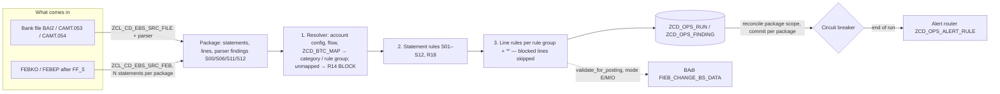

# EBS Validation — BAI2 and CAMT bank statements

> **First principle:** every line on a bank statement is either matched to a payment-engine record, posted by an approved rule, or held as an owned exception — never silently parked in suspense.
> **Analogy:** a customs hall — every parcel (statement line) is scanned against its manifest (bank transaction code map); parcels without a manifest entry go to the held-goods room with a ticket, they are never waved through.

---

## Part A — Business & Operations

### A1. What it does
1. **Receives** a bank statement either as a file before import (BAI2 from JPMC/BOA, CAMT.053 statements, CAMT.054 notifications) or after FF_5/FEBP import (FEBKO/FEBEP).
2. **Checks the statement** as a whole (S-checks): balances chain from the previous statement, the statement adds up, numbers have no gaps, the account is known, nothing is a re-delivery, bank control totals agree.
3. **Classifies every line** by its bank transaction code (BAI2 type code or CAMT Domain-Family-Sub-family) into a business category (C01 ACH collection … X01 unmapped).
4. **Validates each line** with the rules configured for its category: right direction, right currency, reference present, matches the payment run / check register / returns lot / ACH retrieval, amounts agree, not a duplicate.
5. **Records** every problem as an owned exception with a due date, and **alerts** according to the alert rules.
6. **Blocks** (in enforce mode) any line that must not post: unmapped codes, NOC entries, failed integrity checks.

### A2. Category reference (master prompt matrix)

| ID | Category | CAMT | BAI2 | Expected processing |
|---|---|---|---|---|
| C01 | ACH collection settlement | PMNT-IDDT-PADD | 165 | Auto-clear vs debit memo items |
| C02/C03/C04 | ACH collection return / reject / reversal | PMNT-IDDT-UPDD · AREV | 557 · 561 · 558 | Returns lot (FP09) + return reason |
| D01 | ACH disbursement settlement | PMNT-ICDT-ACDT | 447 | Auto-clear vs payment run |
| D02/D03/D04 | Disbursement return / reject / reversal | PMNT-ICDT-ARET · AREV | 257 · 261 · 258 | Re-credit, notify source |
| I01/I02 | Inbound ACH receipt / return | PMNT-RCDT-ACDT · ARET | 142 | Auto-clear, else clarification |
| W01–W06 | Wires out / in / returns | PMNT-ICDT/RCDT-DMCT·XICT · RRTN | 495 · 195 · 266 | Match wire ack; clarification |
| K01/K02 | Check paid / returned | PMNT-ICHQ-CCHQ · CQRV | 475 · 255 | Match check register |
| K03–K05 | Deposit / deposit return / redeposit | PMNT-RCHQ-CCHQ · CQRV | 175/115 · 555 · 176/268 | Payment lot / returns lot |
| N01 | NACHA notification of change | proprietary | NOC file | **Never post**; master data within 6 banking days |
| F01–F05 | Fees, interest, charges | ACMT-MCOP/MDOP-FEES·INTR·CHRG | 698 · 398 · 354/359 · 654 | Posting rule, fee tolerance |
| T01/T02 | Book transfer / sweep | PMNT-RCDT/ICDT-BOOK · RCCN/ICCN-ICCT | 275/575 | Both legs |
| M01/M02 | Miscellaneous credit / debit | PMNT-RCDT/ICDT-ADJT | 399 · 699 | On account — never suspense |
| X01 | Unmapped code | anything not in the map | anything | **BLOCK + exception** |

Production codes used today (legacy validators, disbursement accounts) keep their own rule groups: 166, 168, 195, 255, 466, 468, 581 (and 166 on collection accounts; 143 on collection accounts like 166, 452 like 468). 275 / 575 (ZBA sweeps) are mapped without code-specific validation (business decision 2026-11-06) and carry disposition **NOT_POSTED**: they are never posted, and S10 accepts them unposted (audit A26). 166 disbursement follows the retrieval-log chain (business decision, audit A11): retrieval AP passes alone; AF needs the returns lot item; then DPAYH RETURNED. See `Legacy_Parity_Comparison.md`.

### A3. Triage playbook (RAG)

| Signal | Meaning | First action | Owner |
|---|---|---|---|
| **R14 UNMAPPED_BTC** (B) | The bank used a code nobody configured | Do not post manually. Identify the code on the bank's code sheet, add a ZCD_BTC_MAP row (category + rule group), re-run validation | Payment engine support + Treasury |
| **S01 OPENING_NE_PRIOR_CLOSING** | A statement is missing or was loaded twice | Check FEBKO for the account; request the missing statement from the bank | Treasury |
| **S02 BALANCE_ARITHMETIC** (B) | The file does not add up | Reject the file, ask the bank to resend | Treasury |
| **S06 control totals** (B, from parser) | File corrupted / truncated in transit | Do not import; request resend via PRISM | Payment engine support |
| **R07 / R07C / R07R / R07L** | Bank line cannot be tied to the payment engine record | Look up the reference in DPAYH / check register / returns lot / retrieval log; correct or open clarification | Disbursement ops |
| **R08 / R12** | Check amounts or totals differ from the register | Compare register and bank; possible reissue or bank error | Disbursement ops |
| **S10 ENTRIES_NOT_ACCOUNTED** (W) | Imported entries neither posted nor blocked | Work the FEBAN/FPB7 post-processing queue | Payment engine support |
| **CIRCUIT_BREAKER** | Run stopped: too many failures, or three packages in a row where a rule could not run | Look for a systemic cause (wrong file, configuration change, broken rule class) before re-running | Payment engine support |
| **PLUGIN_ERROR** + "entries not evaluated" in the run message | A rule raised; the lines of its group are **unevaluated** (counted as failed, never passed) and posting is blocked | Fix the rule or its configuration; re-run | Payment engine support |
| **NO_DATA** (run status N, RAG grey) | The run selected no statement — nothing was evaluated | Check the selection (company code, house bank, dates) and whether the bank delivered; maintain `EBS_EMPTY_FEED_OK` = X only for feeds that are intentionally empty | Payment engine support |
| **RULE_GROUP_EMPTY / RULE_UNUSABLE / KEY_LENGTH_CONFIG** (BLOCK) | Configuration gap: a mapped group without a usable rule, a rule without active definition, or a key length above the key width | Fix the configuration (never released line by line) | Payment engine support |
| **TRAILER_FIELD_MISSING** (S06 B / S12) | A 49 / 98 / 99 trailer of the file has an empty total or count | Request a resend; a missing declaration is never replaced by the computed value | Treasury |
| **REF_TOO_LONG / REF_FORMAT** | The bank reference cannot be a document number (longer than the key, or not alphanumeric) | Look the entry up manually; it is never matched on a truncated key | Disbursement ops |
| **DUPLICATE_HISTORY** (R22) | The entry is already in an earlier statement of the account (look-back window) | Check FEBEP for the earlier statement before posting | Treasury |
| **AWAITING_LOT_TRANSFER** (W) | Payment / returns lot not found yet, statement inside the in-flight window (`EBS_INFLIGHT_HOURS`) | None while inside the window; the line is held as EXCEPTION, never auto-posted | Disbursement ops |

### A4. Modes (kill switch)
TVARVC `ZCD_EBS_VALIDATION_MODE` (type P, NUMB 0000): **E** enforce (pre-posting hook blocks B findings), **M** monitor (record only — also the value used when the row cannot be read), **O** off. The scheduled report never blocks; only the pre-posting hook uses the mode.

---

### Blocked-line release (operations app)
A blocked line can be released for posting only through the **Blocked line releases** app: one user requests (line, check code, reason, evidence), a second user approves. In enforce mode `validate_for_posting` then treats exactly that block as information; any other block on the line still blocks, and a rule that could not run (PLUGIN_ERROR / VALIDATION_ERROR) is never releasable. The approval resolves the exception (history action RELEASE). Details: `RAP_Ops_Apps.md` §2.2.

## Part B — Technical

### B1. Flow

Before anything runs the engine takes the **run lock** for its variant (`ZCD_OPS_LOCK` via `E_TABLE`, kept across the package commits, released at the end); a second run of the same variant is refused with RUN_LOCKED. After saving each package's findings the engine **reconciles** the package's lines and statements: open exceptions of earlier runs for these objects that were not raised again are resolved; an exception raised again keeps owner, due date and first-seen time (`ZCL_CD_OPS_STORE`). A package with a PLUGIN_ERROR resolves nothing.

Points of no return: the commit after each package (findings durable) and the alert hand-over after the run. A failure between packages leaves the run in status R (running) — the morning report's health-of-health check flags runs that never closed.

### B2. Objects

| Layer | Object | Purpose |
|---|---|---|
| Types | `ZIF_CD_EBS_TYPES` | Format-neutral statement/line model and configuration types |
| Ports | `ZIF_CD_EBS_PARSER`, `ZIF_CD_EBS_SOURCE`, `ZIF_CD_EBS_RULE`, `ZIF_CD_EBS_CFG_DAO`, `ZIF_CD_EBS_FEB_DAO`, `ZIF_CD_EBS_SAP_DAO` | Strategy and repository interfaces |
| Domain | `ZCL_CD_EBS_BTC_RESOLVER`, `ZCL_CD_EBS_FINDING`, `ZCL_CD_EBS_R_*` (25 rules), `ZCL_CD_EBS_PARSER_BAI2/_CAMT` | No SQL |
| Repositories | `ZCL_CD_EBS_CFG_DAO`, `ZCL_CD_EBS_FEB_DAO`, `ZCL_CD_EBS_SAP_DAO` | All SQL |
| Application | `ZCL_CD_EBS_ENGINE`, `ZCL_CD_EBS_SRC_FEB`, `ZCL_CD_EBS_SRC_FILE`, `ZCL_CD_EBS_FACTORY`, `ZCL_CD_EBS_INJECTOR` | Orchestration |
| Presentation | `ZCD_EBS_VALIDATE` | Selection, ALV, background |

### B3. Customizing (EBS configuration app, delivery class C)

| Table | Key | Holds |
|---|---|---|
| ZCD_BTC_MAP | SCHEME, BTC_CODE, BANK_KEY, FLOW_TYPE | Category, rule group, expected direction, payment method, posting rule, action, **disposition** (blank = posted as usual, NOT_POSTED = never posted, A26) |
| ZCD_EBS_RULE_DEF | RULE_ID | Rule registry: level S/L, class, default severity/action, **BLOCKS_POSTING** default (A27) |
| ZCD_BTC_RULE | RULE_GROUP, RULE_ID | Rule assignment per group (`*` = all) with severity, action, PARAM1–3, tolerance, window, **BLOCKS_POSTING** override (blank = registry default, Y, N). RULE_ID **NONE** marks a group that intentionally has no code-specific rule (A03) |
| ZCD_EBS_ACCT | BUKRS, HBKID, HKTID | Account number as the bank sends it, bank key, format, default flow, currency, bank G/L |
| ZCD_EBS_FLOW_PAT | PRIORITY, PATTERN | XBLNR pattern → flow (ported ZB_BAI_GL_CONFIG) |
| ZCD_EBS_RSN_MAP | REASON | NACHA R01–R85 / NOC C01–C07 → payment engine return reason |
| ZCD_EBS_LOOKUP | LOOKUP_ID | Generic lookups of rule R21: table, key field, key kind (DOCNO / ZTNUM / REFERENCE), key length, status field, allowed values, check codes |

Lookup order in ZCD_BTC_MAP: bank + flow → bank + `*` → blank bank + flow → blank bank + `*`; ISO codes then fall back to the family row (`PMNT-ICDT`), then the proprietary code (BAI type codes in CAMT `Prtry` with issuer BAI reuse the BAI2 rows when `EBS_CAMT_BAI_FALLBACK` = X), then scheme PRTRY. Nothing found → X01.

### B4. Rule catalog

| ID | Level | Class | Checks |
|---|---|---|---|
| S01 | S | ZCL_CD_EBS_R_S01_CONTINUITY | Opening = prior closing (tolerance) |
| S02 | S | ZCL_CD_EBS_R_S02_BALANCE | Opening + credits − debits = closing; declared totals |
| S03 | S | ZCL_CD_EBS_R_S03_SEQUENCE | Statement number gap / repeat |
| S04 | S | ZCL_CD_EBS_R_S04_ACCOUNT | Account configured, currency |
| S05 | S | ZCL_CD_EBS_R_S05_DATE | Date missing / future / stale |
| S06, S11, S12 (file) | parser | ZCL_CD_EBS_PARSER_* | Control totals, empty file, declared counts; an empty trailer total / count is TRAILER_FIELD_MISSING, never the computed value (A86) |
| S07 | S | ZCL_CD_EBS_R_S07_DUPLICATE | Duplicate in file / already imported |
| S08 | FMON | file registry | File expected and registered — file monitoring payment engine area |
| S09 | S | ZCL_CD_EBS_R_S09_COVERAGE | Unmapped entries per statement |
| S10 | S | ZCL_CD_EBS_R_S10_COMPLETE | Entries neither posted nor blocked |
| S12 (imported) | S | ZCL_CD_EBS_R_S12_COUNT | FEBKO-ANZES vs entries. Blocks posting (seed ON) — also for the parser's S12 findings |
| R01 | L | …_R01_SIGN | Direction vs map |
| R02 | L | …_R02_BOUNDS | Min/max (also R11 fee tolerance) |
| R03 | L | …_R03_CURRENCY | Currency |
| R04 | L | …_R04_REFERENCE | Reference present / alphanumeric |
| R05 | L | …_R05_REASON | Return / NOC reason valid and mapped |
| R06, R16 | FMON | NOC lot reader | NOC 6-banking-day SLA, master data applied |
| R07 | L | …_R07_PAYMENT | DPAYH by DOC1R, status |
| R07C | L | …_R07C_CHECK | Check register, status |
| R07L | L | …_R07L_RETRIEVAL | ACH retrieval log status |
| R07R | L | …_R07R_RETURN_LOT | Returns lot item and status |
| R08 | L | …_R08_CHECK_AMOUNT | Amount vs original within tolerance |
| R09 | L | …_R09_DUPLICATE | Duplicate entry |
| R10 | L | …_R10_VALUE_DATE | Value date window (also R13) |
| R12 | L | …_R12_CODE_TOTAL | Settlement total = register total |
| R14 | built in | ZCL_CD_EBS_BTC_RESOLVER | Unmapped → BLOCK |
| R15 | L | …_R15_POSTING_RULE | Posting rule resolves / matches |
| R17 | FMON | ack adapters | Debit matches prior positive ack via PRISM |
| R18 | S | …_R18_GL_BALANCE | Bank G/L = closing |
| R19 | L | …_R19_FI_DOCUMENT | FI posting exists / cleared |
| R21 | L | …_R21_LOOKUP | Configurable lookup: PARAM1 = ZCD_EBS_LOOKUP ID; the line's key must exist in the configured table, with a status in the allowed values (any matching row). A name not in the DDIC or an unknown lookup raises → PLUGIN_ERROR, action BLOCK |
| R22 | L | …_R22_DUP_HISTORY | Entry already in another imported statement of the house bank account within WINDOW_DAYS (else `EBS_DUP_LOOKBACK_DAYS`): same reference, amount, sign and code (A14) |

**Keys (A65).** A bank reference becomes a document-number key only when it fits: the width comes from the key type (12 for OPBEL / AUGBL / DOC1R, VERIFY-DDIC), `EBS_KEYLEN_DOCNO` above it is KEY_LENGTH_CONFIG, a longer reference REF_TOO_LONG and characters outside 0–9 / A–Z REF_FORMAT. Nothing is truncated. Check numbers compare without leading zeros (`EBS_ZTNUM_IGNORE_ZEROS`) and within the company code and house bank account (A07).

**Blocking flag (A27) and configuration gaps (A03).** A failed check of a rule whose blocks-posting flag is on carries action BLOCK (blocks in enforce mode, releasable per line); a rule with the flag off records its finding with the configured action. Seeded ON: S02, S04, S07, S12, R07, R07C, R07L, R07R, R08, R12, R19, R21. A mapped rule group without usable rule, or an assignment whose definition is missing or inactive, is a configuration gap (BLOCK, never released).

**In-flight grace (FS-CD review).** With `EBS_INFLIGHT_HOURS` > 0 a not-found of R07, R07L, R07R or R21 for a statement younger than the window is AWAITING_LOT_TRANSFER (W, NOTIFY, original message in DETAILS). Age from the statement's creation date/time, else from the start of the statement date.

### B5. Parameters (ZCD_OPS_PARAM)

| Parameter | Default | Meaning |
|---|---|---|
| EBS_KEYLEN_DOCNO | 12 | Length of OPBEL/AUGBL/DOC1R keys built from the bank reference; above the key width (12) = KEY_LENGTH_CONFIG |
| EBS_KEYLEN_ZTNUM | 0 | 0 = check number as delivered (DFKKCR-ZTNUM = FEBEP-CHECT) |
| EBS_ZTNUM_IGNORE_ZEROS | X | Leading zeros of all-digit check numbers are not significant |
| EBS_DFKKCR_BUKRS_FIELD | blank | DFKKCR field holding the company code (VERIFY-DDIC); blank = house bank only |
| EBS_DUP_LOOKBACK_DAYS | 5 | R22 look-back when the rule row has no WINDOW_DAYS |
| EBS_FEB_REASON_FIELD | blank | FEBEP field holding the NACHA return / NOC reason (VERIFY-DDIC) |
| EBS_EMPTY_FEED_OK | blank | X = a run without statements is an intentionally empty feed (green); blank = NO_DATA (grey) |
| EBS_INFLIGHT_HOURS | 0 | In-flight grace window in hours; 0 = off |
| EBS_RTRV_STATUS_FIELD | ZZ_RTRV_STATUS | Status field of ZCD_ACH_RTRV_LOG (validated against DDIC) |
| EBS_FEB_DEBIT_IND / EBS_FEB_CREDIT_IND | S / H | FEBKO/FEBEP debit/credit indicators |
| EBS_CAMT_BAI_FALLBACK | X | CAMT proprietary BAI codes reuse BAI2 map rows |
| EBS_GL_LEDGER | 0L | Ledger for R18 |
| EBS_CB_FAIL_PCT / EBS_CB_PACKAGES / EBS_CB_MIN_LINES | 50 / 3 / 20 | Circuit breaker |
| EBS_RESULT_MAX | 100000 | Findings / lines kept in memory for display (exact bound). Saving, counts, RAG and alerts always cover every finding (A67) |
| EBS_PARSER_BAI2 / EBS_PARSER_CAMT053 / EBS_PARSER_CAMT054 | parser classes | Swap a parser by configuration |
| SLA_DAYS_EBS_<severity> | 1 | Exception due date |

### B6. Extension guide (configuration only)

| Change | Rows to add | Code? |
|---|---|---|
| New bank transaction code (acceptance test 3) | ZCD_BTC_MAP row (scheme, code, bank or blank, flow, category, rule group); optional ZCD_BTC_RULE rows for a new rule group | No |
| New bank | ZCD_EBS_ACCT rows with BANK_KEY; bank-specific ZCD_BTC_MAP rows only where the bank deviates | No |
| New validation rule parameterisation (acceptance test 4: closing deviates > 0.01) | ZCD_BTC_RULE row `*` / S01 with TOLERANCE 0.01, SEVERITY B, ACTION BLOCK | No |
| New return reason | ZCD_EBS_RSN_MAP row | No |
| New collection/disbursement account | ZCD_EBS_ACCT row; ZCD_EBS_FLOW_PAT if XBLNR identifies the flow | No |
| A check against a further table (exists / status) | ZCD_EBS_LOOKUP row + ZCD_BTC_RULE row with rule R21, PARAM1 = lookup ID | No |
| A genuinely new kind of check (logic no lookup can express) | New class implementing ZIF_CD_EBS_RULE (inherit ZCL_CD_EBS_RULE_BASE) + ZCD_EBS_RULE_DEF row + test class | Yes — one class |

### B6a. Playbook — add a new BAI / CAMT code and its validations

> **First principle:** a new code is configuration; code is the last resort.

All steps in the **EBS configuration app** (`ZUI_CD_EBS_CFG_O4`). New rows are created in DV1 and transported (design D-3).

1. **Is the code already handled?** The morning report / EBS run shows R14 `UNMAPPED_BTC` for it (blocked, never posted). Check the bank's code sheet with Treasury: meaning, debit or credit, collection or disbursement.
2. **Map the code** — one ZCD_BTC_MAP row: scheme, code, bank (blank = all banks), flow (D / C / `*`), category, expected direction, rule group.
   - Same behaviour as an existing code → reuse its rule group (examples, decision 2026-11-06: **143 → BAI166C on collection accounts only**; **452 → BAI468D**).
   - No code-specific checks → leave the rule group blank (= category, generic `*` rules only; example: **275 / 575 sweeps**).
3. **Validations with existing rules** — ZCD_BTC_RULE rows for the rule group: R01–R19 with PARAM1–3, tolerance and window (catalog B4).
4. **Validation against another table** — a ZCD_EBS_LOOKUP row (table, key field, key kind, status field, allowed values, check codes) and a ZCD_BTC_RULE row with **R21**, PARAM1 = lookup ID. Names are checked against the DDIC when saved and at run time.
5. **Only if nothing above can express the check** — a new rule class (one class, test-first, ZCD_EBS_RULE_DEF row).
6. Test in DV1 with a statement containing the code (test mode), transport, re-run in QA1, record in `Legacy_Parity_Comparison.md` if it replaces a legacy validator.

### B7. Pre-posting hook (BAdI FIEB_CHANGE_BS_DATA)
The engine exposes `validate_for_posting( iv_mode = zcl_cd_ebs_engine=>read_mode( ) is_package = … )`. The BAdI implementation maps the BAdI's statement structures to `ZIF_CD_EBS_TYPES=>TY_PACKAGE` and, when `block = abap_true`, prevents posting of the affected items.

**Posting disposition (A85).** The decision also returns one disposition per line (`dispositions`, keyed by line key), which the BAdI acts on:

| Precedence | Disposition | Comes from |
|---|---|---|
| 1 | BLOCK | A finding with severity B or action BLOCK on the line, its statement or the package (the A27 flag sets action BLOCK; releases turn exactly their block into information) |
| 2 | NOT_POSTED | Map row disposition NOT_POSTED (sweeps 275 / 575) |
| 3 | EXCEPTION | A finding with action EXCEPTION, or blank action and severity E; map action EXCEPTION; AWAITING_LOT_TRANSFER; a line whose block was released but that has no usable mapping |
| 4 | ON_ACCOUNT | Map action ON_ACCOUNT, or a finding with action ON_ACCOUNT |
| 5 | AUTO_POST | Otherwise |

NOTIFY findings and warnings do not change the disposition. In mode M a BLOCK is returned as EXCEPTION (monitor never blocks); in mode O no disposition is returned.

**Run status (A66, A68).** A run that selected no statement ends with status **N** (NO_DATA) and RAG grey plus a NO_DATA finding, unless `EBS_EMPTY_FEED_OK` = X. Lines of a rule group whose rule raised (PLUGIN_ERROR) are unevaluated: counted as failed, reported in the run message and in the result; such a package counts for the circuit breaker. An inverted FEB date range is rejected. A server file that is not valid UTF-8, or that cannot be read to its end, is rejected (A69). **The BAdI method signature must be copied from SE18 before the implementation is written** (house rule: never guess a signature); it is therefore not part of this delivery.

### B8. Not verified
Syntax and typing checked offline with abaplint (v758 rules, SAP stub library). Not activated in SAP; ABAP Unit not executed; DDIC fields marked `VERIFY-DDIC` in `ZCL_CD_EBS_FEB_DAO` and `ZCL_CD_EBS_SAP_DAO` must be confirmed in SE11 before activation. Also to confirm (phase 6): the 12-character width of OPBEL / AUGBL / DOC1R; the DFKKCR company-code field (`EBS_DFKKCR_BUKRS_FIELD`) and the FEBEP reason field (`EBS_FEB_REASON_FIELD`); READ DATASET return code 4 on an unterminated last line; the time zone of statement creation times (in-flight grace). Per-finding status: `Audit_Response_EBS.md`.
