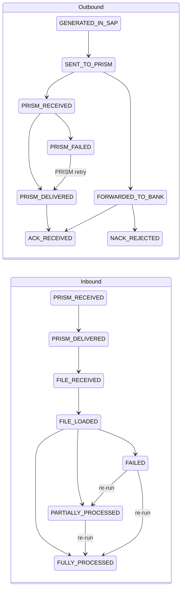
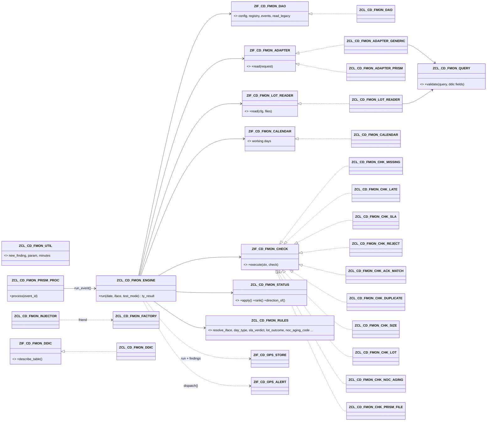

# File Monitoring (FMON)

> **First principle:** a file is money in transit — it is only safe when every hand-off (payment engine → PRISM → bank → acknowledgement, or bank → payment engine → every transaction accounted for) is proven, on time.
> **Analogy:** parcel tracking — each scan (generated, handed to the courier, delivered, signed for) is recorded, a parcel never "un-scans", and a missing scan after the promised time raises a ticket.

Status: built and lint-clean (abaplint, v758 stubs). **Not activated, ABAP Unit not executed, legacy table structures not known.** See §B6.

---

# Part A — Business & Operations

## A1. What FMON watches

> **First principle:** the monitor reads the tables that already record files — it never asks people to key in status.
> **Analogy:** a station board fed by the signal system, not by someone writing on a whiteboard.

- **Outbound** (payment engine → PRISM → bank): payment files (ACH, wire, cheque/positive pay), collections files, BlackLine / GL feeds.
- **Inbound** (bank → payment engine): BAI/CAMT statements, ACH returns files, NOC (Notification of Change) files, Stripe payouts.
- Status comes from the existing custom tables (ZCDT_REGUT, ZCD_ACH_ACK, ZCD_WIRE_ACK, ZCD_CHECK_HIST, ZCD_ACH_RTRV_LOG, ZCD_STRP_POUT_LOG) through configuration only, plus returns/NOC lot completeness from the payment engine's lot tables.
- Every result lands in the shared exception store (`ZCD_OPS_FINDING`) with an owner and an SLA due date; alerts go through the shared alert router.

## A2. Status model

> **First principle:** a file's status only moves forward; a final answer from the bank is never rewritten.
> **Analogy:** a passport stamp — you can add the next stamp, never remove one.

Rules (implemented in `ZCL_CD_FMON_STATUS`, unit-tested without doubles):

1. Stages are ordered per direction. A later stage may arrive without the intermediate ones (an ack without a "forwarded" record still counts).
2. A later stage **never regresses** to an earlier one; re-reading the same record changes nothing.
3. **ACK_RECEIVED and NACK_REJECTED are final.** A payment-level rejection that arrives after an ack is still reported (NACK count on the file → `NACK` finding).
4. **Inbound outcomes may only improve on a re-run:** FAILED → PARTIALLY_PROCESSED → FULLY_PROCESSED. FULLY_PROCESSED is final.
5. PARTIALLY_PROCESSED keeps its outcome and refreshes the **unprocessed count** on every run.
6. For returns/NOC files the **lot decides the outcome**, not the source table: a source saying "processed" is recorded in the audit trail but only moves the file to FILE_LOADED while a transaction is still open.
7. **PRISM milestones (PRISM status API, `PRISM_Status_API.md`)** belong to both directions. Outbound: GENERATED_IN_SAP < SENT_TO_PRISM < **PRISM_RECEIVED** < **PRISM_DELIVERED** (= rank of FORWARDED_TO_BANK) < ACK_RECEIVED / NACK_REJECTED. Inbound: **PRISM_RECEIVED** < **PRISM_DELIVERED** < FILE_RECEIVED < FILE_LOADED < outcomes. **PRISM_FAILED** is a failure outcome at the rank of PRISM_DELIVERED; any later stage of the same or higher rank (PRISM retried and delivered, the bank acknowledged, SAP received the file) supersedes it. A PRISM milestone reported after a final ACK, or after SAP received an inbound file, is history only.
8. **File instance origin (A49 with PRISM):** outbound only GENERATED_IN_SAP opens the instance of its business date; inbound every stage up to FILE_RECEIVED does, because PRISM sees an inbound file before SAP. Stage values are fixed (a dashboard maps them): `PRISM_RECEIVED`, `PRISM_DELIVERED`, `PRISM_FAILED`.

### Two paths into the register (2026-11-06)

| Path | Trigger | Scope | Latency |
|---|---|---|---|
| **Event-driven PRISM** | Each PRISM status API call queues a bgPF unit (`ZCL_CD_FMON_PRISM_OP` → `ZCL_CD_FMON_PRISM_PROC` → `ZCL_CD_FMON_ENGINE=>RUN_EVENT`) | The one event's file: stage, event, the SLA / reject / PRISM-file checks, findings, alert router. Only files FMON already knows (inbound: also the PRISM origin); unknown outbound files, conflicts and unmapped events are left to the polling path. No run lock (variant `PRISM`), no reconcile, no lots / calendar | seconds |
| **5-minute polling** | SM36 periodic job `ZCD_FMON_MONITOR_ALL` every 5 minutes (no Control-M) | Every source incl. PRISM events still unprocessed (safety net), lots, calendar, all checks, reconcile of earlier exceptions, alerts | ≤ 5 min (dashboard stale threshold 15 min) |

Overlap is safe without a shared lock: the registry save is version-checked (A04 — a stale version is never written, PERSIST_CONFLICT; the unit retries once, then leaves the event to the polling run), the event insert is idempotent (unique index SRC) and the status model never regresses.

## A3. SLA board

> **First principle:** one row per file, coloured by its worst open exception.
> **Analogy:** an airport departures board — the gate, the status, and a red line when the flight is late.

Report `ZCD_FMON_MONITOR` (selection: business date, interface, test mode, "show findings") runs the monitor and shows:

| Column | Meaning |
|---|---|
| Light / SLA status | red = an E/B finding, amber = W, green = none |
| Interface, direction, file type, source, LOB, payment method, owner | from the interface definition and the source row |
| File name, business date | from the legacy table |
| Stage / outcome / unprocessed count | status model above |
| Record count, control total, ack count, NACK count | for ack matching |
| First / last event | timestamps of the audit trail |
| Findings, top message | number of findings and the worst one |

**File monitoring dashboard** (launchpad, read-only, `Dashboard_File_Monitoring.md`): the same registry as an analytical list page with flow buckets, SLA status, tiles and the monitor *as of* — refreshed by every run of this report.

Expected files that did not arrive appear as their own row (`<interface>/<date>`, FILE_MISSING or FILE_LATE). Schedule the report (or the engine) after each file window in Control-M with test mode off; online users run it in test mode (nothing saved, no alert).

## A3a. SLA verdict and the PRISM throttle

> **First principle:** an SLA measures the time a party is responsible for; time a file spends waiting its turn in PRISM's queue is planned, not late.
> **Analogy:** a bakery ticket machine — customer 5 is served about four turns after customer 1; measuring each customer from the moment they took a ticket without counting the people ahead would call every busy morning "late".

**SLA basis (unchanged).** Each `ZCD_FMON_SLA` row gives the minutes allowed to reach a stage. Basis **P** measures from the latest event of the highest lower stage (e.g. `PRISM_DELIVERED` from `PRISM_RECEIVED`), basis **G** from the file's first event (generation). Only the stage's own event meets the SLA (A40).

**PRISM throttle (fact, confirmed by the user 2026-11-06):** PRISM throttles **ACH and wire** files at **2 minutes per file** before sending them to the bank; positive pay and stop pay are not throttled. **One queue across all banks** (JPMC, BOA, PNC … — confirmed by the user 2026-11-06); the gap is **1–2 minutes per file** (parameter default 2) and is measured from the PRISM status API timestamps (PRISM_RECEIVED → PRISM_DELIVERED) after go-live, then `FMON_PRISM_THROTTLE_MIN` is tuned. A fixed delivery SLA would report false "late" findings whenever several files go together (the evening ACH cycle), and the bank ACK SLA measured from generation is shifted the same way.

| Item | Rule (`ZCL_CD_FMON_RULES`) |
|---|---|
| Throttled file (`IS_THROTTLED`) | Outbound interface, `ZCD_FMON_IFACE-PAY_METHOD` in `FMON_PRISM_THROTTLE_METHODS` (default `ACH,WIRE`), `FMON_PRISM_THROTTLE_MIN` > 0. The rule uses the payment method, not the file type or bank key: positive pay (`CHECK`), stop pay, IRIS, BlackLine, OFSAA, cost centre and source files are **not** throttled, inbound files never |
| Queue (`BUILD_QUEUE`) | Throttled files of the **same business date** with PRISM receipt evidence (`PRISM_RECEIVED` event). Scope `FMON_PRISM_THROTTLE_SCOPE`: `A` = one PRISM queue for all throttled files (default — the user did not say per bank; **to confirm with the PRISM team**), `C` = one queue per counterparty = `ZCD_FMON_IFACE-BANK_KEY` (blank / `*` share one queue) |
| Left the queue | First event at delivery rank or later: `PRISM_DELIVERED`, `FORWARDED_TO_BANK`, `PRISM_FAILED`, `ACK_RECEIVED` / `NACK_REJECTED` |
| Position (`QUEUE_POSITION`) | Files of the same queue that PRISM received **earlier or in the same instant** (PRISM's order inside one instant is unknown — a tie counts as ahead, so the rule never produces a false late) and that had not left the queue when this file was received |
| Allowance | SLA minutes + `FMON_PRISM_THROTTLE_MIN` × files ahead. Applied to the delivery stage (`PRISM_DELIVERED` = `FORWARDED_TO_BANK`) and to every later stage whose basis lies before the delivery: basis **G** (e.g. `ACK_RECEIVED` 240 G → 240 + 8 for the 5th file) or basis **P** measured from a stage below delivery (no delivery recorded yet). A basis-P stage measured from the **recorded** delivery (`ACK_RECEIVED` P after `PRISM_DELIVERED`) gets nothing — the wait is already behind its basis (test `ack_after_delivery_not_shifted`) |
| Cap | The allowance covers a queue of up to `FMON_PRISM_QUEUE_MAX` files including the file itself (default 30, i.e. at most 29 files ahead). A longer queue gets no further allowance and is reported once per file as **`PRISM_QUEUE_LONG` (W)** by the check evaluating the delivery stage — a jammed PRISM queue is never hidden |
| No PRISM evidence | A file without `PRISM_RECEIVED` has no queue position: today's behaviour. `FMON_PRISM_THROTTLE_MIN = 0` switches the allowance (and PRISM_QUEUE_LONG) off |
| Finding text | A late / missing verdict with an allowance uses message 270 (`… (SLA &4 min incl. PRISM queue allowance)`), &4 = SLA + allowance |

Example (seed SLA `PRISM_DELIVERED` 5 P): five ACH files received by PRISM at 17:00 together. File 1 must be delivered by 17:05, file 5 (4 ahead) by 17:13 — delivered at 17:09 it is on time, at 17:14 it is `PRISM_DELIVERED_LATE`. A positive pay file sent in the same cycle neither waits nor is counted. 31 ACH files: the 31st is allowed 5 + 29 × 2 = 63 minutes and `PRISM_QUEUE_LONG` is raised.

**Where it runs.** The engine (`ZCL_CD_FMON_ENGINE->BUILD_CONTEXT`) reads the four parameters and builds the queue for the business dates of the throttled files in the run; a date the run did not load completely (instant unit, run for one interface, open file of an older date) is read from the register (`GET_EVAL_FILES` / `GET_EVENTS` — no new SQL). `ZCL_CD_FMON_CHK_SLA` asks `QUEUE_POSITION` per file and passes the allowance to `SLA_VERDICT`. The instant PRISM unit (`run_event`) and the 5-minute run go through the same context and check — one rule, no copy.

## A4. NOC and returns completeness

> **First principle:** a returns or NOC file is processed only when zero transactions are unaccounted for.
> **Analogy:** a cash count at closing — the till is balanced only when every coin is in a bag, not when most are.

- For each inbound file of type RETURNS or NOC, FMON finds its lot(s) and counts items whose status is in the configured "done" list versus all items.
- Open items > 0 → outcome **PARTIALLY_PROCESSED**, unprocessed count = open items, finding **LOT_UNPROCESSED** (E) with up to five open lot/item keys → alert (acceptance test 8).
- All items done → FULLY_PROCESSED. Loaded file but no lot at all → **LOT_NOT_FOUND** (W).
- **NOC aging (NACHA):** an NOC must be applied within **6 banking days** of receipt. Day 6 with an open entry → **NOC_DUE_TODAY** (W); beyond day 6 → **NOC_AGING** (E, compliance). Banking days come from the factory calendar; parameter `FMON_AGE_BASIS` decides the boundary (`A` = counted from the first working day after receipt, `N` = a receipt on a non-working day counts as received on the next working day). If the calendar cannot convert the dates the age is **unknown**: no aging verdict, warning 248 instead (never "0 days").
- A lot scan that reaches `FMON_MAX_ROWS` proves nothing: **LOT_SCAN_TRUNCATED** (W), the outcome is not derived (no false FULLY_PROCESSED). Since performance fix 8 (2026-11-06) the item counts come from a grouped `COUNT(*)` per link / lot and status and are exact, so only a capped **lot (header) read** can truncate; the open-item keys (at most 5 per file) are sampled from the links that have open items (`Performance_Review.md` §8).
- Files stay under watch until fully processed (parameter FMON_OPEN_DAYS, default 30 days), so aging keeps being reported every run.

## A5. RAG triage playbook

> **First principle:** triage the money first — a missing or rejected payment file outranks a late statement.
> **Analogy:** an emergency-room triage card: colour first, then the checklist for that colour.

| Finding | RAG | What it means | First action |
|---|---|---|---|
| FILE_MISSING | R | Expected file(s) not received/generated after window + grace | Check the Control-M job and its predecessor (SAP job `ZCD_<function>_<ENTITY>`); confirm the payment run produced a file |
| NO_PRISM_HANDOFF | R | Generated, but PRISM did not pick it up within the SLA | Check the PRISM transfer job / OS command (`ZICD_CALL_SM69_COMMAND_NEW`); call PRISM support |
| NO_BANK_ACK | R | No ack within the SLA | Check PRISM for the bank response; check the ack load job (`ZPAYM_ACH_ACK` / `ZPAYM_WIRE_ACK`) |
| NACK | R | The bank rejected the file or some payments | Open the ack detail, engage the bank, decide re-send vs re-issue with the business |
| ACK_COUNT_MISMATCH / ACK_AMOUNT_MISMATCH | R | Bank confirmed a different count/amount than sent (only when the count was reported; payment-level ACKs are counted once per payment) | Compare file control totals vs ack; escalate before the next cycle |
| DUPLICATE_FILE | R | Same file (name/checksum) generated or received twice | Stop the second transmission if not yet at the bank; check for double payments |
| ZERO_BYTE | R | Empty file | Re-generate; check the payment run selection |
| LOT_UNPROCESSED | R | Returns/NOC transactions not yet accounted for | Work the open items (FP09 returns lot / NOC application); re-run the monitor |
| NOC_AGING | R | NOC beyond 6 banking days — NACHA compliance | Apply the change today; inform compliance |
| FILE_FAILED | R | Inbound file failed to load/process | Re-load after fixing; outcome may improve on re-run |
| PRISM_FAILED | R | PRISM could not process or deliver the file (PRISM's error code in `ZCD_FMON_PRISM`) | Check the PRISM console with `prismReference`; PRISM retries — a later DELIVERED supersedes the failure (Runbook §4c) |
| NO_PRISM_RECEIVED / PRISM_RECEIVED_LATE | R / A | SAP handed the file over, PRISM did not confirm receipt within the SLA | Check the PRISM inbound queue / transfer; is the PRISM status API reachable (Runbook §4c)? |
| PRISM_QUEUE_LONG | A | More ACH / wire files were queued in PRISM ahead of the file than `FMON_PRISM_QUEUE_MAX` covers (PRISM releases one every 2 minutes) | Check PRISM, not SAP: is PRISM's bank queue moving, is a bank connection down? (Runbook §4c) |
| PRISM_UNKNOWN_FILE / PRISM_NOT_LOADED | A | PRISM reported a file SAP has no generation of / delivered a file SAP has not received (after GRACE_MIN) | Compare the reference with SAP's file name / key; inbound: check the load job and directory |
| PLUGIN_ERROR / PERSIST_ERROR / ALERT_FAILED | R | The monitor itself could not check something | IT: fix the configuration named in the message; the rest of the run is valid |
| FILE_LATE, *_LATE (e.g. PRISM_HANDOFF_LATE) | A | Arrived or moved later than the window/SLA | Note for SLA reporting; watch the next cycle |
| SIZE_OUT_OF_BOUNDS | A | Size outside the usual range | Compare volume with the source system |
| NOC_DUE_TODAY, LOT_NOT_FOUND, UNEXPECTED_FILE | A | Deadline today / lot not yet created / file on a no-file day | Act within the day |
| UNMAPPED_FILE / UNMAPPED_STATUS / FILE_REF_AMBIGUOUS / MALFORMED_SOURCE_ROW | A | A legacy row could not be placed or read (no silent drop) | IT: add the interface pattern / status mapping / business date of the response / fix the source data |
| *_INFERRED (e.g. BANK_ACK_INFERRED) | A | Only a later stage was reported, the SLA stage itself has no evidence | Confirm the stage in the source system; map its status |
| LOT_SCAN_TRUNCATED / PERSIST_CONFLICT | A | Lot completion not provable (row cap) / registry changed by another process meanwhile | Raise FMON_MAX_ROWS or narrow the lot; re-run the monitor |

Every R/A finding is an owned exception in `ZCD_OPS_FINDING` with a due date (`SLA_DAYS_FMON_<severity>`).

---

# Part B — Technical

## A6. Operations apps — manual status and PRISM requests
- **Manual status** (`ZUI_CD_FMON_MAN_O4`): sets a stage by hand with reason and evidence where the state machine itself would move the file; writes an event with source `MANUAL`. The next run reconciles the file's exceptions.
- **PRISM payment requests** arrive as API calls logged in `ZCD_PAYM_REQ_LOG`; monitored as interface `PAYREQ_PRISM_IN` (status `ZZ_STATUS`, `SUCCESS` = FULLY_PROCESSED, a later failed attempt never downgrades — `config/fmon_seed.md`). A request handled outside SAP is recorded in `ZUI_CD_FMON_PRQ_O4` (record only); its exception closes.
Details: `RAP_Ops_Apps.md` §2.4, §2.5.

## B1. Tables

> **First principle:** behaviour lives in customizing rows; code only knows the status model.
> **Analogy:** a railway signal box — routes are set on the panel, not by re-laying track.

Customizing (delivery class C, SM30) — `ddic/fmon/*.tabl.ddl`:

| Table | Key | Purpose |
|---|---|---|
| ZCD_FMON_IFACE | IFACE_ID | Interface: direction, file type, source/target, payment method, LOB, bank, CP name pattern, min/max bytes, ack expected, ack level (FILE/PAYMENT), owner, active. Blank/`*` source and LOB = default row |
| ZCD_FMON_SLA | IFACE_ID, STAGE | Max minutes to reach a stage; BASIS P (from previous stage) or G (from generation / first event); severity |
| ZCD_FMON_CAL | IFACE_ID, DAY_TYPE | Expected file count and window per NORMAL / MONTH_END / HOLIDAY / RETURNS_DAY; factory calendar ID |
| ZCD_FMON_SRC | SRC_ID | Legacy source adapter: table name and the field names for file key, file name, date, time or timestamp, status, count, amount, size, checksum, source, LOB; default stage; adapter class (blank = generic) |
| ZCD_FMON_SRCMAP | SRC_ID, STATUS_VALUE | Legacy status value (or `*`) → stage |
| ZCD_FMON_LOTCFG | IFACE_ID, LOT_TYPE | Returns/NOC lot completeness: header table/lot/link fields, item table/lot/key/status/link fields, link by name or reference, done values, NOC banking-day SLA |
| ZCD_FMON_CHK | CHECK_ID | Plug-in check: class, default severity, active, parameters (`NAME=VALUE;…`) |

Application data (delivery class A):

| Table | Key | Purpose / indexes |
|---|---|---|
| ZCD_FMON_FILE | FILE_ID (UUID) | Registry: interface, file reference, direction, type, source, LOB, payment method, name, business date, size, record count, control total, checksum, stage, outcome, unprocessed count, ack/NACK counts, ack amount, origin rows, first/last event, source. Identity of a file instance: IFACE_ID + FILE_REF + BUSINESS_DATE. Indexes REF (unique: IFACE_ID, FILE_REF, BUSINESS_DATE), BDT, OUT, NAM, CHK. Saved only while CHANGED_AT is unchanged since the read (version check) |
| ZCD_FMON_EVENT | FILE_ID, EVENT_NO | Audit trail of every reported stage (also capped or ignored ones). Unique index SRC: FILE_ID, SRC_ID, SRC_KEY, STAGE → idempotent re-runs per file instance |
| ZCD_FMON_PRISM | EVENT_ID | PRISM status API events (one row per call, PRISM's ID as key): reference, interface, direction, milestone, occurredAt (UTC), counterparty, PRISM reference, count, total, error code / masked text, business date, receipt, PROCESSED_AT. Indexes UNP (PROCESSED_AT, RECEIVED_AT), REF, BDT. Read by `ZCL_CD_FMON_ADAPTER_PRISM` (`PRISM_Status_API.md`) |

Runtime parameters (`ZCD_OPS_PARAM`): FMON_LOOKBACK_DAYS, FMON_OPEN_DAYS, FMON_DUP_DAYS, FMON_TIME_ZONE, FMON_FACTORY_CAL, FMON_RETURNS_WEEKDAYS, FMON_NOC_SLA_DAYS, FMON_MAX_ROWS, FMON_AGE_BASIS, FMON_PRISM_MAX_BYTES, FMON_PRISM_INSTANT, FMON_PRISM_THROTTLE_MIN, FMON_PRISM_THROTTLE_SCOPE, FMON_PRISM_THROTTLE_METHODS, FMON_PRISM_QUEUE_MAX (§A3a). Customizing ZCD_FMON_TABWL lists the tables (and fields, or `*`) the dynamic reader may read. Indexes are declared in the DDL as `// @index <ID> [UNIQUE]: F1, F2` and serialized to abapGit by `tools/abapgit_serialize.py`. Example rows: `config/fmon_seed.md`.

## B2. Class model

> **First principle:** domain rules are pure functions; only the DAO touches the database; only the calendar class calls function payment engine areas.
> **Analogy:** a kitchen — the recipe (rules) is on paper, the pantry (DAO) is the only door to the stock, the oven (calendar FMs) is one appliance.

Run sequence (`ZCL_CD_FMON_ENGINE->run`): **run lock** for the whole payment engine area (registry and event numbering are shared; an overlapping run is refused with RUN_LOCKED; not in test mode) → start run (store) + commit (not in test mode) → load customizing → **sync**: every active source → adapter → records → resolve interface (pattern + defaults) → quarantine malformed rows (MALFORMED_SOURCE_ROW) → group by source/file/business date/stage → resolve the file instance (same date; undated responses → latest earlier instance, several → FILE_REF_AMBIGUOUS) → apply all groups in event-time order through the state machine → **registry**: window files + open files + events → **lots**: lot reader per lot config → derive PARTIALLY/FULLY, banking-day age → **expectations** from calendar → **checks** (each isolated; failure = PLUGIN_ERROR) → persist registry and events (not in test mode; version-checked — a row changed meanwhile is not overwritten, PERSIST_CONFLICT; on failure, including a technical CX_SY_OPEN_SQL_DB, **rollback** + PERSIST_ERROR, never a half-written registry) → board → save findings → finish run → **reconcile** the evaluated files (skipped after PLUGIN_ERROR / PERSIST_ERROR) → commit → `ZIF_CD_OPS_ALERT~DISPATCH( run, findings )` (not in test mode; a delivery failure is saved as ALERT_FAILED and committed). Event numbers: MAX + 1 per file; on a key collision with a parallel run the business key (FILE_ID / SRC_ID / SRC_KEY / STAGE) decides — recorded means idempotent, otherwise up to 3 retries.

Generic adapter safety: `ZCL_CD_FMON_DDIC` describes the table with `CL_ABAP_TYPEDESCR=>DESCRIBE_BY_NAME` (classic EXCEPTIONS) and `GET_DDIC_FIELD_LIST`; `ZCL_CD_FMON_QUERY=>VALIDATE` rejects any table/field name that is not a DDIC identifier (pattern check) or not in the table (200–203), requires a date or key restriction (209); at the read boundary the DAO additionally requires the table and every field to be approved in ZCD_FMON_TABWL (244 / 249) and the caller to hold S_TABU_NAM display for the table (245); it builds `SELECT (fields) FROM (table) WHERE (validated name) BETWEEN @… / >= @… AND < @… / IN @…` — timestamps as the half-open range [from, next midnight); there is no free-text WHERE anywhere.

## B3. Extension guide (customizing only)

> **First principle:** a new interface, bank, payment method, source or LOB is a row, never a transport of code.
> **Analogy:** adding a stop to a bus route: you print a new timetable line, you do not build a new bus.

| Change | Rows to add / change |
|---|---|
| **New source system** (e.g. NEWSRC) | Nothing, if the `*` interface rows fit. If it needs its own SLA/pattern/owner: one `ZCD_FMON_IFACE` row with `SOURCE_SYS = NEWSRC` (+ SLA/CAL rows). If a legacy table carries the source, set `ZCD_FMON_SRC-SOURCE_FIELD` so the specific row is chosen. |
| **New LOB** | Same as source, with `LOB` / `LOB_FIELD`. |
| **New interface / file** | `ZCD_FMON_IFACE` (pattern, direction, type, ack expected/level) + `ZCD_FMON_SLA` per stage + `ZCD_FMON_CAL` per day type. If its status is in a table not yet mapped: `ZCD_FMON_SRC` + `ZCD_FMON_SRCMAP`. |
| **New bank** | `ZCD_FMON_IFACE` rows per bank file (BANK_KEY, pattern), SLA and calendar rows (bank cut-offs, factory calendar). |
| **New payment method** | `ZCD_FMON_IFACE` rows with `PAY_METHOD`, `ACK_LEVEL` (PAYMENT for disbursements, FILE for collections), SLA rows (e.g. wire ack 30 min). |
| **New legacy table** | `ZCD_FMON_SRC` (table + field names from SE11; validated at runtime) + `ZCD_FMON_SRCMAP` status values (or `DEFAULT_STAGE`). Only for a table that needs logic beyond field mapping: a class implementing `ZIF_CD_FMON_ADAPTER` in `ADAPTER_CLASS`. |
| **New returns/NOC lot table** | `ZCD_FMON_LOTCFG` row (interface or `*`, lot type, header/item fields, done values, NOC SLA days). |
| **New check** | Class implementing `ZIF_CD_FMON_CHECK` (pure: context in, findings out) + `ZCD_FMON_CHK` row. Variants of existing checks (other stage, grace, tolerance) are rows with parameters. |
| **Thresholds** | SLA minutes, windows, tolerance (`TOLERANCE=`), grace (`GRACE_MIN=`), NOC days — rows/parameters. |
| **Alert routing** | `ZCD_OPS_ALRULE` (core): payment engine area FMON, minimum severity, group1 pattern = interface, channel, recipients. |

## B4. Messages (class ZCD_OPS, FMON range 200–299)

> **First principle:** every refusal names the configuration row to fix.
> **Analogy:** a customs officer who tells you which form field is wrong.

| No. | Text (≤ 73 chars) |
|---|---|
| 200 | Table &1 not found in the DDIC or not a flat DDIC structure |
| 201 | Field &1 does not exist in table &2 |
| 202 | &1 is not a valid DDIC name |
| 203 | Field &1 of table &2 has type &3, expected &4 |
| 204 | Source &1: no field configured for &2 |
| 205 | Read of table &1 failed: &2 |
| 206 | Factory calendar &1: date &2 cannot be converted |
| 208 | Lot configuration &1 &2: field &3 missing |
| 209 | Read of table &1 has no date or key restriction |
| 211 | File ID could not be generated |
| 220 | File monitoring &1: &2 file(s), &3 finding(s), RAG &4 |
| 240 | &1: newer registry state written by another process - not overwritten |
| 241 | &1: lot item scan stopped at &2 row(s) - completion not proven |
| 242 | Reference &1 of &2 matches files of several business dates - not applied |
| 243 | Source &1: &2 row(s) skipped, field &3 malformed |
| 244 | Table &1 is not approved for file monitoring (ZCD_FMON_TABWL) |
| 245 | No display authorization for table &1 (S_TABU_NAM) |
| 246 | Database error in file monitoring, registry not saved: |
| 247 | &1 of &2 &3 item(s) open |
| 248 | Factory calendar &1: banking-day age unknown, no aging verdict: |
| 249 | Field &1 of table &2 is not approved for file monitoring (ZCD_FMON_TABWL) |
| 250–264, 268 | PRISM status API: field and request errors returned to PRISM, bgPF queue failure (`PRISM_Status_API.md` §4) |
| 265 | &1: PRISM could not process or deliver the file (direction &2) |
| 266 | &1: reported by PRISM, but SAP has no generation record of it |
| 267 | &1: delivered by PRISM &2 min ago, not yet received in SAP |
| 269 | &1: PRISM queue of &2 file(s) exceeds the maximum of &3 - check PRISM |
| 270 | &1: &2 after &3 min (SLA &4 min incl. PRISM queue allowance) |

Reused core messages: 010 (insert failed, registry save), 030/031 (plug-in class), 032 (class does not implement interface). 207, 210, 212–219, 221–299 are free. These rows still have to be added to `config/zcd_ops_messages.md` (shared file, not edited by FMON).

## B5. Tests

> **First principle:** test every rule at the cheapest level that can prove it.
> **Analogy:** check the recipe on paper before you heat the oven.

| Test class (include) | Level | Test methods |
|---|---|---|
| ZCL_CD_FMON_STATUS / ltc_status | pure, no doubles | stage_advances_in_order, stage_may_skip_forward, stage_never_regresses, same_stage_is_idempotent, ack_is_never_overwritten, full_is_never_downgraded, partial_improves_to_full, failed_improves_to_partial, partial_count_is_updated, wrong_direction_is_rejected, unknown_stage_is_rejected |
| ZCL_CD_FMON_RULES / ltc_rules | pure, no doubles | specific_source_beats_default, new_source_uses_default_iface, unmatched_file_has_no_iface, configured_iface_wins, non_working_day_is_holiday, last_workday_is_month_end, returns_weekday_is_returns_day, holiday_without_row_expects_0, month_end_falls_back_to_normal, short_after_grace_is_missing, short_within_grace_is_late, file_on_zero_day_is_unexpected, arrival_after_window_is_late, overdue_handoff_is_missing, slow_handoff_is_late, timely_handoff_is_ok, ack_sla_counts_from_generation, sla_code_names_the_stage, ack_count_differs_is_mismatch, nack_rows_count_as_responses, amount_within_tolerance_is_ok, later_same_checksum_is_dup, earlier_file_is_not_duplicate, zero_size_is_zero_byte, size_above_max_is_out_of_bound, unknown_size_is_not_checked, open_items_make_partial, no_open_items_make_full, missing_lot_derives_nothing, noc_older_6_bdays_is_error, noc_on_day_6_is_due_today, processed_noc_does_not_age, blank_token_matches_initial, lot_source_cannot_finish_file, lot_cfg_falls_back_to_default; audit 2026-11-06: known_zero_ack_is_mismatch, unreported_ack_count_unchecked, partial_never_meets_processing, later_stage_only_is_inferred, nack_meets_ack_sla, inferred_code_names_the_stage, truncated_lot_derives_nothing, unknown_age_does_not_age, age_counts_after_receipt |
| ZCL_CD_FMON_QUERY / ltc_query | pure, no doubles | valid_query_passes, unknown_field_is_rejected, injected_name_is_rejected, date_field_must_be_a_date, unrestricted_read_is_rejected, approved_read_passes, unapproved_table_is_rejected, unapproved_field_is_rejected |
| ZCL_CD_FMON_ADAPTER_GENERIC / ltc_mapping | pure, no doubles | mapped_status_gives_stage, unmapped_status_stays_blank, wildcard_row_maps_the_rest, no_status_field_uses_default, file_key_is_correlation_ref, malformed_count_quarantined, invalid_date_quarantined, payment_key_is_taken_over, day_range_is_half_open |
| ZCL_CD_FMON_ADAPTER_GENERIC / ltc_read | LTD DDIC + DAO | unknown_field_stops_before_sql |
| ZCL_CD_FMON_LOT_READER / ltc_lot_reader | LTD DDIC + DAO | one_open_item_is_counted, lot_items_read_by_lot_key, incomplete_config_is_refused, row_cap_marks_truncated, below_cap_is_complete |
| ZCL_CD_FMON_ENGINE / ltc_engine | LTD DAO, adapter, lot reader, calendar, store, alert, clock, lock, failing check | partial_returns_stay_partial, open_item_gives_one_finding, partial_returns_are_alerted (acceptance test 8), source_cannot_close_open_lot, acked_file_ends_ack_received, duplicate_rows_one_event, failing_check_does_not_abort, failing_source_does_not_abort, test_mode_writes_nothing, unmapped_status_is_reported, noc_age_is_in_banking_days, alerts_sent_after_commit, persist_error_rolls_back, held_lock_skips_run, lock_released_after_run, evaluated_files_reconciled, check_failure_no_reconcile, save_conflict_is_reported, sql_error_ends_run_failed, same_name_next_day_new_file, late_ack_goes_to_its_day, undated_ref_ambiguous, payment_acks_deduplicated, ack_count_never_decreases, truncated_lot_not_completed, calendar_failure_no_aging, malformed_row_quarantined, source_full_event_is_capped |
| ZCL_CD_FMON_STATUS / ltc_status (PRISM, 2026-11-06) | pure | prism_received_after_sent, prism_delivered_before_ack, prism_after_ack_is_ignored, inbound_prism_before_receipt, receipt_not_back_to_prism, prism_failed_is_outcome, prism_failed_superseded, prism_stage_fits_both, origin_rules_per_direction |
| ZCL_CD_FMON_ENGINE / ltc_engine (PRISM) | LTD doubles | prism_events_become_stages, prism_only_file_surfaces |
| ZCL_CD_FMON_PRISM_EVENT / ltc_event | pure | 20 methods: every milestone and direction, missing / invalid / future / non-UTC values, truncation, masking, counterparty format, malformed JSON, array, nested member, business date, idempotent payload, answer JSON |
| ZCL_CD_FMON_PRISM_API / ltc_api | LTD PRISM DAO, queue, auth, store, clock | 202 (unit queued before commit), 200, 409, 500 (rollback), 400, 405, 403, 415, UTF-8 accepted, 413, queue failure still 202 |
| ZCL_CD_FMON_PRISM_DAO / ltc_prism_dao | cl_osql_test_environment (ZCD_FMON_PRISM) | insert_new_event, same_payload_is_duplicate, other_payload_is_conflict, unprocessed_read_skips_done, mark_keeps_first_time |
| ZCL_CD_FMON_PRISM_PROC / ltc_proc | real engine + LTD FMON DAO, PRISM DAO, store, alert, clock | unit_applies_prism_stage, late_event_opens_sla_finding, failed_event_opens_finding, unknown_file_is_deferred, conflict_left_to_batch_run, processed_event_not_reapplied, registry_only_without_instant; PRISM throttle: unit_allows_prism_queue, pospay_not_in_ach_queue, unit_throttle_off_is_late, unit_reports_long_queue |
| ZCL_CD_FMON_RULES / ltc_throttle (PRISM throttle, 2026-11-06) | pure, no doubles | single_file_gets_base_sla, fifth_file_on_time_at_9_min, fifth_file_late_after_13_min, scope_c_queues_per_bank, pospay_not_throttled, queue_over_max_is_long, ack_from_generation_shifted, ack_after_delivery_not_shifted, zero_throttle_keeps_today, no_receipt_keeps_today, delivered_file_is_not_ahead |
| ZCL_CD_FMON_ADAPTER_PRISM / ltc_adapter_prism | LTD PRISM DAO | rows_become_prism_stages, interface_id_wins, batch_reads_unprocessed, unknown_field_is_refused |
| ZCL_CD_FMON_CHK_PRISM_FILE / ltc_prism_file, ZCL_CD_FMON_CHK_REJECT / ltc_reject | pure | grace period, outbound unknown / known, inbound not loaded / received; OUTCOME=PRISM_FAILED, default unchanged |
| ZCL_CD_FMON_DAO / ltc_dao | cl_osql_test_environment (ZCD_FMON_FILE, ZCD_FMON_EVENT, ZCD_FMON_TABWL), LTD DDIC | same_event_is_stored_once, repeat_insert_reports_false, events_numbered_per_file, saved_file_found_by_ref, open_old_file_is_evaluated, history_found_by_checksum, later_open_file_not_evaluated, newer_registry_not_overwritten, unchanged_registry_is_saved, event_belongs_to_its_instance, older_instances_not_prefetched, unapproved_table_is_refused, read_without_auth_is_refused, approved_table_is_read |

Deliberately not unit tested:

| Object | Reason | Covered instead by |
|---|---|---|
| ZCL_CD_FMON_CALENDAR | Thin wrapper over DATE_CONVERT_TO_FACTORYDATE / FACTORYDATE_CONVERT_TO_DATE; the result depends on the system's factory calendar (TFACD), so a unit test would test SAP, not FMON | Day-type and NOC-aging rules pure in ZCL_CD_FMON_RULES; engine tests with LTD calendar; QA1 cases FMON-QA-07/08 against the real calendar |
| ZCL_CD_FMON_DDIC | Thin RTTI wrapper (DESCRIBE_BY_NAME, GET_DDIC_FIELD_LIST); its output is the system DDIC | Validation logic pure in ZCL_CD_FMON_QUERY; adapter test with LTD DDIC; QA1 case FMON-QA-10 |
| ZCL_CD_FMON_DAO~READ_LEGACY (the SELECT itself) | Dynamic SELECT on configured legacy tables; cl_osql_test_environment needs the real (unknown) tables. The approval / authorisation boundary before it is unit tested (ltc_dao) | Query validation (pure) + adapter/lot reader tests with LTD DAO; QA1 cases FMON-QA-01/02/05 |
| ZCL_CD_FMON_CHK_* (9 classes) | Thin loops over the context calling the pure rules | Rules in ltc_rules; wiring of all nine through the engine tests (all nine are configured in ltc_engine) |
| ZCL_CD_FMON_FACTORY / INJECTOR | No logic beyond double slots | Every application test resolves its CUT through the factory |
| ZCD_FMON_MONITOR | Presentation only (SALV) | QA1 case FMON-QA-12 |
| ZCL_CD_FMON_PRISM_HTTP | ICF boundary only (copies method, content type, body; writes status and JSON) | Every decision in ltc_api; QA1 cases PRISM-01..11 |
| ZCL_CD_FMON_PRISM_QUEUE / ZCL_CD_FMON_PRISM_OP | Thin bgPF wrappers (CL_BGMC_PROCESS_FACTORY, IF_BGMC_OP_SINGLE_TX_UNCONTR) | ltc_api (queue seam), ltc_proc (unit body); QA1 case PRISM-12 |

Recommended QA1 functional test cases (Test & Validation document):

| ID | Scenario | Configuration | Expected result |
|---|---|---|---|
| FMON-QA-01 | Outbound ACH file end to end | IFACE ACH_PNC_DISB_OUT, SRC REGUT + ACHACK with SE11 field names, SLA rows | Board: GENERATED → SENT → ACK_RECEIVED, green; 3 events in ZCD_FMON_EVENT |
| FMON-QA-02 | Re-run idempotency | Run QA-01 twice (test mode off) | No new events, registry unchanged, no duplicate findings beyond the run's own |
| FMON-QA-03 | Missing PRISM handoff | Generation row only; run after SLA | NO_PRISM_HANDOFF (E), alert via ZCD_OPS_ALRULE |
| FMON-QA-04 | Wire ack SLA 30 min | WIRE_JPMC_OUT SLA ACK_RECEIVED 30 G | Ack after 45 min → BANK_ACK_LATE (W) |
| FMON-QA-05 | Bank NACK | ACK table row with rejected status | Outcome NACK_REJECTED, NACK (E) |
| FMON-QA-06 | Ack count mismatch | Ack count field ≠ file record count | ACK_COUNT_MISMATCH (E) |
| FMON-QA-07 | Expected BAI statement missing | CAL BAI_JPMC_IN NORMAL 1, 08:00–08:20; no file | After 09:20 FILE_MISSING (E); 08:21–09:20 FILE_LATE (W) |
| FMON-QA-08 | Bank holiday | Run on a factory-calendar holiday, no HOLIDAY row | No FILE_MISSING; a file that day → UNEXPECTED_FILE (W) |
| FMON-QA-09 | Returns file with one unprocessed item (acceptance test 8) | LOTCFG RETURNS; leave one returns item unprocessed | PARTIALLY_PROCESSED, unprocessed count 1, LOT_UNPROCESSED (E), alert; after processing and re-run → FULLY_PROCESSED |
| FMON-QA-10 | Wrong field name in customizing | SRC with a non-existent field | PLUGIN_ERROR with message 201; other sources processed |
| FMON-QA-11 | NOC aging | NOC file 7 banking days old with an open entry | NOC_AGING (E); on day 6 NOC_DUE_TODAY (W) |
| FMON-QA-12 | Report and test mode | ZCD_FMON_MONITOR, test mode on | Board shown; nothing in ZCD_FMON_FILE/EVENT/ZCD_OPS_RUN; no alert |
| FMON-QA-13 | New source and LOB (acceptance test 2) | Records with SOURCE/LOB values not configured; `*` interface row | Files registered under the default interface; no code change |
| FMON-QA-14 | Duplicate file | Same file name/checksum twice | DUPLICATE_FILE (E) on the later file |

## B6. Verification status and VERIFY-DDIC markers

> **First principle:** say exactly what was proven and what was not.
> **Analogy:** a pre-flight checklist that marks "not checked" boxes instead of leaving them blank.

- Lint: from `ops-suite/` run `npx @abaplint/cli@2.120.92` — 0 issues for `src/fmon/*`. Lint proves syntax and typing against stubs only.
- **Not verified:** activation, DDIC existence of the ZCD_FMON_* tables, ABAP Unit execution, the structure of ZCDT_REGUT / ZCD_ACH_ACK / ZCD_WIRE_ACK / ZCD_CHECK_HIST / ZCD_ACH_RTRV_LOG / ZCD_STRP_POUT_LOG (no field name of them is in the code), DFKKRP / DFKKNRK fields other than the confirmed DFKKNRP KEYN1/POSNA, the returns lot header table.
- `"VERIFY-DDIC:` markers (all in `ZCL_CD_FMON_CALENDAR`):
  1. `SCAL-FACDATE` as the factory-date type.
  2. Parameter names of `DATE_CONVERT_TO_FACTORYDATE` (CORRECT_OPTION, DATE, FACTORY_CALENDAR_ID, FACTORYDATE, WORKINGDAY_INDICATOR).
  3. Parameter names of `FACTORYDATE_CONVERT_TO_DATE` (FACTORYDATE, FACTORY_CALENDAR_ID, DATE).
- Open ADT verifications from the 2026-11-06 audit fixes (see `docs/Audit_Response_FMON.md`): `SELECT SINGLE FOR UPDATE` inside cl_osql_test_environment, redirect of the dynamic `FROM (table)` read of a test-double table (approved_table_is_read), and that abapGit creates the serialized secondary indexes (SE11 → Indexes).

## B7. Design decisions (changes to the original brief)

> **First principle:** every deviation from the brief is written down with its reason.
> **Analogy:** an as-built drawing next to the original blueprint.

1. **Domain rules extracted** to pure classes (`ZCL_CD_FMON_STATUS`, `ZCL_CD_FMON_RULES`, `ZCL_CD_FMON_QUERY`); check classes are thin. Reason: TDD at the cheapest level.
2. **Inbound outcome may improve FAILED → PARTIALLY_PROCESSED** (not only → FULLY) on re-run; outcomes can only get better. ACK/NACK stay final; a later payment NACK is still reported via the NACK count.
3. **Lot decides the outcome** for returns/NOC interfaces: a source FULLY/PARTIALLY is capped at FILE_LOADED. Without this, a source flag could close a file with an open transaction (acceptance test 8 would fail).
4. **Dynamic SQL in the DAO**, not in the adapter: the adapter/lot reader build and DDIC-validate the query; `ZIF_CD_FMON_DAO~READ_LEGACY` executes it (standards: no SQL outside the DAO). DDIC describer is its own seam (`ZIF_CD_FMON_DDIC`).
5. **Events aggregated** per source + file + stage (one event, counts/amounts summed). Payment-level acks (one row per payment) would otherwise flood the audit trail. Event uniqueness: FILE_ID + SRC_ID + SRC_KEY (= file reference) + STAGE (the file instance is part of the key since 2026-11-06); lot-derived events use SRC_ID `LOT`, SRC_KEY = file ID.
6. **Groups of all sources applied in event-time order** (not per source), so a terminal status from one table cannot overtake an earlier stage from another.
7. **Added fields:** registry FILE_REF (cross-source key), SIZE_KNOWN, ACK_COUNT/ACK_AMOUNT/NACK_COUNT, ORIGIN_ROWS; SRC SIZE/CHECKSUM/SOURCE/LOB fields and DEFAULT_STAGE; LOTCFG header/item split and LINK_BY.
8. **Alert route removed from ZCD_FMON_IFACE**: per addendum, the engine calls `ZIF_CD_OPS_ALERT~DISPATCH` once per run (never in test mode); thresholds and recipients live in `ZCD_OPS_ALRULE`. FMON does not use `send( )`.
9. **SLA check is one configurable class** (`ZCL_CD_FMON_CHK_SLA`) driven by ZCD_FMON_SLA rows; "no PRISM handoff" and "no bank ack" are check rows with `STAGE=`. Late-but-reached is reported separately (`*_LATE`, W).
10. **Holiday without a calendar row expects nothing** (no fallback to NORMAL) — avoids false FILE_MISSING on bank holidays; files that day → UNEXPECTED_FILE.
11. **New warnings for "no silent suspense"**: UNMAPPED_FILE, UNMAPPED_STATUS, LOT_NOT_FOUND; since 2026-11-06 FILE_REF_AMBIGUOUS, MALFORMED_SOURCE_ROW, LOT_SCAN_TRUNCATED, PERSIST_CONFLICT. FILE_REF_REUSED is retired: a reused reference on another business date is a new file instance.
12. **Run lock (2026-11-06):** one monitor run at a time for the whole payment engine area (core message 040, RUN_LOCKED alert); the unique registry index still protects against double registration. Checksum-mismatch and archive-failure checks from the requirements baseline are possible as further `ZIF_CD_FMON_CHECK` rows once a source delivers those fields.
13. **Audit hardening (2026-11-06, `docs/Audit_Response_FMON.md`):** version-checked registry save (A04), SQL errors handled at the LUW owner (A05), file instance = reference + business date (A49), SLA met only by admissible evidence — the stage itself or a NACK for an ACK SLA, a later stage alone is `*_INFERRED` (A40), ACK counts deduplicated per payment and cumulative, unknown ≠ zero (A39), truncated lot scans derive nothing (A38), age basis and calendar failure explicit (A41), open-file window bounded by the run date (A50), approved tables + S_TABU_NAM at the read boundary (A51), malformed rows quarantined and half-open timestamp range (A52).
14. **PRISM throttle (2026-11-06, user fact):** the delivery SLA of ACH / wire files includes 2 min × files ahead in PRISM's queue (§A3a). Decided from `PAY_METHOD` (configurable list), not from `FILE_TYPE` or `BANK_KEY`, because positive pay and stop pay go to the same banks but are not throttled. Default queue scope `A` (one queue) is the conservative reading of "2 min per file" — it can only make the allowance larger than per-bank queues would; to confirm with the PRISM team. A capped allowance plus `PRISM_QUEUE_LONG` keeps a stuck queue visible.
