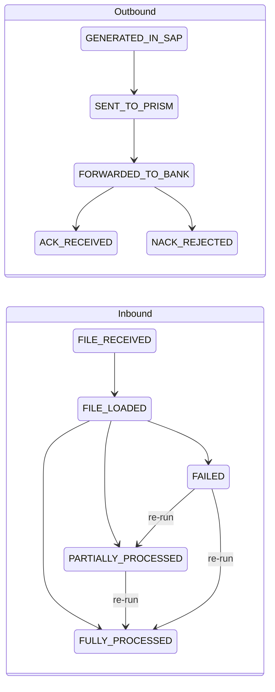
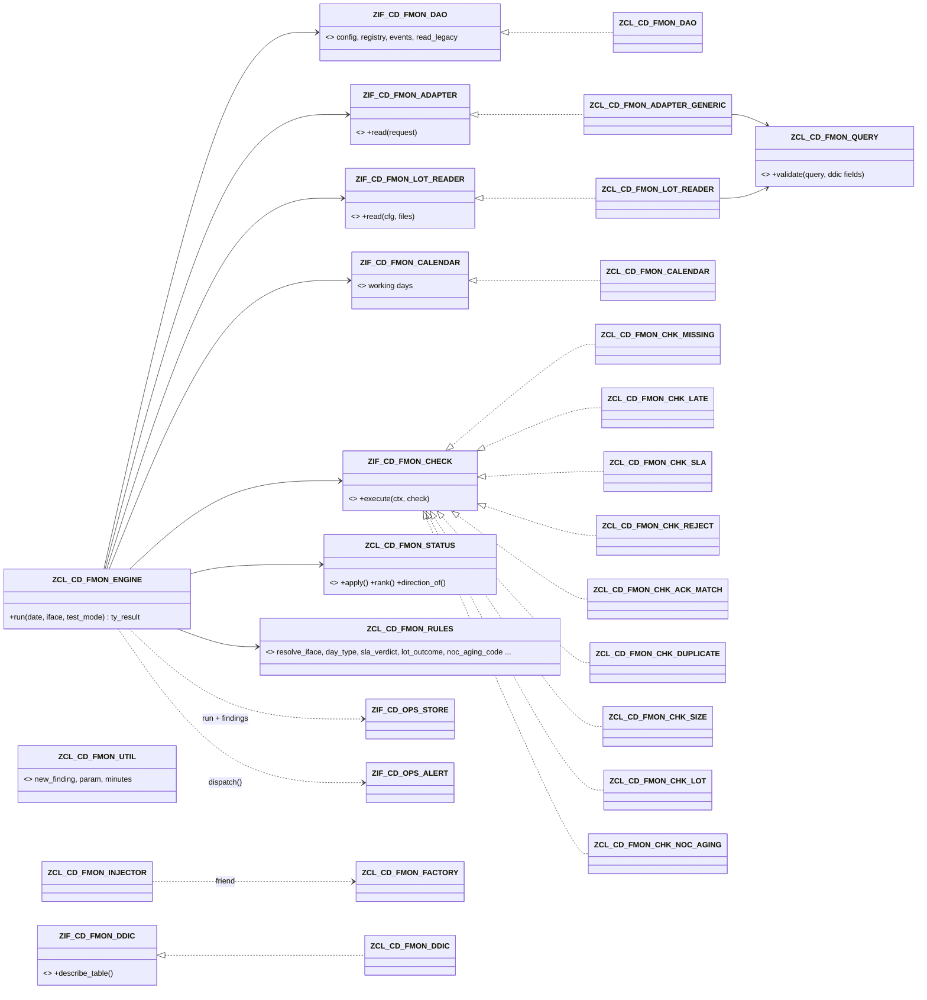

# File Monitoring (FMON)

> **First principle:** a file is money in transit — it is only safe when every hand-off (payment engine → PRISM → bank → acknowledgement, or bank → payment engine → every transaction accounted for) is proven, on time.
> **Analogy:** parcel tracking — each scan (generated, handed to the courier, delivered, signed for) is recorded, a parcel never "un-scans", and a missing scan after the promised time raises a ticket.

Status: built and lint-clean (abaplint, v758 stubs). **Not activated, ABAP Unit not executed, legacy table structures not known.** See §B6.

---

# Part A — Business & Operations

## A1. What FMON watches

> **First principle:** the monitor reads the tables that already record files — it never asks people to key in status.
> **Analogy:** a station board fed by the signal system, not by someone writing on a whiteboard.

- **Outbound** (payment engine → PRISM → bank): payment files (ACH, wire, cheque/positive pay), collections files, BlackLine / GL feeds.
- **Inbound** (bank → payment engine): BAI/CAMT statements, ACH returns files, NOC (Notification of Change) files, Stripe payouts.
- Status comes from the existing custom tables (ZCDT_REGUT, ZCD_ACH_ACK, ZCD_WIRE_ACK, ZCD_CHECK_HIST, ZCD_ACH_RTRV_LOG, ZCD_STRP_POUT_LOG) through configuration only, plus returns/NOC lot completeness from the payment engine's lot tables.
- Every result lands in the shared exception store (`ZCD_OPS_FINDING`) with an owner and an SLA due date; alerts go through the shared alert router.

## A2. Status model

> **First principle:** a file's status only moves forward; a final answer from the bank is never rewritten.
> **Analogy:** a passport stamp — you can add the next stamp, never remove one.

Rules (implemented in `ZCL_CD_FMON_STATUS`, unit-tested without doubles):

1. Stages are ordered per direction. A later stage may arrive without the intermediate ones (an ack without a "forwarded" record still counts).
2. A later stage **never regresses** to an earlier one; re-reading the same record changes nothing.
3. **ACK_RECEIVED and NACK_REJECTED are final.** A payment-level rejection that arrives after an ack is still reported (NACK count on the file → `NACK` finding).
4. **Inbound outcomes may only improve on a re-run:** FAILED → PARTIALLY_PROCESSED → FULLY_PROCESSED. FULLY_PROCESSED is final.
5. PARTIALLY_PROCESSED keeps its outcome and refreshes the **unprocessed count** on every run.
6. For returns/NOC files the **lot decides the outcome**, not the source table: a source saying "processed" is recorded in the audit trail but only moves the file to FILE_LOADED while a transaction is still open.

## A3. SLA board

> **First principle:** one row per file, coloured by its worst open exception.
> **Analogy:** an airport departures board — the gate, the status, and a red line when the flight is late.

Report `ZCD_FMON_MONITOR` (selection: business date, interface, test mode, "show findings") runs the monitor and shows:

| Column | Meaning |
|---|---|
| Light / SLA status | red = an E/B finding, amber = W, green = none |
| Interface, direction, file type, source, LOB, payment method, owner | from the interface definition and the source row |
| File name, business date | from the legacy table |
| Stage / outcome / unprocessed count | status model above |
| Record count, control total, ack count, NACK count | for ack matching |
| First / last event | timestamps of the audit trail |
| Findings, top message | number of findings and the worst one |

Expected files that did not arrive appear as their own row (`<interface>/<date>`, FILE_MISSING or FILE_LATE). Schedule the report (or the engine) after each file window in Control-M with test mode off; online users run it in test mode (nothing saved, no alert).

## A4. NOC and returns completeness

> **First principle:** a returns or NOC file is processed only when zero transactions are unaccounted for.
> **Analogy:** a cash count at closing — the till is balanced only when every coin is in a bag, not when most are.

- For each inbound file of type RETURNS or NOC, FMON finds its lot(s) and counts items whose status is in the configured "done" list versus all items.
- Open items > 0 → outcome **PARTIALLY_PROCESSED**, unprocessed count = open items, finding **LOT_UNPROCESSED** (E) with up to five open lot/item keys → alert (acceptance test 8).
- All items done → FULLY_PROCESSED. Loaded file but no lot at all → **LOT_NOT_FOUND** (W).
- **NOC aging (NACHA):** an NOC must be applied within **6 banking days** of receipt. Day 6 with an open entry → **NOC_DUE_TODAY** (W); beyond day 6 → **NOC_AGING** (E, compliance). Banking days come from the factory calendar; a receipt on a non-banking day counts from the next banking day.
- Files stay under watch until fully processed (parameter FMON_OPEN_DAYS, default 30 days), so aging keeps being reported every run.

## A5. RAG triage playbook

> **First principle:** triage the money first — a missing or rejected payment file outranks a late statement.
> **Analogy:** an emergency-room triage card: colour first, then the checklist for that colour.

| Finding | RAG | What it means | First action |
|---|---|---|---|
| FILE_MISSING | R | Expected file(s) not received/generated after window + grace | Check the Control-M job and its predecessor (SAP job `ZCD_<function>_<ENTITY>`); confirm the payment run produced a file |
| NO_PRISM_HANDOFF | R | Generated, but PRISM did not pick it up within the SLA | Check the PRISM transfer job / OS command (`ZICD_CALL_SM69_COMMAND_NEW`); call PRISM support |
| NO_BANK_ACK | R | No ack within the SLA | Check PRISM for the bank response; check the ack load job (`ZPAYM_ACH_ACK` / `ZPAYM_WIRE_ACK`) |
| NACK | R | The bank rejected the file or some payments | Open the ack detail, engage the bank, decide re-send vs re-issue with the business |
| ACK_COUNT_MISMATCH / ACK_AMOUNT_MISMATCH | R | Bank confirmed a different count/amount than sent | Compare file control totals vs ack; escalate before the next cycle |
| DUPLICATE_FILE | R | Same file (name/checksum) generated or received twice | Stop the second transmission if not yet at the bank; check for double payments |
| ZERO_BYTE | R | Empty file | Re-generate; check the payment run selection |
| LOT_UNPROCESSED | R | Returns/NOC transactions not yet accounted for | Work the open items (FP09 returns lot / NOC application); re-run the monitor |
| NOC_AGING | R | NOC beyond 6 banking days — NACHA compliance | Apply the change today; inform compliance |
| FILE_FAILED | R | Inbound file failed to load/process | Re-load after fixing; outcome may improve on re-run |
| PLUGIN_ERROR / PERSIST_ERROR / ALERT_FAILED | R | The monitor itself could not check something | IT: fix the configuration named in the message; the rest of the run is valid |
| FILE_LATE, *_LATE (e.g. PRISM_HANDOFF_LATE) | A | Arrived or moved later than the window/SLA | Note for SLA reporting; watch the next cycle |
| SIZE_OUT_OF_BOUNDS | A | Size outside the usual range | Compare volume with the source system |
| NOC_DUE_TODAY, LOT_NOT_FOUND, UNEXPECTED_FILE | A | Deadline today / lot not yet created / file on a no-file day | Act within the day |
| UNMAPPED_FILE / UNMAPPED_STATUS / FILE_REF_REUSED | A | A legacy row could not be placed (no silent drop) | IT: add the interface pattern / status mapping / unique file key |

Every R/A finding is an owned exception in `ZCD_OPS_FINDING` with a due date (`SLA_DAYS_FMON_<severity>`).

---

# Part B — Technical

## B1. Tables

> **First principle:** behaviour lives in customizing rows; code only knows the status model.
> **Analogy:** a railway signal box — routes are set on the panel, not by re-laying track.

Customizing (delivery class C, SM30) — `ddic/fmon/*.tabl.ddl`:

| Table | Key | Purpose |
|---|---|---|
| ZCD_FMON_IFACE | IFACE_ID | Interface: direction, file type, source/target, payment method, LOB, bank, CP name pattern, min/max bytes, ack expected, ack level (FILE/PAYMENT), owner, active. Blank/`*` source and LOB = default row |
| ZCD_FMON_SLA | IFACE_ID, STAGE | Max minutes to reach a stage; BASIS P (from previous stage) or G (from generation / first event); severity |
| ZCD_FMON_CAL | IFACE_ID, DAY_TYPE | Expected file count and window per NORMAL / MONTH_END / HOLIDAY / RETURNS_DAY; factory calendar ID |
| ZCD_FMON_SRC | SRC_ID | Legacy source adapter: table name and the field names for file key, file name, date, time or timestamp, status, count, amount, size, checksum, source, LOB; default stage; adapter class (blank = generic) |
| ZCD_FMON_SRCMAP | SRC_ID, STATUS_VALUE | Legacy status value (or `*`) → stage |
| ZCD_FMON_LOTCFG | IFACE_ID, LOT_TYPE | Returns/NOC lot completeness: header table/lot/link fields, item table/lot/key/status/link fields, link by name or reference, done values, NOC banking-day SLA |
| ZCD_FMON_CHK | CHECK_ID | Plug-in check: class, default severity, active, parameters (`NAME=VALUE;…`) |

Application data (delivery class A):

| Table | Key | Purpose / indexes |
|---|---|---|
| ZCD_FMON_FILE | FILE_ID (UUID) | Registry: interface, file reference, direction, type, source, LOB, payment method, name, business date, size, record count, control total, checksum, stage, outcome, unprocessed count, ack/NACK counts, ack amount, origin rows, first/last event, source. Indexes REF (unique: IFACE_ID, FILE_REF), BDT, OUT, NAM, CHK |
| ZCD_FMON_EVENT | FILE_ID, EVENT_NO | Audit trail of every reported stage (also capped or ignored ones). Unique index SRC: SRC_ID, SRC_KEY, STAGE → idempotent re-runs |

Runtime parameters (`ZCD_OPS_PARAM`): FMON_LOOKBACK_DAYS, FMON_OPEN_DAYS, FMON_DUP_DAYS, FMON_TIME_ZONE, FMON_FACTORY_CAL, FMON_RETURNS_WEEKDAYS, FMON_NOC_SLA_DAYS, FMON_MAX_ROWS. Example rows: `config/fmon_seed.md`.

## B2. Class model

> **First principle:** domain rules are pure functions; only the DAO touches the database; only the calendar class calls function modules.
> **Analogy:** a kitchen — the recipe (rules) is on paper, the pantry (DAO) is the only door to the stock, the oven (calendar FMs) is one appliance.

Run sequence (`ZCL_CD_FMON_ENGINE->run`): **run lock** for the whole module (registry and event numbering are shared; an overlapping run is refused with RUN_LOCKED; not in test mode) → start run (store) + commit (not in test mode) → load customizing → **sync**: every active source → adapter → records → resolve interface (pattern + defaults) → group by source/file/stage → apply all groups in event-time order through the state machine → **registry**: window files + open files + events → **lots**: lot reader per lot config → derive PARTIALLY/FULLY, banking-day age → **expectations** from calendar → **checks** (each isolated; failure = PLUGIN_ERROR) → persist registry and events (not in test mode; on failure **rollback** + PERSIST_ERROR, never a half-written registry) → board → save findings → finish run → **reconcile** the evaluated files (skipped after PLUGIN_ERROR / PERSIST_ERROR) → commit → `ZIF_CD_OPS_ALERT~DISPATCH( run, findings )` (not in test mode; a delivery failure is saved as ALERT_FAILED and committed). Event numbers: MAX + 1 per file; on a key collision with a parallel run the business key (SRC_ID / SRC_KEY / STAGE) decides — recorded means idempotent, otherwise up to 3 retries.

Generic adapter safety: `ZCL_CD_FMON_DDIC` describes the table with `CL_ABAP_TYPEDESCR=>DESCRIBE_BY_NAME` (classic EXCEPTIONS) and `GET_DDIC_FIELD_LIST`; `ZCL_CD_FMON_QUERY=>VALIDATE` rejects any table/field name that is not a DDIC identifier (pattern check) or not in the table (200–203), requires a date or key restriction (209); the DAO builds `SELECT (fields) FROM (table) WHERE (validated name) BETWEEN @… / IN @…` — there is no free-text WHERE anywhere.

## B3. Extension guide (customizing only)

> **First principle:** a new interface, bank, payment method, source or LOB is a row, never a transport of code.
> **Analogy:** adding a stop to a bus route: you print a new timetable line, you do not build a new bus.

| Change | Rows to add / change |
|---|---|
| **New source system** (e.g. NEWSRC) | Nothing, if the `*` interface rows fit. If it needs its own SLA/pattern/owner: one `ZCD_FMON_IFACE` row with `SOURCE_SYS = NEWSRC` (+ SLA/CAL rows). If a legacy table carries the source, set `ZCD_FMON_SRC-SOURCE_FIELD` so the specific row is chosen. |
| **New LOB** | Same as source, with `LOB` / `LOB_FIELD`. |
| **New interface / file** | `ZCD_FMON_IFACE` (pattern, direction, type, ack expected/level) + `ZCD_FMON_SLA` per stage + `ZCD_FMON_CAL` per day type. If its status is in a table not yet mapped: `ZCD_FMON_SRC` + `ZCD_FMON_SRCMAP`. |
| **New bank** | `ZCD_FMON_IFACE` rows per bank file (BANK_KEY, pattern), SLA and calendar rows (bank cut-offs, factory calendar). |
| **New payment method** | `ZCD_FMON_IFACE` rows with `PAY_METHOD`, `ACK_LEVEL` (PAYMENT for disbursements, FILE for collections), SLA rows (e.g. wire ack 30 min). |
| **New legacy table** | `ZCD_FMON_SRC` (table + field names from SE11; validated at runtime) + `ZCD_FMON_SRCMAP` status values (or `DEFAULT_STAGE`). Only for a table that needs logic beyond field mapping: a class implementing `ZIF_CD_FMON_ADAPTER` in `ADAPTER_CLASS`. |
| **New returns/NOC lot table** | `ZCD_FMON_LOTCFG` row (interface or `*`, lot type, header/item fields, done values, NOC SLA days). |
| **New check** | Class implementing `ZIF_CD_FMON_CHECK` (pure: context in, findings out) + `ZCD_FMON_CHK` row. Variants of existing checks (other stage, grace, tolerance) are rows with parameters. |
| **Thresholds** | SLA minutes, windows, tolerance (`TOLERANCE=`), grace (`GRACE_MIN=`), NOC days — rows/parameters. |
| **Alert routing** | `ZCD_OPS_ALERT_RULE` (core): module FMON, minimum severity, group1 pattern = interface, channel, recipients. |

## B4. Messages (class ZCD_OPS, FMON range 200–299)

> **First principle:** every refusal names the configuration row to fix.
> **Analogy:** a customs officer who tells you which form field is wrong.

| No. | Text (≤ 73 chars) |
|---|---|
| 200 | Table &1 not found in the DDIC or not a flat DDIC structure |
| 201 | Field &1 does not exist in table &2 |
| 202 | &1 is not a valid DDIC name |
| 203 | Field &1 of table &2 has type &3, expected &4 |
| 204 | Source &1: no field configured for &2 |
| 205 | Read of table &1 failed: &2 |
| 206 | Factory calendar &1: date &2 cannot be converted |
| 208 | Lot configuration &1 &2: field &3 missing |
| 209 | Read of table &1 has no date or key restriction |
| 211 | File ID could not be generated |
| 220 | File monitoring &1: &2 file(s), &3 finding(s), RAG &4 |

Reused core messages: 010 (insert failed, registry save), 030/031 (plug-in class), 032 (class does not implement interface). 207, 210, 212–219, 221–299 are free. These rows still have to be added to `config/zcd_ops_messages.md` (shared file, not edited by FMON).

## B5. Tests

> **First principle:** test every rule at the cheapest level that can prove it.
> **Analogy:** check the recipe on paper before you heat the oven.

| Test class (include) | Level | Test methods |
|---|---|---|
| ZCL_CD_FMON_STATUS / ltc_status | pure, no doubles | stage_advances_in_order, stage_may_skip_forward, stage_never_regresses, same_stage_is_idempotent, ack_is_never_overwritten, full_is_never_downgraded, partial_improves_to_full, failed_improves_to_partial, partial_count_is_updated, wrong_direction_is_rejected, unknown_stage_is_rejected |
| ZCL_CD_FMON_RULES / ltc_rules | pure, no doubles | specific_source_beats_default, new_source_uses_default_iface, unmatched_file_has_no_iface, configured_iface_wins, non_working_day_is_holiday, last_workday_is_month_end, returns_weekday_is_returns_day, holiday_without_row_expects_0, month_end_falls_back_to_normal, short_after_grace_is_missing, short_within_grace_is_late, file_on_zero_day_is_unexpected, arrival_after_window_is_late, overdue_handoff_is_missing, slow_handoff_is_late, timely_handoff_is_ok, ack_sla_counts_from_generation, sla_code_names_the_stage, ack_count_differs_is_mismatch, nack_rows_count_as_responses, amount_within_tolerance_is_ok, later_same_checksum_is_dup, earlier_file_is_not_duplicate, zero_size_is_zero_byte, size_above_max_is_out_of_bound, unknown_size_is_not_checked, open_items_make_partial, no_open_items_make_full, missing_lot_derives_nothing, noc_older_6_bdays_is_error, noc_on_day_6_is_due_today, processed_noc_does_not_age, blank_token_matches_initial, lot_source_cannot_finish_file, lot_cfg_falls_back_to_default |
| ZCL_CD_FMON_QUERY / ltc_query | pure, no doubles | valid_query_passes, unknown_field_is_rejected, injected_name_is_rejected, date_field_must_be_a_date, unrestricted_read_is_rejected |
| ZCL_CD_FMON_ADAPTER_GENERIC / ltc_mapping | pure, no doubles | mapped_status_gives_stage, unmapped_status_stays_blank, wildcard_row_maps_the_rest, no_status_field_uses_default, file_key_is_correlation_ref |
| ZCL_CD_FMON_ADAPTER_GENERIC / ltc_read | LTD DDIC + DAO | unknown_field_stops_before_sql |
| ZCL_CD_FMON_LOT_READER / ltc_lot_reader | LTD DDIC + DAO | one_open_item_is_counted, lot_items_read_by_lot_key, incomplete_config_is_refused |
| ZCL_CD_FMON_ENGINE / ltc_engine | LTD DAO, adapter, lot reader, calendar, store, alert, clock, lock, failing check | partial_returns_stay_partial, open_item_gives_one_finding, partial_returns_are_alerted (acceptance test 8), source_cannot_close_open_lot, acked_file_ends_ack_received, duplicate_rows_one_event, failing_check_does_not_abort, failing_source_does_not_abort, test_mode_writes_nothing, unmapped_status_is_reported, noc_age_is_in_banking_days, alerts_sent_after_commit, persist_error_rolls_back, held_lock_skips_run, lock_released_after_run, evaluated_files_reconciled, check_failure_no_reconcile |
| ZCL_CD_FMON_DAO / ltc_dao | cl_osql_test_environment (ZCD_FMON_FILE, ZCD_FMON_EVENT) | same_event_is_stored_once, repeat_insert_reports_false, events_numbered_per_file, saved_file_found_by_ref, open_old_file_is_evaluated, history_found_by_checksum |

Deliberately not unit tested:

| Object | Reason | Covered instead by |
|---|---|---|
| ZCL_CD_FMON_CALENDAR | Thin wrapper over DATE_CONVERT_TO_FACTORYDATE / FACTORYDATE_CONVERT_TO_DATE; the result depends on the system's factory calendar (TFACD), so a unit test would test SAP, not FMON | Day-type and NOC-aging rules pure in ZCL_CD_FMON_RULES; engine tests with LTD calendar; QA1 cases FMON-QA-07/08 against the real calendar |
| ZCL_CD_FMON_DDIC | Thin RTTI wrapper (DESCRIBE_BY_NAME, GET_DDIC_FIELD_LIST); its output is the system DDIC | Validation logic pure in ZCL_CD_FMON_QUERY; adapter test with LTD DDIC; QA1 case FMON-QA-10 |
| ZCL_CD_FMON_DAO~READ_LEGACY | Dynamic SELECT on configured legacy tables; cl_osql_test_environment needs the real (unknown) tables | Query validation (pure) + adapter/lot reader tests with LTD DAO; QA1 cases FMON-QA-01/02/05 |
| ZCL_CD_FMON_CHK_* (9 classes) | Thin loops over the context calling the pure rules | Rules in ltc_rules; wiring of all nine through the engine tests (all nine are configured in ltc_engine) |
| ZCL_CD_FMON_FACTORY / INJECTOR | No logic beyond double slots | Every application test resolves its CUT through the factory |
| ZCD_FMON_MONITOR | Presentation only (SALV) | QA1 case FMON-QA-12 |

Recommended QA1 functional test cases (Test & Validation document):

| ID | Scenario | Configuration | Expected result |
|---|---|---|---|
| FMON-QA-01 | Outbound ACH file end to end | IFACE ACH_PNC_DISB_OUT, SRC REGUT + ACHACK with SE11 field names, SLA rows | Board: GENERATED → SENT → ACK_RECEIVED, green; 3 events in ZCD_FMON_EVENT |
| FMON-QA-02 | Re-run idempotency | Run QA-01 twice (test mode off) | No new events, registry unchanged, no duplicate findings beyond the run's own |
| FMON-QA-03 | Missing PRISM handoff | Generation row only; run after SLA | NO_PRISM_HANDOFF (E), alert via ZCD_OPS_ALERT_RULE |
| FMON-QA-04 | Wire ack SLA 30 min | WIRE_JPMC_OUT SLA ACK_RECEIVED 30 G | Ack after 45 min → BANK_ACK_LATE (W) |
| FMON-QA-05 | Bank NACK | ACK table row with rejected status | Outcome NACK_REJECTED, NACK (E) |
| FMON-QA-06 | Ack count mismatch | Ack count field ≠ file record count | ACK_COUNT_MISMATCH (E) |
| FMON-QA-07 | Expected BAI statement missing | CAL BAI_JPMC_IN NORMAL 1, 08:00–08:20; no file | After 09:20 FILE_MISSING (E); 08:21–09:20 FILE_LATE (W) |
| FMON-QA-08 | Bank holiday | Run on a factory-calendar holiday, no HOLIDAY row | No FILE_MISSING; a file that day → UNEXPECTED_FILE (W) |
| FMON-QA-09 | Returns file with one unprocessed item (acceptance test 8) | LOTCFG RETURNS; leave one returns item unprocessed | PARTIALLY_PROCESSED, unprocessed count 1, LOT_UNPROCESSED (E), alert; after processing and re-run → FULLY_PROCESSED |
| FMON-QA-10 | Wrong field name in customizing | SRC with a non-existent field | PLUGIN_ERROR with message 201; other sources processed |
| FMON-QA-11 | NOC aging | NOC file 7 banking days old with an open entry | NOC_AGING (E); on day 6 NOC_DUE_TODAY (W) |
| FMON-QA-12 | Report and test mode | ZCD_FMON_MONITOR, test mode on | Board shown; nothing in ZCD_FMON_FILE/EVENT/ZCD_OPS_RUN; no alert |
| FMON-QA-13 | New source and LOB (acceptance test 2) | Records with SOURCE/LOB values not configured; `*` interface row | Files registered under the default interface; no code change |
| FMON-QA-14 | Duplicate file | Same file name/checksum twice | DUPLICATE_FILE (E) on the later file |

## B6. Verification status and VERIFY-DDIC markers

> **First principle:** say exactly what was proven and what was not.
> **Analogy:** a pre-flight checklist that marks "not checked" boxes instead of leaving them blank.

- Lint: from `ops-suite/` run `/tmp/claude-0/-home-user-bai/914e445a-1a4a-59f8-9715-e9953e835f40/scratchpad/lint/node_modules/.bin/abaplint` — 0 issues for `src/fmon/*`. Lint proves syntax and typing against stubs only.
- **Not verified:** activation, DDIC existence of the ZCD_FMON_* tables, ABAP Unit execution, the structure of ZCDT_REGUT / ZCD_ACH_ACK / ZCD_WIRE_ACK / ZCD_CHECK_HIST / ZCD_ACH_RTRV_LOG / ZCD_STRP_POUT_LOG (no field name of them is in the code), DFKKRP / DFKKNRK fields other than the confirmed DFKKNRP KEYN1/POSNA, the returns lot header table.
- `"VERIFY-DDIC:` markers (all in `ZCL_CD_FMON_CALENDAR`):
  1. `SCAL-FACDATE` as the factory-date type.
  2. Parameter names of `DATE_CONVERT_TO_FACTORYDATE` (CORRECT_OPTION, DATE, FACTORY_CALENDAR_ID, FACTORYDATE, WORKINGDAY_INDICATOR).
  3. Parameter names of `FACTORYDATE_CONVERT_TO_DATE` (FACTORYDATE, FACTORY_CALENDAR_ID, DATE).

## B7. Design decisions (changes to the original brief)

> **First principle:** every deviation from the brief is written down with its reason.
> **Analogy:** an as-built drawing next to the original blueprint.

1. **Domain rules extracted** to pure classes (`ZCL_CD_FMON_STATUS`, `ZCL_CD_FMON_RULES`, `ZCL_CD_FMON_QUERY`); check classes are thin. Reason: TDD at the cheapest level.
2. **Inbound outcome may improve FAILED → PARTIALLY_PROCESSED** (not only → FULLY) on re-run; outcomes can only get better. ACK/NACK stay final; a later payment NACK is still reported via the NACK count.
3. **Lot decides the outcome** for returns/NOC interfaces: a source FULLY/PARTIALLY is capped at FILE_LOADED. Without this, a source flag could close a file with an open transaction (acceptance test 8 would fail).
4. **Dynamic SQL in the DAO**, not in the adapter: the adapter/lot reader build and DDIC-validate the query; `ZIF_CD_FMON_DAO~READ_LEGACY` executes it (standards: no SQL outside the DAO). DDIC describer is its own seam (`ZIF_CD_FMON_DDIC`).
5. **Events aggregated** per source + file + stage (one event, counts/amounts summed). Payment-level acks (one row per payment) would otherwise flood the audit trail. Event uniqueness: SRC_ID + SRC_KEY (= file reference) + STAGE; lot-derived events use SRC_ID `LOT`, SRC_KEY = file ID.
6. **Groups of all sources applied in event-time order** (not per source), so a terminal status from one table cannot overtake an earlier stage from another.
7. **Added fields:** registry FILE_REF (cross-source key), SIZE_KNOWN, ACK_COUNT/ACK_AMOUNT/NACK_COUNT, ORIGIN_ROWS; SRC SIZE/CHECKSUM/SOURCE/LOB fields and DEFAULT_STAGE; LOTCFG header/item split and LINK_BY.
8. **Alert route removed from ZCD_FMON_IFACE**: per addendum, the engine calls `ZIF_CD_OPS_ALERT~DISPATCH` once per run (never in test mode); thresholds and recipients live in `ZCD_OPS_ALERT_RULE`. FMON does not use `send( )`.
9. **SLA check is one configurable class** (`ZCL_CD_FMON_CHK_SLA`) driven by ZCD_FMON_SLA rows; "no PRISM handoff" and "no bank ack" are check rows with `STAGE=`. Late-but-reached is reported separately (`*_LATE`, W).
10. **Holiday without a calendar row expects nothing** (no fallback to NORMAL) — avoids false FILE_MISSING on bank holidays; files that day → UNEXPECTED_FILE.
11. **New warnings for "no silent suspense"**: UNMAPPED_FILE, UNMAPPED_STATUS, FILE_REF_REUSED, LOT_NOT_FOUND.
12. **Run lock (2026-11-06):** one monitor run at a time for the whole module (core message 040, RUN_LOCKED alert); the unique registry index still protects against double registration. Checksum-mismatch and archive-failure checks from the master prompt are possible as further `ZIF_CD_FMON_CHECK` rows once a source delivers those fields.
