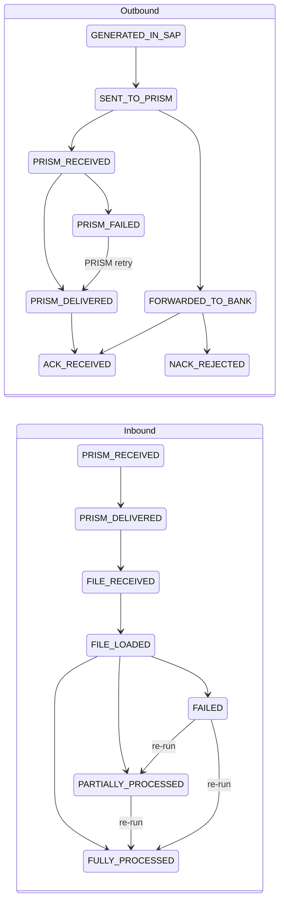
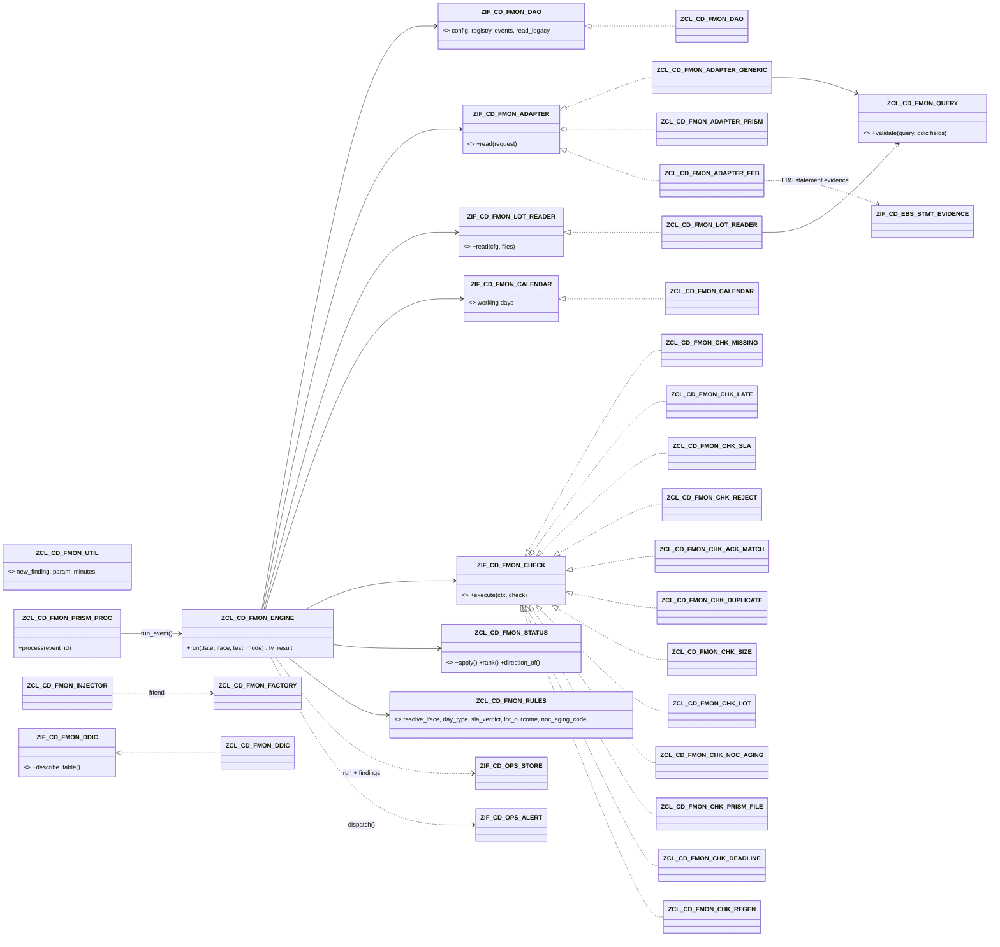

# File Monitoring (FMON)

> **First principle:** a file is money in transit — it is only safe when every hand-off (payment engine → PRISM → bank → acknowledgement, or bank → payment engine → every transaction accounted for) is proven, on time.
> **Analogy:** parcel tracking — each scan (generated, handed to the courier, delivered, signed for) is recorded, a parcel never "un-scans", and a missing scan after the promised time raises a ticket.

Status: built and lint-clean (abaplint, v758 stubs). **Not activated, ABAP Unit not executed, legacy table structures not known.** See §B6.

---

# Part A — Business & Operations

## A1. What FMON watches

> **First principle:** the monitor reads the tables that already record files — it never asks people to key in status.
> **Analogy:** a station board fed by the signal system, not by someone writing on a whiteboard.

- **Outbound** (payment engine → PRISM → bank): payment files (ACH, wire, cheque/positive pay), collections files, BlackLine / GL feeds.
- **Inbound** (bank → payment engine): BAI/CAMT statements, ACH returns files, NOC (Notification of Change) files, Stripe payouts.
- Status comes from the existing custom tables (ZCDT_REGUT, ZCD_ACH_ACK, ZCD_WIRE_ACK, ZCD_CHECK_HIST, ZCD_ACH_RTRV_LOG, ZCD_STRP_POUT_LOG) through configuration only, plus returns/NOC lot completeness from the payment engine's lot tables.
- Every result lands in the shared exception store (`ZCD_OPS_FINDING`) with an owner and an SLA due date; alerts go through the shared alert router.

## A2. Status model

> **First principle:** a file's status only moves forward; a final answer from the bank is never rewritten.
> **Analogy:** a passport stamp — you can add the next stamp, never remove one.

Rules (implemented in `ZCL_CD_FMON_STATUS`, unit-tested without doubles):

1. Stages are ordered per direction. A later stage may arrive without the intermediate ones (an ack without a "forwarded" record still counts).
2. A later stage **never regresses** to an earlier one; re-reading the same record changes nothing.
3. **ACK_RECEIVED and NACK_REJECTED are final.** A payment-level rejection that arrives after an ack is still reported (NACK count on the file → `NACK` finding).
4. **Inbound outcomes may only improve on a re-run:** FAILED → PARTIALLY_PROCESSED → FULLY_PROCESSED. FULLY_PROCESSED is final.
5. PARTIALLY_PROCESSED keeps its outcome and refreshes the **unprocessed count** on every run.
6. For returns/NOC files the **lot decides the outcome**, not the source table: a source saying "processed" is recorded in the audit trail but only moves the file to FILE_LOADED while a transaction is still open.
7. **PRISM milestones (PRISM status API, `PRISM_Status_API.md`)** belong to both directions. Outbound: GENERATED_IN_SAP < SENT_TO_PRISM < **PRISM_RECEIVED** < **PRISM_DELIVERED** (= rank of FORWARDED_TO_BANK) < ACK_RECEIVED / NACK_REJECTED. Inbound: **PRISM_RECEIVED** < **PRISM_DELIVERED** < FILE_RECEIVED < FILE_LOADED < outcomes. **PRISM_FAILED** is a failure outcome at the rank of PRISM_DELIVERED; any later stage of the same or higher rank (PRISM retried and delivered, the bank acknowledged, SAP received the file) supersedes it. A PRISM milestone reported after a final ACK, or after SAP received an inbound file, is history only.
8. **File generation identity (design review 2026-11-07; refines A49):** the instance of a file is **fixed when the file is first known** — outbound by GENERATED_IN_SAP, inbound by the first of PRISM_RECEIVED / PRISM_DELIVERED / FILE_RECEIVED (PRISM sees an inbound file before SAP) — keyed by interface + reference, with the business date of that first evidence, which never changes. Every later event of the same reference attaches to it **regardless of its own date or time** (midnight, daylight saving). An instance of the event's own business date is that file (the generation date decides); a **new instance only for a new generation**: first evidence of a stage the latest earlier instance already reached (next day's file of the same name, a generation on a later date) — unless that instance recorded the very same event (re-read: same source, stage, time). Earlier evidence that reaches SAP late attaches to the instance it belongs to; an undated later stage that fits several instances is FILE_REF_AMBIGUOUS. Pure rule `ZCL_CD_FMON_RULES=>FILE_INSTANCE` (tests `ltc_instance`), used by the 5-minute run and the instant PRISM unit; event times and SLA minutes are UTC. Acceptance cases: `PRISM_Status_API.md` §7a. **The reference is unique per file generation — confirmed by the user 2026-11-07: PRISM rejects a file whose name it has already received** (VERIFY item 1 of §7a closed); the generation-date rule stays as the safeguard for an inbound name repeated on a later day. Stage values are fixed (a dashboard maps them): `PRISM_RECEIVED`, `PRISM_DELIVERED`, `PRISM_FAILED`.
9. **Regenerated files (facts confirmed by the user 2026-11-07).** When PRISM cannot deliver a file (`PRISM_FAILED`) — to the bank, or a cheque print file to IRIS when the PRISM → IRIS API call fails — SAP **regenerates the same payments into a new file with a new name**, sends it to PRISM, and PRISM delivers that one. The two files are **separate instances** (rule 8: different references, never merged), linked only by their **generation group**: the payment run that produced them, configured as a field list on the generating source (`ZCD_FMON_SRC-GROUP_FIELDS`, e.g. `LAUFD,LAUFI,HBKID` of `ZCDT_REGUT` — field names VERIFY-SE11; at most 4 fields, values joined by `/`). Only the group key is stored on the file (`ZCD_FMON_FILE-GEN_GROUP`, index GRP) — no amounts or counts are copied. Generations of one interface and group are ordered by their first event (then file ID); each is judged against the next / previous one. Pure rules `ZCL_CD_FMON_RULES=>FAILED_VERDICT` and `=>UNFAILED_PREDECESSOR` (tests `ltc_regen`), used by `ZCL_CD_FMON_CHK_REJECT` (row `F_PRFAIL`) and `ZCL_CD_FMON_CHK_REGEN` (row `F_REGEN`) on **both paths** (5-minute run and instant PRISM unit; the engine reads the other generations of the groups by index GRP). **A source without `GROUP_FIELDS` changes nothing** (no read, no link, PRISM_FAILED as before).

| # | Situation | Finding | Effect |
|---|---|---|---|
| (a) | A `PRISM_FAILED` file and a **later generation of its group** exists | `FILE_REPLACED` (information, message 280: names the replacing file and the group) **instead of** `PRISM_FAILED` | The open `PRISM_FAILED` exception is not raised again and the next 5-minute run's reconcile resolves it (disposition R, "passed on re-run"); the `FILE_REPLACED` information of the same run and object key names the replacing file. The new file follows its own SLA |
| (b) | A `PRISM_FAILED` file of a group, **no later generation** `FMON_REGEN_WAIT_MIN` minutes (default 60, UTC minutes since the latest PRISM failure) after the failure | `PRISM_FAILED` stays open and escalates as before, **plus** `REGENERATION_MISSING` (E, message 281) | Raised when the window closes, closed by the reconcile once the regenerated file arrives. `FMON_REGEN_WAIT_MIN` = 0 switches it off |
| (c) | A later generation exists while the earlier one did **not** fail — delivered / acknowledged, still in flight, or a failure PRISM later retried successfully | `FILE_REGENERATED_NOT_FAILED` (row severity, seed **B**, message 282) on the newer file, naming the earlier file and its state | **Possible duplicate payment file to the bank / IRIS** — stop the second transmission (Runbook §4e) |
| (d) | PRISM reports `FAILED` with an error code listed in `FMON_PRISM_DUP_NAME_CODES` (default empty — codes to VERIFY with PRISM): SAP re-sent a name PRISM already has | `PRISM_DUPLICATE_NAME` (E, message 283) **instead of** `PRISM_FAILED` | Regenerate, do not resend. A later generation answers it like (a). A rejected re-send of a file that was already delivered changes nothing (a FAILED after DELIVERED is history, rule 7) |

**Why REGENERATION_MISSING is its own finding (decision).** It adds information the open `PRISM_FAILED` cannot give: (1) `PRISM_FAILED` is alerted once, when PRISM fails, and a carried-forward exception is not alerted again — the moment the regeneration becomes overdue would be silent; (2) the action and owner differ — `PRISM_FAILED` = check PRISM / the bank or IRIS connection, `REGENERATION_MISSING` = regenerate the payment run's file in SAP (payment operations); (3) it is only raised where a regeneration is expected (a generation group is configured) and closes by itself when the regenerated file arrives. Not raised next to `PRISM_DUPLICATE_NAME`, whose text already says "regenerate".

### Two paths into the register (2026-11-06)

| Path | Trigger | Scope | Latency |
|---|---|---|---|
| **Event-driven PRISM** | Each PRISM status API call queues a bgPF unit (`ZCL_CD_FMON_PRISM_OP` → `ZCL_CD_FMON_PRISM_PROC` → `ZCL_CD_FMON_ENGINE=>RUN_EVENT`) | The one event's file: stage, event, the SLA / reject / PRISM-file checks, findings, alert router. Only files FMON already knows (inbound: also the PRISM origin); unknown outbound files, conflicts and unmapped events are left to the polling path. No run lock (variant `PRISM`), no reconcile, no lots / calendar | seconds |
| **5-minute polling** | SM36 periodic job `ZCD_FMON_MONITOR_ALL` every 5 minutes (no Control-M) | Every source incl. PRISM events still unprocessed (safety net), lots, calendar, all checks, reconcile of earlier exceptions, alerts | ≤ 5 min (dashboard stale threshold 15 min) |

Overlap is safe without a shared lock: the registry save is version-checked (A04 — a stale version is never written, PERSIST_CONFLICT; the unit retries once, then leaves the event to the polling run), the event insert is idempotent (unique index SRC) and the status model never regresses.

## A3. SLA board

> **First principle:** one row per file, coloured by its worst open exception.
> **Analogy:** an airport departures board — the gate, the status, and a red line when the flight is late.

Report `ZCD_FMON_MONITOR` (selection: business date, interface, test mode, "show findings") runs the monitor and shows:

| Column | Meaning |
|---|---|
| Light / SLA status | red = an E/B finding, amber = W, green = none |
| Interface, direction, file type, source, LOB, payment method, owner | from the interface definition and the source row |
| File name, business date | from the legacy table |
| Stage / outcome / unprocessed count | status model above |
| Record count, control total, ack count, NACK count | for ack matching |
| First / last event | timestamps of the audit trail |
| Findings, top message | number of findings and the worst one |

**File monitoring dashboard** (launchpad, read-only, `Dashboard_File_Monitoring.md`): the same registry as an analytical list page with flow buckets, SLA status, tiles and the monitor *as of* — refreshed by every run of this report.

Expected files that did not arrive appear as their own row (`<interface>/<date>`, FILE_MISSING or FILE_LATE). Schedule the report (or the engine) after each file window in Control-M with test mode off; online users run it in test mode (nothing saved, no alert).

## A3a. SLA verdict and the PRISM throttle

> **First principle:** an SLA measures the time a party is responsible for; time a file spends waiting its turn in PRISM's queue is planned, not late.
> **Analogy:** a bakery ticket machine — customer 5 is served about four turns after customer 1; measuring each customer from the moment they took a ticket without counting the people ahead would call every busy morning "late".

**SLA basis (unchanged).** Each `ZCD_FMON_SLA` row gives the minutes allowed to reach a stage. Basis **P** measures from the latest event of the highest lower stage (e.g. `PRISM_DELIVERED` from `PRISM_RECEIVED`), basis **G** from the file's first event (generation). Only the stage's own event meets the SLA (A40).

**PRISM throttle (fact, confirmed by the user 2026-11-06):** PRISM throttles **ACH and wire** files at **2 minutes per file** before sending them to the bank; positive pay and stop pay are not throttled. **One queue per bank** (JPMC, BOA, PNC … each wait 2 minutes between their own files; files to different banks do not wait for each other — confirmed by the user 2026-11-06, scope `C`); the gap is **1–2 minutes per file** (parameter default 2) and is measured from the PRISM status API timestamps (PRISM_RECEIVED → PRISM_DELIVERED) after go-live, then `FMON_PRISM_THROTTLE_MIN` is tuned. A fixed delivery SLA would report false "late" findings whenever several files go together (the evening ACH cycle), and the bank ACK SLA measured from generation is shifted the same way.

| Item | Rule (`ZCL_CD_FMON_RULES`) |
|---|---|
| Throttled file (`IS_THROTTLED`) | Outbound interface, `ZCD_FMON_IFACE-PAY_METHOD` in `FMON_PRISM_THROTTLE_METHODS` (default `ACH,WIRE`), `FMON_PRISM_THROTTLE_MIN` > 0. The rule uses the payment method, not the file type or bank key: positive pay (`CHECK`), stop pay, IRIS, BlackLine, OFSAA, cost centre and source files are **not** throttled, inbound files never |
| Queue (`BUILD_QUEUE`) | Throttled files of the **same business date** (of the file instance, §A2 rule 8) with PRISM receipt evidence (`PRISM_RECEIVED` event). Scope `FMON_PRISM_THROTTLE_SCOPE`: `A` = one PRISM queue for all throttled files, `C` = one queue per bank = `ZCD_FMON_IFACE-BANK_KEY` (blank / `*` share one queue) — **C is the default, confirmed by the user 2026-11-06: PRISM waits 2 minutes between files per bank** |
| Left the queue | First event at delivery rank or later: `PRISM_DELIVERED`, `FORWARDED_TO_BANK`, `PRISM_FAILED`, `ACK_RECEIVED` / `NACK_REJECTED` |
| Position (`QUEUE_POSITION`) | Files of the same queue that PRISM received **earlier or in the same instant** (PRISM's order inside one instant is unknown — a tie counts as ahead, so the rule never produces a false late) and that had not left the queue when this file was received |
| Allowance | SLA minutes + `FMON_PRISM_THROTTLE_MIN` × files ahead. Applied to the delivery stage (`PRISM_DELIVERED` = `FORWARDED_TO_BANK`) and to every later stage whose basis lies before the delivery: basis **G** (e.g. `ACK_RECEIVED` 240 G → 240 + 8 for the 5th file) or basis **P** measured from a stage below delivery (no delivery recorded yet). A basis-P stage measured from the **recorded** delivery (`ACK_RECEIVED` P after `PRISM_DELIVERED`) gets nothing — the wait is already behind its basis (test `ack_after_delivery_not_shifted`) |
| Cap | The allowance covers a queue of up to `FMON_PRISM_QUEUE_MAX` files including the file itself (default 30, i.e. at most 29 files ahead). A longer queue gets no further allowance and is reported once per file as **`PRISM_QUEUE_LONG` (W)** by the check evaluating the delivery stage — a jammed PRISM queue is never hidden |
| No PRISM evidence | A file without `PRISM_RECEIVED` has no queue position: today's behaviour. `FMON_PRISM_THROTTLE_MIN = 0` switches the allowance (and PRISM_QUEUE_LONG) off |
| Finding text | A late / missing verdict with an allowance uses message 270 (`… (SLA &4 min incl. PRISM queue allowance)`), &4 = SLA + allowance |

Example (seed SLA `PRISM_DELIVERED` 5 P): five ACH files received by PRISM at 17:00 together. File 1 must be delivered by 17:05, file 5 (4 ahead) by 17:13 — delivered at 17:09 it is on time, at 17:14 it is `PRISM_DELIVERED_LATE`. A positive pay file sent in the same cycle neither waits nor is counted. 31 ACH files: the 31st is allowed 5 + 29 × 2 = 63 minutes and `PRISM_QUEUE_LONG` is raised.

**Where it runs.** The engine (`ZCL_CD_FMON_ENGINE->BUILD_CONTEXT`) reads the four parameters and builds the queue for the business dates of the throttled files in the run; a date the run did not load completely (instant unit, run for one interface, open file of an older date) is read from the register (`GET_EVAL_FILES` / `GET_EVENTS` — no new SQL). `ZCL_CD_FMON_CHK_SLA` asks `QUEUE_POSITION` per file and passes the allowance to `SLA_VERDICT`. The instant PRISM unit (`run_event`) and the 5-minute run go through the same context and check — one rule, no copy.

## A3b. Stage deadlines by clock time — "BAI processed by 10:00" (user requirement 2026-11-07)

> **First principle:** a duration SLA asks "how long after the previous step"; a business deadline asks "is it done by 10 o'clock" — both are configuration, and the deadline is the one operations promised.
> **Analogy:** a newspaper on the doorstep by 7 — it does not matter when the printing started; at 7 the reader either has the paper or calls, and the call says whether the van never came, came without the paper, or brought only half of it.

**Requirement.** "Alert if BAI is not processed until 10 AM" — JPMC and BOA, **10:00 US Central** (`FMON_TIME_ZONE` = CST), normal business days. A new deadline or similar alert is a configuration row created in DV1 and transported (user decision 2026-11-07); in production support edits existing rows only.

**Deadline basis (`ZCD_FMON_DEADL`, key IFACE_ID + STAGE + DAY_TYPE).** A stage must be reached by `DUE_TIME` (clock time of the business date in `FMON_TIME_ZONE`). `DAY_TYPE` NORMAL / MONTH_END / RETURNS_DAY or `*` (any business day); MONTH_END / RETURNS_DAY fall back to NORMAL, then `*` (same fallback as the calendar). Severity from the row (blank = the check row's, else E). `ACTIVE` switches a row off (an existing row may be edited in PS4; new rows only by transport from DV1, `RAP_Config_Apps.md` §2). Stages a deadline may name: FILE_RECEIVED, FILE_LOADED, FULLY_PROCESSED, GENERATED_IN_SAP, ACK_RECEIVED.

**Why a separate table, not basis `T` on ZCD_FMON_SLA.** (1) The SLA key is IFACE_ID + STAGE: a stage could carry either a duration or a clock time, never both — BAI keeps its 30-minute FILE_RECEIVED SLA after PRISM's delivery and gets a 10:00 FULLY_PROCESSED deadline; a returns file may need 480 G *and* "processed by 16:00". (2) The deadline varies by calendar day type (month end later than a normal day): DAY_TYPE must be a key field, which would change the key of a live table and every SLA reader / check. (3) The SLA check (`ZCL_CD_FMON_CHK_SLA`, `F_SLA` with `STAGE=FULLY_PROCESSED`) keeps its exact semantics; nothing configured today changes.

**Check `ZCL_CD_FMON_CHK_DEADLINE` (row `F_DEADLINE`), code `STAGE_DEADLINE_MISSED`.** In every batch run (not in the instant PRISM unit), per interface with an expectation of the business date (`ZCD_FMON_CAL`):

| Situation at or after DUE_TIME | Finding (GROUP2) | Message |
|---|---|---|
| Holiday, or the calendar expects 0 files, or before DUE_TIME, or no interface calendar row | none | — |
| Stage reached by any file instance of the interface and day (`ZCL_CD_FMON_STATUS=>REACHES`: FULLY_PROCESSED needs the outcome FULLY; PARTIALLY never counts) | none — an open finding of the day is **reconciled** (closed) | — |
| (1) No file received, no statement imported | `NOT_RECEIVED` | 272 |
| (2) Received (PRISM delivery, load log, or some statements in SAP) but the statements of **not every** payment engine account of the bank are imported — none or some (x of y) | `NOT_IMPORTED` | 273 + 275 |
| (3) Every account imported, n of m in-scope FEBEP lines not posted | `NOT_POSTED` | 274 + 276 / 279 + 275 |
| A non-inbound stage (GENERATED_IN_SAP, ACK_RECEIVED) | `STAGE_NOT_REACHED` | 278 |

The message names the bank and statement date (277). **One finding per interface and business date** (object key `<iface>/<date>`, `ZCL_CD_FMON_UTIL=>IFACE_DAY_KEY`): several missed stages are one finding with the latest due time and the worst severity. **No repeat spam:** the next 5-minute runs raise the same object key + check code; the core store carries the open exception forward (occurrences + 1, same owner / due date) and the alert router does **not** alert a carried-forward finding again (status R in ZCD_OPS_ALLOG) — only the rule's escalation (`ESCALATE_AFTER`) re-sends; when the stage is met the engine reconciles the interface-day key and the exception is resolved ("passed on rerun"). The engine reconciles the interface-day keys of every expectation of the run, so a FILE_MISSING of the day is closed the same way once the file is there.

**Time zone — business times are US Central (user decision 2026-11-07).** `FMON_TIME_ZONE` (ZCA_PARAM area CD_FMON, definition default UTC) has the value row `CST` (`config/param_values.csv`). It governs every clock time of FMON: (1) deadlines — `DUE_TIME` of the business date (`ZCL_CD_FMON_CHK_DEADLINE`); (2) calendar windows `ZCD_FMON_CAL-WINDOW_FROM / WINDOW_TO` (engine, expected-file window); (3) the business date of a UTC timestamp — legacy `TS_FIELD` and PRISM `occurredAt` (`ZCL_CD_FMON_ADAPTER_GENERIC`, `ZCL_CD_FMON_PRISM_EVENT`) — and the read window of the generic and PRISM adapters; (4) **legacy date / time fields**: a source with `DATE_FIELD` + `TIME_FIELD` (no timestamp) is read as Central local time and converted to UTC (`ZCL_CD_FMON_ADAPTER_GENERIC`). Consequences and checks:
- **VERIFY-STZAC:** SAP time zone `CST` (TTZZ) carries rule UTC-6 with the US daylight-saving rule (TTZD / TTZDV `USA`: 10:00 local all year, CDT in summer); `CSTNO` would be standard time all year — do not use it.
- **VERIFY the PS4 system time zone** (STZAC, TTZCU-TZONESYS). Legacy tables filled with `SY-DATUM` / `SY-UZEIT` hold *system* time: if the PS4 system time zone is not Central, their date/time fields are read shifted by the difference (e.g. UTC system: 5 h in summer, 6 h in winter), which moves events into the wrong window or business date and distorts SLA durations of those sources. Then either such sources are configured with a timestamp field, or the difference is accepted and documented per source; timestamps (UTC by SAP convention) are unaffected. A legacy table that stores a *local* timestamp in a TS field would be misread the same way — check per source in Phase 0.
- **Daylight saving (design review 2026-11-07):** event times are stored and compared in UTC, so SLA minutes are UTC differences — the repeated hour on the fall-back day and the missing hour on the spring-forward day never stretch or shrink a duration; only the business date, deadlines and calendar windows use `CST`. A file whose events straddle midnight or a clock change keeps one instance (§A2 rule 8; tests `dst_fall_back_one_instance`, `dst_spring_forward_one_inst`, `sla_utc_minutes_fall_back`, `sla_utc_minutes_spring`, `central_dates_midnight_dst`).
- The monitor's default business date (`ZCD_FMON_MONITOR` `P_DATE` default and the instant PRISM unit's fallback = clock `today( )` = `SY-DATUM`) is the **system** date: with a non-Central system time zone the job evaluates the next calendar day from the system midnight on (e.g. 18:00 / 19:00 Central on a UTC system) — schedule the Control-M variant with an explicit Central business date or confirm the system time zone.

**Timing.** The 5-minute job (`ZCD_FMON_MONITOR_ALL`) evaluates the deadline in the first run at or after 10:00 Central: the alert leaves between 10:00 and 10:05 (alert rule `FMON_BAIDL`, SO23 list `ZCD_PAYOPS`, escalation `ZCD_RTBLEAD`; `config/alert_seed.md`).

## A4. NOC and returns completeness

> **First principle:** a returns or NOC file is processed only when zero transactions are unaccounted for.
> **Analogy:** a cash count at closing — the till is balanced only when every coin is in a bag, not when most are.

- For each inbound file of type RETURNS or NOC, FMON finds its lot(s) and counts items whose status is in the configured "done" list versus all items.
- Open items > 0 → outcome **PARTIALLY_PROCESSED**, unprocessed count = open items, finding **LOT_UNPROCESSED** (E) with up to five open lot/item keys → alert (acceptance test 8).
- All items done → FULLY_PROCESSED. Loaded file but no lot at all → **LOT_NOT_FOUND** (W).
- **NOC aging (NACHA):** an NOC must be applied within **6 banking days** of receipt. Day 6 with an open entry → **NOC_DUE_TODAY** (W); beyond day 6 → **NOC_AGING** (E, compliance). Banking days come from the factory calendar; parameter `FMON_AGE_BASIS` decides the boundary (`A` = counted from the first working day after receipt, `N` = a receipt on a non-working day counts as received on the next working day). If the calendar cannot convert the dates the age is **unknown**: no aging verdict, warning 248 instead (never "0 days").
- A lot scan that reaches `FMON_MAX_ROWS` proves nothing: **LOT_SCAN_TRUNCATED** (W), the outcome is not derived (no false FULLY_PROCESSED). Since performance fix 8 (2026-11-06) the item counts come from a grouped `COUNT(*)` per link / lot and status and are exact, so only a capped **lot (header) read** can truncate; the open-item keys (at most 5 per file) are sampled from the links that have open items (`Performance_Review.md` §8).
- Files stay under watch until fully processed (parameter FMON_OPEN_DAYS, default 30 days), so aging keeps being reported every run.

## A4a. Cheque status from IRIS (ECT) — proposed, not built (2026-11-07)

**Proposed, not built — awaiting the user's confirmation of which pay groups and sources have this behaviour** (process: the payment run clears and generates the positive pay / cheque print files). Rule confirmed by the user 2026-11-07, recorded for the later build:
- the ECT status (IRIS → PRISM → SAP) is validated on `ZCD_CHECK_HIST` records with **`ZCD_CHECK_HIST-STATE` = space** (field name STATE confirmed; the state filter is part of the read of `ZCD_CHECK_HIST`);
- link to the cheque: **`ZCD_CHECK_HIST-ZTNUM = DFKKCR-ZTNUM`** (scoped to house bank / account where both tables carry them; leading zeros normalised as the existing cheque-number code does) — DFKKCR ties the cheque to its payment and print file; **`DFKKCR-STATE` is not checked**;
- statuses **1, 3, 4 and 9** are reported (a configurable list; 3 failed, 4 rejected, 9 returned; mailed 10 may still become 9);
- **open:** which pay groups and sources have this behaviour (the user is confirming), and the meaning of status 1 (to be reported under its own code / detail, never as "failed").
Design direction once confirmed: an inbound interface for the IRIS status flow, a grouped, incremental read of `ZCD_CHECK_HIST` joined to `DFKKCR` by key (no row-by-row loops), findings per print file (cheques without status within an SLA) and per cheque (reported status, status of a replaced print file generation — §A2 rule 9). Field names other than STATE and the status domain stay VERIFY-SE11 (`USAA_Known_Tables.md`). Nothing of it is in the code, configuration, seeds or tests.

## A5. RAG triage playbook

> **First principle:** triage the money first — a missing or rejected payment file outranks a late statement.
> **Analogy:** an emergency-room triage card: colour first, then the checklist for that colour.

| Finding | RAG | What it means | First action |
|---|---|---|---|
| FILE_MISSING | R | Expected file(s) not received/generated after window + grace | Check the Control-M job and its predecessor (SAP job `ZCD_<function>_<ENTITY>`); confirm the payment run produced a file |
| NO_PRISM_HANDOFF | R | Generated, but PRISM did not pick it up within the SLA | Check the PRISM transfer job / OS command (`ZICD_CALL_SM69_COMMAND_NEW`); call PRISM support |
| NO_BANK_ACK | R | No ack within the SLA | Check PRISM for the bank response; check the ack load job (`ZPAYM_ACH_ACK` / `ZPAYM_WIRE_ACK`) |
| NACK | R | The bank rejected the file or some payments | Open the ack detail, engage the bank, decide re-send vs re-issue with the business |
| ACK_COUNT_MISMATCH / ACK_AMOUNT_MISMATCH | R | Bank confirmed a different count/amount than sent (only when the count was reported; payment-level ACKs are counted once per payment) | Compare file control totals vs ack; escalate before the next cycle |
| DUPLICATE_FILE | R | Same file (name/checksum) generated or received twice | Stop the second transmission if not yet at the bank; check for double payments |
| ZERO_BYTE | R | Empty file | Re-generate; check the payment run selection |
| LOT_UNPROCESSED | R | Returns/NOC transactions not yet accounted for | Work the open items (FP09 returns lot / NOC application); re-run the monitor |
| NOC_AGING | R | NOC beyond 6 banking days — NACHA compliance | Apply the change today; inform compliance |
| FILE_FAILED | R | Inbound file failed to load/process | Re-load after fixing; outcome may improve on re-run |
| PRISM_FAILED | R | PRISM could not process or deliver the file (PRISM's error code in `ZCD_FMON_PRISM`) | Check the PRISM console with `prismReference`; PRISM retries — a later DELIVERED supersedes the failure; otherwise SAP regenerates the payment run's file under a new name (Runbook §4c, §4e) |
| FILE_REGENERATED_NOT_FAILED | R (B) | A regenerated file of the same payment run exists although the earlier generation did not fail (delivered or still in flight) — possible duplicate payment file to the bank / IRIS (§A2 rule 9) | Stop the newer transmission if not yet at the bank / IRIS; confirm with PRISM which generation was delivered; check for double payments (Runbook §4e) |
| PRISM_DUPLICATE_NAME | R | PRISM rejected the file because it already has that name (error code of `FMON_PRISM_DUP_NAME_CODES`) — SAP re-sent instead of regenerating | Do not resend: regenerate the payment run's file (new name); the new generation closes the finding (Runbook §4e) |
| REGENERATION_MISSING | R | A file PRISM could not deliver has no regenerated file after `FMON_REGEN_WAIT_MIN` minutes | Regenerate the payment run's file in SAP; if PRISM is retrying, confirm with PRISM first (Runbook §4e) |
| FILE_REPLACED | — (information) | The failed file was replaced by a regenerated file of the same payment run; names the new file | None — the PRISM_FAILED exception is resolved by the next run; follow the new file |
| NO_PRISM_RECEIVED / PRISM_RECEIVED_LATE | R / A | SAP handed the file over, PRISM did not confirm receipt within the SLA | Check the PRISM inbound queue / transfer; is the PRISM status API reachable (Runbook §4c)? |
| PRISM_QUEUE_LONG | A | More ACH / wire files were queued in PRISM ahead of the file than `FMON_PRISM_QUEUE_MAX` covers (PRISM releases one every 2 minutes) | Check PRISM, not SAP: is PRISM's bank queue moving, is a bank connection down? (Runbook §4c) |
| PRISM_UNKNOWN_FILE / PRISM_NOT_LOADED | A | PRISM reported a file SAP has no generation of / delivered a file SAP has not received (after GRACE_MIN) | Compare the reference with SAP's file name / key; inbound: check the load job and directory |
| PLUGIN_ERROR / PERSIST_ERROR / ALERT_FAILED | R | The monitor itself could not check something | IT: fix the configuration named in the message; the rest of the run is valid |
| STAGE_DEADLINE_MISSED | R (row severity) | A stage of ZCD_FMON_DEADL was not reached by its clock time (BAI not processed by 10:00); GROUP2 names the missing step | NOT_RECEIVED: check PRISM / the bank delivery and the Control-M statement job; NOT_IMPORTED: FF.5 / FEBAN import log for the accounts not imported; NOT_POSTED: FEBAN / FEBP for the open lines (EBS dashboard `POSTING_INCOMPLETE`) — Runbook §4d |
| FILE_LATE, *_LATE (e.g. PRISM_HANDOFF_LATE) | A | Arrived or moved later than the window/SLA | Note for SLA reporting; watch the next cycle |
| SIZE_OUT_OF_BOUNDS | A | Size outside the usual range | Compare volume with the source system |
| NOC_DUE_TODAY, LOT_NOT_FOUND, UNEXPECTED_FILE | A | Deadline today / lot not yet created / file on a no-file day | Act within the day |
| UNMAPPED_FILE / UNMAPPED_STATUS / FILE_REF_AMBIGUOUS / MALFORMED_SOURCE_ROW | A | A legacy row could not be placed or read (no silent drop) | IT: add the interface pattern / status mapping / business date of the response / fix the source data |
| *_INFERRED (e.g. BANK_ACK_INFERRED) | A | Only a later stage was reported, the SLA stage itself has no evidence | Confirm the stage in the source system; map its status |
| LOT_SCAN_TRUNCATED / PERSIST_CONFLICT | A | Lot completion not provable (row cap) / registry changed by another process meanwhile | Raise FMON_MAX_ROWS or narrow the lot; re-run the monitor |

Every R/A finding is an owned exception in `ZCD_OPS_FINDING` with a due date (`SLA_DAYS_FMON_<severity>`).

---

# Part B — Technical

## A6. Operations apps — manual status and PRISM requests
- **Manual status** (`ZUI_CD_FMON_MAN_O4`): sets a stage by hand with reason and evidence where the state machine itself would move the file; writes an event with source `MANUAL`. The next run reconciles the file's exceptions.
- **PRISM payment requests** arrive as API calls logged in `ZCD_PAYM_REQ_LOG`; monitored as interface `PAYREQ_PRISM_IN` (status `ZZ_STATUS`, `SUCCESS` = FULLY_PROCESSED, a later failed attempt never downgrades — `config/fmon_seed.md`). A request handled outside SAP is recorded in `ZUI_CD_FMON_PRQ_O4` (record only); its exception closes.
Details: `RAP_Ops_Apps.md` §2.3, §2.4.

## B1. Tables

> **First principle:** behaviour lives in customizing rows; code only knows the status model.
> **Analogy:** a railway signal box — routes are set on the panel, not by re-laying track.

Customizing (delivery class C, SM30) — `ddic/fmon/*.tabl.ddl`:

| Table | Key | Purpose |
|---|---|---|
| ZCD_FMON_IFACE | IFACE_ID | Interface: direction, file type, source/target, payment method, LOB, bank, name pattern (PCRE, complete file name, case ignored — §B1a), min/max bytes, ack expected, ack level (FILE/PAYMENT), owner, active. Blank/`*` source and LOB = default row |
| ZCD_FMON_SLA | IFACE_ID, STAGE | Max minutes to reach a stage; BASIS P (from previous stage) or G (from generation / first event); severity; ACTIVE (2026-11-07; new rows by transport, an existing row editable in PS4) |
| ZCD_FMON_DEADL | IFACE_ID, STAGE, DAY_TYPE | Stage deadline by clock time (2026-11-07, §A3b): DUE_TIME in FMON_TIME_ZONE, severity, ACTIVE; day type NORMAL / MONTH_END / RETURNS_DAY / `*`; new rows by transport, an existing row editable in PS4 |
| ZCD_FMON_CAL | IFACE_ID, DAY_TYPE | Expected file count and window per NORMAL / MONTH_END / HOLIDAY / RETURNS_DAY; factory calendar ID; ACTIVE (2026-11-07; new rows by transport, an existing row editable in PS4) |
| ZCD_FMON_SRC | SRC_ID | Legacy source adapter: table name and the field names for file key, file name, date, time or timestamp, status, count, amount, size, checksum, source, LOB; default stage; adapter class (blank = generic); **GROUP_FIELDS** (2026-11-07): up to 4 fields naming the payment run of a file — the generation group of regenerated files (§A2 rule 9; blank = no link) |
| ZCD_FMON_SRCMAP | SRC_ID, STATUS_VALUE | Legacy status value (or `*`) → stage |
| ZCD_FMON_LOTCFG | IFACE_ID, LOT_TYPE | Returns/NOC lot completeness: header table/lot/link fields, item table/lot/key/status/link fields, link by name or reference, done values, NOC banking-day SLA |
| ZCD_FMON_CHK | CHECK_ID | Plug-in check: class, default severity, active, parameters (`NAME=VALUE;…`) |

Application data (delivery class A):

| Table | Key | Purpose / indexes |
|---|---|---|
| ZCD_FMON_FILE | FILE_ID (UUID) | Registry: interface, file reference, direction, type, source, LOB, payment method, name, business date, size, record count, control total, checksum, stage, outcome, unprocessed count, ack/NACK counts, ack amount, origin rows, first/last event, source. Identity of a file instance: one per file generation — IFACE_ID + FILE_REF, BUSINESS_DATE = business date of the file's first evidence (§A2 rule 8); later events attach whatever their own date. Indexes REF (unique: IFACE_ID, FILE_REF, BUSINESS_DATE — one file per reference and business date), BDT, OUT, NAM, CHK, **GRP** (IFACE_ID, GEN_GROUP: the generations of a payment run, §A2 rule 9). **GEN_GROUP** = generation group key from the generating source (the only link between a regenerated file and the file it replaces). Saved only while CHANGED_AT is unchanged since the read (version check) |
| ZCD_FMON_EVENT | FILE_ID, EVENT_NO | Audit trail of every reported stage (also capped or ignored ones). Unique index SRC: FILE_ID, SRC_ID, SRC_KEY, STAGE → idempotent re-runs per file instance |
| ZCD_FMON_PRISM | EVENT_ID | PRISM status API events (one row per call, PRISM's ID as key): reference, interface, direction, milestone, occurredAt (UTC), counterparty, PRISM reference, count, total, error code / masked text, business date, receipt, PROCESSED_AT. Indexes UNP (PROCESSED_AT, RECEIVED_AT), REF, BDT. Read by `ZCL_CD_FMON_ADAPTER_PRISM` (`PRISM_Status_API.md`) |

Runtime parameters (framework `ZCA_PARAM`, area `CD_FMON` — maintained in the app *Parameter areas* (`ZUI_CA_PARAM_O4`); definitions and delivered defaults: `config/param_definitions.csv`): FMON_LOOKBACK_DAYS, FMON_OPEN_DAYS, FMON_DUP_DAYS, FMON_TIME_ZONE, FMON_FACTORY_CAL, FMON_RETURNS_WEEKDAYS, FMON_NOC_SLA_DAYS, FMON_MAX_ROWS, FMON_AGE_BASIS, FMON_PRISM_MAX_BYTES, FMON_PRISM_INSTANT, FMON_PRISM_THROTTLE_MIN, FMON_PRISM_THROTTLE_SCOPE, FMON_PRISM_THROTTLE_METHODS, FMON_PRISM_QUEUE_MAX (§A3a), FMON_FEB_STMT_OFFSET (§B1b), FMON_REGEN_WAIT_MIN (default 60), FMON_PRISM_DUP_NAME_CODES (default empty; §A2 rule 9). Customizing ZCD_FMON_TABWL lists the tables (and fields, or `*`) the dynamic reader may read. Indexes are declared in the DDL as `// @index <ID> [UNIQUE]: F1, F2` and serialized to abapGit by `tools/abapgit_serialize.py`. Example rows: `config/fmon_seed.md`.

## B1a. Interface name patterns (PCRE, user decision 2026-11-06)

`ZCD_FMON_IFACE-NAME_PATTERN` is PCRE matched to the **complete file name**, case ignored (`ACH_PNC_.*` — every file starting with ACH_PNC_; `ACH_PNC_[0-9]{8}_.*\.txt` — a literal dot escaped). Blank = the interface is not resolved by name. Several matching rows: the one with the most literal characters wins (`ZCL_CD_OPS_UTIL=>PCRE_LITERALS`), then exact source, then LOB. The FMON configuration app refuses a pattern that does not compile (message 418); one already stored is reported every run as `PATTERN_INVALID` (object key `IFC:<interface>`, message 271) and resolves no file. Check a pattern before saving it: `ZCD_OPS_PATTERN_CHECK`, area FMON_FILE (file names of ZCD_FMON_FILE in the window, the interface patterns capturing each, names no pattern captures).

## B1b. Statement evidence of BAI files — FEB adapter (2026-11-07)

> **First principle:** a statement file is processed only when the bank's statements are in SAP for every payment engine account and every line that should post has posted — the same definition EBS uses, read the same way.
> **Analogy:** a delivery note signed at the warehouse (received), every carton on the shelf (imported), every item booked into stock (posted).

`ZCL_CD_FMON_ADAPTER_FEB` (ZCD_FMON_SRC row `FEB`, `ADAPTER_CLASS = ZCL_CD_FMON_ADAPTER_FEB`, IFACE_ID blank = every active inbound STATEMENT interface with a bank key) reports per interface and **working** business date of the window, from the EBS statement evidence `ZIF_CD_EBS_STMT_EVIDENCE` (one FEBKO and one FEBEP read for all banks and dates, row cap FMON_MAX_ROWS statements):

| Evidence (bank, statement date) | Record |
|---|---|
| Bank without active payment engine accounts (ZCD_EBS_ACCT with that BANK_KEY) | none (nothing to prove) |
| No account imported | evidence only (no stage) — the deadline check reads it |
| Some accounts imported (x of y) | `FILE_RECEIVED` (statements in SAP prove the file arrived), raw status `IMPORT_PARTIAL` |
| All imported, posting state not read (`EBS_FEB_POSTED_FIELDS` OFF) or the read capped | `FILE_LOADED` (`IMPORTED`) — processing not proven, never FULLY |
| All imported, n in-scope lines not posted | `PARTIALLY_PROCESSED` (`POSTING_OPEN`), unprocessed count n, record count m |
| All imported, every in-scope line posted | `FULLY_PROCESSED` (`POSTED`) |

**Mapping statement ↔ file instance (decision; facts confirmed by the user 2026-11-07).**
- *Bank:* `ZCD_FMON_IFACE-BANK_KEY` = `ZCD_EBS_ACCT-BANK_KEY` (condensed, upper case): the payment engine accounts of the interface are the active house bank accounts (BUKRS / HBKID / HKTID) of that bank. An account counts as imported when FEBKO holds a statement of the date for it. **Confirmed (2026-11-07):** every payment engine account receives a statement every business day (also without activity), so a missing account statement is a real gap. **BANK_KEY rule (user decision 2026-11-07):** `BANK_KEY` = the bank identifier as the bank identifies itself in the statement (not a short name such as JPMC / BOA), the same value in `ZCD_EBS_ACCT`, the FMON interface rows and bank-specific `ZCD_BTC_MAP` rows (CHAR 15: routing number 9 / BIC 11 fit; `config/fmon_seed.md`).
- *Date:* business date B (a working day of the interface's factory calendar, `ZCD_FMON_CAL-FCAL_ID`, else `FMON_FACTORY_CAL`); statement date FEBKO-AZDAT = the `FMON_FEB_STMT_OFFSET`-th working day before B (default 1: prior-day BAI — Monday's file carries Friday's statement; 0 = same-day statement). Weekend / holiday business dates are not reported. **Confirmed (2026-11-07):** the BAI statement date FEBKO-AZDAT is the previous business day (`FMON_FEB_STMT_OFFSET` 1). Still to align in Phase 0: the bank holiday calendar = the factory calendar of `ZCD_FMON_CAL`.
- *Instance:* when another source (PRISM delivery, a load log) registered **exactly one** instance of the interface and B, the statement evidence attaches to it (one board row); otherwise the adapter's own reference `FEB/<bank>/<statement date>` (several instances: no guess). The deadline check reads every instance of the interface and day, so two instances never hide a missing step.
- *Event time:* the run's clock (FMON's first observation, at most 5 minutes after the import). **VERIFY-DDIC:** an import timestamp of FEBKO could replace it later.
- *Scope:* only payment engine accounts count, exactly the EBS scope — a statement whose every line carries an active ZCD_EBS_ACCT account (`ZCL_CD_EBS_PE_SCOPE`); an out-of-scope (mixed) statement is imported (its account counts) but its lines do not.
- *Posted:* the EBS definition `ZCL_CD_EBS_STMT_EVIDENCE=>IS_POSTING_OPEN` (FEBEP posting-area flags of `EBS_FEB_POSTED_FIELDS`, VB1OK / VB2OK — confirmed 2026-11-07 as the posted flags; map disposition NOT_POSTED never expected to post), used by the EBS engine for POSTING_INCOMPLETE too. **Deliberate difference:** FMON counts a *blocked* (unmapped code) unposted line as not posted — EBS reports it separately (UNMAPPED_BTC, B) and leaves it out of POSTING_INCOMPLETE; for the file it is still not processed.

**Dependency direction.** FMON → EBS only: the adapter calls `ZCL_CD_EBS_FACTORY=>GET_STMT_EVIDENCE( )` (interface `ZIF_CD_EBS_STMT_EVIDENCE`, implementation built from `ZCL_CD_EBS_SRC_FEB`, `ZCL_CD_EBS_PE_SCOPE`, `ZCL_CD_EBS_BTC_RESOLVER` and `ZIF_CD_EBS_FEB_DAO` — no second FEBKO / FEBEP read, no copy of the posting rule). EBS never references FMON. Activation: EBS before FMON (`Implementation_Order.md` step 2.4 → 2.5). The adapter has no SQL of its own, needs no ZCD_FMON_TABWL row and writes no application log.

## B2. Class model

> **First principle:** domain rules are pure functions; only the DAO touches the database; only the calendar class calls function payment engine areas.
> **Analogy:** a kitchen — the recipe (rules) is on paper, the pantry (DAO) is the only door to the stock, the oven (calendar FMs) is one appliance.

Run sequence (`ZCL_CD_FMON_ENGINE->run`): **run lock** for the whole payment engine area (registry and event numbering are shared; an overlapping run is refused with RUN_LOCKED; not in test mode) → start run (store) + commit (not in test mode) → load customizing → **sync**: every active source → adapter → records → resolve interface (pattern + defaults) → quarantine malformed rows (MALFORMED_SOURCE_ROW) → group by source/file/business date/stage → resolve the file instance (file generation identity, §A2 rule 8, `ZCL_CD_FMON_RULES=>FILE_INSTANCE` with the recorded events of the instances found by reference: instance of the same date, else the latest earlier instance unless the observation is a new generation's first evidence; undated with several instances → FILE_REF_AMBIGUOUS) → apply all groups in event-time order through the state machine → **registry**: window files + open files + the other generations of their generation groups (index GRP, §A2 rule 9; the instant unit keeps them in the check context only) + events → **lots**: lot reader per lot config → derive PARTIALLY/FULLY, banking-day age → **expectations** from calendar → **checks** (each isolated; failure = PLUGIN_ERROR) → persist registry and events (not in test mode; version-checked — a row changed meanwhile is not overwritten, PERSIST_CONFLICT; on failure, including a technical CX_SY_OPEN_SQL_DB, **rollback** + PERSIST_ERROR, never a half-written registry) → board → save findings → finish run → **reconcile** the evaluated files (skipped after PLUGIN_ERROR / PERSIST_ERROR) → commit → `ZIF_CD_OPS_ALERT~DISPATCH( run, findings )` (not in test mode; a delivery failure is saved as ALERT_FAILED and committed). Event numbers: MAX + 1 per file; on a key collision with a parallel run the business key (FILE_ID / SRC_ID / SRC_KEY / STAGE) decides — recorded means idempotent, otherwise up to 3 retries.

Generic adapter safety: `ZCL_CD_FMON_DDIC` describes the table with `CL_ABAP_TYPEDESCR=>DESCRIBE_BY_NAME` (classic EXCEPTIONS) and `GET_DDIC_FIELD_LIST`; `ZCL_CD_FMON_QUERY=>VALIDATE` rejects any table/field name that is not a DDIC identifier (pattern check) or not in the table (200–203), requires a date or key restriction (209); at the read boundary the DAO additionally requires the table and every field to be approved in ZCD_FMON_TABWL (244 / 249) and the caller to hold S_TABU_NAM display for the table (245); it builds `SELECT (fields) FROM (table) WHERE (validated name) BETWEEN @… / >= @… AND < @… / IN @…` — timestamps as the half-open range [from, next midnight); there is no free-text WHERE anywhere.

## B3. Extension guide (customizing only)

> **First principle:** a new interface, bank, payment method, source or LOB is a row, never a transport of code.
> **Analogy:** adding a stop to a bus route: you print a new timetable line, you do not build a new bus.

| Change | Rows to add / change |
|---|---|
| **New source system** (e.g. NEWSRC) | Nothing, if the `*` interface rows fit. If it needs its own SLA/pattern/owner: one `ZCD_FMON_IFACE` row with `SOURCE_SYS = NEWSRC` (+ SLA/CAL rows). If a legacy table carries the source, set `ZCD_FMON_SRC-SOURCE_FIELD` so the specific row is chosen. |
| **New LOB** | Same as source, with `LOB` / `LOB_FIELD`. |
| **New interface / file** | `ZCD_FMON_IFACE` (pattern, direction, type, ack expected/level) + `ZCD_FMON_SLA` per stage + `ZCD_FMON_CAL` per day type. If its status is in a table not yet mapped: `ZCD_FMON_SRC` + `ZCD_FMON_SRCMAP`. |
| **New bank** | `ZCD_FMON_IFACE` rows per bank file (BANK_KEY, pattern), SLA and calendar rows (bank cut-offs, factory calendar). |
| **New payment method** | `ZCD_FMON_IFACE` rows with `PAY_METHOD`, `ACK_LEVEL` (PAYMENT for disbursements, FILE for collections), SLA rows (e.g. wire ack 30 min). |
| **New legacy table** | `ZCD_FMON_SRC` (table + field names from SE11; validated at runtime) + `ZCD_FMON_SRCMAP` status values (or `DEFAULT_STAGE`). Only for a table that needs logic beyond field mapping: a class implementing `ZIF_CD_FMON_ADAPTER` in `ADAPTER_CLASS`. |
| **New returns/NOC lot table** | `ZCD_FMON_LOTCFG` row (interface or `*`, lot type, header/item fields, done values, NOC SLA days). |
| **New check** | Class implementing `ZIF_CD_FMON_CHECK` (pure: context in, findings out) + `ZCD_FMON_CHK` row. Variants of existing checks (other stage, grace, tolerance) are rows with parameters. |
| **Thresholds** | SLA minutes, windows, tolerance (`TOLERANCE=`), grace (`GRACE_MIN=`), NOC days — rows/parameters. |
| **Alert routing** | `ZCD_OPS_ALRULE` (core): payment engine area FMON, minimum severity, group1 pattern = interface, channel, recipients. |

## B4. Messages (class ZCD_OPS, FMON range 200–299)

> **First principle:** every refusal names the configuration row to fix.
> **Analogy:** a customs officer who tells you which form field is wrong.

| No. | Text (≤ 73 chars) |
|---|---|
| 200 | Table &1 not found in the DDIC or not a flat DDIC structure |
| 201 | Field &1 does not exist in table &2 |
| 202 | &1 is not a valid DDIC name |
| 203 | Field &1 of table &2 has type &3, expected &4 |
| 204 | Source &1: no field configured for &2 |
| 205 | Read of table &1 failed: &2 |
| 206 | Factory calendar &1: date &2 cannot be converted |
| 208 | Lot configuration &1 &2: field &3 missing |
| 209 | Read of table &1 has no date or key restriction |
| 211 | File ID could not be generated |
| 220 | File monitoring &1: &2 file(s), &3 finding(s), RAG &4 |
| 240 | &1: newer registry state written by another process - not overwritten |
| 241 | &1: lot item scan stopped at &2 row(s) - completion not proven |
| 242 | Reference &1 of &2 matches files of several business dates - not applied |
| 243 | Source &1: &2 row(s) skipped, field &3 malformed |
| 244 | Table &1 is not approved for file monitoring (ZCD_FMON_TABWL) |
| 245 | No display authorization for table &1 (S_TABU_NAM) |
| 246 | Database error in file monitoring, registry not saved: |
| 247 | &1 of &2 &3 item(s) open |
| 248 | Factory calendar &1: banking-day age unknown, no aging verdict: |
| 249 | Field &1 of table &2 is not approved for file monitoring (ZCD_FMON_TABWL) |
| 250–264, 268 | PRISM status API: field and request errors returned to PRISM, bgPF queue failure (`PRISM_Status_API.md` §4) |
| 265 | &1: PRISM could not process or deliver the file (direction &2) |
| 266 | &1: reported by PRISM, but SAP has no generation record of it |
| 267 | &1: delivered by PRISM &2 min ago, not yet received in SAP |
| 269 | &1: PRISM queue of &2 file(s) exceeds the maximum of &3 - check PRISM |
| 270 | &1: &2 after &3 min (SLA &4 min incl. PRISM queue allowance) |
| 272 | &1 &2: file not received by &3 (&4 due) |
| 273 | &1 &2: received, not imported by &3 (&4 due) |
| 274 | &1 &2: imported, not fully posted by &3 (&4 due) |
| 275 | &1 of &2 payment engine account(s) imported. |
| 276 | &1 of &2 in-scope line(s) not posted; |
| 277 | Bank &1, statement date &2: |
| 278 | &1 &2: stage &4 not reached by &3 |
| 279 | Posting state not read or statement read capped - not proven; |
| 280 | &1: replaced by regenerated file &2 (generation &3) |
| 281 | &1: PRISM failed &2 min ago, not regenerated yet (generation &3) |
| 282 | &1: regenerated, but &2 did not fail (&3) - possible duplicate |
| 283 | &1: PRISM already has this name (error &2) - regenerate, do not resend |
| 284 | Source &1: at most &2 generation group fields (GROUP_FIELDS) |

Reused core messages: 010 (insert failed, registry save), 030/031 (plug-in class), 032 (class does not implement interface). 226, 231 and 285–299 are free. These rows still have to be added to `config/zcd_ops_messages.md` (shared file, not edited by FMON).

## B5. Tests

> **First principle:** test every rule at the cheapest level that can prove it.
> **Analogy:** check the recipe on paper before you heat the oven.

| Test class (include) | Level | Test methods |
|---|---|---|
| ZCL_CD_FMON_STATUS / ltc_status | pure, no doubles | stage_advances_in_order, stage_may_skip_forward, stage_never_regresses, same_stage_is_idempotent, ack_is_never_overwritten, full_is_never_downgraded, partial_improves_to_full, failed_improves_to_partial, partial_count_is_updated, wrong_direction_is_rejected, unknown_stage_is_rejected |
| ZCL_CD_FMON_RULES / ltc_rules | pure, no doubles | specific_source_beats_default, new_source_uses_default_iface, unmatched_file_has_no_iface, configured_iface_wins, non_working_day_is_holiday, last_workday_is_month_end, returns_weekday_is_returns_day, holiday_without_row_expects_0, month_end_falls_back_to_normal, short_after_grace_is_missing, short_within_grace_is_late, file_on_zero_day_is_unexpected, arrival_after_window_is_late, overdue_handoff_is_missing, slow_handoff_is_late, timely_handoff_is_ok, ack_sla_counts_from_generation, sla_code_names_the_stage, ack_count_differs_is_mismatch, nack_rows_count_as_responses, amount_within_tolerance_is_ok, later_same_checksum_is_dup, earlier_file_is_not_duplicate, zero_size_is_zero_byte, size_above_max_is_out_of_bound, unknown_size_is_not_checked, open_items_make_partial, no_open_items_make_full, missing_lot_derives_nothing, noc_older_6_bdays_is_error, noc_on_day_6_is_due_today, processed_noc_does_not_age, blank_token_matches_initial, lot_source_cannot_finish_file, lot_cfg_falls_back_to_default; audit 2026-11-06: known_zero_ack_is_mismatch, unreported_ack_count_unchecked, partial_never_meets_processing, later_stage_only_is_inferred, nack_meets_ack_sla, inferred_code_names_the_stage, truncated_lot_derives_nothing, unknown_age_does_not_age, age_counts_after_receipt |
| ZCL_CD_FMON_QUERY / ltc_query | pure, no doubles | valid_query_passes, unknown_field_is_rejected, injected_name_is_rejected, date_field_must_be_a_date, unrestricted_read_is_rejected, approved_read_passes, unapproved_table_is_rejected, unapproved_field_is_rejected |
| ZCL_CD_FMON_ADAPTER_GENERIC / ltc_mapping | pure, no doubles | mapped_status_gives_stage, unmapped_status_stays_blank, wildcard_row_maps_the_rest, no_status_field_uses_default, file_key_is_correlation_ref, malformed_count_quarantined, invalid_date_quarantined, payment_key_is_taken_over, day_range_is_half_open |
| ZCL_CD_FMON_ADAPTER_GENERIC / ltc_read | LTD DDIC + DAO | unknown_field_stops_before_sql |
| ZCL_CD_FMON_LOT_READER / ltc_lot_reader | LTD DDIC + DAO | one_open_item_is_counted, lot_items_read_by_lot_key, incomplete_config_is_refused, row_cap_marks_truncated, below_cap_is_complete |
| ZCL_CD_FMON_ENGINE / ltc_engine | LTD DAO, adapter, lot reader, calendar, store, alert, clock, lock, failing check | partial_returns_stay_partial, open_item_gives_one_finding, partial_returns_are_alerted (acceptance test 8), source_cannot_close_open_lot, acked_file_ends_ack_received, duplicate_rows_one_event, failing_check_does_not_abort, failing_source_does_not_abort, test_mode_writes_nothing, unmapped_status_is_reported, noc_age_is_in_banking_days, alerts_sent_after_commit, persist_error_rolls_back, held_lock_skips_run, lock_released_after_run, evaluated_files_reconciled, check_failure_no_reconcile, save_conflict_is_reported, sql_error_ends_run_failed, same_name_next_day_new_file, late_ack_goes_to_its_day, undated_ref_ambiguous, payment_acks_deduplicated, ack_count_never_decreases, truncated_lot_not_completed, calendar_failure_no_aging, malformed_row_quarantined, source_full_event_is_capped |
| ZCL_CD_FMON_STATUS / ltc_status (PRISM, 2026-11-06) | pure | prism_received_after_sent, prism_delivered_before_ack, prism_after_ack_is_ignored, inbound_prism_before_receipt, receipt_not_back_to_prism, prism_failed_is_outcome, prism_failed_superseded, prism_stage_fits_both, origin_rules_per_direction |
| ZCL_CD_FMON_ENGINE / ltc_engine (PRISM) | LTD doubles | prism_events_become_stages, prism_only_file_surfaces |
| ZCL_CD_FMON_RULES / ltc_instance (file generation identity, 2026-11-07) | pure, no doubles | same_date_instance_is_used, receipt_after_midnight_joins, reread_receipt_stays, next_day_file_is_new, next_day_generation_is_new, later_stage_joins_any_date, early_evidence_joins_later, retry_after_failure_joins, undated_two_instances_ambig, first_evidence_without_file, sla_utc_minutes_fall_back, sla_utc_minutes_spring |
| ZCL_CD_FMON_ENGINE / ltc_engine (file generation identity, 2026-11-07) | LTD doubles (DAO serves recorded events) | inbound_midnight_one_instance, outbound_midnight_one_instance, reread_receipt_no_new_instance, same_name_two_days_two_files, dst_fall_back_one_instance, dst_spring_forward_one_inst |
| ZCL_CD_FMON_PRISM_EVENT / ltc_event | pure | 20 methods: every milestone and direction, missing / invalid / future / non-UTC values, truncation, masking, counterparty format, malformed JSON, array, nested member, business date, idempotent payload, answer JSON |
| ZCL_CD_FMON_PRISM_API / ltc_api | LTD PRISM DAO, queue, auth, store, clock | 202 (unit queued before commit), 200, 409, 500 (rollback), 400, 405, 403, 415, UTF-8 accepted, 413, queue failure still 202 |
| ZCL_CD_FMON_PRISM_DAO / ltc_prism_dao | cl_osql_test_environment (ZCD_FMON_PRISM) | insert_new_event, same_payload_is_duplicate, other_payload_is_conflict, unprocessed_read_skips_done, mark_keeps_first_time |
| ZCL_CD_FMON_PRISM_PROC / ltc_proc | real engine + LTD FMON DAO, PRISM DAO, store, alert, clock | unit_applies_prism_stage, late_event_opens_sla_finding, failed_event_opens_finding, unknown_file_is_deferred, conflict_left_to_batch_run, processed_event_not_reapplied, registry_only_without_instant; PRISM throttle: unit_allows_prism_queue, pospay_not_in_ach_queue, unit_throttle_off_is_late, unit_reports_long_queue |
| ZCL_CD_FMON_RULES / ltc_throttle (PRISM throttle, 2026-11-06) | pure, no doubles | single_file_gets_base_sla, fifth_file_on_time_at_9_min, fifth_file_late_after_13_min, scope_c_queues_per_bank, default_scope_is_per_bank, bank_queues_do_not_wait (scope C: a JPMC file is not counted in the BOA queue), scope_a_one_queue_when_set, pospay_not_throttled, queue_over_max_is_long, ack_from_generation_shifted, ack_after_delivery_not_shifted, zero_throttle_keeps_today, no_receipt_keeps_today, delivered_file_is_not_ahead |
| ZCL_CD_FMON_ADAPTER_PRISM / ltc_adapter_prism | LTD PRISM DAO | rows_become_prism_stages, interface_id_wins, batch_reads_unprocessed, unknown_field_is_refused, central_dates_midnight_dst (US Central business dates around midnight and both DST changes, event time UTC) |
| ZCL_CD_FMON_CHK_PRISM_FILE / ltc_prism_file, ZCL_CD_FMON_CHK_REJECT / ltc_reject | pure | grace period, outbound unknown / known, inbound not loaded / received; OUTCOME=PRISM_FAILED, default unchanged; regenerated files: replaced_file_is_information, dup_name_replaces_failed, overdue_regen_adds_missing |
| ZCL_CD_FMON_RULES / ltc_regen (regenerated files, 2026-11-07) | pure, no doubles | key_joins_fields_in_order, key_blank_values_no_link, key_keeps_inner_blank, failed_replaced_by_next, no_group_stays_prism_failed, other_iface_not_replacement, earlier_file_not_replacement, wait_end_not_missing (boundary 60 min), wait_passed_is_missing (61 min), zero_wait_never_missing, dup_code_is_duplicate_name, dup_code_ignores_case, other_code_stays_failed, empty_code_list_stays_failed, dup_before_generation_ignored, replaced_wins_over_dup_name, regen_after_delivery_flagged, regen_in_flight_flagged, regen_after_failure_ok, first_generation_not_flagged, same_instant_ordered_by_id, chain_uses_latest_earlier |
| ZCL_CD_FMON_CHK_REGEN / ltc_regen_check (2026-11-07) | pure, context field by field | delivered_twice_is_critical, peer_outside_run_is_used, regen_after_failure_silent, file_without_group_silent |
| ZCL_CD_FMON_ADAPTER_GENERIC / ltc_mapping (2026-11-07) | pure | group_fields_give_generation, no_group_fields_no_generation, five_group_fields_refused |
| ZCL_CD_FMON_ENGINE / ltc_engine (regenerated files, 5-minute run) | LTD doubles (DAO serves the generations of a group) | regen_replaces_failed_file, regen_peer_in_registry_found, no_group_failure_unchanged |
| ZCL_CD_FMON_PRISM_PROC / ltc_proc (regenerated files, instant unit) | real engine + LTD doubles | unit_flags_regen_not_failed, unit_failure_replaced_is_info, unit_dup_name_not_failed |
| ZCL_CD_FMON_DAO / ltc_dao, ZCL_CD_FMON_PRISM_DAO / ltc_prism_dao (2026-11-07) | cl_osql_test_environment | generations_found_by_group, failures_by_listed_code |
| ZCL_CD_FMON_CHK_DEADLINE / ltc_deadline (2026-11-07) | pure, context field by field | not_received_is_condition_1, no_import_is_condition_2, some_accounts_is_condition_2, not_posted_is_condition_3, processed_raises_nothing, holiday_raises_nothing, no_file_day_raises_nothing, before_due_raises_nothing, month_end_uses_normal_row, one_finding_per_day, message_names_counts, registry_only_names_step |
| ZCL_CD_FMON_ADAPTER_FEB / ltc_adapter_feb (2026-11-07) | LTD FMON DAO, calendar, EBS evidence, clock | all_posted_is_fully, open_entries_are_partial, some_accounts_is_received, nothing_imported_is_evidence, posting_off_is_loaded, monday_reads_friday, prism_instance_is_used, bank_without_accounts_skip |
| ZCL_CD_EBS_STMT_EVIDENCE / ltc_evidence (EBS, 2026-11-07) | LTD FEB DAO, configuration DAO | all_posted_is_complete, missing_account_counted, nothing_imported_reported, unposted_entry_is_open, not_posted_code_not_open, blocked_entry_is_open, other_bank_not_counted, mixed_statement_out_scope, one_item_read_for_all, ebs_open_excludes_blocked |
| ZCL_CD_FMON_STATUS / ltc_status (deadline) | pure | partial_not_fully_reached, later_stage_reaches_earlier, prism_failed_not_delivered |
| ZCL_CD_FMON_ENGINE / ltc_engine (deadline) | LTD doubles | feb_evidence_drives_deadline (evidence-only record not applied, NOT_RECEIVED, interface-day key reconciled), feb_partial_sets_unprocessed |
| ZCL_CD_FMON_DAO / ltc_dao | cl_osql_test_environment (ZCD_FMON_FILE, ZCD_FMON_EVENT, ZCD_FMON_TABWL), LTD DDIC | same_event_is_stored_once, repeat_insert_reports_false, events_numbered_per_file, saved_file_found_by_ref, open_old_file_is_evaluated, history_found_by_checksum, later_open_file_not_evaluated, newer_registry_not_overwritten, unchanged_registry_is_saved, event_belongs_to_its_instance, older_instances_not_prefetched, unapproved_table_is_refused, read_without_auth_is_refused, approved_table_is_read |

Deliberately not unit tested:

| Object | Reason | Covered instead by |
|---|---|---|
| ZCL_CD_FMON_CALENDAR | Thin wrapper over DATE_CONVERT_TO_FACTORYDATE / FACTORYDATE_CONVERT_TO_DATE; the result depends on the system's factory calendar (TFACD), so a unit test would test SAP, not FMON | Day-type and NOC-aging rules pure in ZCL_CD_FMON_RULES; engine tests with LTD calendar; QA1 cases FMON-QA-07/08 against the real calendar |
| ZCL_CD_FMON_DDIC | Thin RTTI wrapper (DESCRIBE_BY_NAME, GET_DDIC_FIELD_LIST); its output is the system DDIC | Validation logic pure in ZCL_CD_FMON_QUERY; adapter test with LTD DDIC; QA1 case FMON-QA-10 |
| ZCL_CD_FMON_DAO~READ_LEGACY (the SELECT itself) | Dynamic SELECT on configured legacy tables; cl_osql_test_environment needs the real (unknown) tables. The approval / authorisation boundary before it is unit tested (ltc_dao) | Query validation (pure) + adapter/lot reader tests with LTD DAO; QA1 cases FMON-QA-01/02/05 |
| ZCL_CD_FMON_CHK_* (9 classes) | Thin loops over the context calling the pure rules | Rules in ltc_rules; wiring of all nine through the engine tests (all nine are configured in ltc_engine). ZCL_CD_FMON_CHK_REGEN (2026-11-07) has its own test include |
| ZCL_CD_FMON_FACTORY / INJECTOR | No logic beyond double slots | Every application test resolves its CUT through the factory |
| ZCD_FMON_MONITOR | Presentation only (SALV) | QA1 case FMON-QA-12 |
| ZCL_CD_FMON_PRISM_HTTP | ICF boundary only (copies method, content type, body; writes status and JSON) | Every decision in ltc_api; QA1 cases PRISM-01..11 |
| ZCL_CD_FMON_PRISM_QUEUE / ZCL_CD_FMON_PRISM_OP | Thin bgPF wrappers (CL_BGMC_PROCESS_FACTORY, IF_BGMC_OP_SINGLE_TX_UNCONTR) | ltc_api (queue seam), ltc_proc (unit body); QA1 case PRISM-12 |

Recommended QA1 functional test cases (Test & Validation document):

| ID | Scenario | Configuration | Expected result |
|---|---|---|---|
| FMON-QA-01 | Outbound ACH file end to end | IFACE ACH_PNC_DISB_OUT, SRC REGUT + ACHACK with SE11 field names, SLA rows | Board: GENERATED → SENT → ACK_RECEIVED, green; 3 events in ZCD_FMON_EVENT |
| FMON-QA-02 | Re-run idempotency | Run QA-01 twice (test mode off) | No new events, registry unchanged, no duplicate findings beyond the run's own |
| FMON-QA-03 | Missing PRISM handoff | Generation row only; run after SLA | NO_PRISM_HANDOFF (E), alert via ZCD_OPS_ALRULE |
| FMON-QA-04 | Wire ack SLA 30 min | WIRE_JPMC_OUT SLA ACK_RECEIVED 30 G | Ack after 45 min → BANK_ACK_LATE (W) |
| FMON-QA-05 | Bank NACK | ACK table row with rejected status | Outcome NACK_REJECTED, NACK (E) |
| FMON-QA-06 | Ack count mismatch | Ack count field ≠ file record count | ACK_COUNT_MISMATCH (E) |
| FMON-QA-07 | Expected BAI statement missing | CAL BAI_JPMC_IN NORMAL 1, 08:00–08:20; no file | After 09:20 FILE_MISSING (E); 08:21–09:20 FILE_LATE (W) |
| FMON-QA-08 | Bank holiday | Run on a factory-calendar holiday, no HOLIDAY row | No FILE_MISSING; a file that day → UNEXPECTED_FILE (W) |
| FMON-QA-09 | Returns file with one unprocessed item (acceptance test 8) | LOTCFG RETURNS; leave one returns item unprocessed | PARTIALLY_PROCESSED, unprocessed count 1, LOT_UNPROCESSED (E), alert; after processing and re-run → FULLY_PROCESSED |
| FMON-QA-10 | Wrong field name in customizing | SRC with a non-existent field | PLUGIN_ERROR with message 201; other sources processed |
| FMON-QA-11 | NOC aging | NOC file 7 banking days old with an open entry | NOC_AGING (E); on day 6 NOC_DUE_TODAY (W) |
| FMON-QA-12 | Report and test mode | ZCD_FMON_MONITOR, test mode on | Board shown; nothing in ZCD_FMON_FILE/EVENT/ZCD_OPS_RUN; no alert |
| FMON-QA-13 | New source and LOB (acceptance test 2) | Records with SOURCE/LOB values not configured; `*` interface row | Files registered under the default interface; no code change |
| FMON-QA-14 | Duplicate file | Same file name/checksum twice | DUPLICATE_FILE (E) on the later file |
| FMON-QA-15 | BAI deadline: not received | DEADL BAI_JPMC_IN FULLY_PROCESSED 10:00; no file, no FEBKO for the statement date | Run 10:00–10:05: STAGE_DEADLINE_MISSED (E), GROUP2 NOT_RECEIVED, alert to ZCD_PAYOPS; 10:05 run: no second mail (ALLOG R) |
| FMON-QA-16 | BAI deadline: received, not imported | PRISM delivered the file; FEBKO for 1 of 2 JPMC accounts | NOT_IMPORTED, message "1 of 2 payment engine account(s) imported" |
| FMON-QA-17 | BAI deadline: imported, not posted | Both accounts imported, 3 FEBEP lines with VB1OK/VB2OK open | NOT_POSTED, "3 of n in-scope line(s) not posted"; after FEBP and the next run the exception is resolved |
| FMON-QA-18 | BAI deadline: processed | All lines posted before 10:00 | Board FULLY_PROCESSED, no finding |
| FMON-QA-19 | BAI deadline: holiday | Factory-calendar holiday | No STAGE_DEADLINE_MISSED |
| FMON-QA-20 | Regenerated ACH file replaces the failed one (§A2 rule 9 a) | REGUT `GROUP_FIELDS` = payment run fields (SE11); PRISM `FAILED` for file 1, SAP regenerates file 2 of the same run | File 1: FILE_REPLACED (information, names file 2), its PRISM_FAILED exception resolved by the next run; file 2 on its own SLA |
| FMON-QA-21 | Regeneration overdue (b) | PRISM `FAILED`, no regeneration for `FMON_REGEN_WAIT_MIN` + 1 minutes | PRISM_FAILED open + REGENERATION_MISSING (E) alerted once; closed after the regeneration |
| FMON-QA-22 | Regeneration although the first file was delivered (c), also for a cheque print file to IRIS | File 1 `DELIVERED`, file 2 of the same run generated | FILE_REGENERATED_NOT_FAILED (B) on file 2 — in the instant unit at PRISM's receipt of file 2 and in the 5-minute run |
| FMON-QA-23 | Re-send of a name PRISM already has (d) | `FMON_PRISM_DUP_NAME_CODES` = PRISM's code (to confirm); SAP re-sends file 1 | PRISM_DUPLICATE_NAME instead of PRISM_FAILED; after the regeneration FILE_REPLACED |
| FMON-QA-24 | No generation group | Source without `GROUP_FIELDS` | Behaviour unchanged: PRISM_FAILED only, no group read |

## B6. Verification status and VERIFY-DDIC markers

> **First principle:** say exactly what was proven and what was not.
> **Analogy:** a pre-flight checklist that marks "not checked" boxes instead of leaving them blank.

- Lint: from `ops-suite/` run `npx @abaplint/cli@2.120.92` — 0 issues for `src/fmon/*`. Lint proves syntax and typing against stubs only.
- **Not verified:** activation, DDIC existence of the ZCD_FMON_* tables, ABAP Unit execution, the structure of ZCDT_REGUT / ZCD_ACH_ACK / ZCD_WIRE_ACK / ZCD_CHECK_HIST / ZCD_ACH_RTRV_LOG / ZCD_STRP_POUT_LOG (no field name of them is in the code), DFKKRP / DFKKNRK fields other than the confirmed DFKKNRP KEYN1/POSNA, the returns lot header table.
- `"VERIFY-DDIC:` markers (all in `ZCL_CD_FMON_CALENDAR`):
  1. `SCAL-FACDATE` as the factory-date type.
  2. Parameter names of `DATE_CONVERT_TO_FACTORYDATE` (CORRECT_OPTION, DATE, FACTORY_CALENDAR_ID, FACTORYDATE, WORKINGDAY_INDICATOR).
  3. Parameter names of `FACTORYDATE_CONVERT_TO_DATE` (FACTORYDATE, FACTORY_CALENDAR_ID, DATE).
- **Regenerated files (2026-11-07).** Confirmed by the user 2026-11-07 (closed): PRISM rejects a file name it has already received (file reference unique per generation); a file PRISM could not deliver is regenerated by SAP with a new name for the same payments, also the cheque print file to IRIS. Still **VERIFY-SE11**: the payment-run fields of `ZCDT_REGUT` for `GROUP_FIELDS` (`LAUFD`, `LAUFI`, house bank) and that one payment run + interface (+ house bank) produces exactly one file per generation (otherwise two files of one run look like a regeneration — add the distinguishing field); **VERIFY with PRISM**: the error code(s) of a rejected duplicate name (`FMON_PRISM_DUP_NAME_CODES`, default empty); whether SAP also regenerates after a bank NACK (today only PRISM_FAILED counts as failed).
- **BAI deadline (2026-11-07).** Confirmed by the user 2026-11-07 (closed): statement date FEBKO-AZDAT of the prior-day BAI = previous business day (`FMON_FEB_STMT_OFFSET` 1); every payment engine account gets a statement every business day; FEBEP-VB1OK / VB2OK are the posted flags (EBS); `BANK_KEY` = bank identifier as in the statement, the same value in `ZCD_EBS_ACCT`, `ZCD_FMON_IFACE` and bank-specific `ZCD_BTC_MAP` rows; 10:00 is US Central (`FMON_TIME_ZONE` = CST). Still **VERIFY**: SAP time zone CST carries the US daylight-saving rule (STZAC / TTZZ); the PS4 system time zone (legacy date/time fields and the default business date, §A3b); bank holiday calendar = factory calendar; VERIFY-DDIC an import time field of FEBKO for the event time.
- Open ADT verifications from the 2026-11-06 audit fixes (see `docs/history/Audit_History.md`): `SELECT SINGLE FOR UPDATE` inside cl_osql_test_environment, redirect of the dynamic `FROM (table)` read of a test-double table (approved_table_is_read), and that abapGit creates the serialized secondary indexes (SE11 → Indexes).

## B7. Design decisions (changes to the original brief)

> **First principle:** every deviation from the brief is written down with its reason.
> **Analogy:** an as-built drawing next to the original blueprint.

1. **Domain rules extracted** to pure classes (`ZCL_CD_FMON_STATUS`, `ZCL_CD_FMON_RULES`, `ZCL_CD_FMON_QUERY`); check classes are thin. Reason: TDD at the cheapest level.
2. **Inbound outcome may improve FAILED → PARTIALLY_PROCESSED** (not only → FULLY) on re-run; outcomes can only get better. ACK/NACK stay final; a later payment NACK is still reported via the NACK count.
3. **Lot decides the outcome** for returns/NOC interfaces: a source FULLY/PARTIALLY is capped at FILE_LOADED. Without this, a source flag could close a file with an open transaction (acceptance test 8 would fail).
4. **Dynamic SQL in the DAO**, not in the adapter: the adapter/lot reader build and DDIC-validate the query; `ZIF_CD_FMON_DAO~READ_LEGACY` executes it (standards: no SQL outside the DAO). DDIC describer is its own seam (`ZIF_CD_FMON_DDIC`).
5. **Events aggregated** per source + file + stage (one event, counts/amounts summed). Payment-level acks (one row per payment) would otherwise flood the audit trail. Event uniqueness: FILE_ID + SRC_ID + SRC_KEY (= file reference) + STAGE (the file instance is part of the key since 2026-11-06); lot-derived events use SRC_ID `LOT`, SRC_KEY = file ID.
6. **Groups of all sources applied in event-time order** (not per source), so a terminal status from one table cannot overtake an earlier stage from another.
7. **Added fields:** registry FILE_REF (cross-source key), SIZE_KNOWN, ACK_COUNT/ACK_AMOUNT/NACK_COUNT, ORIGIN_ROWS; SRC SIZE/CHECKSUM/SOURCE/LOB fields and DEFAULT_STAGE; LOTCFG header/item split and LINK_BY.
8. **Alert route removed from ZCD_FMON_IFACE**: per addendum, the engine calls `ZIF_CD_OPS_ALERT~DISPATCH` once per run (never in test mode); thresholds and recipients live in `ZCD_OPS_ALRULE`. FMON does not use `send( )`.
9. **SLA check is one configurable class** (`ZCL_CD_FMON_CHK_SLA`) driven by ZCD_FMON_SLA rows; "no PRISM handoff" and "no bank ack" are check rows with `STAGE=`. Late-but-reached is reported separately (`*_LATE`, W).
10. **Holiday without a calendar row expects nothing** (no fallback to NORMAL) — avoids false FILE_MISSING on bank holidays; files that day → UNEXPECTED_FILE.
11. **New warnings for "no silent suspense"**: UNMAPPED_FILE, UNMAPPED_STATUS, LOT_NOT_FOUND; since 2026-11-06 FILE_REF_AMBIGUOUS, MALFORMED_SOURCE_ROW, LOT_SCAN_TRUNCATED, PERSIST_CONFLICT. FILE_REF_REUSED is retired: a reused reference on another business date is a new file instance when it is a new generation (§A2 rule 8, 2026-11-07), otherwise the same file.
12. **Run lock (2026-11-06):** one monitor run at a time for the whole payment engine area (core message 040, RUN_LOCKED alert); the unique registry index still protects against double registration. Checksum-mismatch and archive-failure checks from the requirements baseline are possible as further `ZIF_CD_FMON_CHECK` rows once a source delivers those fields.
13. **Audit hardening (2026-11-06, `docs/history/Audit_History.md`):** version-checked registry save (A04), SQL errors handled at the LUW owner (A05), file instance = reference + business date (A49; refined 2026-11-07 to one instance per file generation, item 16), SLA met only by admissible evidence — the stage itself or a NACK for an ACK SLA, a later stage alone is `*_INFERRED` (A40), ACK counts deduplicated per payment and cumulative, unknown ≠ zero (A39), truncated lot scans derive nothing (A38), age basis and calendar failure explicit (A41), open-file window bounded by the run date (A50), approved tables + S_TABU_NAM at the read boundary (A51), malformed rows quarantined and half-open timestamp range (A52).
15. **Stage deadlines and the FEB adapter (2026-11-07, user requirement):** a separate table ZCD_FMON_DEADL instead of basis `T` on ZCD_FMON_SLA (§A3b: duration and clock time on the same stage, day type as key, SLA semantics unchanged); FEB adapter emits the stages of the interface's file instance from the EBS statement evidence (§B1b); partial import = not imported (user clarification 2026-11-07); interface-day keys reconciled so a met deadline closes its exception. No application log is written by the adapter, the check or the policy (SLG1 kept to a minimum, user rule 2026-11-07).
14. **PRISM throttle (2026-11-06, user fact):** the delivery SLA of ACH / wire files includes 2 min × files ahead in PRISM's queue (§A3a). Decided from `PAY_METHOD` (configurable list), not from `FILE_TYPE` or `BANK_KEY`, because positive pay and stop pay go to the same banks but are not throttled. Queue scope `C` — one queue per bank (confirmed by the user 2026-11-06; definition default, code default and value row, design review 2026-11-07): a long queue at one bank never delays another bank's files; `A` (one queue for all) stays configurable. A capped allowance plus `PRISM_QUEUE_LONG` keeps a stuck queue visible.
16. **File generation identity (design review 2026-11-07):** the instance is fixed by the file's first evidence and later events attach regardless of their own date or time (§A2 rule 8); before, the instance followed each event's business date, so a delivery at 23:58 CST and a receipt at 00:03 CST were two instances. A new instance needs evidence of a new generation; a reused name is told apart by the generation date (contract assumption, VERIFY with PRISM — `PRISM_Status_API.md` §7a; **closed by the user 2026-11-07**: PRISM rejects a name it already has).
17. **Regenerated files (user facts 2026-11-07):** linked by a configurable generation group (source field list), never merged — a regeneration is a new file with its own SLA. Stored is only the group key (no copied amounts or counts; the user's rule on redundant data); the relation replaced / replacing is derived each run from the generation order, so it does not depend on arrival order. The failed file's exception is resolved by the standard reconcile ("passed on re-run") with a `FILE_REPLACED` information finding of the same run and object key naming the replacing file — **not** a new disposition: the core disposition S means "carried forward by a later run of the same exception" and is not reused, and the core store stays unchanged (the brief asked for "superseded/replaced"). `REGENERATION_MISSING` added (reason in §A2 rule 9). `FILE_REGENERATED_NOT_FAILED` chosen over `DUPLICATE_DELIVERY` (the catalogue already has `DUPLICATE_FILE` for the same name / checksum; this one names the cause). `PRISM_DUPLICATE_NAME` replaces `PRISM_FAILED` for its cause (one exception per cause). Only `PRISM_FAILED` counts as "failed" (a bank NACK does not — VERIFY). In the batch run the other generations of a group are evaluated with the run (so a replaced failed file older than the lookback window is reconciled); the instant unit only shows them to its checks.
