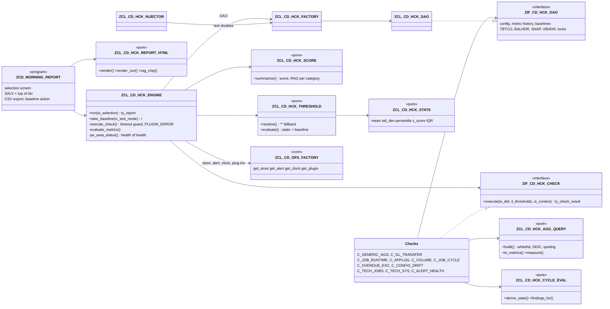

# Payment Engine Health Check & Morning Report

| | |
|---|---|
| **Payment engine area** | HCK — Health Check (operations suite) |
| **Program** | `ZCD_MORNING_REPORT` |
| **Landscape** | S/4HANA 2023, SAP_BASIS 7.58 — DV1 → QA1 → PS4 |
| **Status** | Built and lint-clean offline; **not yet activated or executed in an SAP system** |
| **Version** | 2026-11-05 — initial version (ops suite consolidation) |

---

# Part 1 — Business & Operations

## 1. What the morning report is

> **First principle:** before the first payment run of the day, someone must know — with evidence — whether yesterday's money movements completed and whether today's can start safely.
>
> **Analogy:** a pilot's pre-flight checklist: a fixed list, each item green or not, and nobody takes off on "probably fine".

The morning report is a daily scorecard of the **payment engine**. It runs a configured list of health checks, compares each measured value with its limits and with its own history, and produces:

- a **health score 0–100** and an overall **RAG** (red / amber / green);
- a **RAG per category** (A–E, below);
- the status of the other monitoring payment engine areas (bank statement validation **EBS**, file monitoring **FMON**, and the health check itself) — the "health of the health check";
- the list of **checks** with a one-line summary each, drill-down to the individual findings;
- the **oldest open exceptions** across all payment engine areas with their owner, due date and age.

It is sent by e-mail (mobile-friendly HTML) to the morning distribution list and is available in SAP (`ZCD_MORNING_REPORT`) with drill-down. Every red or amber finding becomes an **owned exception** with a due date in the shared exception store; nothing is "just a log line".

| Category | Business question | Examples |
|---|---|---|
| **A — Financial integrity** | Did the money and the books stay consistent? | Return debits older than 10 days per company code; reconciliation keys that never reached the general ledger |
| **B — Mass-run and job health** | Did the batch runs complete, on time, at normal speed? | Job duration vs its own history; error rate in the application log; payment-engine volumes per day; job cycles (payment request → wire/ACH/check → ACK → GL) |
| **C — Exception queues** | Is anything waiting too long for a human? | Owned exceptions past their due date; postprocessing backlog |
| **D — Configuration drift** | Did productive settings change outside a transport? | Hash of key customizing tables vs the approved baseline |
| **E — Technical health** | Is the platform under the payment engine healthy? | Cancelled / long-running / late jobs, short dumps, update errors, old locks, failed alert deliveries |

## 2. How to read the scorecard (RAG and score)

> **First principle:** a colour must always mean the same action, whoever reads it.
>
> **Analogy:** traffic lights — nobody negotiates what red means at a crossing.

| RAG | Meaning | Expected action |
|---|---|---|
| **GREEN** | Every measured value within its limits and its normal range | None — glance only |
| **AMBER** | A warning limit was reached, the value is unusual against its own history (baseline outlier), or a check ran longer than its time budget | Look today; decide whether it is timing or a real issue |
| **RED** | An error limit was reached, a check failed to run, a critical job step failed / was missed / is stuck | Act now; follow the triage playbook below and escalate if SLA-bound |
| **N/A (grey)** | Nothing was measured (category without active checks; a check that read no evidence at all - evidence NONE, e.g. `A_RECON_3WAY` without any bank, G/L or payment engine line in its window) | Ask whether the category should be monitored / why there is no evidence |

**Health score.** Each check scores 100 (green), 50 (amber) or 0 (red / not executed), weighted by priority (High 3, Medium 2, Low 1). Score ≥ 90 → GREEN, ≥ 70 → AMBER, below → RED. Two safety rules stop an average from hiding a failure: **any red High-priority check makes the whole day RED**, and **any red check makes the day at least AMBER**. Red checks are counted as *critical*, amber checks as *high*.

**Baseline outlier.** For volumes and durations, a fixed limit is not enough (month-end is busier than mid-month). The check compares today's value with its last runs (z-score or inter-quartile range): far outside the usual range → AMBER, even if no fixed limit was crossed.

## 3. Triage playbook per category

> **First principle:** check the effect, not the job status — a green job that posted nothing is still a problem.
>
> **Analogy:** a doctor reads the symptom first, then orders the test that confirms the cause — not every test for every patient.

| Finding (check code) | First look | Typical cause | Next step / escalation |
|---|---|---|---|
| **A** `THRESHOLD_*` on `RET_AGED` | Drill-down → company code with the count | Returns lot not processed, return reason not mapped, clarification backlog | Collections team: process returns (FP09 / clarification); confirm the returns file was fully loaded (FMON) |
| **A** `GL_TRANSFER_GAP` | Reconciliation key in the finding | Key not closed / transfer job not run / transfer error | Run or rerun the GL transfer for the key; check job `ZPOST_GL*` in the RECON_EOD cycle; Finance if month-end |
| **A** `PAYMENT_NOT_CLEARED` (`A_INFLIGHT`) | Flow + method class (e.g. `DWIR`, `DACH`, `DCHQ`, `CACH`, `CCRD`) and the oldest payments in the finding detail (payment document, method, run date, date it is aged from, age, amount) | No evidence of any purpose yet: wire / ACH - the bank statement line is missing (statement not loaded, reference not in CHECT); an unmapped monetary code is `BTC_ROLE_MISSING`, not this finding; collections - G/L line not cleared (F.13 not run / not matched); Stripe - payout not processed or F.13 not cleared; cheque - not cashed for > 60 / > 90 days | Disbursement ops (flow D) / collections team (flow C): payment trace (`ZCD_OPS_PAYMENT_TRACE`), FEBAN, DFKKCR, FP09; Treasury when the bank has not reported it. The suite clears nothing (`Operations_Runbook.md` §5k) |
| **A** `CLEARING_INCONSISTENT` / `RETURN_INCONSISTENT` (E) | Flow + class; per payment the purpose and which evidence held, is missing or must not hold (or the anomaly of the evidence) | Evidence disagrees: statement line but DPAYH status not CLEARED (or the reverse); cheque B without line, line while blank / V; G/L line cleared without payout log row; payout processed but descriptor not set; assignment changed; returns lot missing / extra / without return line / amount differs | Payment engine support with disbursement ops / collections: FEBEP (FEBAN), DPAYH-ZZ_PAYMENT_STATUS, DFKKCR, DFKKRP (FP09), BSEG (FB03), Stripe payout log (`Operations_Runbook.md` §5l) |
| **A** `PAY_STATUS_LAG` (W, one per payment, 2026-11-08) | Payment document, the DPAYH status that did not follow, the bank evidence (returned / retrieved since a day) or the bank ACK time (per payment, or the ACK of the payment run's file for classes acknowledged per file) | The hourly payment status job did not run, failed or skipped the payment | Runbook §5k-1: check the status job in SM37 / its owner; never set the status from the suite; no alert by default |
| **A** `CHEQUE_CLARIFICATION` / `MANUAL_CLEARING_REQUIRED` / `CHEQUE_AMOUNT_MISMATCH` (E) | `DCHQ`; cheque number, register state, codes with dates | Several 581 / 255 for one cheque; a bank correction (399 / 699) and the cheque not yet cleared in the register; 581 amount differs from the payment amount | Disbursement ops / payment engine support: clarification worklist, FPCHR (manual clearing), FEBAN (`Operations_Runbook.md` §5l) |
| **A** `UNEXPECTED_SEQUENCE` / `PENDING_OUTCOME_MISSING` (E / per outcome) | Flow + class; codes with dates / pending outcome and its age | The bank code sequence of the payment matches no configured outcome; a redeposit (or other pending outcome) had no follow-up within its maximum age | Treasury / collections: confirm the sequence with the bank; add an outcome row by transport when it is legitimate (`Operations_Runbook.md` §5l) |
| **A** `CLEARING_RULE_INVALID` (E) / `VALUE_DATE_MISSING` / `INFLIGHT_CONFIG` (I / W) | Evidence class and parameter / count of payments / missing calendar, class or rule | A rule row cannot be used (class, parameter, pattern, configured table / field; a technical read error is `PAY_EVIDENCE_FAILED` E since 2026-11-10) - its purposes are not judged; DPAYH value date empty; no calendar; a class without payment methods or CLEARED rule; an evidence kind not configured (Stripe settings) | Payment engine support: fix the row in the HCK configuration app by transport (`Operations_Runbook.md` §5k) |
| **A** `RECON_BREAK` / `RECON_SUBLEDGER_BREAK` / `STRIPE_GROUP_BREAK` (`A_RECON_3WAY`, E) | Group (company code / clearing account / currency), day, difference and unexplained residual; Stripe: descriptor, charges, fees, deposit; ACH: unmatched assignment groups | Statement line not posted / posted elsewhere, G/L transfer missing or to another account, manual posting on the clearing account, fee posting of a Stripe payout missing, F.13 not cleared one-to-one | Payment engine support with Treasury / GL accounting / collections (`Operations_Runbook.md` §5m); the suite clears nothing |
| **A** `RECON_TIMING` (I) / `RECON_VARIANCE` (W) / `RECON_NO_DATA` (I) / `RECON_CONFIG` (W) | Bucket named in the message (TIMING, CUTOFF, REDEPOSIT; CHEQUE, UNMAPPED, OTHER), unmapped codes, set and reason | Statement / transfer of the next day, return of the next period, 468 waiting for its redeposit (listed, not red); cheque cashed later, new bank code without role, explained other code; no activity; set without payment engine account | Timing: none; variance / config: role row or set fixed in the HCK configuration app by transport (`Operations_Runbook.md` §5m) |
| **B** `BASELINE_OUTLIER` on `DURATION_MIN` | Job name, mean vs today | Volume spike, lock waits, DB contention, wrong variant | Compare volumes (B_VOLUME); check locks (E_SYSTEM); if the job is SLA-bound escalate to Basis |
| **B** `THRESHOLD_*` on `ERR_RATE_PCT` | Log object / subobject | Master-data errors in a mass run, interface errors | SLG1 for object/subobject and date; fix data; rerun the affected interval |
| **B** volume `BASELINE_OUTLIER` / `THRESHOLD_RED` (low) | Source / LOB, day | Missing inbound file, PRISM hold, source outage | FMON file status; confirm with the source system; do **not** start payment runs on partial input |
| **B** `STEP_FAILED` / `STEP_MISSED` / `STEP_STUCK` / `STEP_BLOCKED` | Cycle / step, job name | Cancelled job, Control-M did not trigger, predecessor failed | Control-M runbook: map Control-M name → SAP job → program + variant; fix predecessor first; rerun; list every downstream step to rerun |
| **C** `THRESHOLD_*` on `OVERDUE` | Payment engine area with overdue items | Exceptions not worked, owner absent | Owner's lead reassigns; waive only with a reason (audited) |
| **C** PPO backlog | Business process | Postprocessing not worked | Responsible team works the PPO queue |
| **D** `PARAM_INVALID` | Area / parameter name, framework message | A parameter of `CD_OPS` / `CD_EBS` / `CD_FMON` / `CD_HCK` that ZCA_PARAM refuses (invalid value or default, unknown name, mandatory value missing, two rows for a single value, area missing / inactive); the run used the code default meanwhile | `Operations_Runbook.md` §5f: correct the value in the app *Parameter areas* (or the definition by transport); SLG1 object ZCA_OPS / PARAM shows when the runs met it |
| **D** `POSTAREA_INVALID` | Posting area / key values of the entry, ZCD_OPS message (e.g. 427 `*` not supported, 385 one payment method in two classes) | An entry of the FI-CA customer posting areas ZRSN / ZPMC / ZBTM / ZBTR (FQC0) that its reader cannot use, or an empty posting area (W); FQC0 checks only domains (`docs/FICA_Posting_Areas.md` §3) | `Operations_Runbook.md` §5o: FI-CA team corrects the entry in FQC0 in DV1 and transports it |
| **D** `CONFIG_DRIFT` | Table name, baseline taker | Direct change in production, transport not baselined | Find the change (table change logs / transport); if approved, take a new baseline; if not, revert and raise a security incident |
| **D** `CONFIG_NO_BASELINE` | Table name | New table under control | Take the baseline after the next approved transport |
| **E** `JOB_CANCELLED` / `JOB_LATE_START` / `JOB_LONG_RUNNING` | Job name / count | Cancelled step, missing Control-M trigger, runaway job | SM37 job log; Basis if system-related |
| **E** `SHORT_DUMPS` / `UPDATE_ERRORS` / `LOCK_MAX_AGE_MIN` | Count / age | Program error, failed update task, orphan lock | ST22 / SM13 / SM12; Basis; never delete a lock held by an active payment run |
| **E** `ALERT_FAILED` | Channel | Mail server down or application log not written | Alerts are not reaching people — treat as RED for operations |
| **E** `NR_USAGE_HIGH` (`E_NUMRANGE`) | Object, interval (subobject / number / year), usage %, numbers left | A number range object is running out; at 100 % postings of that object stop with a number range error | Payment engine support + Basis: look in SNRO (interval status); plan a new interval or year by transport **before** red; never reset NRLEVEL (`Operations_Runbook.md` §5i) |
| **E** `NR_NO_INTERVAL` / `NR_NOT_NUMERIC` (W) | Object / interval | Object name wrong in PARAM1, only external intervals, no interval for this / next year (create it before 1 January), alphanumeric limits | Correct PARAM1 or create the interval in DV1 (transport); external intervals are not measured |
| **E** `QUEUE_ERROR` / `QUEUE_HOLD` / `QUEUE_STUCK` (`E_QUEUES`) | Source (QOUT / QIN / BGRF), queue, destination, state, entries, oldest age and the transaction in the finding | SYSFAIL / CPICERR: receiver error or connection down; STOP: queue stopped (often deliberately during a release); READY / RUNNING too long: scheduler not running, receiver slow | Basis / middleware support: SMQ1 (outbound), SMQ2 (inbound), SBGRFCMON (bgRFC) - read the error text there; restart / unlock only after the cause is known and by the owning team, never from the suite (`Operations_Runbook.md` §5j) |
| **E** `QUEUE_CONFIG_INVALID` / `QUEUE_NOT_MONITORED` | Source and message | A delivered qRFC field name does not exist (VERIFY-DDIC), the bgRFC table is not whitelisted or not configured | Developer: correct the delivered name or PARAM4; until then the source measures nothing (never zero) |
| `TECH_READ_CAPPED` / `LIMITS_NOT_CONFIGURED` (W) | Parameter or metric named in the message | A read reached `HCK_MAX_TECH_ROWS` / `HCK_INFLIGHT_MAX_ROWS`; no `ZCD_HCK_THRESH` row for a metric the check classifies by | Raise the cap after a QA1 runtime check / maintain the threshold row by transport; until then the result may be incomplete or not judged |
| `HCK_SELF` `PE_AREA_STALE` | Payment engine area | Monitoring job (EBS, FMON or HCK) did not run | Restart the monitoring job; until then, nobody is watching that area |
| `PLUGIN_ERROR` / `AGG_CONFIG_INVALID` | Message text | Configuration error (unknown field, table not whitelisted) or program error | Fix the customizing row; the rest of the report is still valid |
| `TIMEOUT_OVERRUN` | Runtime vs budget | Check too slow for the volume | Performance review of the check (index, narrower window) |

Many "failures" are timing: if a behaviour is working as designed, record it as a *scheduling / configuration alignment opportunity*, not a defect.

## 4. Daily routine

> **First principle:** a report nobody owns is noise.
>
> **Analogy:** the morning stand-up of a ward — one list, one owner per bed, decisions recorded.

1. The scheduled run (native SAP job in SM36 running `ZCD_MORNING_REPORT` with the productive variant) finishes before the first business payment cycle; the e-mail reaches the RTB distribution list.
2. The RTB analyst on duty reads the scorecard, works RED first, then AMBER, using §3.
3. Every RED/AMBER finding is already an owned exception (payment engine area HCK) with a due date; assign the owner the same morning.
4. Persistent false positives are a **threshold change** (customizing, §13) — never "ignore the colour".

---

# Part 2 — Technical

## 5. Architecture and class model

> **First principle:** checks measure, the engine judges — one place decides what is red, so every check is judged by the same rules.
>
> **Analogy:** laboratory analysers produce numbers; the reference ranges printed on the report come from one table, not from each machine.

Layering (development standards §3): interfaces → domain (pure rules, no SQL) → DAO (all SQL) → application (engine) → presentation (report, CDS).



**Run sequence.**

```mermaid
sequenceDiagram
  participant R as ZCD_MORNING_REPORT
  participant E as ZCL_CD_HCK_ENGINE
  participant D as ZIF_CD_HCK_DAO
  participant C as Check plug-in
  participant S as Core store
  participant A as Core alert
  R->>E: run(selection)
  Note over E: run lock for the variant (not in test mode); held → refused run RUN_LOCKED, nothing else
  E->>S: start_run(HCK, test mode) + commit (not in test mode)
  E->>D: get_check_defs(categories, priorities, ids)
  loop each active check (SEQ)
    E->>C: execute(def, thresholds, context)
    C-->>E: metrics, findings, step states
    Note over E: timeout guard, PLUGIN_ERROR on any exception,<br/>thresholds + baseline per metric
    E->>S: save_findings + commit (not in test mode)
    E->>D: save_metrics, save_results - verdict of the check (not in test mode)
  end
  E->>S: get_last_run(EBS/FMON/HCK) -> HCK_SELF
  E->>D: save_results(SKIPPED rows of a filtered run) (not in test mode)
  E->>S: reconcile(executed check IDs without plugin error) (not in test mode)
  E->>D: get_open_exceptions(top N)
  E->>S: finish_run + commit (not in test mode: results durable first)
  E->>A: dispatch(run, findings) (not in test mode)
  E->>A: send(MORNING, HTML) if requested (not in test mode)
  E->>S: save ALERT_FAILED findings + finish_run + commit (only on a delivery failure)
  E-->>R: report (score, categories, results, pe_areas, exceptions)
  Note over E: run lock released (also on exception)
```

## 6. Tables

> **First principle:** configuration and evidence live in different tables — configuration is transported, evidence never is.
>
> **Analogy:** the recipe book travels between kitchens; the delivery notes stay in the kitchen that received the goods.

| Table | Class | Key | Purpose |
|---|---|---|---|
| `ZCD_HCK_DEF` | C | MANDT, CHECK_ID | Check catalog: category, class, active, SEQ, priority, PARAM1–4, package size, timeout |
| `ZCD_HCK_THRESH` | C | MANDT, CHECK_ID, METRIC, BUKRS | Amber/red limits, direction, baseline mode (NONE/ZSCORE/IQR), z limit / IQR k, lookback; `*` default rows |
| `ZCD_HCK_AGG` | C | MANDT, CHECK_ID, AGG_ID | Generic COUNT/SUM: table, date field + mode (AGE/DAY) + days, group field, expected groups (comma list: a listed group without rows measures 0, A103 - `ZCD_HCK_AGGGRP` merged 2026-11-08), 3 conditions |
| Core `ZCD_OPS_TABWL` | C | MANDT, PE_AREA, PURPOSE, TABLE_NAME, FIELD_NAME | One approved-table list of every reader (table consolidation 2026-11-08, was `ZCD_HCK_TABWL` / `ZCD_HCK_DRIFT` / `ZCD_FMON_TABWL`): HCK reads only its own rows - `HCK` / `READ` = tables the aggregates, value queries, queue and evidence sources may read (security boundary, with approver), `HCK` / `DRIFT` = tables under configuration-drift control; field blank (whole table) |
| `ZCD_JOB_CYCLE` | C | MANDT, CYCLE_ID | Cycle header: text, factory calendar, active |
| `ZCD_JOB_STEP` | C | MANDT, CYCLE_ID, STEP_NO | Job name pattern (PCRE, §9a), program, variant, predecessor, day offset, start window, max runtime, skippable, critical |
| `ZCD_HCK_METRIC` | A | MANDT, RUN_ID, CHECK_ID, METRIC, DIM1, DIM2 | Metric history for baselines, trends, dashboard. Index `HST` (CHECK_ID, METRIC, DIM1, DIM2, MEASURED_AT), `TIM` (MEASURED_AT) |
| `ZCD_HCK_BASELINE` | A | MANDT, TABNAME | Golden baseline hash, row count, taken at / by (per system, never transported) |
| `ZCD_HCK_RCSET` | C | MANDT, SET_ID | Three-way reconciliation clearing account sets: kind (THREEWAY / ACH_ZUONR / STRIPE), side, company code, clearing account, currency, house bank account (→ `ZCD_EBS_ACCT` XBLNR account), leg mapping (invert bank sign, compare bank, compare payment engine), tolerance (§7d) |
| FI-CA `TFK033D` (posting areas `ZPMC`, `ZBTR`) | C (SAP) | APPLK, BUBER, KTOPL, KEY01–KEY08 | Customer posting areas maintained in FQC0 (user decision 2026-11-08, were ZCD_HCK_PMCLASS / ZCD_HCK_BTCROLE), read only through `ZCL_CD_OPS_POSTAREA` (`docs/FICA_Posting_Areas.md`): **ZPMC** method classes (FLOW / PAY_METHOD / HOUSE_BANK → METHOD_CLASS / AGE_BASIS / CALENDAR) and **ZBTR** bank code roles (USAGE / SCOPE / SCHEME / CODE / FAMILY / SUB_FAMILY → ROLE / COMPARE_AMOUNT; usage LIFECYCLE for `A_INFLIGHT`, RECON for `A_RECON_3WAY`, no entry = unmapped). Checked every morning by `D_POSTAREA_INVALID` |
| `ZCD_HCK_RESULT` | A | MANDT, RUN_ID, CHECK_ID | **Verdict of each check per run** (design review 2026-11-07), written by the engine from the decision the report uses: executed at, verdict (R / A / G, blank grey), check status (RED / AMBER / GREEN / WARMUP / GREY / FAILED / SKIPPED), completion (COMPLETE / PARTIAL - timeout, budget, capped read / FAILED - plug-in error / SKIPPED - outside the scope of a filtered run), evidence (ALL / PARTIAL / NONE), run scope (variant + selection ranges, message 300), metric / finding / error / warning counts, baseline mode used (NONE / ZSCORE / IQR / MIXED), warm-up, runtime, summary. The health dashboard reads it and never re-derives a status. Index `TIM` (EXECUTED_AT); purge target `HCK_RESULT` (ZCA_PARAM `RETENTION_DAYS_HCK_RESULT`, 400 days) |
| Core `ZCA_OPS_RUN` / `ZCA_OPS_FINDING` | A / A | — | Run header, findings / owned exceptions (read and written only through the core store; HCK DAO only *reads* findings for the exception queue) |
| Framework `ZCA_PARAM_AREA` / `_DEF` / `_VAL` | C | — | Parameters of areas `CD_HCK` / `CD_OPS` (read through `ZCL_CD_OPS_FACTORY=>GET_PARAMS`; the check `D_PARAM_INVALID` reads every definition of the four suite areas) |
| Core `ZCA_OPS_ALLOG` | A | — | Read by `E_ALERT_DELIVERY` (delivered by the core alert router) |

Every HCK finding: payment engine area `HCK`, `OBJECT_TYPE = 'CHECK'`, `GROUP1` = category, `GROUP2` = check id. Severity B/E/W → owned exception with SLA (`SLA_DAYS_HCK_<sev>`).

## 7. Check catalog

> **First principle:** a check is a measurement plus a list of itemised problems; whether it is red is configuration.
>
> **Analogy:** a thermometer does not decide you have a fever — the threshold on the chart does.

| Class | Cat. | Parameters | Metrics (DIM1 / DIM2) | Own findings |
|---|---|---|---|---|
| `ZCL_CD_HCK_C_GENERIC_AGG` | A, C (any) | rows in ZCD_HCK_AGG | `<AGG_ID>` per group value (e.g. company code) | `AGG_CONFIG_INVALID` per invalid row |
| `ZCL_CD_HCK_C_GL_TRANSFER` | A | P1 lag days (1), P2 window days (7), P3 max keys (500) | `GL_MISSING_KEYS` (*) | `GL_TRANSFER_GAP` per reconciliation key (E) |
| `ZCL_CD_HCK_C_JOB_RUNTIME` | B | P1 job patterns, P2 day offset (1) | `DURATION_MIN` (job / job count) | — (baseline per job via thresholds) |
| `ZCL_CD_HCK_C_APPLOG` | B | P1 log objects, P2 subobjects, P3 day offset (1) | `ERR_RATE_PCT`, `ERR_MESSAGES` (object/subobject / day) | — |
| `ZCL_CD_HCK_C_VOLUME` | B | P1 offset (1), P2 days (1); rows in ZCD_HCK_AGG, expected groups in its EXPECTED_GROUPS (comma list) | `<AGG_ID>` per source/LOB / day; 0 for each silent expected group (A103) | `AGG_CONFIG_INVALID` (also a failed query — no metric, never 0) |
| `ZCL_CD_HCK_C_JOB_CYCLE` | B | P1 cycle date offset (0), P2 cycle ids | `STEPS_NOT_OK`, `STEPS_COMPLETED` (cycle / date) + step board | `STEP_MISSED/FAILED/STUCK/OVERRUN/BLOCKED` |
| `ZCL_CD_HCK_C_OVERDUE_EXC` | C | — | `OVERDUE`, `OLDEST_OVERDUE_DAYS` (payment engine area) | — |
| `ZCL_CD_HCK_C_CONFIG_DRIFT` | D | rows of ZCD_OPS_TABWL HCK / DRIFT | `DRIFTED_TABLES` (*) | `CONFIG_DRIFT` (E), `CONFIG_NO_BASELINE` (W) |
| `ZCL_CD_HCK_C_PARAM` | D | — (every definition of the four suite areas in ZCA_PARAM plus every delivered one) | `PARAM_INVALID` (*) | `PARAM_INVALID` (E), object key area/name |
| `ZCL_CD_HCK_C_POSTAREA` | D | — (entries of the posting areas `POSTAREA_RSN` / `_PMC` / `_BTM` / `_BTR`, rule groups of ZCD_BTC_RULE) | `POSTAREA_INVALID` (*) | `POSTAREA_INVALID` (E; W for an empty posting area), object key posting area / key values |
| `ZCL_CD_HCK_C_TECH_JOBS` | E | P1 job patterns, P2 long-running min (120), P3 grace min (30) | `CANCELLED`, `LONG_RUNNING`, `LATE_START` (*) | `JOB_CANCELLED` (E), `JOB_LONG_RUNNING`, `JOB_LATE_START` (W) |
| `ZCL_CD_HCK_C_TECH_SYS` | E | — | `SHORT_DUMPS`, `UPDATE_ERRORS`, `LOCK_ENTRIES`, `LOCK_MAX_AGE_MIN` (*) | — |
| `ZCL_CD_HCK_C_ALERT_HEALTH` | E | P1 window hours (24) | `ALERT_FAILED`, `ALERT_THROTTLED` (channel) | — |
| `ZCL_CD_HCK_C_NUMRANGE` | E | P1 number range objects (exact SNRO names, comma list; required) | `NR_USED_PCT` (object/subobject/interval/year; level) | `NR_USAGE_HIGH` (W at amber, E at red), `NR_NO_INTERVAL`, `NR_NOT_NUMERIC`, `LIMITS_NOT_CONFIGURED`, `TECH_READ_CAPPED` (W) |
| `ZCL_CD_HCK_C_QUEUES` | E | P1 queue name PCRE list, P2 destination PCRE list (blank = all), P3 stuck minutes (30), P4 bgRFC source `TABLE=…;NAME=…;DEST=…;STATE=…;DATE=…;TIME=…`; `HCK_QUEUE_ERR_STATES` / `_HOLD_STATES` / `_WAIT_STATES` | `Q_ERROR`, `Q_HOLD`, `Q_STUCK` (entries), `Q_OLDEST_MIN` (level) per source `QOUT` / `QIN` / `BGRF` | `QUEUE_ERROR` (E), `QUEUE_HOLD`, `QUEUE_STUCK`, `QUEUE_CONFIG_INVALID` (W), `QUEUE_NOT_MONITORED` (I) |
| `ZCL_CD_HCK_C_INFLIGHT` | A | P1 factory calendar (fallback of class / house bank), P2 look-back days VALUE_DATE classes (10), P3 look-back days ISSUE_DATE classes (120) - since 2026-11-08 the window of the live evaluation before the snapshot's first run only; examples per finding `PAYOUT_EXAMPLES` (ZCA_PARAM, 10; P4 retired); stale snapshot `MON_STALE_AFTER_MIN_CORE` (30); classes, rules, roles, outcomes, settings in the HCK configuration app (§7b, §7b-7) | `PAY_OPEN`, `AGE_OLDEST` (level), `OVER_WARN_CNT`, `OVER_CRIT_CNT`, `PAY_INCONSISTENT`, `PAY_UNDETERMINED`, `PAY_STATUS_LAG`, `PAY_NOT_SNAPSHOT` per flow + class (`DWIR` …); `OVER_WARN_AMT`, `OVER_CRIT_AMT` (DIM2 currency) | every finding below that concerns payments is **one per flow + class + code + payment run date** with count, amount per currency and the first N payments (§7b-7): `PAYMENT_NOT_CLEARED` (W / E), `PAY_STATUS_LAG` (W, §7b-6), `CLEARING_INCONSISTENT`, `RETURN_INCONSISTENT`, `UNEXPECTED_SEQUENCE`, `PENDING_OUTCOME_MISSING`, `CLEARING_UNDETERMINED` (W), `BTC_ROLE_MISSING`, `CHEQUE_LINK_AMBIGUOUS`, `CHEQUE_REGISTER_MISSING`, `CHEQUE_CLARIFICATION`, `MANUAL_CLEARING_REQUIRED`, `CHEQUE_AMOUNT_MISMATCH` (E), `CLEARING_RULE_INVALID`, `VALUE_DATE_MISSING` (I), `INFLIGHT_CONFIG`, `LIMITS_NOT_CONFIGURED`, `TECH_READ_CAPPED`, `PAY_SNAPSHOT_STALE` (W), `PAY_EVALUATED_LIVE` (I) |
| `ZCL_CD_HCK_C_PRQ_NOT_PAID` (check `A_PRQ_NOT_PAID`, 2026-11-08) | A | — (row cap `HCK_INFLIGHT_MAX_ROWS`, examples `PAYOUT_EXAMPLES`; due date and cut-off: `PAYOUT_REQ_CUTOFF`, `TRACE_SRC_REQUEST` `DUE=`, A_INFLIGHT PARAM1 calendar, cancellation `C_PRQ_CANCEL` PARAM2; §7b-8) | `PRQ_NOT_PAID` (DIM1 `*` and per source, DIM2 stage) | `PRQ_NOT_PAID` (E) **one per source + stage + due date** with count, amount per currency and the first `PAYOUT_EXAMPLES` requests; `PAY_NIGHTLY_MISSING` (W, evidence PARTIAL), `TECH_READ_CAPPED` (W) |
| `ZCL_CD_HCK_C_RECON3` | A | — (ZCA_PARAM `HCK_RECON_LOOKBACK_DAYS` 7, `_TIMING_DAYS` 3, `_REDEPOSIT_DAYS` 10, `_TOLERANCE` 0.00, `_MAX_ROWS` 5 000); sets and bank code roles in the HCK configuration app (§7d) | `RC_DIFF_BANK_GL`, `RC_DIFF_GL_FICA`, `RC_UNEXPLAINED` (level; DIM1 group BUKRS/HKONT/WAERS, DIM2 ISO day), `RC_DAYS` (DIM2 status), `RC_BUCKET` (DIM2 bucket), `RC_STRIPE_DIFF` (DIM2 descriptor), `RC_ACH_OPEN` (DIM2 day/status), `RC_BREAKS` (*) | `RECON_BREAK`, `RECON_SUBLEDGER_BREAK`, `STRIPE_GROUP_BREAK` (E), `RECON_VARIANCE`, `RECON_CONFIG`, `TECH_READ_CAPPED` (W), `RECON_TIMING`, `RECON_NO_DATA` (I); evidence NONE = grey |
| `ZCL_CD_HCK_C_DOCCHG` (build C) | A | PARAM1 window days (7), PARAM2 G/L lag days (1), PARAM3 row cap (500), PARAM4 statuses that mean the payment left SAP (§7e) | `RV_REVERSALS`, `RV_LEFT_SAP`, `RV_GL_NOT_REV`, `RV_BANK_LINE` (`*`) | `REV_AFTER_LEFT_SAP`, `REV_GL_NOT_REVERSED`, `REV_BANK_LINE` (E), `REV_READ_CAPPED` (W) |
| `ZCL_CD_HCK_C_FRAMEWORK` (check `D_PROC_ONBOARD`, 2026-11-10) | D (any) | P1 class of the operations framework implementing `ZIF_CA_OPS_CHECK` (`ZCL_CA_OPS_CHK_ONBOARD`), P2 area of its registry rows (blank = CD_HCK) | — | the framework check's findings: `PROC_NO_CHECK` (E), `PROC_NO_CONTROL`, `PROC_NO_ALERT_RULE`, `PROC_NO_OWNER`, `PROC_NO_PURGE`, `PROC_NO_AUTH` (W), object key area / process; a partial framework result = PARTIAL |
| built-in `HCK_SELF` | E | `HCK_WATCH_PE_AREAS`; stale threshold: core parameter `MON_STALE_AFTER_MIN_<area>` (minutes, the same parameter as the dashboards; was the `ZCD_OPS_MONCFG` row), only when it cannot be read `HCK_MAX_AGE_H_<pe_area>`, else `HCK_MAX_AGE_HOURS` (hours) | — | `PE_AREA_STALE` (E) |

Engine findings for every check: `THRESHOLD_RED` (E), `THRESHOLD_AMBER` (W), `BASELINE_OUTLIER` (W), `BASELINE_WARMUP` (I, A102), `TIMEOUT_OVERRUN` (W), `PLUGIN_ERROR` (E), `ALERT_FAILED` (W).

### 7a. Known-table checks (USAA reference)
| Check | Class | What it finds |
|---|---|---|
| `C_PRQ_NO_SPE` | `ZCL_CD_HCK_C_PRQ_SPE` | Payment requests that failed (and have no SUCCESS row) without a `ZCD_SPE_EXCP_LOG` row — the source is never told |
| `C_CHQ_STATUS` | `ZCL_CD_HCK_C_CHQ_STATUS` | Cheques whose status went backwards in `ZCD_CHECK_HIST` (ZECT_STATUS: 3 / 4 / 9 terminal, 10 → 9 allowed) |
| `C_PRQ_CANCEL` | `ZCL_CD_HCK_C_PRQ_CANCEL` | PCLM requests CANCELLED although their open item (FIN number = `DFKKOP-ZZ_FIN_TRANS_NUM`) is cleared |

Table and field names come from PARAM1–3 (`NAME=VALUE;…`, `config/hck_seed.md`), are checked against the DDIC and the whitelist, and every query is limited by its date field (`ZCL_CD_HCK_VALUE_QUERY`).

### 7b. Number ranges, queues, payments in flight (2026-11-07)

All three are read-only: they never change an interval, never restart, unlock or delete a queue entry, never post, clear or change a status. Their reads are in `ZCL_CD_HCK_RUNTIME_DAO` (factory `GET_RUNTIME_DAO`) and in the evidence plug-ins; bank lines, cheques, document headers, payment runs and returns come from the payment trace repository (`ZIF_CD_OPS_TRACE_DAO`, core factory) - one definition of each join path. Alerts: the existing rule `HCK_RED` (severity E of a red check, e-mail to the SO23 list) - no new channel, no application-log rule.

- **`E_NUMRANGE`** - NRIV intervals with `EXTERNIND` blank of the PARAM1 objects, not year-dependent (`TOYEAR` 0000) or valid this / next year. Usage = (NRLEVEL − FROMNUMBER) / (TONUMBER − FROMNUMBER) × 100, rounded to 2 decimals, level capped at TONUMBER; NRLEVEL below FROMNUMBER (initial) = 0 %. Limits and level are converted only when they are digits (PCRE constant `GC_PCRE_DIGITS`), else `NR_NOT_NUMERIC`. Limits: `ZCD_HCK_THRESH` `NR_USED_PCT` row `*` (DIM1 is longer than 4 characters), seed amber 85 / red 95. A configured object without interval is a warning - nothing measured is never green.
- **`E_QUEUES`** - sources `QOUT` (TRFCQOUT, SMQ1), `QIN` (TRFCQIN, SMQ2) with delivered field names (VERIFY-DDIC, constants `GC_TRFCQOUT` / `GC_TRFCQIN` of `ZIF_CD_HCK_RUNTIME_TYPES`) and, when PARAM4 names it, a bgRFC table (`BGRF`, SBGRFCMON; needs a `ZCD_OPS_TABWL` row HCK / READ). Every name is checked against the runtime DDIC before the read (date field DATS, time field TIMS); a source that fails is `QUEUE_CONFIG_INVALID` and measures nothing. Entries are read grouped per queue / destination / state / day (oldest time of the day; a day group counts as stuck when its oldest entry passes the age limit). State in `HCK_QUEUE_ERR_STATES` → ERROR, in `_HOLD_STATES` → HOLD, in `_WAIT_STATES` and older than PARAM3 minutes → STUCK; a bgRFC source without STATE lists errors only. Queue and destination filters are PCRE on the complete value (case ignored), applied in ABAP; a source without destination is not filtered by PARAM2. Empty queues measure 0 (evidence of health).
- **`A_INFLIGHT`** - every payment of a payment run (DPAYH, DOC1R filled, proposal runs excluded) **not yet final, however old** (since 2026-11-08 from the current versions of the outcome snapshot, §7b-7 - no row cap, no look-back window; before: the look-back window and `HCK_INFLIGHT_MAX_ROWS`) whose method belongs to a method class of the posting area `ZPMC`; flow from `TFK042Z-XEINZ` (country of the company code): **D** disbursement, **C** collection. A class is watched when it has payment methods and at least one active CLEARED rule. Reversed payments (DFKKKO-STBEL) are left out. What takes a payment out of flight, and what is inconsistent, is configuration (below); payments without a decision are aged. *Age* = VALUE_DATE classes (wire, ACH, card): business days after the **value date** (DPAYH-VALUT; run date when empty, said in the detail and in `VALUE_DATE_MISSING`) in the calendar of the house bank (`ZPMC` entry with the payment's house bank - table consolidation 2026-11-08, was `ZCD_HCK_PMBANK`; e.g. UK / German bank holidays of Barclays / Commerzbank), else of the class row (HBKID blank), else PARAM1; ISSUE_DATE classes (cheques): calendar days since the run date. Limits: `ZCD_HCK_THRESH` `AGE_OLDEST` per flow + class (DIM1 = threshold key): AMBER = age from which the payment is late (warning), RED = critical; seed (user 2026-11-08, `config/hck_seed.md` §3): wire 1 / 2 (next business day), ACH both flows and card 3 / 4, international ACH 7 / 8 business days after the value date; cheques no limit (AMBER = RED = 0: counted and listed, never late - no stale-cheque policy). Amounts are reported per currency (USD, EUR, GBP …), never summed across currencies. The finding (one per flow + class + run date) carries the count, the amount per currency and the first `PAYOUT_EXAMPLES` late payments oldest first: payment document, method, run date, aged-from date, age, amount - no bank account data. No payment in flight measures 0 for every watched flow + class.

#### 7b-1. Rule table and evidence kinds (user rules 2026-11-07)

> **First principle:** a payment leaves flight only on evidence, and two pieces of evidence that disagree are a finding, not a guess.
> **Analogy:** a parcel is delivered when the courier's scan *and* the recipient's signature agree; one without the other is a query to the depot.

`ZCD_HCK_CLRRULE` (key FLOW + METHOD_CLASS + PURPOSE + SEQ; seed `config/hck_seed.md` §8c) names per row an **evidence kind** (`EVIDENCE_CLASS`, a plug-in implementing `ZIF_CD_HCK_EVIDENCE`, validated on save and at run time), its PARAM1-3 and REQUIRED: `X` mandatory, must hold and indicates the purpose; `C` mandatory corroboration, must hold but never indicates alone; `N` mandatory, must not hold; blank = informational, shown only. Purposes decide in the order **VOIDED → RETURNED → RETRIEVED → PENDING → CLEARED → IN_FLIGHT** (RETRIEVED 2026-11-07: a manual retrieval is not a return - canonical outcome, §7b-5): the first purpose with an `X` row that holds decides. All its `X` / `C` rows hold and no `N` row holds → the payment is excluded and counted (`PAY_EXCLUDED`, DIM2 = purpose; IN_FLIGHT = consistent state, stays in flight and is aged). Some but not all → `CLEARING_INCONSISTENT` (VOIDED, RETRIEVED, PENDING, CLEARED, IN_FLIGHT) or `RETURN_INCONSISTENT` (RETURNED), severity E, the detail names per payment what held, what is missing and what must not hold. An **anomaly** an evidence kind reports itself (code and severity of the evidence) is its own finding. A payment in an inconsistency or anomaly finding is not aged (`PAY_INCONSISTENT`). **Undetermined (design review 2026-11-07, fail closed).** A kind that cannot be used (class, parameters, read error) is `CLEARING_RULE_INVALID` (E); a kind whose settings are not maintained is `INFLIGHT_CONFIG` - warning "not configured - mandatory: purpose not determinable" when a mandatory row (`X` / `C` / `N`) uses it, information when only informational rows do. A purpose is **undetermined** for a payment when one of its `X` rows cannot be evaluated, or when an `X` row holds but a `C` / `N` row cannot be evaluated: no positive conclusion, no later purpose decides (a payment whose RETURNED evidence cannot be read is never concluded CLEARED), the payment stays in flight and is aged, and it is listed in `CLEARING_UNDETERMINED` (W, one finding per flow + class naming the purpose and the unavailable rows; metric `PAY_UNDETERMINED`, not counted in `PAY_INCONSISTENT`). Only informational rows are skipped. Card payments while the Stripe settings are missing are the delivered example ("clearing not determinable: Stripe evidence not configured"); the explicit per-row switch (REQUIRED blank = BSEG decides alone) and its trade-off are in `config/hck_seed.md` §8c. One collect per kind and parameters for all flows / classes (one batch read per kind and run, capped by `HCK_INFLIGHT_MAX_ROWS`, `TECH_READ_CAPPED` naming the table).

| Evidence kind (class) | Holds when | Parameters | Anomaly |
|---|---|---|---|
| `ZCL_CD_HCK_EV_BTC_SEQ` - bank code lifecycle | the outcome of the payment's ordered roles (below) is in PARAM1 | PARAM1 outcomes | `UNEXPECTED_SEQUENCE`, `RETURN_INCONSISTENT`, `PENDING_OUTCOME_MISSING` |
| `ZCL_CD_HCK_EV_STMT_DOC` - statement line | FEBEP-CHECT = AUGBL (any code) | - | - |
| `ZCL_CD_HCK_EV_PAY_STATUS` - payment status | DPAYH-ZZ_PAYMENT_STATUS of the newest run row in PARAM1 (values confirmed 2026-11-08: ISSUED, CONFIRMED, CLEARED, RETURNED, RETRIEVED, STOPPED) | PARAM1 status values (`CLEARED` / `RETURNED` / `RETRIEVED`); PARAM2 statuses the hourly status job has not updated yet (`ISSUED,CONFIRMED`): such a payment is **pending** - not found, not missing | - |
| `ZCL_CD_HCK_EV_CHQ_STATUS` - cheque status | DFKKCR-STATE (confirmed: B cashed, V voided, blank open) of the deciding cheque in PARAM1, **or** the DPAYH status in PARAM2 (holds alone, with or without register row) | PARAM1 `B` / `V`; PARAM2 payment statuses (`STOPPED` on VOIDED, user decision 2026-11-08) | - |
| `ZCL_CD_HCK_EV_STMT_CHEQUE` - cheque on the statement | FEBEP-CHECT = last PARAM1 characters of DFKKCR-ZTNUM **and** the statement's house bank account (FEBKO BUKRS / HBKID / HKTID) = the cheque's paying account (payment company code + DFKKCR-HBKID / HKTID) | PARAM1 suffix length (13) | a line fitting several cheques of one account → `CHEQUE_LINK_AMBIGUOUS` (E) for each, no cashing inherited |
| `ZCL_CD_HCK_EV_GL_XREF2` - G/L line cleared | BSEG line with XREF2 = AUGBL (stable key) and AUGBL filled | PARAM1 G/L accounts (optional) | - |
| `ZCL_CD_HCK_EV_GL_ZUONR` - assignment state | BSEG-ZUONR still AUGBL (`EQUAL`) / no longer AUGBL (`CHANGED`) | PARAM1 `EQUAL` / `CHANGED`, PARAM2 accounts | `EQUAL` violated → `CLEARING_INCONSISTENT` "assignment changed" |
| `ZCL_CD_HCK_EV_RETURN_LOT` - returns lot | DFKKRP-SELW1 = AUGBL | - | - |
| `ZCL_CD_HCK_EV_STRIPE` - Stripe payout | payout log row of the payment intent ID (DFKKOP by AUGBL → intent field → `ZCD_STRP_POUT_LOG`); optional charge / payout / full-ACK conditions | parameters `HCK_STRIPE_*` (ZCA_PARAM area CD_HCK, delivered blank - was `ZCD_HCK_EVSET`; field names VERIFY-SE11, DDIC + `ZCD_OPS_TABWL` HCK / READ checked); PARAM1 not read | refund or partial ACK → `CLEARING_INCONSISTENT` |

**Pending evidence (confirmed status values 2026-11-08).** A mandatory row (`X` / `C`) whose kind reports the payment as *pending* (payment status in PARAM2 of `ZCL_CD_HCK_EV_PAY_STATUS`: the hourly status job has not updated it yet) is neither held nor missing: it never indicates a purpose; when the purpose is indicated by its other rows and the pending row is its only gap, the payment stays **IN_FLIGHT** (verdict `STATUS_PENDING`, aged, not listed, no later purpose decides) and `PAY_STATUS_LAG` reports it after the grace period (§7b-6); with another missing or forbidden row the purpose is inconsistent as before (the pending row counted as not held).

Seeded rules (all `config/hck_seed.md` §8c): **rule 1** wire / ACH disbursements cleared = lifecycle CLEARED (495 / 466) AND DPAYH status CLEARED - "on statement but status not CLEARED" / "status CLEARED but no statement line" are `CLEARING_INCONSISTENT`; returned / retrieved = the lifecycle AND DPAYH status RETURNED / RETRIEVED (2026-11-08; ISSUED / CONFIRMED pending = in flight, the status alone without the bank line = inconsistent); **rule 2** cheques cleared = state B AND the cheque lifecycle CLEARED (581 with CHECT = last 13 of ZTNUM) or CLEARED_MANUAL (correction cleared in FPCHR); voided = state V **or DPAYH status STOPPED** (stop payment = the same outcome as voided, user decision 2026-11-08) AND no cashed line AND the register not cashed - a stopped cheque that was cashed (581 / state B) is `CLEARING_INCONSISTENT` "stopped cheque cashed", a stopped cheque with the register state still blank is VOIDED; its reissue is a separate payment (new payment document and cheque number, user 2026-11-08) judged on its own - cashed = CLEARED, never "stopped cheque cashed"; returned = 255 with the register state of a return (blank today) - not aged (V with a 581, B without a line, a 581 while blank are `CLEARING_INCONSISTENT`; blank without a line is open and aged 60 / 90 days); **rule 3** ACH and card collections cleared = BSEG XREF2 = AUGBL cleared (replaces the BSAS ZUONR read) - ACH also lifecycle CLEARED (166 / 143); **rule 4** returns from the bank code lifecycle and the returns lot (below).

#### 7b-2. Bank code lifecycle of a payment (user correction of rule 4)

The bank statement shows a sequence of codes per payment reference (FEBEP-CHECT = AUGBL). The scheme and code of each line come from the statement format - BAI2 type code in FEBEP-VORGC, ISO Domain-Family-Sub-family of a CAMT import in VGEXT - through the same derivation EBS uses (`ZCL_CD_EBS_SRC_FEB=>LINE_CODE`). The posting area `ZBTR` (usage LIFECYCLE) gives each (flow, class, scheme, code) a role - the same code means different things per flow; the roles ordered by statement date / statement / line form the sequence, e.g. `ORIGINAL,RETURNED`; `ZCD_HCK_SEQOUT` matches it (PCRE, complete value, in SEQ order) to an outcome with the returns lot items expected (DFKKRP count, blank = not checked), a maximum age for pending outcomes and the severity. Codes without a role are ignored. For cheques (rule PARAM2 `ZTNUM`) an outcome row may also require a register state (`REG_STATE`, DFKKCR-STATE, `BLANK` = blank) and may name its own finding (`FINDING`, open list: the outcome is itself a finding, severity of the row, its DESCRIPTION in the detail together with cheque number, register state, codes and dates); a line whose role compares with `R` must carry the payment amount (DPAYH-RWBTR of the same AUGBL - no DFKKCR amount field is read) or the cheque is `CHEQUE_AMOUNT_MISMATCH` (E, manual clearing in FPCHR). The suite only reports - cheques are cleared manually by support in FPCHR. A 581 or correction line whose cheque number matches no cheque cannot be tied to a payment here; EBS reports it at import (rule group BAI581D: R08 cheque amount against the register by ZTNUM; BAI255D: R07C), see `EBS_VALIDATION.md`.

| Flow / class | Codes → roles | Sequences → outcome (DFKKRP items) |
|---|---|---|
| C ACH (BAI) | 166, 143 COLLECTED; 468 COLLECT_FAIL | COLLECTED → CLEARED (0); COLLECT_FAIL → REDEPOSIT_PENDING (0, max 10 days - delayed redeposit, confirmed); COLLECT_FAIL,COLLECTED → CLEARED (0); COLLECT_FAIL,COLLECT_FAIL → RETURNED (1) |
| C ACH (CAMT, methods 1-5) | ISO codes - **confirm** | as BAI once the codes are known |
| D ACH | 466 ORIGINAL; 168 RETURNED; 166 RETRIEVED; 468 RETRIEVE_FAIL | ORIGINAL → CLEARED (0); ORIGINAL,RETURNED → RETURNED (1); ORIGINAL,RETRIEVED → RETRIEVED (0, confirmed); ORIGINAL,RETRIEVE_FAIL → RETRIEVAL_FAILED (0, stays paid); ORIGINAL,RETRIEVED,RETURNED,RETRIEVE_FAIL → RETURNED (1, confirmed: the original failed) |
| D WIR | 495 ORIGINAL; 195 RETURNED | ORIGINAL → CLEARED (0); ORIGINAL,RETURNED → RETURNED (1); no redeposit for wires |
| C CRD | 195 PAYOUT_RECEIVED (Stripe deposit) | reserved for the planned deposit evidence |
| D CHQ (link DFKKCR-DOC1R = AUGBL → last 13 of ZTNUM = FEBEP-CHECT) | 581 CASHED (amount = payment amount); 255 RETURNED; 399, 699 CORRECTION (open list) | any CORRECTION + register B → CLEARED_MANUAL; any CORRECTION otherwise → `MANUAL_CLEARING_REQUIRED` (E, "clear manually in FPCHR"); several 581 or several 255 → `CHEQUE_CLARIFICATION` (E); CASHED → CLEARED (with state B); (CASHED,)RETURNED + register blank → RETURNED, + V → voided after return, + B → `RETURN_INCONSISTENT` ("register still shows cashed"); DFKKRP 0 for all (confirmed) |

Any other sequence is `UNEXPECTED_SEQUENCE` (codes and dates in the detail). **Unmapped codes (design review 2026-11-07).** A line on the payment reference whose (flow, class, scheme, code) has no role is no longer dropped: when it carries an amount (≠ 0, "monetary") and its code is not an approved informational exclusion of its scheme - ZCA_PARAM `HCK_BTC_INFO_BAI2` / `_ISO` / `_PRTRY` (comma lists, delivered blank: codes that never concern a payment, approved on a customizing request) - the lifecycle is **INDETERMINATE** (never CLEARED / RETURNED, the evidence does not hold) and the payment is listed in `BTC_ROLE_MISSING` (E) with scheme, code, posting date, amount and flow / class, so that the posting area `ZBTR` gets the entry (or the code the exclusion). A line without amount and without role, and an excluded code, are ignored. Returns lot items other than expected (missing lot, extra lot), a lot without any return line, or the amount of the last line whose role is compared (`COMPARE_AMOUNT`) differing from the lot amount (DFKKRP-BETRW, VERIFY-DDIC) are `RETURN_INCONSISTENT`. A pending outcome older than `MAX_AGE_DAYS` after its last line is `PENDING_OUTCOME_MISSING` ("redeposit outcome missing").

**Cheque lifecycle (code review 2026-11-07).** Correction lines (role COMPARE_AMOUNT `C`, 399 / 699) stop the amount comparison of an earlier 581; one lifecycle per cheque, the newest cheque not voided decides the payment and the others keep their own outcome in the detail (defensive path for several cheques on one payment document - a stop and reissue creates a new payment document and cheque number, user 2026-11-08, and is judged as a separate payment); every anomaly is reported (`TY_EVIDENCE-MORE`: an outcome FINDING no longer hides returns lot, amount or age), the primary one first; REG_STATE applies only to a register row - without one `CHEQUE_REGISTER_MISSING` (E); REG_STATE (CHAR 40) and FINDING (catalogue `ZCL_CD_HCK_EV_SUPPORT=>OUTCOME_FINDINGS`) are validated on save (messages 420 / 421); the lifecycle is evaluated once per link (PARAM2 / PARAM3) and run, found per PARAM1, and DFKKCR is read once per payment and run for all cheque kinds (memo of the collection, `ZCL_CD_HCK_EV_SUPPORT=>START_COLLECTION` at the start of each `A_INFLIGHT` run). Details `config/hck_seed.md` §8f.

**Cheque link (design review 2026-11-07).** Cheque lines (rule PARAM2 `ZTNUM`, and `ZCL_CD_HCK_EV_STMT_CHEQUE`) are read once through `ZCL_CD_HCK_EV_SUPPORT=>LINES_BY_CHEQUE` and tied by the core rule `ZCL_CD_OPS_CHEQUE_LINK`, which the payment trace uses too (full number there): a line belongs to a cheque only when its CHECT is the last N characters of DFKKCR-ZTNUM (as given or without leading zeros) **and** its statement account equals the cheque's paying house bank account. Every eligible cheque is kept: the same suffix on another account never fits (neither cheque inherits the other's cashing), several cheques of the same account for one line make it **ambiguous** - attributed to none, each payment listed in `CHEQUE_LINK_AMBIGUOUS` (E, lifecycle not evaluated). A line or cheque without full account identity fits nothing (fail closed). Candidates are the cheques of the payments in the look-back window; a colliding cheque issued before the window is not a candidate (VERIFY: ZTNUM layout - whether the last 13 characters are unique per house bank account). EBS matches lines to the register at import with its own account-scoped rule (`ZCL_CD_EBS_RULE_BASE=>REGISTER_MATCH`, full number, `HOUSE_BANK_AMBIGUOUS`); it does not use the suffix and is not changed.

**Overlap with EBS.** EBS validates each statement line when it is imported (rule groups BAI166 / 168 / 195D / 466 / 468D: is the payment there, retrieval status, returns lot); `A_INFLIGHT` evaluates the payment's whole lifecycle across lines and days. Both read FEBEP through shared readers (scheme / code derivation `ZCL_CD_EBS_SRC_FEB=>LINE_CODE`, returns lot `ZIF_CD_EBS_SAP_DAO=>GET_RETURN_ITEMS`, DPAYH status `GET_PAYMENTS`); posting area `ZBTM` (line categories of EBS) and posting area `ZBTR` (payment lifecycle roles) answer different questions and are not merged.

#### 7b-3. Collections clearing models

After the payment run BSEG-ZUONR and BSEG-XREF2 both carry AUGBL. **ACH collections**: both stay AUGBL; F.13 clears the line one-to-one by ZUONR - cleared = the XREF2 line is cleared; a changed ZUONR is an anomaly ("assignment changed"). **Stripe card collections (method B)**: payout-file processing overwrites ZUONR with the Stripe statement descriptor (XREF2 stays AUGBL); F.13 clears the group of all lines with that descriptor (charges, Stripe fees …) against the BAI 195 deposit on the JPMC account ending 16650 (account from `ZCD_EBS_ACCT`, never hard-coded). Rows: CLEARED = BSEG XREF2 cleared (X) and a payout log row (C); IN_FLIGHT = payout log row (X) and descriptor set (X). So: cleared without payout row, or payout row with ZUONR still AUGBL ("payout processed but descriptor not set") = `CLEARING_INCONSISTENT`; payout + descriptor but F.13 not yet cleared = in flight, late after the `CCRD` limit. XREF2 is the only key used to find the payment (never ZUONR). The group balance of a descriptor (charges + fees = the 195 amount) is proven by the three-way reconciliation check `A_RECON_3WAY` (§7d, `STRIPE_GROUP_BREAK`), not here.

#### 7b-4. Adding a payment method for collections or disbursements

Worked example: international ACH disbursements through Barclays and Commerzbank (payment methods, statement format and codes not yet given; placeholder rows in `config/hck_seed.md` §8 marked **confirm**).

1. **DV1, HCK configuration app** (`ZUI_CD_HCK_CFG`), on a customizing request: *Payment method classes* - row D / `ACI` (3 characters: flow + class is the threshold key), the SAP payment methods, AGE_BASIS `VALUE_DATE` (or `ISSUE_DATE` for cheques), the calendar; in the same entity one row per house bank with only its calendar (HBKID filled; Barclays: UK calendar, Commerzbank: German calendar - was the entity *Factory calendar per house bank*).
2. *Bank code roles (lifecycle and reconciliation)* (usage LIFECYCLE) - the codes of the bank's statements with their scheme (CAMT: `ISO`, e.g. ORIGINAL / RETURNED codes), *Role sequence outcomes* - the legitimate sequences (e.g. `ORIGINAL` → CLEARED 0, `ORIGINAL,RETURNED` → RETURNED 1).
3. *Clearing / return evidence rules* - CLEARED (lifecycle CLEARED + DPAYH status), RETURNED (lifecycle RETURNED); reuse the delivered evidence kinds. A plug-in class is needed only for a genuinely new kind of evidence (e.g. a new log table) - one class implementing `ZIF_CD_HCK_EVIDENCE`, no change to the check.
4. `ZCD_HCK_THRESH` `AGE_OLDEST` row for the key (e.g. `DACI`); amounts are reported per currency (EUR / GBP).
5. Test in QA1 (`Test_and_Validation_Document.md` HCK-QA-21 …), then transport DV1 → QA1 → PS4. A collection class (e.g. collection wire or cheque, flow C) is the same steps with flow C.

#### 7b-5. One canonical payment outcome (2026-11-07)

> **First principle:** the rules above are the one definition of a payment's outcome - the morning report, the payment trace and the transactions dashboard must never judge the same payment differently.
> **Analogy:** one referee, three scoreboards.

The evaluation of this check - configuration (method classes, house-bank calendars, rules), reversal (DFKKKO-STBEL), one collect per evidence kind, the decision per payment (purposes in order, X / C / N / blank, anomalies, fail closed) - moved **unchanged** into the shared service `ZIF_CD_OPS_PAY_OUTCOME` / `ZCL_CD_OPS_PAY_OUTCOME` (core factory `GET_PAY_OUTCOME`, injector `INJECT_PAY_OUTCOME`). `A_INFLIGHT` keeps its ageing, metrics and findings: it lets the evaluator classify and judge payments (`LOAD`, `CLASSIFY`, `EVALUATE`) and turns the verdicts into aged payments (status O, also UNDETERMINED) and the listings of its findings (status I); final payments (status X) are left out. **`PAY_EXCLUDED` retired 2026-11-08**: it only counted clean payments, which the worklist no longer holds. The ageing (business days, calendars, AMBER / RED of `AGE_OLDEST`) is one class shared with the snapshot's late marking: `ZCL_CD_HCK_PAY_AGEING`. Findings, codes, messages and metrics are as before; the existing tests are unchanged and green offline (lint), plus `fixture_*` tests on the shared fixtures.

| Verdict | Outcome | A_INFLIGHT |
|---|---|---|
| Consistent purpose VOIDED / RETURNED / RETRIEVED / CLEARED | the purpose | left out (final: no worklist row) |
| Consistent purpose PENDING | `PENDING` | left out (open worklist row) |
| No purpose decided, or consistent IN_FLIGHT | `IN_FLIGHT` | aged |
| Bank evidence of a purpose holds, the payment status row is pending (status job not run yet, 2026-11-08) | `IN_FLIGHT` (verdict `STATUS_PENDING`) | aged; `PAY_STATUS_LAG` after the grace period (§7b-6) |
| A mandatory kind not usable | `UNDETERMINED` | aged, `CLEARING_UNDETERMINED` |
| Some but not all evidence, or an anomaly | `INCONSISTENT` | listed, not aged |
| Payment document reversed | `REVERSED` | left out |
| FIN in two or more sources (attribution, not evidence) | `AMBIGUOUS` | not used (the check has no source) |

The same evaluator gives the payment trace its stage `OUTCOME` (`Payment_Trace.md` §2) and the snapshot behind the transactions dashboard its worklist rows (`ZCD_PAY_OUTCOME`, `Dashboard_Transactions.md` §0): no consumer holds a second copy of a rule. Purpose **RETRIEVED** is new (rap generator enum, seed row D ACH RETRIEVED in `config/hck_seed.md` §8c; the D ACH RETURNED row lists `RETURNED` only) - with the old seed a retrieval was excluded as RETURNED. Shared negative fixtures (`ZCL_CD_OPS_PAY_FIXTURE`, test support): retrieval without return, bank line without clearing, two DPAYH runs, FIN in two sources, SUCCESS older than 30 days.

#### 7b-6. Payment status lag `PAY_STATUS_LAG` (2026-11-08)

> **First principle:** the bank has spoken; the live payment status must follow within the rhythm of the job that maintains it - a status that does not follow is a broken status feed, not a broken payment.
> **Analogy:** the parcel is in the depot's scanner, but the tracking page still says "label printed" two hours later.

DPAYH-ZZ_PAYMENT_STATUS values (confirmed by the user 2026-11-08): `ISSUED` file sent to the bank, `CONFIRMED` bank ACK received, `CLEARED`, `RETURNED`, `RETRIEVED`, `STOPPED` (cheques only); the hourly payment status job updates them. `A_INFLIGHT` lists a payment **in flight** (also undetermined) as `PAY_STATUS_LAG` (severity W, action NOTIFY; since 2026-11-08 **one finding per flow + class + payment run date** with count, amounts and the first `PAYOUT_EXAMPLES` payments - object key `A_INFLIGHT/<flow+class>/PAY_STATUS_LAG/<run date>`, reference and GROUP1 = flow + class, §7b-7; was one finding per payment) when, after the grace period `HCK_PAY_STATUS_LAG_MIN` (ZCA_PARAM `CD_HCK`, INT, default **120** minutes = two runs of the hourly job):

| Case | Evidence | Status still | Grace counted from | Message |
|---|---|---|---|---|
| **(b) bank evidence decides** | The purpose's bank evidence holds and its payment status row is pending (verdict `STATUS_PENDING`, §7b-1): e.g. 495 → 195 with its returns lot (RETURNED), 466 → 166 (RETRIEVED) | a status in PARAM2 of the purpose's `ZCL_CD_HCK_EV_PAY_STATUS` row (`ISSUED,CONFIRMED`) | the end of the posting day (FEBEP-BUDAT) of the newest statement line of the lifecycle - FEBEP has no time (the payment's run date when the deciding kind has no date) | 683 + the deciding evidence (682) |
| **(a) bank ACK received - per payment** | Payment in flight, not (b), of a flow + class **not** in `HCK_PAY_ACK_FILE_CLASSES` (by default every disbursement class: wire, ACH, cheque); the payment-level ACK row of the configured source `TRACE_SRC_ACK` (the link the payment trace uses: KEY = clearing reference = payment document, DATE, TIME, STATUS; a NACK in `TRACE_ACK_NACK_VALUES` and a row without date do not count; the oldest ACK) | a status in `HCK_PAY_STATUS_ACK_OPEN` (LIST, default `ISSUED`) | the ACK date and time (date only: the end of that day) | 684 + the ACK row (table, status) |

| **(a) bank ACK received - per file** (2026-11-08) | Payment in flight, not (b), of a flow + class in `HCK_PAY_ACK_FILE_CLASSES` (LIST, default `CACH,CCRD`: ACH and card collections); the `ACK_RECEIVED` event of the FMON file of the payment's run: DPAYH LAUFD / LAUFI (+ HBKID) as named by `GROUP_FIELDS` of the FMON source `HCK_PAY_ACK_FILE_SRC` (default `REGUT`) → generation group key (`ZCL_CD_FMON_RULES=>GENERATION_KEY`, the key FMON stores in `ZCD_FMON_FILE-GEN_GROUP`) → the files of that group of the source's interface, else of every outbound interface with `ACK_EXPECTED` and `ACK_LEVEL = FILE` → per interface the **latest generation** (FMON's order: first event, then file ID; a replaced, failed file never counts) must have its ACK; several interfaces in one group: the latest of their ACKs | a status in `HCK_PAY_STATUS_ACK_OPEN` (`ISSUED`) | the ACK event's time stamp | 688 + "file of payment run <group>, interface <id>: <file name>" (689) |

**Which ACK applies is configuration (user 2026-11-08: every payment goes through ISSUED and CONFIRMED - disbursements and collections, every method including cheques; ISSUED = file sent to the bank, CONFIRMED = bank ACK received).** Disbursements are acknowledged per payment (`TRACE_SRC_ACK`), collections and any method acknowledged per file are acknowledged per file (FMON stage `ACK_RECEIVED` on the file). `HCK_PAY_ACK_FILE_CLASSES` lists the flow + method classes acknowledged per file; every other class is acknowledged per payment - no flow or method literal in the code. Delivered: `CACH,CCRD`. **Cheques (`DCHQ`) - VERIFY:** the landscape note says "disbursements ACK per payment, collections per file" and cheques are a disbursement method, so cheques are delivered as **per payment**; if the bank acknowledges cheques per (positive pay / print) file, add `DCHQ` to the list by transport.

**File-level link not configured.** Without `GROUP_FIELDS` on the source (or with a group field that is not a DPAYH payment run field LAUFD / LAUFI / HBKID, or without an outbound interface acknowledged per file) the file-level case judges nothing and says so **once per run** as `INFLIGHT_CONFIG` (W, object key `A_INFLIGHT/PAY_STATUS_LAG/HCK_PAY_ACK_FILE_SRC`, messages 301 / 312 / 346) whenever a watched class is acknowledged per file - never a silent pass. A file of the payment run that never got an ACK is FMON's file-level finding (`NO_BANK_ACK`, `STAGE_NOT_REACHED`, `REGENERATION_MISSING`), **not** `PAY_STATUS_LAG`: no double report.

**Mapping is configuration.** Which purposes expect which status is the rule table (`ZCD_HCK_CLRRULE`): a payment status row of a purpose with PARAM2 makes that purpose pending - delivered for D WIR / D ACH RETURNED and D ACH RETRIEVED. The CLEARED status rows keep PARAM2 blank (rule 1: "on the statement but status not CLEARED" stays `CLEARING_INCONSISTENT` E, not a lag); adding `ISSUED,CONFIRMED` there turns that case into in flight + `PAY_STATUS_LAG` - a customizing decision open for the user. Classes without a payment status row (collections, card, cheques) never lag by (b). The statuses of (a) are `HCK_PAY_STATUS_ACK_OPEN` (both ACK levels); methods in `TRACE_NO_ACK_METHODS` are skipped.

**Reads (set-based, millions of rows).** No read per payment: the DPAYH status comes from the status read the evidence kinds already made in the same run (`ZCL_CD_HCK_EV_SUPPORT=>STATUS_OF`, one read per payment and collection); (a) makes **one** read of the ACK source for all candidate payments (`ZIF_CD_OPS_TRACE_DAO=>READ_CONFIGURED_SET`, KEY IN the payment documents as stored and without leading zeros, capped by `HCK_INFLIGHT_MAX_ROWS` - `TECH_READ_CAPPED` naming the table). The file-level case makes **one** FMON read for all its candidates (`ZIF_CD_FMON_DAO=>GET_GROUP_ACKS` through `ZCL_CD_FMON_FACTORY`: `ZCD_FMON_FILE` by index GRP - interface + generation group, business date from the day before the earliest run date - LEFT OUTER JOIN `ZCD_FMON_EVENT` stage `ACK_RECEIVED`; nothing new is stored, the generation group key is the one FMON already stores) plus the FMON customizing reads of the source and the interfaces once per run. The cross-area read is one-way (HCK → FMON interface and factory; FMON never references HCK), as the FMON FEB adapter → EBS read (`DEVELOPMENT_STANDARDS.md` §1). Without `TRACE_SRC_ACK` (table, key or date field blank) the payment-level (a) is not evaluated and said once (`INFLIGHT_CONFIG` I, message 685); a read error is `INFLIGHT_CONFIG` W (686). Metric `PAY_STATUS_LAG` per watched flow + class (DIM1, 0 measured).

**Where it shows.** Morning report and health check dashboard (finding and metric of `A_INFLIGHT`; owned exception with the W SLA, resolved when the status follows). **No alert by default** - no `ZCA_OPS_ALRULE` row is delivered (`HCK_RED` alerts E of a red check only); a route can be added by transport if wanted. The snapshot does **not** evaluate the lag: it marks the row IN_FLIGHT with `PAY_STATUS_PENDING` (an exception of the worklist, so its versions are kept) and the morning report counts the grace from VALID_FROM of that row. When the status follows, the payment is final and its history closed (purged after 90 days).

**(a) per file - built 2026-11-08 (replaces the proposal of 8629db1).** The link no longer reads `ZCDT_REGUT` per payment: the generation group (FMON rule 9, `FMON_FILE_MONITORING.md` §A2) already names the payment run of each file, so the payment's own run fields give the key and one indexed FMON read gives the ACK times. **VERIFY-SE11:** the `GROUP_FIELDS` of `REGUT` are named and filled like DPAYH LAUFD / LAUFI / HBKID (same names, a DATS run date read unformatted `YYYYMMDD`; another name is refused with message 312 until mapped); DPAYH-HBKID (in-flight item (f)); that one payment run (+ house bank) produces one collection file per interface. **VERIFY:** cheques per payment or per file (above); the payment trace has **one** payment-level ACK source (`TRACE_SRC_ACK`); ACH and wire ACKs in two tables (`ZCD_ACH_ACK`, `ZCD_WIRE_ACK`) need one of them configured or a second source (proposal).

**Grace basis of (b) - VERIFY / proposal.** FEBEP carries no time: (b) counts the grace from the end of the posting day of the newest statement line. A statement of the previous day imported shortly before the morning report can therefore be reported before the next status job ran (W, resolved by the next report). FEBKO's import date / time (field names VERIFY-SE11) would give minute precision - proposed, not built.

#### 7b-7. Every payment in flight at scale (2026-11-08)

> **First principle:** a payment that is not final is still in flight on day 400 - the check counts what is open, not what fits in a window.
> **Analogy:** the depot counts every parcel still on its shelves from the shelf labels, rather than re-scanning each parcel every morning; only parcels that arrived after the last label run are scanned by hand.

Volume (user 2026-11-08, updated 2026-11-10): 200 000-400 000 payments a normal day, two peak days of about 2 000 000, about 8 million a month. The former read (payments of the look-back window, `HCK_INFLIGHT_MAX_ROWS` 5 000 per window, re-evaluated live every morning) covered only a fraction of a peak day, and a payment stuck longer than the window dropped out.

| Step | What | Bound |
|---|---|---|
| 1. Snapshot freshness | Lag = minutes since the oldest `ZCD_PAY_OUTWM-CURRENT_TO` of the FAST evidence sources (`ZCL_CD_OPS_PAY_SNAPSHOT=>LAG`, RECHECK and the NIGHTLY cursors left out). Above `MON_STALE_AFTER_MIN_CORE` (30) or never run: `PAY_SNAPSHOT_STALE` W (messages 761 / 762), **evidence PARTIAL** - the check is never green on stale data | one read of the watermarks |
| 2. Aggregate | Current versions of `ZCD_PAY_OUTCOME` (VALID_TO open) grouped on HANA (`ZIF_CD_OPS_PAY_OUTCOME_DAO=>GET_OUTCOME_GROUPS`): one row per payment (the FIN / source rows of a payment collapse; company code from DPAYH), joined to DPAYH by key (LAUFD, LAUFI, DOC1R = AUGBL) and TFK042Z, grouped by flow indicator, method, house bank, run, value date, currency, outcome, finding, severity, live payment status and "grace passed" - count and sum of the absolute amounts. Outcomes IN_FLIGHT, UNDETERMINED, INCONSISTENT **however old** (2026-11-08: the worklist holds open payments and exceptions only - nothing final is read) | no row cap: the result has one row per group (days × methods × banks × currencies), not per payment |
| 3. Ageing | Groups classified (flow + class from the evaluator's configuration, posting area ZPMC); age exactly as before: VALUE_DATE classes business days after the value date (run date when missing, `VALUE_DATE_MISSING`) in the calendar of the house bank / class / PARAM1, at most the last 400 days; ISSUE_DATE classes calendar days since the run date. Each calendar is read once per run into a day table (working days in ( date, today ], built downwards as far as the oldest group needs) and applied to the groups | calendar reads per calendar and date, never per payment |
| 4. Live | Payment documents of runs since the day before the DOCUMENTS watermark **without current version** (not reached by the snapshot) and payments whose versions all say AMBIGUOUS (the evaluated outcome is not stored): their latest DPAYH run classified and judged by the shared evaluator as before. Metric `PAY_NOT_SNAPSHOT` per flow + class; `PAY_EVALUATED_LIVE` I names the ambiguous ones | `HCK_INFLIGHT_MAX_ROWS` (`TECH_READ_CAPPED`) |
| 5. Status lag | (b) groups IN_FLIGHT marked `PAY_STATUS_PENDING` whose version is older than `HCK_PAY_STATUS_LAG_MIN` (grace from VALID_FROM = when the snapshot saw the pending state); (a) per file: the grouped runs still ISSUED of the classes in `HCK_PAY_ACK_FILE_CLASSES` - one FMON read; (a) per payment: the candidates still ISSUED (one bounded read oldest run first, then one ACK read) | (a) per payment: `HCK_INFLIGHT_MAX_ROWS` |
| 6. Examples | One read (`GET_OUTCOME_EXAMPLES`, `ROW_NUMBER( ) OVER( PARTITION BY ... ORDER BY value date, document )`) of the run dates that have a finding: the first `PAYOUT_EXAMPLES` payments of every partition; a finding keeps the oldest N of its partitions | N × partitions rows |

**Aggregated findings.** Every finding about payments - `PAYMENT_NOT_CLEARED`, `PAY_STATUS_LAG`, `CLEARING_INCONSISTENT` / `RETURN_INCONSISTENT`, `CLEARING_UNDETERMINED` and every anomaly code - is **one finding per flow + method class + finding code + payment run date**: object key `A_INFLIGHT/<flow+class>/<code>/<YYYYMMDD>` (stable across runs, so carry-forward and auto-resolve work: the exception closes when no payment of that run date has the code any more), reference and GROUP1 = flow + class; message 388 (late: count, critical, oldest age) or 395 (count, code) with "flow + class run date"; amount and currency fields when one currency; details: the amount per currency (758), "first N of M payments, oldest first" (759), the N examples (payment line 389 / 390 with the evidence reference of the version, or the lag line 683 / 684 / 688), and the drill-down line (760). Severity per code unchanged (late W / E by the critical age, inconsistency E, undetermined W, anomalies as their evidence or the version's SEVERITY); alerts still route by code. A payment counts once, under its **primary** finding code (the snapshot stores one code per payment); its further codes are in the payment trace.

**Drill-down - the full list.** (1) Transactions dashboard: date kind RUN = the day, outcome (INCONSISTENT / UNDETERMINED / IN_FLIGHT), finding = the code, flow + method class - one row per worklist row with the payment document; (2) SE16H / Data Preview on `ZCD_PAY_OUTCOME` with VALID_TO = 99991231235959, LAUFD = the day, FINDING = the code (or OUTCOME), AUGBL = payment document; (3) payment trace (`ZCD_OPS_PAYMENT_TRACE`) per payment document for the evidence. The morning report never lists more than N payments per finding.

**What changed against the former semantics (decided 2026-11-08).** Payments in flight have no window and no cap; PAY_EXCLUDED is retired (exceptions-only worklist, the morning report reads only the worklist). A document paid in two runs counts once (its latest run, as the snapshot and the trace). The grace of `PAY_STATUS_LAG` (b) on versioned payments starts when the snapshot saw the pending state (VALID_FROM of the marked version, at most one snapshot cycle after the statement import) instead of the end of the posting day - the documented weakness "a statement of the previous day imported shortly before the report is reported before the next status job ran" is gone; payments evaluated live keep the posting-day rule. Every open payment of a watched method has a current worklist row (also collections without a FIN: FIN / source blank); a clean final payment has none. The snapshot rechecks the marked payments in every run, so a status the job has moved is never reported as lagging for longer than one cycle; the NIGHTLY run re-judges every row, so a payment becomes late (`PAYMENT_NOT_CLEARED` on its row) without new evidence.

#### 7b-8. Payment requests not paid on their due date `A_PRQ_NOT_PAID` (2026-11-08)

> **First principle:** a request accepted with SUCCESS is a promise to pay on the requested date; the morning after that date, an unpaid request is a broken promise, whatever the reason.
> **Analogy:** a standing order the bank did not execute on its date - the reason (no money, a block, not picked up) is the second question.

**What is a request.** FIN + source with **any** SUCCESS attempt in `ZCD_PAYM_REQ_LOG` (never the highest COUNTER); a later status in the cancellation rule of `C_PRQ_CANCEL` (PARAM2 `CANCEL_RULE`: value, sources) cancels it (stage `PRQ_CANCELLED`, finished). **Due date:** the requested payment date (`TRACE_SRC_REQUEST` key `DUE=`, VERIFY-SE11), never before the received date; received on the due day after the source's cut-off (`PAYOUT_REQ_CUTOFF` LIST `SOURCE=HHMMSS`, `*=` the others, default `*=190000` = 19:00 in `FMON_TIME_ZONE`, CST) → the next day; a non-business day (A_INFLIGHT PARAM1 calendar) → the next business day. **Paid:** the items of the FIN (`DFKKOP-ZZ_FIN_TRANS_NUM`) cleared by a payment run (DPAYH, proposal runs excluded) on or before the due date.

**How it is judged.** The snapshot's FAST mode reads new SUCCESS requests (source `REQUESTS`, keyset on received date / time / FIN) into the worklist (`REQ_OPEN`, due date in `DUE_DATE`) and re-judges the requests of every FIN whose payment it judges; the NIGHTLY mode re-judges every request row (source `NIGHTLYREQ`), so a request passes its due date without new evidence. Not paid by the end of the due date → `REQ_NOT_PAID` with finding `PRQ_NOT_PAID` (E) and the stage: `PRQ_NO_ITEM` (no payment engine item with the FIN), `PRQ_PAYMENT_BLOCK` (item with a payment lock, DFKKOP-SPZAH VERIFY-SE11), `PRQ_NOT_IN_RUN` (open item, no block, not in a payment run), `PRQ_CLEARED_NO_RUN` (cleared without payment run). Paid on time → row gone; paid late → closing version `REQ_PAID_LATE` (history, purged after 90 days).

**The check** reads only the worklist (current request rows due before today: `REQ_NOT_PAID`, and `REQ_OPEN` rows the nightly has not judged yet - judged live by the same rule) and reports **one finding per source + stage + due date**: object key `A_PRQ_NOT_PAID/<source>/<stage>/<YYYYMMDD>`, severity **E** (RED from the morning after the due date), message 772 with count and due date, amount per currency (items of the FIN; without item the request amount `AMOUNT=`, VERIFY-SE11, currency unknown), the first `PAYOUT_EXAMPLES` requests (773 "FIN, source, due"), drill-down (774: dashboard date kind DUE, kind REQUEST; trace by FIN + source). A NIGHTLY run not completed since the start of the day → `PAY_NIGHTLY_MISSING` W, evidence PARTIAL. Threshold row `A_PRQ_NOT_PAID / PRQ_NOT_PAID / * / 1 / 1` (red from one request); alerts through the existing `HCK_RED` rule. **AML hold:** no SAP indicator is known - open question (`Release_Readiness.md` §5); such a request shows as `PRQ_NOT_IN_RUN` or `PRQ_PAYMENT_BLOCK`.

### 7c. Suppressions (operations app)
Known findings can be suppressed per check, object pattern and company code for a period (`ZUI_CD_HCK_SUP_O4`; more than `HCK_SUPPRESS_MAX_DAYS` = 7 days needs a second user). A suppressed finding stays on the report as information "Suppressed until … by …", is not alerted and does not make the check red or amber.

### 7d. Three-way reconciliation bank <-> G/L transit <-> payment engine (`A_RECON_3WAY`, 2026-11-07)

> **First principle:** money that left (or reached) the bank, the transit account that expected it and the subledger that caused it must tell the same story per day - a difference is either explained (timing, a known bucket) or a break.
> **Analogy:** three till rolls of one shop - the card terminal, the cash book and the sales ledger: the totals of a day must agree; a receipt printed after midnight is timing, not theft.

Read-only; reads in `ZCL_CD_HCK_RECON_DAO` (factory `GET_RECON_DAO`), every leg aggregated on HANA (`Performance_Review.md` §9); rules in the pure class `ZCL_CD_HCK_RECON_EVAL`; nothing stored but results (metrics `RC_*` of `ZCD_HCK_METRIC`, readable through `ZI_CD_HckRecon`, and the findings with amount, currency and detail). Alerts: rule `HCK_RECON` (`config/alert_seed.md`).

**Groups and legs.** A *set* (`ZCD_HCK_RCSET`) is one transit / clearing account in one currency of one company code; the group key is `BUKRS/HKONT/WAERS` (DIM1), the day is the posting / booking day. Window: the report date - 1 back `HCK_RECON_LOOKBACK_DAYS` days.

| Leg | Source (grouped) | Scope |
|---|---|---|
| Bank | FEBEP / FEBKO through `ZI_CD_HckRcBankLine`: SUM of KWBTR per account, currency (line, else statement), booking day (FEBEP-BUDAT), BAI code (VORGC), debit / credit (EPVOZ) | The payment engine account of FEBEP-XBLNR (bank text removed, 10 characters - as EBS, `EBS_VALIDATION.md` §A0a) = `ZCD_EBS_ACCT-ACCOUNT_NO` of the set's house bank account (EBS configuration read through `ZCL_CD_EBS_FACTORY`). Signed: credit +, debit - (EBS parameters `EBS_FEB_CREDIT_IND` / `_DEBIT_IND`), inverted by `INVERT_BANK`. Each code counts by its role (`ZCD_HCK_BTCROLE` usage RECON) |
| G/L | ACDOCA (ledger `EBS_GL_LEDGER`, transaction currency RWCUR / WSL) on the clearing account per day and reference procedure | Lines of the payment engine G/L transfer (AWTYP = `TRACE_GL_AWTYP`, FKKSU) are the G/L leg; other postings (bank statement, manual) are shown apart in the detail |
| Payment engine | DFKKSUMC (G/L transfer totals: the confirmed path DFKKSUMC-FIKEY = DFKKKO-FIKEY = BKPF-AWKEY) per company code, account, currency, posting day; DPAYH payment documents (DOC1R filled, no proposal run) of the house bank account per run date in the detail | Matching G/L to the subledger line by line is not possible (summarised transfer): the comparison is at group level only |

**Comparisons.** Bank <-> G/L: difference = bank - G/L transfer (`LEG_BANK`). G/L <-> payment engine: difference = G/L transfer - control total (`LEG_FICA`). Tolerance: `ZCD_HCK_RCSET-TOLERANCE`, else `HCK_RECON_TOLERANCE`; |difference| <= tolerance is balanced (the boundary is balanced).

**Variance buckets** (shown apart from true breaks; every day's buckets are counted in `RC_BUCKET`):

| Bucket | Detected | Verdict |
|---|---|---|
| TIMING | (a) the account's statements cover only days before this day (last booking day < day) and the day is within `HCK_RECON_TIMING_DAYS` of the report date - statement of the last days arrives the next day or month; (b) the differences of this day and the next days (within the timing days) add up to the tolerance - the statement / value date / transfer of a later day | `RECON_TIMING` I (listed, not red); after the timing days without (a) or (b): break |
| CUTOFF | Lines of codes with role CUTOFF (returns / retrievals processed in the next period, e.g. 168 / 166 on disbursement accounts, 195 wire return) | `RECON_TIMING` I |
| REDEPOSIT | Lines of codes with role REDEPOSIT (468) **without returns lot** (no DFKKRP with SELW1 = FEBEP-CHECT) and not older than `HCK_RECON_REDEPOSIT_DAYS` (10, delayed redeposit) | `RECON_TIMING` I; older: break |
| CHEQUE | Lines of codes with role CHEQUE (581 / 255 / corrections: cashed weeks after the run) | `RECON_VARIANCE` W |
| UNMAPPED | Lines of a code without RECON entry in the posting area `ZBTR` (new or unmapped BTC); also one warning per set naming the codes and their amount | `RECON_VARIANCE` W |
| OTHER | Lines of codes with role OTHER (explained, e.g. retrieval failure that stays paid) | `RECON_VARIANCE` W |

The buckets are applied in this order and only while each brings the residual nearer to zero (group level: a bucket explains what the G/L leg does not contain); what remains above the tolerance is `RECON_BREAK` E (residual = amount of the finding, `RC_UNEXPLAINED`). Codes with role IGNORE are no money of the set. The G/L <-> payment engine comparison knows TIMING only ((b), or within the timing days = transfer lag); after that `RECON_SUBLEDGER_BREAK` E.

**Special groups.** *Stripe* (`KIND = STRIPE`): after payout processing BSEG-ZUONR carries the Stripe statement descriptor (XREF2 keeps AUGBL) and F.13 clears the descriptor group against the BAI 195 deposit on the JPMC account (example: the account ending 16650 - a `ZCD_EBS_ACCT` row named by the set, never a literal; deposit code = the set's `DEPOSIT` row). The check reads the deposits of the window per posting document (FEBEP-BELNR / GJAHR), the descriptor of each from the deposit document's own clearing-account line (ACDOCA-ZUONR), and every clearing-account line of that descriptor: **charges** (debits) + **fees** (credits) without the deposit document's lines must equal the **deposit**; otherwise `STRIPE_GROUP_BREAK` E (a missing fee posting leaves the group off by exactly the fees). A deposit not yet posted is TIMING within the timing days, then a break; a posted deposit without clearing-account line is a break (F.13 can never clear it). Descriptor groups without a deposit yet are the in-flight check's (`A_INFLIGHT`, CCRD). *ACH collections* (`KIND = ACH_ZUONR`): day legs as THREEWAY plus the one-to-one clearing by assignment - groups of the clearing account (ZUONR not blank) whose lines do not net to zero (`HAVING SUM <> 0`, read back the timing + redeposit days so a pair is complete), per first day: TIMING within the timing days, else `RECON_BREAK` E (key `…/ACH`, count, amount, first assignment); capped by `HCK_RECON_MAX_ROWS` (`TECH_READ_CAPPED` W).

**Empty day - grey, never green.** A day without any bank, G/L or payment engine line is EMPTY (counted in `RC_DAYS`, no difference stored). A set without evidence in the window is `RECON_NO_DATA` I; when no set has any, the check returns evidence NONE and the engine shows it **grey** (status GREY in `ZCD_HCK_RESULT`), never green. A set that cannot be evaluated is `RECON_CONFIG` W (NO_ACCOUNT, DUPLICATE group, NO_DEPOSIT) and makes the evidence PARTIAL.

Overlap: EBS R18 compares the bank G/L balance with the statement per statement; `A_GL_TRANSFER` lists reconciliation keys without G/L document; `A_INFLIGHT` follows single payments. `A_RECON_3WAY` is the daily group-level proof across the three legs and does not replace them.

### 7e. Document-change risks `A_DOC_CHANGE` (build C, 2026-11-11)

> **First principle:** a reversal is harmless while the money is still in SAP; once the file was sent, the bank acknowledged it, a statement line or a cashed cheque exists, it is a possible double payment or an orphaned bank item.

`ZCL_CD_HCK_C_DOCCHG` (category A, priority H, delivered **inactive** until V108). Reads: one set-based read of the payment documents whose header carries a reversal entered in the window (`ZIF_CD_HCK_DOCCHG_DAO=>GET_REVERSED_PAYMENTS`: DFKKKO by the reversal's CPUDT, STBEL, DPAYH by DOC1R without proposal runs; latest run per document decides), then batch reads of the existing repositories - bank lines by CHECT (both forms of the payment document) and cheques by payment document (payment trace repository, as `A_INFLIGHT`), G/L transfer gaps (`ZCL_CD_HCK_DAO=>GET_FIKEYS_WITHOUT_GL`, the `A_GL_TRANSFER` rule - reused, no second gap check). No SELECT per payment; every read capped by PARAM3 (cap reached = `REV_READ_CAPPED` W, evidence PARTIAL).

| Check code | Sev. | Object key | Rule |
|---|---|---|---|
| `REV_AFTER_LEFT_SAP` | E | `LEFT/<payment document>` | Reversed after it left SAP: latest DPAYH status in PARAM4 (default ISSUED, CONFIRMED, CLEARED, RETURNED, RETRIEVED; STOPPED = stop and reissue, not a risk), else a bank line with CHECT = the payment document, else a cashed cheque (DFKKCR-STATE B); message 860 names the evidence; amount = the payment amount |
| `REV_GL_NOT_REVERSED` | E | `GLREV/<reversal document>` | The reversal document's reconciliation key (DFKKKO-FIKEY) is a G/L transfer gap after PARAM2 days: the G/L still shows the payment (message 861) |
| `REV_BANK_LINE` | E | `BANK/<KUKEY>/<ESNUM>` | A bank line references the reversed payment document - the line keeps the OLD AUGBL; this is the variance bucket *reset / reversal* of the ledger reconciliation (`Dashboard_Production_Support.md` §9d; message 862) |
| `REV_READ_CAPPED` | W | `REV_READ_CAPPED` | A read reached PARAM3 (message 863) |

Metrics (DIM1 `*`): `RV_REVERSALS` (reversed payments read), `RV_LEFT_SAP`, `RV_GL_NOT_REV`, `RV_BANK_LINE` (thresholds red at 1, `config/hck_seed.md` §3). Alert rule `HCK_REVERSAL` (`config/alert_seed.md`), control `DAILY_RECON` (`config/control_seed.md`). **Not built:** a clearing reset without re-clearing after N days (needs the clearing-reset history, V100) - then a parameter `REV_RESET_OPEN_DAYS` and a set-based history read.

### 7y. Framework checks in the morning report (process onboarding, 2026-11-10)

The suite adopts the framework's check contract `ZIF_CA_OPS_CHECK` through one adapter, `ZCL_CD_HCK_C_FRAMEWORK`:
a `ZCD_HCK_DEF` row with this class runs the framework check named in PARAM1 inside the morning report - with the
engine's time budget, suppressions, scoring, persistence (GROUP2 = the HCK check ID) and the report e-mail; a
partial framework result is a PARTIAL check, a class that is no framework check a `PLUGIN_ERROR` (032). Delivered
row: `D_PROC_ONBOARD` (`config/hck_seed.md` §2) with `ZCL_CA_OPS_CHK_ONBOARD` - every active business process of the
framework's register (`ZCA_OPS_PROC`) without an active check, control, alert rule, owner, purge target or role is
a finding every morning. The framework's own registry row `CA_OPS` / `ONBOARDING` stays inactive here (one report
per gap). Existing HCK checks keep `ZIF_CD_HCK_CHECK` unchanged (metrics, thresholds, baselines); the generic
aggregate `ZCL_CD_HCK_C_GENERIC_AGG` stays the suite's (SUM, DAY mode, expected groups, metric history and
baselines - the framework's no-code aggregate `ZCL_CA_OPS_CHK_AGG` is the findings-only subset for processes).

### 7z. Changes of 2026-11-10 — alert health and reconciliation evidence

- **`E_ALERT_DELIVERY`** measures, besides failed (F) and throttled (T) deliveries, the alert-log rows still **claimed** (status C) `HCK_ALERT_CLAIM_MIN` minutes (default 30, ZCA_PARAM) after the claim: metric `ALERT_CLAIM_STUCK` per channel, `*` = 0 when none (threshold row `config/hck_seed.md` §3: red at 1). A claim that is never completed means the dispatcher stopped between claim and send - nothing else reports it.
- **`A_RECON_3WAY` evidence (deterministic verification).** Every group-day with data records - balanced days included - the bank leg `RC_BANK` (expected of bank ↔ G/L), the G/L leg `RC_GL`, the payment engine leg `RC_FICA` (when the subledger leg is compared), the differences `RC_DIFF_BANK_GL` / `RC_DIFF_GL_FICA` and the tolerance used under `RC_TOLERANCE_SET` or `RC_TOLERANCE_PARAM` (the metric name is the source). Break, timing and variance findings carry the same line in DETAILS (message 838: expected, actual, difference, tolerance, source).
- **Set tolerance maintained explicitly.** `ZCD_HCK_RCSET-TOLERANCE_SET` = X makes the set tolerance apply even at 0.00 (exact match); without the flag a tolerance above 0 still counts as maintained, 0.00 falls back to `HCK_RECON_TOLERANCE` (as before).
- **S_TABU_NAM 03** is checked before every dynamic read of a configured table (message 813, reported by the check as PLUGIN_ERROR with the trace).

## 8. Thresholds and baselines

> **First principle:** a limit is either absolute (policy) or relative to the metric's own history (normality) — the table says which.
>
> **Analogy:** a speed limit vs "you usually drive this road at 40, today you did 90".

- Resolution: (metric, company code) → (metric, `*`) → (`*`, `*`). DIM1 is used as the company-code key only when it has ≤ 4 characters; job names and log objects use the `*` row.
- Static: higher-is-worse → value ≥ red = RED, ≥ amber = AMBER, zero limit = not set. Lower-is-worse → value ≤ red = RED, ≤ amber = AMBER; both zero = off.
- Baseline: history = last `LOOKBACK_RUNS` runs of the same check/metric/DIM1/DIM2 series (A101; default `HCK_LOOKBACK_RUNS` = 8), at least 3 points. ZSCORE: z ≥ `Z_LIMIT` (default 3; ≤ −limit when lower is worse). IQR: beyond Q3 + k·IQR (or Q1 − k·IQR), k = `Z_LIMIT` (default 1.5). Outlier → AMBER when static limits are green.
- **Seasonal baseline (2026-11-11, missing-volume checks).** `ZCD_HCK_THRESH-SEASON` on a day series (DIM2 = the counted day, DAY mode of `ZCL_CD_HCK_C_VOLUME` / generic aggregate): `WD` = the history is the value of the **same weekday** of the previous `LOOKBACK_RUNS` weeks, `DY` = of the previous `LOOKBACK_RUNS` days - the latest measurement of each day (`ZCL_CD_HCK_THRESHOLD=>SEASON_DAYS`, `ZIF_CD_HCK_DAO=>GET_METRIC_HISTORY` with a day list). Blank = the last runs of the series (unchanged; note: for a day series that series is the day itself, so without a season it never leaves warm-up). DIM2 that is not a day ignores the season. Checks `B_VOL_PAYRUN`, `B_VOL_STMT`, `B_VOL_FILES`, `B_VOL_PRQ` (inactive) - `config/hck_seed.md` §4b. Tests: `ltc_threshold` (`weekday_season_steps_weeks`, `day_season_steps_days`, `season_needs_a_day_series`), `ltc_dao` (`season_latest_point_per_day`), `ltc_engine` (`volume_below_same_weekday`).
- Baseline warm-up (A102): fewer than 3 history runs of the series → finding `BASELINE_WARMUP` (information). A static RED / AMBER still stands and a static GREEN stays GREEN; a baseline-only metric (no static limit) leaves the check **grey WARM-UP**, never GREEN. Warm-up checks are counted per category and in the scorecard line, not scored, and are neither passed nor failed in the run counters.
- Statistics are sample statistics (n−1), percentiles interpolate linearly (`ZCL_CD_HCK_STATS`).

### 8a. Row caps (parameters, 2026-11-07)

| Parameter | Default | Hard ceiling (constant) | Cap reached |
|---|---|---|---|
| `HCK_MAX_JOB_ROWS` | 5 000 | 50 000 (`ZIF_CD_HCK_TYPES=>GC_MAX_JOB_ROWS`) | technical-jobs / job-cycle check reports the cap (possibly incomplete) |
| `HCK_MAX_JOB_NAMES` | 20 000 | 200 000 (`ZIF_CD_HCK_TYPES=>GC_MAX_JOB_NAMES`) | message 747, the check fails loudly |
| `HCK_MAX_AGG_ROWS` | 5 000 | 50 000 (`ZIF_CD_HCK_DAO=>GC_MAX_AGG_ROWS`) | groups not returned are unknown, never zero |
| `HCK_MAX_TECH_ROWS` | 5 000 | 50 000 (`ZIF_CD_HCK_RUNTIME_TYPES=>GC_MAX_TECH_ROWS`) | NRIV intervals / queue groups of one read: `TECH_READ_CAPPED` (W) |
| `HCK_INFLIGHT_MAX_ROWS` | 5 000 | 50 000 (`ZIF_CD_HCK_RUNTIME_TYPES=>GC_MAX_INFLIGHT_ROWS`) | since 2026-11-08 **not** the count of payments in flight (aggregate, uncapped): the documents evaluated live (not yet snapshotted, AMBIGUOUS-only), the candidates of the bank ACK case of `PAY_STATUS_LAG`, the rows of every evidence read: `TECH_READ_CAPPED` (W) |

Effective cap = parameter (default when not maintained, blank, not a number or not positive), cut to the ceiling (`ZCL_CD_HCK_PARAM=>ROW_CAP`). Raise a cap only after checking the runtime of the read in QA1; the ceilings bound memory and runtime of one check.

## 9. Job cycle monitor (Control-M fallback, monitoring only)

> **First principle:** a chain is healthy only when every link ran, in order, inside its window.
>
> **Analogy:** a relay race — a fast runner is useless if the baton was never handed over.

Per step (`ZCL_CD_HCK_CYCLE_EVAL`): step date = cycle date + `DAY_OFFSET`. The step's instance is the earliest TBTCO job matching the `JOBNAME` pattern (PCRE, complete name, case ignored) that started on the step date at or after `WINDOW_FROM`.

| State | Rule |
|---|---|
| `COMPLETED` | Instance finished (F); overrun flag when runtime > `MAX_RUNTIME_MIN` |
| `FAILED` | Instance cancelled (A) |
| `RUNNING` | Instance active (R) within `MAX_RUNTIME_MIN` |
| `STUCK` | Instance active beyond `MAX_RUNTIME_MIN` |
| `NOT_STARTED` | No started instance and `WINDOW_TO` not yet passed; *blocked* when the predecessor is FAILED/MISSED/STUCK |
| `MISSED` | No started instance and `WINDOW_TO` passed |

Findings: MISSED → E if critical, I if skippable, else W; FAILED → E if critical else W; STUCK → E; overrun → W; blocked → W. Non-working days of the cycle's factory calendar are skipped. **Retrigger / restart from SAP, outage mode and Control-M divergence detection are a later phase** — this release only monitors. Repeating schedules (every 5 min / hourly) are watched by `E_JOBS`; a cycle step models one expected instance.

### 9a. Patterns (PCRE, user decision 2026-11-06)

Job names of `ZCD_JOB_STEP`, the job-name lists (PARAM1 of `ZCL_CD_HCK_C_TECH_JOBS` / `_JOB_RUNTIME`), the log object / subobject lists (PARAM1 / PARAM2 of `_APPLOG`), the cycle ids (PARAM2 of `_JOB_CYCLE`) and suppression key patterns are PCRE matched to the **complete value**, case ignored: `ZCD_PAYM_WIRE_.*` captures every job starting with ZCD_PAYM_WIRE_, `ZCD_POST_GL` only that job. List items are separated by `,` or `;`. Invalid patterns are configuration errors, never an empty selection: a parameter list raises E373 (PLUGIN_ERROR of the check), a step job name gives `PATTERN_INVALID` for the step (E, counted not OK, not MISSED, message 371), a suppression key pattern is not applied and gives `SUPPRESSION_PATTERN_INVALID` (W, message 372); the job-step app and the suppression app refuse them on save (418).

TBTCO / BALHDR are not read with a pattern in SQL (`Performance_Review.md` §6b): the DAO reads the distinct job names of the date window (or of the open statuses), capped at parameter `HCK_MAX_JOB_NAMES` (default 20 000, hard ceiling `GC_MAX_JOB_NAMES` = 200 000; reaching it raises message 747 — the check fails loudly, never partly), matches them in ABAP and reads the runs of the matched names (FOR ALL ENTRIES, then ordered and capped at parameter `HCK_MAX_JOB_ROWS`, default 5 000, ceiling `GC_MAX_JOB_ROWS` = 50 000; a check that reaches it reports the cap as before); BALHDR counters are grouped per object / subobject for the day and filtered in ABAP. Check a job-name pattern before saving it: `ZCD_OPS_PATTERN_CHECK`, area HCK_JOB (job names of TBTCO in the window against step and list patterns); suppression keys: area HCK_SUPPR.

## 10. Generic aggregate security

> **First principle:** customizing may choose *what* to count, never *how* SQL is written.
>
> **Analogy:** a vending machine — you press numbered buttons; you cannot reach inside.

`ZCL_CD_HCK_AGG_QUERY=>build` (pure, unit-tested): the table must have an active `ZCD_OPS_TABWL` row HCK / READ (message 302); field names (sum, date, group, conditions) must exist in the runtime DDIC of that table (`describe_by_name` + `get_ddic_field_list`, classic EXCEPTIONS; 303/304); operators only EQ NE GT LT GE LE IN (305); character literals are quoted with `cl_abap_dyn_prg=>quote` (inner quotes doubled), numeric literals must match a number pattern (306); date fields must be DATS (309); SUM needs a numeric field (318). The DAO executes the validated query (COUNT/SUM, optional GROUP BY, max 5 000 groups) and maps database errors to message 308.

## 11. Dashboard CDS layer (embedded analytics)

> **First principle:** the dashboard reads the same store the report writes — one truth, two views.
>
> **Analogy:** the scoreboard and the referee's notebook record the same match.

Sources in `cds/` (ADT text sources; release-dependent annotations marked *verify on target release*):

| View | Type | Content |
|---|---|---|
| `ZI_CD_OpsRun` | basic | Run headers (all payment engine areas), `RunDate` |
| `ZI_CD_OpsRunCube` / `ZC_CD_OpsRunQry` | cube / query | Runs, red runs, findings, runtime (sum, max, average formula) per payment engine area/day |
| `ZI_CD_OpsFinding` | basic | Findings / owned exceptions with `IsOverdue`, `DaysPastDue`, `CreatedDate` |
| `ZI_CD_OpsFindingCube` / `ZC_CD_OpsFindingQry` | cube / query | Finding, open, overdue counts, max days past due, amount per payment engine area/category/check/severity/owner |
| `ZI_CD_HckCheck` | dimension | Check text, category, priority |
| `ZI_CD_HckMetric` / `ZI_CD_HckMetricCube` / `ZC_CD_HckMetricQry` | basic / cube / query | Metric trend (volumes per source/LOB per day, durations, error rates) |
| `ZI_CD_FmonFlowCube` / `ZC_CD_FmonFlowQry` | cube / query | Files, records, control totals, ACK / NACK, rejected / partial per source / LOB / payment method / bank / business date (over `src/fmon` `ZI_CD_FmonFlowFile`; the Fiori deliverable is the file monitoring dashboard, `Dashboard_File_Monitoring.md`) |
| `ZI_CD_OpsAnalytics` (DCL) | role | `pfcg_auth( ZCA_OPS, ZCA_PARAR, ACTVT = '03' )` on basic views and cubes — authorization object `ZCA_OPS` must be created (SU21) |

The health check dashboard (`src/hck`, `Dashboard_Health_Check.md`) shows the verdict of each check as the engine persisted it (`ZCD_HCK_RESULT` → `ZI_CD_HckResult` → `ZR_CD_HckCheck`, design review 2026-11-07): dashboard and report mail show the same status, completion, evidence and scope.

Amounts are DEC without currency reference: always slice by `Currency` before reading totals. Recommended consumption: Fiori "Analytical List Page" / KPI tiles or Analysis for Office on the three queries; test mode runs are filtered out of the run cube and filterable in the findings query.

## 12. Morning report program

> **First principle:** the program presents; it never decides.
>
> **Analogy:** the newsreader reads the bulletin, the newsroom writes it.

Selection screen (maintain selection texts / text symbols):

| Element | Text |
|---|---|
| TEXT-B01 | Report date |
| TEXT-B02 | Scope |
| TEXT-B03 | Output |
| TEXT-B04 | Administration |
| P_TODAY / P_YDAY / P_CUST / P_DATE | Today / Yesterday / Custom date / Report date |
| S_CAT / S_PRIO / S_CHECK | Category (A–E) / Priority (H, M, L) / Check ID |
| P_MODS | Include EBS / FMON / HCK payment engine area status |
| P_TEST | Test mode (nothing saved, no mail) — default ON for dialog use |
| P_MAIL | Send morning report e-mail (route MORNING) |
| P_EXC | Show open exceptions list |
| P_EXP / P_FILE | Export CSV to application server / file path (AUTHORITY_CHECK_DATASET) |
| P_BASE | Take configuration baseline (S_TABU_NAM 02 on ZCD_HCK_BASELINE) |

Output: SALV with a scorecard header (score, RAG, red/amber counts, mode, RAG per category, payment engine area status), exception-column lights, double-click → findings popup (job-cycle checks show the step board; checks without findings show their metrics); then the open-exception list. In background both lists go to the spool. Schedule with a variant `P_TEST = space`, `P_MAIL = X`.

## 13. Extension guide — customizing only

> **First principle:** a new question about the payment engine costs table rows, not a transport of code.
>
> **Analogy:** a railway signal box — routes are set on the panel, the track is not re-laid.

| Change | Rows to add (SM30, DV1 → QA1 → PS4) |
|---|---|
| **New aggregate check** (e.g. acceptance test 1, return debits > 10 days by company code) | `ZCD_OPS_TABWL` row HCK / READ (table, approver; core configuration app) → `ZCD_HCK_AGG` (CHECK_ID, AGG_ID, table, COUNT/SUM, date field, `AGE`, days, group field, conditions) → `ZCD_HCK_DEF` (CHECK_ID, category, `ZCL_CD_HCK_C_GENERIC_AGG`, active, SEQ, priority) → `ZCD_HCK_THRESH` (`*` row, optional company-code rows). See `config/hck_seed.md` §4. |
| **New threshold / company-code override** | One `ZCD_HCK_THRESH` row with the company code in `BUKRS` (the `*` row stays the default) |
| **Switch a metric to baseline detection** | `ZCD_HCK_THRESH-BASELINE_MODE` = `ZSCORE` or `IQR`, `Z_LIMIT`, `LOOKBACK_RUNS` |
| **New job-cycle step** (acceptance test 5) | One `ZCD_JOB_STEP` row: job pattern, predecessor, day offset, window, max runtime, critical/skippable |
| **New job cycle** | `ZCD_JOB_CYCLE` row + steps; it is picked up by `B_CYCLE_*` (PARAM2 blank = all cycles) |
| **New volume source / LOB** | `ZCD_OPS_TABWL` row HCK / READ + `ZCD_HCK_AGG` row under `B_VOLUME` (DAY mode set by the check; group field = source/LOB) + optional threshold |
| **New SLG1 object** | Extend `PARAM1` of `B_APPLOG` |
| **New table under drift control** | `ZCD_OPS_TABWL` row HCK / DRIFT (core configuration app), then take a baseline |
| **Watch another payment engine area** | ZCA_PARAM `HCK_WATCH_PE_AREAS` (plus definitions `HCK_MAX_AGE_H_<area>` / `HCK_MAX_RUN_MIN_<area>` for the new area); its stale threshold in a definition `MON_STALE_AFTER_MIN_<area>` (area CD_OPS, app *Parameter areas*; RUNTIME of `tools/param_definitions.py` enumerates the areas; fallback `HCK_MAX_AGE_H_<pe_area>`) and a row of the as-of union |
| **Who is alerted** | Core `ZCA_OPS_ALRULE` (payment engine area HCK, severity, group/check pattern, channel) — not an HCK table |
| **New clearing account to reconcile** (`A_RECON_3WAY`) | `ZCD_EBS_ACCT` row of its house bank account (XBLNR account) → `ZCD_HCK_RCSET` (company code, account, currency, house bank account, kind, legs, tolerance) → posting area `ZBTR` usage RECON in FQC0 (role of every bank code of the account); a code without role shows as `RECON_VARIANCE` until its entry is transported (§7d, `config/hck_seed.md` §10) |
| New check *logic* (only when no existing class fits) | New class implementing `ZIF_CD_HCK_CHECK` (only SQL via a DAO method), then a `ZCD_HCK_DEF` row |
| **New business process** (process onboarding of the operations framework, 2026-11-10) | Not an HCK row: the process gets its own area and is registered in the framework (`ZCA_OPS_PROC`, `ZCA_OPS_CHECK`, no-code `ZCA_OPS_AGG` rows or one check class implementing `ZIF_CA_OPS_CHECK`), run by the framework job `ZCA_OPS_CHECK_RUN`; scaffold `tools/abaptools/new_process.py`, guide `ops-framework/docs/ADDING_A_BUSINESS_PROCESS.md`, example `config/control_seed.md` §2b. `D_PROC_ONBOARD` reports an incomplete one every morning; a framework check can also run here as an HCK row with class `ZCL_CD_HCK_C_FRAMEWORK` (P1 = its class) |

Acceptance test 4 of the requirements baseline (statement balance rule) belongs to the EBS payment engine area's rule tables; for HCK the equivalent proof is that limits and rules are rows in `ZCD_HCK_THRESH` / `ZCD_HCK_AGG` (QA1 case HCK-QA-04).

## 14. Testing

> **First principle:** pure rules are proven without a database; glue is proven in QA1 with real data.
>
> **Analogy:** test the recipe on paper, then taste the dish in the real kitchen.

ABAP Unit (RISK LEVEL HARMLESS, DURATION SHORT; pure classes without doubles; engine with `LTD_*` doubles through `ZCL_CD_HCK_INJECTOR` and `ZCL_CD_OPS_INJECTOR`; DAO with `cl_osql_test_environment`):

| Test class (local) | Class under test | Test methods |
|---|---|---|
| `ltc_stats` | `ZCL_CD_HCK_STATS` | mean_of_empty_is_zero, single_value_zero_stddev, mean_of_known_series, p50_even_count_averages, p50_odd_count_is_middle, sample_stddev_known_series, percentile_interpolates, zscore_measures_distance, zscore_zero_without_spread, iqr_flags_high_outlier, iqr_keeps_inner_value, iqr_low_side_when_lower_bad |
| `ltc_threshold` | `ZCL_CD_HCK_THRESHOLD` | bukrs_row_beats_star_row, star_row_without_bukrs_row, unknown_metric_no_threshold, red_when_value_reaches_red, amber_between_amber_and_red, green_below_amber, lower_worse_red_at_zero, zero_red_disabled_when_higher, zscore_outlier_turns_amber, short_history_no_baseline, iqr_outlier_turns_amber |
| `ltc_score` | `ZCL_CD_HCK_SCORE` | all_green_scores_hundred, red_high_forces_red, score_weighted_by_priority, category_takes_worst_rag, no_results_grey_zero, red_counts_critical |
| `ltc_cycle_eval` | `ZCL_CD_HCK_CYCLE_EVAL` | no_run_before_window_end, no_run_after_window_missed, active_job_is_running, stuck_step_after_max_runtime, finished_job_is_completed, slow_finish_flags_overrun, cancelled_job_is_failed, failed_pred_blocks_step, critical_missed_is_error, skippable_missed_is_info, completed_step_no_finding |
| `ltc_agg_query` | `ZCL_CD_HCK_AGG_QUERY` | builds_aging_where, rejects_unlisted_table, rejects_unknown_field, rejects_unknown_operator, rejects_text_numeric_field, rejects_non_date_age_field, rejects_sum_on_text_field, escapes_quote_in_literal, in_list_quotes_each_value, day_mode_compares_one_date, no_rows_give_star_zero, group_rows_become_dims |
| `ltc_report_html` | `ZCL_CD_HCK_REPORT_HTML` | escapes_markup_in_values, red_chip_label_and_colour, green_chip_label_and_colour, grey_chip_for_unknown_rag, empty_exceptions_say_none, category_row_has_chip, csv_quotes_and_neutralises |
| `ltc_param` | `ZCL_CD_HCK_PARAM` | list_items_are_pcre, blank_list_gives_no_pattern, invalid_pattern_is_refused, text_int_uses_default |
| `ltc_engine` | `ZCL_CD_HCK_ENGINE` | all_green_scores_hundred, red_metric_turns_check_red, failed_plugin_does_not_abort, timeout_overrun_is_flagged, test_mode_saves_nothing, real_run_persists_dispatches, mail_goes_to_morning_route, stale_module_fails_self, category_rag_and_score |
| `ltc_dao` | `ZCL_CD_HCK_DAO` | history_newest_first_capped, history_only_same_dimension, saved_metric_is_read_back, overdue_open_and_assigned |
| `ltc_recon_eval` | `ZCL_CD_HCK_RECON_EVAL` | balanced_day_is_balanced, difference_is_break, next_day_statement_timing, missing_statement_timing, old_missing_statement_break, redeposit_no_lot_in_days, redeposit_after_days_break, cutoff_return_is_timing, cheque_bucket_is_variance, unmapped_code_is_variance, tolerance_boundary, empty_day_never_balanced, ignored_code_not_counted, inverted_bank_sign, leg_off_is_not_compared, subledger_break, subledger_transfer_lag, stripe_group_balanced, stripe_group_off_by_fees, stripe_deposit_not_posted, stripe_deposit_not_cleared, stripe_deposit_without_descr, ach_unmatched_old_and_new |
| `ltc_recon3` | `ZCL_CD_HCK_C_RECON3` | balanced_day_no_finding, break_is_error_with_amount, timing_next_day_is_info, redeposit_468_is_info, stripe_balanced_no_break, stripe_off_by_fees_breaks, unmapped_btc_is_warning, currencies_kept_apart, company_codes_kept_apart, tolerance_param_and_set, empty_window_is_no_evidence, set_without_account_config, window_ends_before_report, ach_unmatched_group_breaks, subledger_break_is_error |
| `ltc_docchg` | `ZCL_CD_HCK_C_DOCCHG` | left_sap_by_status_is_error, before_issue_is_silent, latest_run_decides, bank_line_found_both_ways, cashed_cheque_is_left_sap, reversal_without_gl_transfer, param4_replaces_statuses, capped_read_is_partial |
| `ltc_docchg_dao` | `ZCL_CD_HCK_DOCCHG_DAO` (OSQL: DFKKKO, DPAYH) | reversed_payment_per_run, row_cap_holds |
| `ltc_recon_dao` (OSQL) | `ZCL_CD_HCK_RECON_DAO` | sets_active_ordered, roles_active_only, bank_days_grouped, bank_last_day_per_account, bank_no_lot_skips_lot, gl_days_per_awtyp, fica_days_grouped, payment_days_runs_only, deposits_per_document, doc_assignments_on_account, assignment_sums_per_cdi, open_groups_not_netting, empty_lists_read_nothing |
| `ltc_recon_cds` (CDS) | `ZI_CD_HckRcBankLine`, `ZI_CD_HckRecon` | bank_line_account_from_xblnr, bank_line_currency_fallback, results_split_group_key |
| `ltc_engine` (addition) | `ZCL_CD_HCK_ENGINE` | no_evidence_check_is_grey |

**Deliberately not unit tested**

| Object | Reason | Covered instead by |
|---|---|---|
| DAO reads of TBTCO, BALHDR, SNAP_BEG, VBHDR, DFKKSUMC/DFKKKO/BKPF; `ENQUEUE_READ`; `DATE_CONVERT_TO_FACTORYDATE`; `get_table_fields` (RTTI) | Thin wrappers over SAP standard tables / FMs with unverified fields; doubling them proves only the double | QA1 cases HCK-QA-06…10; the logic consuming their output is unit-tested (cycle eval, threshold, agg query) |
| DAO `aggregate` and `compute_table_hash` (dynamic SQL on arbitrary tables) | Dynamic FROM on non-doubled tables; the SQL text is built and tested in the pure builder | `ltc_agg_query`; QA1 HCK-QA-01, HCK-QA-05 |
| Check plug-ins `ZCL_CD_HCK_C_*` | Glue: parameter → DAO → pure helper; no own rules | Pure tests of `agg_query`, `cycle_eval`, `param`; engine tests through LTD plug-ins; QA1 cases |
| `ZCL_CD_HCK_ENGINE=>take_baseline` | AUTHORITY-CHECK + DAO wrapper | QA1 HCK-QA-05 |
| `ZCD_MORNING_REPORT` (SALV, OPEN DATASET) | Presentation only | QA1 HCK-QA-11 |
| E-mail delivery (core `send` / `dispatch`, BCS) | Core payment engine area | Engine tests assert the calls; QA1 HCK-QA-12 |
| CDS views and DCL | Not executable offline | QA1 HCK-QA-13 (data preview / RSRT) |

**Recommended QA1 functional test cases**

| ID | Scenario | Configuration | Expected result |
|---|---|---|---|
| HCK-QA-01 | **Acceptance test 1**: add "return debits aging > 10 days by company code" by customizing only | Seed §4 rows: TABWL `DFKKOP`, AGG `A_RET_AGED/RET_AGED`, DEF `A_RET_AGED`, THRESH `*` 1/25 + one company-code row; test data: open return-debit items due 11+ days ago in two company codes | Report shows `A_RET_AGED` with one metric per company code; the company with ≥ 25 items is RED with `THRESHOLD_RED`; the override company uses its own limits; no transport of code objects |
| HCK-QA-02 | Invalid aggregate row is contained | AGG row with a misspelled field / table not whitelisted | `AGG_CONFIG_INVALID` (messages 304 / 302) for that row; other rows and checks still measured |
| HCK-QA-03 | Plug-in failure does not abort | `ZCD_HCK_DEF` row with a non-existent class name | That check RED with `PLUGIN_ERROR` (message 030/300); report complete |
| HCK-QA-04 | **Acceptance test 4 (HCK counterpart)**: change a rule / limit by customizing only | Change `ZCD_HCK_THRESH` `C_OVERDUE_EXC/OVERDUE/*` red from 20 to 1; next run | Same data now RED; no code change. (The statement-balance rule of test 4 itself is proven in the EBS payment engine area.) |
| HCK-QA-05 | Config drift and baseline | Take baseline (P_BASE), change one row of `ZCD_HCK_THRESH` in QA1, run | `D_CONFIG_DRIFT` RED with `CONFIG_DRIFT` naming the table, baseline time and user; re-baseline → GREEN; user without S_TABU_NAM 02 gets message 041 |
| HCK-QA-06 | **Acceptance test 5**: add a job-cycle step by customizing only | Insert `ZCD_JOB_STEP DISB_DAY/035` (seed §7) | Next run's `B_CYCLE_TODAY` drill-down lists step 035 with its state |
| HCK-QA-07 | Job-cycle states | Schedule a test job matching a step pattern: (a) cancel it, (b) let it exceed MAX_RUNTIME_MIN, (c) never schedule it and wait past WINDOW_TO, (d) cancel the predecessor | (a) FAILED, (b) STUCK, (c) MISSED (E if critical), (d) successor NOT_STARTED + `STEP_BLOCKED` |
| HCK-QA-08 | Technical checks | Cancel a `ZCD_*` test job; create a lock older than 60 min; force a short dump | `E_JOBS` `JOB_CANCELLED`; `E_SYSTEM` LOCK_MAX_AGE_MIN amber; SHORT_DUMPS ≥ 1 |
| HCK-QA-09 | Baseline outlier | Run `B_JOB_RUNTIME` daily ≥ 3 days, then slow one job artificially | `BASELINE_OUTLIER` (AMBER) with mean and z in the message |
| HCK-QA-10 | GL transfer completeness | Reconciliation key with totals records and no GL transfer in the window | `GL_TRANSFER_GAP` per key; metric GL_MISSING_KEYS |
| HCK-QA-11 | Report in dialog and background | Run interactively in test mode; then as background job with productive variant and CSV export | Dialog: scorecard + ALV + drill-downs, nothing saved; background: spool lists, ZCA_OPS_RUN/FINDING rows, ZCD_HCK_METRIC rows, CSV file on the application server |
| HCK-QA-12 | Mail and alerts | ALERT_MORNING maintained; P_MAIL = X; one red finding | One HTML mail (renders on phone and desktop, RAG chips); core `dispatch` logs to ZCA_OPS_ALLOG per alert rule; test mode sends nothing |
| HCK-QA-13 | Dashboard | Activate CDS + DCL, role with ZCD_OPS ZCA_PARAR = HCK only | Queries return HCK data only; run, finding and metric trends consistent with the morning report |
| HCK-QA-14 | Health of the health check | Suspend the EBS validation job for > 26 h | `HCK_SELF` RED with `PE_AREA_STALE` for EBS |
| HCK-QA-18 | Number range nearly exhausted | QA1 test object (SNRO) with an interval of 100 numbers, NRLEVEL 86 / 96; PARAM1 = the object | `E_NUMRANGE` AMBER / RED with `NR_USAGE_HIGH` naming object, interval, 85 % / 95 %, numbers left; object without interval → `NR_NO_INTERVAL` |
| HCK-QA-19 | Queue in error / stuck | Outbound queue to an unreachable test destination (SYSFAIL / CPICERR); a stopped test queue; PARAM1 = its name pattern | `E_QUEUES` `QUEUE_ERROR` (E) naming SMQ1, `QUEUE_HOLD`; metrics `Q_ERROR` / `Q_HOLD` QOUT; queue left untouched |
| HCK-QA-20 | Payments in flight | Payment run with one wire, one ACH (value date one / three business days back), one cheque older than 61 days (counted, never late: no cheque limit), no statement line; one collection; one returned payment | `A_INFLIGHT` `PAYMENT_NOT_CLEARED` per flow + class + run date with the count, the amounts and the oldest payments in the detail; the returned payment is not listed; after the statement line is loaded the payment drops out |
| HCK-QA-40 … 49 | Three-way reconciliation `A_RECON_3WAY` | Cases of `Test_and_Validation_Document.md` HCK-QA-40 … 49 (balanced day, break, timing next day, 468 within 10 days without lot, Stripe balanced / off by the fees, unmapped code, multi-currency and two company codes, tolerance boundary, empty window, subledger and ACH one-to-one) | As listed there; nothing posted or cleared |
| HCK-QA-21 | Clearing and return evidence (user rules 1-4) | Cases of `Test_and_Validation_Document.md` HCK-QA-21 .. 26 (wire / ACH status and line, cheque B / V / blank, collection BSEG XREF2, ACH return sequences, redeposit, Stripe) | Excluded per purpose / `CLEARING_INCONSISTENT` / `RETURN_INCONSISTENT` / `UNEXPECTED_SEQUENCE` / `PENDING_OUTCOME_MISSING` as listed there |
| HCK-QA-50 … 53 | Confirmed DPAYH status values (2026-11-08) | Cases of `Test_and_Validation_Document.md` HCK-QA-50 … 53 (status rows of RETURNED / RETRIEVED with pending statuses, stopped cheques and their reissue, `PAY_STATUS_LAG` per payment and per file) | As listed there |

### Phase 6 audit changes (operations notes)

- **Baseline retake:** configuration-drift hashes are canonical (length-prefixed fields, version `2`, A57).
  Baselines taken before are reported as CONFIG_BASELINE_OUTDATED until `take_baseline` is run once.
- **Time budget:** item-wise checks stop between items at TIMEOUT_SEC (BUDGET_EXHAUSTED, A18). A synchronous
  check still cannot be interrupted inside one SQL; long checks belong in a separate job step / variant.
- **Self-checks:** a hung run (status R beyond HCK_MAX_RUN_MIN) and an empty selection are red (A06); green
  needs at least one executed business check.
- **History:** one point per finished, non-test run, as of the report date (A59); flat history uses
  HCK_FLAT_TOL_PCT (A58).
- **Metric kinds (A88):** checks classify metrics as volume, level or rate (ZCD_HCK_METRIC-KIND / WEIGHT);
  the dashboard cube adds volumes, takes MAX / average of levels and weights rates. Rows written before the
  change count as volumes.
- **CSV export** is written to a temp file and published only when complete (A61).

## 15. VERIFY-DDIC register and what is not verified

> **First principle:** say what you checked; everything else is a hypothesis.
>
> **Analogy:** a surveyor marks which boundary stones were found on site and which were copied from an old map.

`"VERIFY-DDIC:` markers (all in `ZCL_CD_HCK_DAO`):

1. `TBTCO`-JOBNAME, JOBCOUNT, STATUS, SDLSTRTDT, SDLSTRTTM, STRTDATE, STRTTIME, ENDDATE, ENDTIME (`get_job_runs`)
2. `BALHDR`-OBJECT, SUBOBJECT, ALDATE, MSG_CNT_AL, MSG_CNT_E, MSG_CNT_A (`get_applog_stats`)
3. `DFKKKO`-BUDAT (`get_fikeys_without_gl`)
4. `BKPF`-AWKEY carries the FIKEY of the payment engine transfer (confirmed path names BSEG-AWKEY; BKPF chosen for its AWTYP/AWKEY index) (`get_fikeys_without_gl`)
5. `SNAP_BEG`-DATUM (else SNAP with SEQNO = '000') (`count_short_dumps`)
6. `VBHDR`-VBRC <> 0 = update request in error (`count_update_errors`)
7. `SEQG3`-GTDATE / GTTIME (`read_lock_stats`)
8. `TBTCP`-PROGNAME / VARIANT, step 1 (`get_job_runs`, A42)
9. `BKPF`-AWTYP `FKKSU`, BUKRS, STBLG (`get_fikeys_without_gl`, A43)

`ZCL_CD_HCK_RUNTIME_DAO` / `ZIF_CD_HCK_RUNTIME_TYPES` (2026-11-07):

10. `NRIV`-OBJECT, SUBOBJECT, NRRANGENR, TOYEAR, FROMNUMBER, TONUMBER, NRLEVEL, EXTERNIND (`get_number_ranges`; character limits CHAR 20)
11. `TRFCQOUT`-QNAME, DEST, QSTATE, QRFCDATUM, QRFCUZEIT and `TRFCQIN`-QNAME, QSTATE, QRFCDATUM, QRFCUZEIT (constants `GC_TRFCQOUT` / `GC_TRFCQIN`, validated at run time; also whether the queue state shown in SMQ1 / SMQ2 is held in these tables or in TRFCQSTATE)
12. bgRFC unit / error table and its fields (PARAM4 of `E_QUEUES`; SBGRFCMON tables on 7.58)
13. `DPAYH`-XVORL, BUKRS, PYMET, HBKID, VALUT, RWBTR, WAERS; `TFK042Z` key LAND1 / ZLSCH via `T001`-LAND1 (`get_issued_payments`)
14. `BSEG`-XREF2 / ZUONR / AUGBL / HKONT read by BUKRS + XREF2 + GJAHR (FOR ALL ENTRIES, `get_gl_lines_by_xref2`): BSEG has no index on XREF2 - access path in a QA1 SQL trace (secondary index BUKRS / XREF2, or the clearing accounts in PARAM1); fiscal year = calendar year assumed
15. `FEBEP`-VORGC / VGEXT (bank code of the line, as the EBS read) and the CHECT form of AUGBL / ZTNUM (with or without leading zeros - both are read); ZTNUM length and the 13-character suffix; `DFKKCR`-STATE is **confirmed** (B / V / blank)
16. `DFKKRP`-BETRW (returned amount, shared EBS read `GET_RETURN_ITEMS`)
17. Stripe payout log `ZCD_STRP_POUT_LOG` field names and the DFKKOP payment intent field (parameters `HCK_STRIPE_*`, validated against the DDIC and `ZCD_OPS_TABWL` HCK / READ at run time)
18. `DPAYH` by DOC1R (`get_issued_payments_by_doc`, canonical payment outcome): index on DOC1R; DOC1R not unique (re-runs) - the latest run (LAUFD, then LAUFI, descending) is judged

`ZCL_CD_HCK_RECON_DAO` / `ZI_CD_HckRcBankLine` (2026-11-07, `A_RECON_3WAY`):

18. `ACDOCA`-RLDNR, RBUKRS, RACCT, RWCUR, WSL (signed, transaction currency), BUDAT, AWTYP, BELNR, GJAHR, DOCLN, **ZUONR** (Stripe descriptor after payout processing, ACH assignment = AUGBL), **DRCRK** (`get_gl_days`, `get_doc_assignments`, `get_assignment_sums`, `get_open_assignments`)
19. `DFKKSUMC`-BUKRS, HKONT, WAERS, **BUDAT**, **BETRW** (signed?) (`get_fica_days`)
20. `DPAYH`-HKTID (house bank account of the payment) (`get_payment_days`)
21. `FEBEP`-VORGC length (35 characters in the ZBTR key CODE, CHAR 10 in the reconciliation types), CHECT = `DFKKRP`-SELW1 form (`get_bank_days_no_lot`); FEBEP-BELNR / GJAHR = the posted deposit document in FEBKO-BUKRS (`get_deposits`)


`ZCL_CD_HCK_DOCCHG_DAO` (2026-11-11, `A_DOC_CHANGE`, build C):

22. `DFKKKO`-STBEL / CPUDT / FIKEY of the payment document and its reversal document; index on CPUDT (as the snapshot source REVERSALS); `DPAYH`-XVORL / BUKRS / RWBTR / WAERS / ZZ_PAYMENT_STATUS by DOC1R (`get_reversed_payments`) - V108
Seed-only (customizing, validated at runtime against the DDIC): DFKKOP-FAEDN/AUGST/HVORG/BUKRS/BETRH, FEBKO-AZDAT and format field, ZCD_PAYM_REQ_LOG date/source fields, /SAPPO/ORDER_HDR fields, return-debit main transactions, log objects, factory calendars, real SAP job names behind the wiki placeholders.

Not verified (offline build): activation, DDIC existence, ABAP Unit execution, CDS/DCL syntax on 2023 (release-dependent annotations marked), FM interfaces (`ENQUEUE_READ`, `DATE_CONVERT_TO_FACTORYDATE`, `AUTHORITY_CHECK_DATASET`), dynamic SQL behaviour for SUM into DECFLOAT34, BKPF-AWKEY vs FIKEY length comparison, performance at 10M+ open items (the aging aggregate on DFKKOP needs an index on the date/clearing fields or a narrower condition — performance test phase). Timeouts are measured, not enforced: a synchronous check cannot be killed (parallel aRFC with a server-group time-out is the later option).

## 16. Design decisions and the legacy morning report

> **First principle:** keep the ideas that served the operators; remove the mechanisms that put the system at risk.
>
> **Analogy:** renovating a house — keep the floor plan people know, replace the wiring.

**Kept from the existing morning report:** rule categories (now A–E), priority filter (H/M/L) and check-id filter, overall health score (now 0–100, priority-weighted, with the "red High forces RED" rule), critical / high counts, e-mail of the result, export (CSV on the application server), the quick date window (today / yesterday / custom) and the application-log error analysis (now aggregated from BALHDR counters instead of loading every message).

**Dropped defects:** free-text dynamic SQL and a regex "SQL security validator" (replaced by whitelist + DDIC-validated names + quoted literals), WRITE lists (SALV + HTML), invented tables (only core and HCK tables plus standard tables marked VERIFY-DDIC), placeholder e-mail/export that never sent or wrote, mail only when "critical", `SELECT *`, missing test mode.

**Changes vs the build brief:** `ZCD_HCK_AGG` keyed by CHECK_ID **+ AGG_ID** (one check holds several aggregates — volumes) and a `DATE_MODE` (AGE/DAY); `ZCD_HCK_DEF-ROUTE` removed — alert routing is now core customizing `ZCA_OPS_ALRULE` via `dispatch( )`, the morning mail is a deliberate `send( 'MORNING' )`; `ZCD_JOB_STEP-DAY_OFFSET` added (cycles crossing midnight, e.g. BlackLine at 02:00); check interface gets an execution context (report date, now, test mode); pure rule classes split out (`SCORE`, `CYCLE_EVAL`, `AGG_QUERY`, `PARAM`) so they are tested without doubles; overdue exceptions include disposition A (assigned) as well as O; empty aggregates measure 0 under `*` so a silent feed is visible; DIM1 longer than 4 characters uses the `*` threshold row instead of being truncated; new check `E_ALERT_DELIVERY` reads `ZCA_OPS_ALLOG`.
