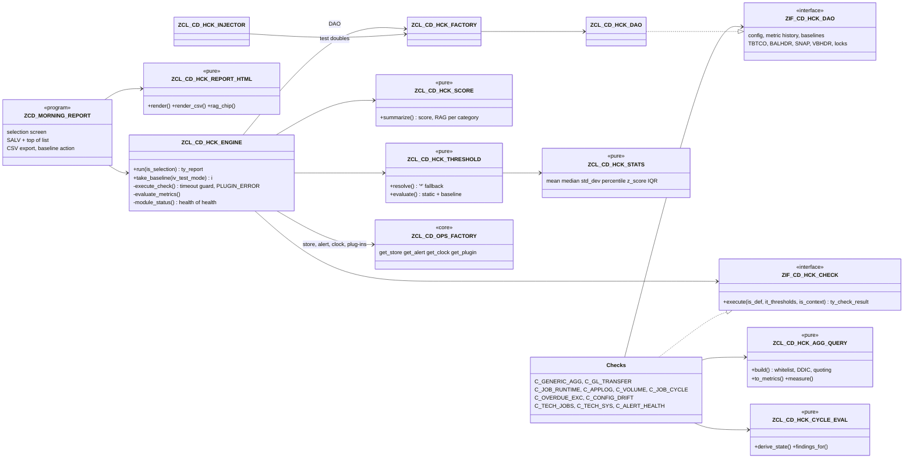
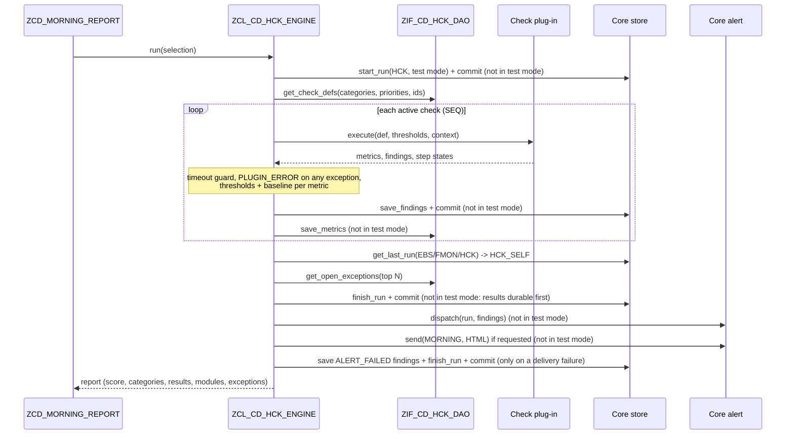

# Payment Engine Health Check & Morning Report

| | |
|---|---|
| **Module** | HCK — Health Check (operations suite) |
| **Program** | `ZCD_MORNING_REPORT` |
| **Landscape** | S/4HANA 2023, SAP_BASIS 7.58 — DV1 → QA1 → PS4 |
| **Status** | Built and lint-clean offline; **not yet activated or executed in an SAP system** |
| **Version** | 2026-11-05 — initial version (ops suite consolidation) |

---

# Part 1 — Business & Operations

## 1. What the morning report is

> **First principle:** before the first payment run of the day, someone must know — with evidence — whether yesterday's money movements completed and whether today's can start safely.
>
> **Analogy:** a pilot's pre-flight checklist: a fixed list, each item green or not, and nobody takes off on "probably fine".

The morning report is a daily scorecard of the **payment engine**. It runs a configured list of health checks, compares each measured value with its limits and with its own history, and produces:

- a **health score 0–100** and an overall **RAG** (red / amber / green);
- a **RAG per category** (A–E, below);
- the status of the other monitoring modules (bank statement validation **EBS**, file monitoring **FMON**, and the health check itself) — the "health of the health check";
- the list of **checks** with a one-line summary each, drill-down to the individual findings;
- the **oldest open exceptions** across all modules with their owner, due date and age.

It is sent by e-mail (mobile-friendly HTML) to the morning distribution list and is available in SAP (`ZCD_MORNING_REPORT`) with drill-down. Every red or amber finding becomes an **owned exception** with a due date in the shared exception store; nothing is "just a log line".

| Category | Business question | Examples |
|---|---|---|
| **A — Financial integrity** | Did the money and the books stay consistent? | Return debits older than 10 days per company code; reconciliation keys that never reached the general ledger |
| **B — Mass-run and job health** | Did the batch runs complete, on time, at normal speed? | Job duration vs its own history; error rate in the application log; payment-engine volumes per day; job cycles (payment request → wire/ACH/check → ACK → GL) |
| **C — Exception queues** | Is anything waiting too long for a human? | Owned exceptions past their due date; postprocessing backlog |
| **D — Configuration drift** | Did productive settings change outside a transport? | Hash of key customizing tables vs the approved baseline |
| **E — Technical health** | Is the platform under the payment engine healthy? | Cancelled / long-running / late jobs, short dumps, update errors, old locks, failed alert deliveries |

## 2. How to read the scorecard (RAG and score)

> **First principle:** a colour must always mean the same action, whoever reads it.
>
> **Analogy:** traffic lights — nobody negotiates what red means at a crossing.

| RAG | Meaning | Expected action |
|---|---|---|
| **GREEN** | Every measured value within its limits and its normal range | None — glance only |
| **AMBER** | A warning limit was reached, the value is unusual against its own history (baseline outlier), or a check ran longer than its time budget | Look today; decide whether it is timing or a real issue |
| **RED** | An error limit was reached, a check failed to run, a critical job step failed / was missed / is stuck | Act now; follow the triage playbook below and escalate if SLA-bound |
| **N/A (grey)** | Nothing was measured (category without active checks) | Ask whether the category should be monitored |

**Health score.** Each check scores 100 (green), 50 (amber) or 0 (red / not executed), weighted by priority (High 3, Medium 2, Low 1). Score ≥ 90 → GREEN, ≥ 70 → AMBER, below → RED. Two safety rules stop an average from hiding a failure: **any red High-priority check makes the whole day RED**, and **any red check makes the day at least AMBER**. Red checks are counted as *critical*, amber checks as *high*.

**Baseline outlier.** For volumes and durations, a fixed limit is not enough (month-end is busier than mid-month). The check compares today's value with its last runs (z-score or inter-quartile range): far outside the usual range → AMBER, even if no fixed limit was crossed.

## 3. Triage playbook per category

> **First principle:** check the effect, not the job status — a green job that posted nothing is still a problem.
>
> **Analogy:** a doctor reads the symptom first, then orders the test that confirms the cause — not every test for every patient.

| Finding (check code) | First look | Typical cause | Next step / escalation |
|---|---|---|---|
| **A** `THRESHOLD_*` on `RET_AGED` | Drill-down → company code with the count | Returns lot not processed, return reason not mapped, clarification backlog | Collections team: process returns (FP09 / clarification); confirm the returns file was fully loaded (FMON) |
| **A** `GL_TRANSFER_GAP` | Reconciliation key in the finding | Key not closed / transfer job not run / transfer error | Run or rerun the GL transfer for the key; check job `ZPOST_GL*` in the RECON_EOD cycle; Finance if month-end |
| **B** `BASELINE_OUTLIER` on `DURATION_MIN` | Job name, mean vs today | Volume spike, lock waits, DB contention, wrong variant | Compare volumes (B_VOLUME); check locks (E_SYSTEM); if the job is SLA-bound escalate to Basis |
| **B** `THRESHOLD_*` on `ERR_RATE_PCT` | Log object / subobject | Master-data errors in a mass run, interface errors | SLG1 for object/subobject and date; fix data; rerun the affected interval |
| **B** volume `BASELINE_OUTLIER` / `THRESHOLD_RED` (low) | Source / LOB, day | Missing inbound file, PRISM hold, source outage | FMON file status; confirm with the source system; do **not** start payment runs on partial input |
| **B** `STEP_FAILED` / `STEP_MISSED` / `STEP_STUCK` / `STEP_BLOCKED` | Cycle / step, job name | Cancelled job, Control-M did not trigger, predecessor failed | Control-M runbook: map Control-M name → SAP job → program + variant; fix predecessor first; rerun; list every downstream step to rerun |
| **C** `THRESHOLD_*` on `OVERDUE` | Module with overdue items | Exceptions not worked, owner absent | Owner's lead reassigns; waive only with a reason (audited) |
| **C** PPO backlog | Business process | Postprocessing not worked | Responsible team works the PPO queue |
| **D** `CONFIG_DRIFT` | Table name, baseline taker | Direct change in production, transport not baselined | Find the change (table change logs / transport); if approved, take a new baseline; if not, revert and raise a security incident |
| **D** `CONFIG_NO_BASELINE` | Table name | New table under control | Take the baseline after the next approved transport |
| **E** `JOB_CANCELLED` / `JOB_LATE_START` / `JOB_LONG_RUNNING` | Job name / count | Cancelled step, missing Control-M trigger, runaway job | SM37 job log; Basis if system-related |
| **E** `SHORT_DUMPS` / `UPDATE_ERRORS` / `LOCK_MAX_AGE_MIN` | Count / age | Program error, failed update task, orphan lock | ST22 / SM13 / SM12; Basis; never delete a lock held by an active payment run |
| **E** `ALERT_FAILED` | Channel | Mail server / webhook down | Alerts are not reaching people — treat as RED for operations |
| `HCK_SELF` `MODULE_STALE` | Module | Monitoring job (EBS, FMON or HCK) did not run | Restart the monitoring job; until then, nobody is watching that area |
| `PLUGIN_ERROR` / `AGG_CONFIG_INVALID` | Message text | Configuration error (unknown field, table not whitelisted) or program error | Fix the customizing row; the rest of the report is still valid |
| `TIMEOUT_OVERRUN` | Runtime vs budget | Check too slow for the volume | Performance review of the check (index, narrower window) |

Many "failures" are timing: if a behaviour is working as designed, record it as a *scheduling / configuration alignment opportunity*, not a defect.

## 4. Daily routine

> **First principle:** a report nobody owns is noise.
>
> **Analogy:** the morning stand-up of a ward — one list, one owner per bed, decisions recorded.

1. The scheduled run (Control-M → SAP job running `ZCD_MORNING_REPORT` with the productive variant) finishes before the first business payment cycle; the e-mail reaches the RTB distribution list.
2. The RTB analyst on duty reads the scorecard, works RED first, then AMBER, using §3.
3. Every RED/AMBER finding is already an owned exception (module HCK) with a due date; assign the owner the same morning.
4. Persistent false positives are a **threshold change** (customizing, §13) — never "ignore the colour".

---

# Part 2 — Technical

## 5. Architecture and class model

> **First principle:** checks measure, the engine judges — one place decides what is red, so every check is judged by the same rules.
>
> **Analogy:** laboratory analysers produce numbers; the reference ranges printed on the report come from one table, not from each machine.

Layering (development standards §3): interfaces → domain (pure rules, no SQL) → DAO (all SQL) → application (engine) → presentation (report, CDS).

**Run sequence.**

## 6. Tables

> **First principle:** configuration and evidence live in different tables — configuration is transported, evidence never is.
>
> **Analogy:** the recipe book travels between kitchens; the delivery notes stay in the kitchen that received the goods.

| Table | Class | Key | Purpose |
|---|---|---|---|
| `ZCD_HCK_DEF` | C | MANDT, CHECK_ID | Check catalog: category, class, active, SEQ, priority, PARAM1–4, package size, timeout |
| `ZCD_HCK_THRESH` | C | MANDT, CHECK_ID, METRIC, BUKRS | Amber/red limits, direction, baseline mode (NONE/ZSCORE/IQR), z limit / IQR k, lookback; `*` default rows |
| `ZCD_HCK_AGG` | C | MANDT, CHECK_ID, AGG_ID | Generic COUNT/SUM: table, date field + mode (AGE/DAY) + days, group field, 3 conditions |
| `ZCD_HCK_TABWL` | C | MANDT, TABNAME | Tables the generic aggregate may read (security boundary, with approver) |
| `ZCD_HCK_DRIFT` | C | MANDT, TABNAME | Tables under configuration-drift control |
| `ZCD_JOB_CYCLE` | C | MANDT, CYCLE_ID | Cycle header: text, factory calendar, active |
| `ZCD_JOB_STEP` | C | MANDT, CYCLE_ID, STEP_NO | Job name pattern, program, variant, predecessor, day offset, start window, max runtime, skippable, critical |
| `ZCD_HCK_METRIC` | A | MANDT, RUN_ID, CHECK_ID, METRIC, DIM1, DIM2 | Metric history for baselines, trends, dashboard. Index `HST` (CHECK_ID, METRIC, DIM1, MEASURED_AT), `TIM` (MEASURED_AT) |
| `ZCD_HCK_BASELINE` | A | MANDT, TABNAME | Golden baseline hash, row count, taken at / by (per system, never transported) |
| Core `ZCD_OPS_RUN` / `ZCD_OPS_FINDING` / `ZCD_OPS_PARAM` | A / A / C | — | Run header, findings / owned exceptions, parameters (read and written only through the core store; HCK DAO only *reads* findings for the exception queue) |
| Core `ZCD_OPS_ALERT_LOG` | A | — | Read by `E_ALERT_DELIVERY` (delivered by the core alert router) |

Every HCK finding: module `HCK`, `OBJECT_TYPE = 'CHECK'`, `GROUP1` = category, `GROUP2` = check id. Severity B/E/W → owned exception with SLA (`SLA_DAYS_HCK_<sev>`).

## 7. Check catalog

> **First principle:** a check is a measurement plus a list of itemised problems; whether it is red is configuration.
>
> **Analogy:** a thermometer does not decide you have a fever — the threshold on the chart does.

| Class | Cat. | Parameters | Metrics (DIM1 / DIM2) | Own findings |
|---|---|---|---|---|
| `ZCL_CD_HCK_C_GENERIC_AGG` | A, C (any) | rows in ZCD_HCK_AGG | `<AGG_ID>` per group value (e.g. company code) | `AGG_CONFIG_INVALID` per invalid row |
| `ZCL_CD_HCK_C_GL_TRANSFER` | A | P1 lag days (1), P2 window days (7), P3 max keys (500) | `GL_MISSING_KEYS` (*) | `GL_TRANSFER_GAP` per reconciliation key (E) |
| `ZCL_CD_HCK_C_JOB_RUNTIME` | B | P1 job patterns, P2 day offset (1) | `DURATION_MIN` (job / job count) | — (baseline per job via thresholds) |
| `ZCL_CD_HCK_C_APPLOG` | B | P1 log objects, P2 subobjects, P3 day offset (1) | `ERR_RATE_PCT`, `ERR_MESSAGES` (object/subobject / day) | — |
| `ZCL_CD_HCK_C_VOLUME` | B | P1 offset (1), P2 days (1); rows in ZCD_HCK_AGG | `<AGG_ID>` per source/LOB / day | `AGG_CONFIG_INVALID` |
| `ZCL_CD_HCK_C_JOB_CYCLE` | B | P1 cycle date offset (0), P2 cycle ids | `STEPS_NOT_OK`, `STEPS_COMPLETED` (cycle / date) + step board | `STEP_MISSED/FAILED/STUCK/OVERRUN/BLOCKED` |
| `ZCL_CD_HCK_C_OVERDUE_EXC` | C | — | `OVERDUE`, `OLDEST_OVERDUE_DAYS` (module) | — |
| `ZCL_CD_HCK_C_CONFIG_DRIFT` | D | rows in ZCD_HCK_DRIFT | `DRIFTED_TABLES` (*) | `CONFIG_DRIFT` (E), `CONFIG_NO_BASELINE` (W) |
| `ZCL_CD_HCK_C_TECH_JOBS` | E | P1 job patterns, P2 long-running min (120), P3 grace min (30) | `CANCELLED`, `LONG_RUNNING`, `LATE_START` (*) | `JOB_CANCELLED` (E), `JOB_LONG_RUNNING`, `JOB_LATE_START` (W) |
| `ZCL_CD_HCK_C_TECH_SYS` | E | — | `SHORT_DUMPS`, `UPDATE_ERRORS`, `LOCK_ENTRIES`, `LOCK_MAX_AGE_MIN` (*) | — |
| `ZCL_CD_HCK_C_ALERT_HEALTH` | E | P1 window hours (24) | `ALERT_FAILED`, `ALERT_THROTTLED` (channel) | — |
| built-in `HCK_SELF` | E | `HCK_WATCH_MODULES`, `HCK_MAX_AGE_HOURS`, `HCK_MAX_AGE_H_<module>` | — | `MODULE_STALE` (E) |

Engine findings for every check: `THRESHOLD_RED` (E), `THRESHOLD_AMBER` (W), `BASELINE_OUTLIER` (W), `TIMEOUT_OVERRUN` (W), `PLUGIN_ERROR` (E), `ALERT_FAILED` (W).

## 8. Thresholds and baselines

> **First principle:** a limit is either absolute (policy) or relative to the metric's own history (normality) — the table says which.
>
> **Analogy:** a speed limit vs "you usually drive this road at 40, today you did 90".

- Resolution: (metric, company code) → (metric, `*`) → (`*`, `*`). DIM1 is used as the company-code key only when it has ≤ 4 characters; job names and log objects use the `*` row.
- Static: higher-is-worse → value ≥ red = RED, ≥ amber = AMBER, zero limit = not set. Lower-is-worse → value ≤ red = RED, ≤ amber = AMBER; both zero = off.
- Baseline: history = last `LOOKBACK_RUNS` values of the same check/metric/DIM1 (default `HCK_LOOKBACK_RUNS` = 8), at least 3 points. ZSCORE: z ≥ `Z_LIMIT` (default 3; ≤ −limit when lower is worse). IQR: beyond Q3 + k·IQR (or Q1 − k·IQR), k = `Z_LIMIT` (default 1.5). Outlier → AMBER when static limits are green.
- Statistics are sample statistics (n−1), percentiles interpolate linearly (`ZCL_CD_HCK_STATS`).

## 9. Job cycle monitor (Control-M fallback, monitoring only)

> **First principle:** a chain is healthy only when every link ran, in order, inside its window.
>
> **Analogy:** a relay race — a fast runner is useless if the baton was never handed over.

Per step (`ZCL_CD_HCK_CYCLE_EVAL`): step date = cycle date + `DAY_OFFSET`. The step's instance is the earliest TBTCO job matching the `JOBNAME` pattern that started on the step date at or after `WINDOW_FROM`.

| State | Rule |
|---|---|
| `COMPLETED` | Instance finished (F); overrun flag when runtime > `MAX_RUNTIME_MIN` |
| `FAILED` | Instance cancelled (A) |
| `RUNNING` | Instance active (R) within `MAX_RUNTIME_MIN` |
| `STUCK` | Instance active beyond `MAX_RUNTIME_MIN` |
| `NOT_STARTED` | No started instance and `WINDOW_TO` not yet passed; *blocked* when the predecessor is FAILED/MISSED/STUCK |
| `MISSED` | No started instance and `WINDOW_TO` passed |

Findings: MISSED → E if critical, I if skippable, else W; FAILED → E if critical else W; STUCK → E; overrun → W; blocked → W. Non-working days of the cycle's factory calendar are skipped. **Retrigger / restart from SAP, outage mode and Control-M divergence detection are a later phase** — this release only monitors. Repeating schedules (every 5 min / hourly) are watched by `E_JOBS`; a cycle step models one expected instance.

## 10. Generic aggregate security

> **First principle:** customizing may choose *what* to count, never *how* SQL is written.
>
> **Analogy:** a vending machine — you press numbered buttons; you cannot reach inside.

`ZCL_CD_HCK_AGG_QUERY=>build` (pure, unit-tested): the table must be active in `ZCD_HCK_TABWL` (message 302); field names (sum, date, group, conditions) must exist in the runtime DDIC of that table (`describe_by_name` + `get_ddic_field_list`, classic EXCEPTIONS; 303/304); operators only EQ NE GT LT GE LE IN (305); character literals are quoted with `cl_abap_dyn_prg=>quote` (inner quotes doubled), numeric literals must match a number pattern (306); date fields must be DATS (309); SUM needs a numeric field (318). The DAO executes the validated query (COUNT/SUM, optional GROUP BY, max 5 000 groups) and maps database errors to message 308.

## 11. Dashboard CDS layer (embedded analytics)

> **First principle:** the dashboard reads the same store the report writes — one truth, two views.
>
> **Analogy:** the scoreboard and the referee's notebook record the same match.

Sources in `cds/` (ADT text sources; release-dependent annotations marked *verify on target release*):

| View | Type | Content |
|---|---|---|
| `ZI_CD_OpsRun` | basic | Run headers (all modules), `RunDate` |
| `ZI_CD_OpsRunCube` / `ZC_CD_OpsRunQry` | cube / query | Runs, red runs, findings, runtime (sum, max, average formula) per module/day |
| `ZI_CD_OpsFinding` | basic | Findings / owned exceptions with `IsOverdue`, `DaysPastDue`, `CreatedDate` |
| `ZI_CD_OpsFindingCube` / `ZC_CD_OpsFindingQry` | cube / query | Finding, open, overdue counts, max days past due, amount per module/category/check/severity/owner |
| `ZI_CD_HckCheck` | dimension | Check text, category, priority |
| `ZI_CD_HckMetric` / `ZI_CD_HckMetricCube` / `ZC_CD_HckMetricQry` | basic / cube / query | Metric trend (volumes per source/LOB per day, durations, error rates) |
| `ZI_CD_OpsAnalytics` (DCL) | role | `pfcg_auth( ZCD_OPS, ZCD_MODULE, ACTVT = '03' )` on basic views and cubes — authorization object `ZCD_OPS` must be created (SU21) |

Amounts are DEC without currency reference: always slice by `Currency` before reading totals. Recommended consumption: Fiori "Analytical List Page" / KPI tiles or Analysis for Office on the three queries; test mode runs are filtered out of the run cube and filterable in the findings query.

## 12. Morning report program

> **First principle:** the program presents; it never decides.
>
> **Analogy:** the newsreader reads the bulletin, the newsroom writes it.

Selection screen (maintain selection texts / text symbols):

| Element | Text |
|---|---|
| TEXT-B01 | Report date |
| TEXT-B02 | Scope |
| TEXT-B03 | Output |
| TEXT-B04 | Administration |
| P_TODAY / P_YDAY / P_CUST / P_DATE | Today / Yesterday / Custom date / Report date |
| S_CAT / S_PRIO / S_CHECK | Category (A–E) / Priority (H, M, L) / Check ID |
| P_MODS | Include EBS / FMON / HCK module status |
| P_TEST | Test mode (nothing saved, no mail) — default ON for dialog use |
| P_MAIL | Send morning report e-mail (route MORNING) |
| P_EXC | Show open exceptions list |
| P_EXP / P_FILE | Export CSV to application server / file path (AUTHORITY_CHECK_DATASET) |
| P_BASE | Take configuration baseline (S_TABU_NAM 02 on ZCD_HCK_BASELINE) |

Output: SALV with a scorecard header (score, RAG, red/amber counts, mode, RAG per category, module status), exception-column lights, double-click → findings popup (job-cycle checks show the step board; checks without findings show their metrics); then the open-exception list. In background both lists go to the spool. Schedule with a variant `P_TEST = space`, `P_MAIL = X`.

## 13. Extension guide — customizing only

> **First principle:** a new question about the payment engine costs table rows, not a transport of code.
>
> **Analogy:** a railway signal box — routes are set on the panel, the track is not re-laid.

| Change | Rows to add (SM30, DV1 → QA1 → PS4) |
|---|---|
| **New aggregate check** (e.g. acceptance test 1, return debits > 10 days by company code) | `ZCD_HCK_TABWL` (table, approver) → `ZCD_HCK_AGG` (CHECK_ID, AGG_ID, table, COUNT/SUM, date field, `AGE`, days, group field, conditions) → `ZCD_HCK_DEF` (CHECK_ID, category, `ZCL_CD_HCK_C_GENERIC_AGG`, active, SEQ, priority) → `ZCD_HCK_THRESH` (`*` row, optional company-code rows). See `config/hck_seed.md` §4. |
| **New threshold / company-code override** | One `ZCD_HCK_THRESH` row with the company code in `BUKRS` (the `*` row stays the default) |
| **Switch a metric to baseline detection** | `ZCD_HCK_THRESH-BASELINE_MODE` = `ZSCORE` or `IQR`, `Z_LIMIT`, `LOOKBACK_RUNS` |
| **New job-cycle step** (acceptance test 5) | One `ZCD_JOB_STEP` row: job pattern, predecessor, day offset, window, max runtime, critical/skippable |
| **New job cycle** | `ZCD_JOB_CYCLE` row + steps; it is picked up by `B_CYCLE_*` (PARAM2 blank = all cycles) |
| **New volume source / LOB** | `ZCD_HCK_TABWL` + `ZCD_HCK_AGG` row under `B_VOLUME` (DAY mode set by the check; group field = source/LOB) + optional threshold |
| **New SLG1 object** | Extend `PARAM1` of `B_APPLOG` |
| **New table under drift control** | `ZCD_HCK_DRIFT` row, then take a baseline |
| **Watch another module** | `ZCD_OPS_PARAM` `HCK_WATCH_MODULES`, optional `HCK_MAX_AGE_H_<module>` |
| **Who is alerted** | Core `ZCD_OPS_ALERT_RULE` (module HCK, severity, group/check pattern, channel) — not an HCK table |
| New check *logic* (only when no existing class fits) | New class implementing `ZIF_CD_HCK_CHECK` (only SQL via a DAO method), then a `ZCD_HCK_DEF` row |

Acceptance test 4 of the master prompt (statement balance rule) belongs to the EBS module's rule tables; for HCK the equivalent proof is that limits and rules are rows in `ZCD_HCK_THRESH` / `ZCD_HCK_AGG` (QA1 case HCK-QA-04).

## 14. Testing

> **First principle:** pure rules are proven without a database; glue is proven in QA1 with real data.
>
> **Analogy:** test the recipe on paper, then taste the dish in the real kitchen.

ABAP Unit (RISK LEVEL HARMLESS, DURATION SHORT; pure classes without doubles; engine with `LTD_*` doubles through `ZCL_CD_HCK_INJECTOR` and `ZCL_CD_OPS_INJECTOR`; DAO with `cl_osql_test_environment`):

| Test class (local) | Class under test | Test methods |
|---|---|---|
| `ltc_stats` | `ZCL_CD_HCK_STATS` | mean_of_empty_is_zero, single_value_zero_stddev, mean_of_known_series, median_even_count_averages, median_odd_count_is_middle, sample_stddev_known_series, percentile_interpolates, zscore_measures_distance, zscore_zero_without_spread, iqr_flags_high_outlier, iqr_keeps_inner_value, iqr_low_side_when_lower_bad |
| `ltc_threshold` | `ZCL_CD_HCK_THRESHOLD` | bukrs_row_beats_star_row, star_row_without_bukrs_row, unknown_metric_no_threshold, red_when_value_reaches_red, amber_between_amber_and_red, green_below_amber, lower_worse_red_at_zero, zero_red_disabled_when_higher, zscore_outlier_turns_amber, short_history_no_baseline, iqr_outlier_turns_amber |
| `ltc_score` | `ZCL_CD_HCK_SCORE` | all_green_scores_hundred, red_high_forces_red, score_weighted_by_priority, category_takes_worst_rag, no_results_grey_zero, red_counts_critical |
| `ltc_cycle_eval` | `ZCL_CD_HCK_CYCLE_EVAL` | no_run_before_window_end, no_run_after_window_missed, active_job_is_running, stuck_step_after_max_runtime, finished_job_is_completed, slow_finish_flags_overrun, cancelled_job_is_failed, failed_pred_blocks_step, critical_missed_is_error, skippable_missed_is_info, completed_step_no_finding |
| `ltc_agg_query` | `ZCL_CD_HCK_AGG_QUERY` | builds_aging_where, rejects_unlisted_table, rejects_unknown_field, rejects_unknown_operator, rejects_text_numeric_field, rejects_non_date_age_field, rejects_sum_on_text_field, escapes_quote_in_literal, in_list_quotes_each_value, day_mode_compares_one_date, no_rows_give_star_zero, group_rows_become_dims |
| `ltc_report_html` | `ZCL_CD_HCK_REPORT_HTML` | escapes_markup_in_values, red_chip_label_and_colour, green_chip_label_and_colour, grey_chip_for_unknown_rag, empty_exceptions_say_none, category_row_has_chip, csv_quotes_and_neutralises |
| `ltc_param` | `ZCL_CD_HCK_PARAM` | star_pattern_becomes_cp, blank_list_gives_no_range, text_int_uses_default |
| `ltc_engine` | `ZCL_CD_HCK_ENGINE` | all_green_scores_hundred, red_metric_turns_check_red, failed_plugin_does_not_abort, timeout_overrun_is_flagged, test_mode_saves_nothing, real_run_persists_dispatches, mail_goes_to_morning_route, stale_module_fails_self, category_rag_and_score |
| `ltc_dao` | `ZCL_CD_HCK_DAO` | history_newest_first_capped, history_only_same_dimension, saved_metric_is_read_back, overdue_open_and_assigned |

**Deliberately not unit tested**

| Object | Reason | Covered instead by |
|---|---|---|
| DAO reads of TBTCO, BALHDR, SNAP_BEG, VBHDR, DFKKSUMC/DFKKKO/BKPF; `ENQUEUE_READ`; `DATE_CONVERT_TO_FACTORYDATE`; `get_table_fields` (RTTI) | Thin wrappers over SAP standard tables / FMs with unverified fields; doubling them proves only the double | QA1 cases HCK-QA-06…10; the logic consuming their output is unit-tested (cycle eval, threshold, agg query) |
| DAO `aggregate` and `compute_table_hash` (dynamic SQL on arbitrary tables) | Dynamic FROM on non-doubled tables; the SQL text is built and tested in the pure builder | `ltc_agg_query`; QA1 HCK-QA-01, HCK-QA-05 |
| Check plug-ins `ZCL_CD_HCK_C_*` | Glue: parameter → DAO → pure helper; no own rules | Pure tests of `agg_query`, `cycle_eval`, `param`; engine tests through LTD plug-ins; QA1 cases |
| `ZCL_CD_HCK_ENGINE=>take_baseline` | AUTHORITY-CHECK + DAO wrapper | QA1 HCK-QA-05 |
| `ZCD_MORNING_REPORT` (SALV, OPEN DATASET) | Presentation only | QA1 HCK-QA-11 |
| E-mail delivery (core `send` / `dispatch`, BCS) | Core module | Engine tests assert the calls; QA1 HCK-QA-12 |
| CDS views and DCL | Not executable offline | QA1 HCK-QA-13 (data preview / RSRT) |

**Recommended QA1 functional test cases**

| ID | Scenario | Configuration | Expected result |
|---|---|---|---|
| HCK-QA-01 | **Acceptance test 1**: add "return debits aging > 10 days by company code" by customizing only | Seed §4 rows: TABWL `DFKKOP`, AGG `A_RET_AGED/RET_AGED`, DEF `A_RET_AGED`, THRESH `*` 1/25 + one company-code row; test data: open return-debit items due 11+ days ago in two company codes | Report shows `A_RET_AGED` with one metric per company code; the company with ≥ 25 items is RED with `THRESHOLD_RED`; the override company uses its own limits; no transport of code objects |
| HCK-QA-02 | Invalid aggregate row is contained | AGG row with a misspelled field / table not whitelisted | `AGG_CONFIG_INVALID` (messages 304 / 302) for that row; other rows and checks still measured |
| HCK-QA-03 | Plug-in failure does not abort | `ZCD_HCK_DEF` row with a non-existent class name | That check RED with `PLUGIN_ERROR` (message 030/300); report complete |
| HCK-QA-04 | **Acceptance test 4 (HCK counterpart)**: change a rule / limit by customizing only | Change `ZCD_HCK_THRESH` `C_OVERDUE_EXC/OVERDUE/*` red from 20 to 1; next run | Same data now RED; no code change. (The statement-balance rule of test 4 itself is proven in the EBS module.) |
| HCK-QA-05 | Config drift and baseline | Take baseline (P_BASE), change one row of `ZCD_HCK_THRESH` in QA1, run | `D_CONFIG_DRIFT` RED with `CONFIG_DRIFT` naming the table, baseline time and user; re-baseline → GREEN; user without S_TABU_NAM 02 gets message 041 |
| HCK-QA-06 | **Acceptance test 5**: add a job-cycle step by customizing only | Insert `ZCD_JOB_STEP DISB_DAY/035` (seed §7) | Next run's `B_CYCLE_TODAY` drill-down lists step 035 with its state |
| HCK-QA-07 | Job-cycle states | Schedule a test job matching a step pattern: (a) cancel it, (b) let it exceed MAX_RUNTIME_MIN, (c) never schedule it and wait past WINDOW_TO, (d) cancel the predecessor | (a) FAILED, (b) STUCK, (c) MISSED (E if critical), (d) successor NOT_STARTED + `STEP_BLOCKED` |
| HCK-QA-08 | Technical checks | Cancel a `ZCD_*` test job; create a lock older than 60 min; force a short dump | `E_JOBS` `JOB_CANCELLED`; `E_SYSTEM` LOCK_MAX_AGE_MIN amber; SHORT_DUMPS ≥ 1 |
| HCK-QA-09 | Baseline outlier | Run `B_JOB_RUNTIME` daily ≥ 3 days, then slow one job artificially | `BASELINE_OUTLIER` (AMBER) with mean and z in the message |
| HCK-QA-10 | GL transfer completeness | Reconciliation key with totals records and no GL transfer in the window | `GL_TRANSFER_GAP` per key; metric GL_MISSING_KEYS |
| HCK-QA-11 | Report in dialog and background | Run interactively in test mode; then as background job with productive variant and CSV export | Dialog: scorecard + ALV + drill-downs, nothing saved; background: spool lists, ZCD_OPS_RUN/FINDING rows, ZCD_HCK_METRIC rows, CSV file on the application server |
| HCK-QA-12 | Mail and alerts | ALERT_MORNING maintained; P_MAIL = X; one red finding | One HTML mail (renders on phone and desktop, RAG chips); core `dispatch` logs to ZCD_OPS_ALERT_LOG per alert rule; test mode sends nothing |
| HCK-QA-13 | Dashboard | Activate CDS + DCL, role with ZCD_OPS ZCD_MODULE = HCK only | Queries return HCK data only; run, finding and metric trends consistent with the morning report |
| HCK-QA-14 | Health of the health check | Suspend the EBS validation job for > 26 h | `HCK_SELF` RED with `MODULE_STALE` for EBS |

## 15. VERIFY-DDIC register and what is not verified

> **First principle:** say what you checked; everything else is a hypothesis.
>
> **Analogy:** a surveyor marks which boundary stones were found on site and which were copied from an old map.

`"VERIFY-DDIC:` markers (all in `ZCL_CD_HCK_DAO`):

1. `TBTCO`-JOBNAME, JOBCOUNT, STATUS, SDLSTRTDT, SDLSTRTTM, STRTDATE, STRTTIME, ENDDATE, ENDTIME (`get_job_runs`)
2. `BALHDR`-OBJECT, SUBOBJECT, ALDATE, MSG_CNT_AL, MSG_CNT_E, MSG_CNT_A (`get_applog_stats`)
3. `DFKKKO`-BUDAT (`get_fikeys_without_gl`)
4. `BKPF`-AWKEY carries the FIKEY of the FI-CA transfer (confirmed path names BSEG-AWKEY; BKPF chosen for its AWTYP/AWKEY index) (`get_fikeys_without_gl`)
5. `SNAP_BEG`-DATUM (else SNAP with SEQNO = '000') (`count_short_dumps`)
6. `VBHDR`-VBRC <> 0 = update request in error (`count_update_errors`)
7. `SEQG3`-GTDATE / GTTIME (`read_lock_stats`)

Seed-only (customizing, validated at runtime against the DDIC): DFKKOP-FAEDN/AUGST/HVORG/BUKRS/BETRH, FEBKO-AZDAT and format field, ZCD_PAYM_REQ_LOG date/source fields, /SAPPO/ORDER_HDR fields, return-debit main transactions, log objects, factory calendars, real SAP job names behind the wiki placeholders.

Not verified (offline build): activation, DDIC existence, ABAP Unit execution, CDS/DCL syntax on 2023 (release-dependent annotations marked), FM interfaces (`ENQUEUE_READ`, `DATE_CONVERT_TO_FACTORYDATE`, `AUTHORITY_CHECK_DATASET`), dynamic SQL behaviour for SUM into DECFLOAT34, BKPF-AWKEY vs FIKEY length comparison, performance at 10M+ open items (the aging aggregate on DFKKOP needs an index on the date/clearing fields or a narrower condition — performance test phase). Timeouts are measured, not enforced: a synchronous check cannot be killed (parallel aRFC with a server-group time-out is the later option).

## 16. Design decisions and the legacy morning report

> **First principle:** keep the ideas that served the operators; remove the mechanisms that put the system at risk.
>
> **Analogy:** renovating a house — keep the floor plan people know, replace the wiring.

**Kept from the existing morning report:** rule categories (now A–E), priority filter (H/M/L) and check-id filter, overall health score (now 0–100, priority-weighted, with the "red High forces RED" rule), critical / high counts, e-mail of the result, export (CSV on the application server), the quick date window (today / yesterday / custom) and the application-log error analysis (now aggregated from BALHDR counters instead of loading every message).

**Dropped defects:** free-text dynamic SQL and a regex "SQL security validator" (replaced by whitelist + DDIC-validated names + quoted literals), WRITE lists (SALV + HTML), invented tables (only core and HCK tables plus standard tables marked VERIFY-DDIC), placeholder e-mail/export that never sent or wrote, mail only when "critical", `SELECT *`, missing test mode.

**Changes vs the build brief:** `ZCD_HCK_AGG` keyed by CHECK_ID **+ AGG_ID** (one check holds several aggregates — volumes) and a `DATE_MODE` (AGE/DAY); `ZCD_HCK_DEF-ROUTE` removed — alert routing is now core customizing `ZCD_OPS_ALERT_RULE` via `dispatch( )`, the morning mail is a deliberate `send( 'MORNING' )`; `ZCD_JOB_STEP-DAY_OFFSET` added (cycles crossing midnight, e.g. BlackLine at 02:00); check interface gets an execution context (report date, now, test mode); pure rule classes split out (`SCORE`, `CYCLE_EVAL`, `AGG_QUERY`, `PARAM`) so they are tested without doubles; overdue exceptions include disposition A (assigned) as well as O; empty aggregates measure 0 under `*` so a silent feed is visible; DIM1 longer than 4 characters uses the `*` threshold row instead of being truncated; new check `E_ALERT_DELIVERY` reads `ZCD_OPS_ALERT_LOG`.
