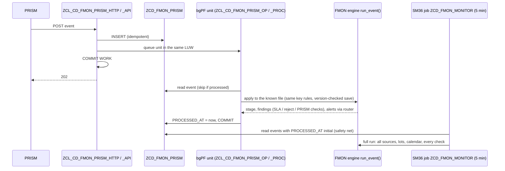

# PRISM status API — contract, processing, security

> **First principle:** SAP can only prove a hand-off it has evidence for. PRISM is the only party that sees a file arrive and leave the middleware, so PRISM tells SAP, with its own timestamps, and SAP records it — nothing else.
> **Analogy:** a courier scanning a parcel at the depot door and again at the customer's door — the sender's tracking page shows the courier's scans with the courier's times, and the scans never change the parcel.

Status 2026-11-06: **built, lint-clean, ABAP Unit not executed, switched off.** The ICF node is not delivered by abapGit and stays inactive until CAB approves the integration (§10). Decision: user, 2026-11-06 — *"We need to provide an API to PRISM which they can call once they receive a file and have processed it."* Style: plain REST JSON over HTTPS to an ICF service (no OData, no CSRF token).

## 1. Operating boundary

The requirements baseline lists *new payment APIs or callbacks* as outside the read-only rollout. This API is therefore **its own approved change**, separate from the read-only release:

| It does | It never does |
|---|---|
| Store one PRISM milestone per call in the suite's own table `ZCD_FMON_PRISM` | Touch business data (payment requests, documents, DPAYH, DFKK*, FEB*) |
| Apply the milestone to the FMON file register (`ZCD_FMON_FILE` / `ZCD_FMON_EVENT`) and write findings to `ZCD_OPS_FINDING` | Change, move, resend or delete a payment file |
| Hand findings to the suite's alert router | Start, stop or rerun a job; change routing or a source-system contract |

The background unit it queues is suite-internal processing (FMON evaluation of one file), not a business job.

## 2. Endpoint

| Item | Value |
|---|---|
| Method / path | `POST /sap/zcd_ops/prism_status` (SICF: `default_host` → `sap` → `zcd_ops` → `prism_status`) — VERIFY with Basis that a customer node directly below `/sap` is allowed in the landscape; fallback `/sap/bc/zcd_ops/prism_status` |
| URL | `https://<PS4 web dispatcher host>:<port>/sap/zcd_ops/prism_status?sap-client=<client>` |
| Request headers | `Content-Type: application/json` (charset, if sent, must be `utf-8`), `Authorization` (basic) or client certificate (§9) |
| CSRF | none — machine-to-machine call of a technical user; no session, no cookies |
| Calls | **one event per call**; the body is one JSON object (an array is refused) |
| Handler | `ZCL_CD_FMON_PRISM_HTTP` (IF_HTTP_EXTENSION) → `ZCL_CD_FMON_PRISM_API` |
| Size limit | `ZCD_OPS_PARAM` `FMON_PRISM_MAX_BYTES`, default 16384 bytes (413 above) |

## 3. Request

| Member | Type | Required | Rule | Stored as |
|---|---|---|---|---|
| `eventId` | string ≤ 64 | **yes** | PRISM's unique ID of this event; letters, digits, `. _ : -`; the **idempotency key** — a retry sends the same ID | `EVENT_ID` (key) |
| `fileReference` | string ≤ 255 | **yes** | The reference FMON keys the flow by: the file name SAP generated (outbound) / PRISM delivers (inbound), or the message / request reference of an API flow (§8); no control characters | `FILE_REF` |
| `interfaceId` | string ≤ 20 | no | FMON interface (`ZCD_FMON_IFACE`), upper case `A-Z 0-9 _`; when sent it selects the interface, otherwise FMON matches the name pattern | `IFACE_ID` |
| `direction` | `OUTBOUND` \| `INBOUND` | **yes** | Outbound = SAP → PRISM → bank / IRIS / target; inbound = bank / IRIS / source → PRISM → SAP (case-insensitive) | `DIRECTION` (`O` / `I`) |
| `milestone` | `RECEIVED` \| `DELIVERED` \| `FAILED` | **yes** | RECEIVED = PRISM received the file (from SAP, or from bank / IRIS / source); DELIVERED = PRISM delivered it (to bank / IRIS / target, or to SAP); FAILED = PRISM could not process or deliver it | `MILESTONE` |
| `occurredAt` | string | **yes** | ISO 8601 **UTC**: `YYYY-MM-DDThh:mm:ss[.f{1,7}]Z` or `+00:00`; not more than 15 minutes after the SAP clock | `OCCURRED_AT` (UTC) |
| `counterparty` | string ≤ 20 | no (recommended) | Any system code PRISM exchanges with — bank (`PNC`, `JPMC`, `BOA`), `IRIS`, `BLACKLINE`, `OFSAA`, `STRIPE`, `BRIDGER`, `KESTREL`, source codes (`PCLM`, `ORCI`, …). Format only (letters, digits, `. _ : -`, upper-cased); no closed list, so a new partner needs no SAP change | `COUNTERPARTY` |
| `prismReference` | string ≤ 64 | no | PRISM's own transfer / message ID (for the PRISM console) | `PRISM_REF` |
| `recordCount` | integer ≥ 0 | no | Records PRISM counted | `RECORD_COUNT`, `COUNT_SENT` = X |
| `controlTotal` | number or string, 2 decimals | no | Requires `currency` | `CONTROL_TOTAL` |
| `currency` | string, ISO 4217 | with `controlTotal` | `[A-Z]{3}` (upper-cased) | `CURRENCY` |
| `errorCode` | string ≤ 20 | no (recommended with FAILED) | PRISM's error code | `ERROR_CODE` |
| `errorText` | string | no | Masked (every run of 8+ digits keeps its last 4: `****1234`), control characters replaced, **truncated** to 255 — never rejected for its length. **Must not carry member, bank-account or card data**; the masking is a safety net, not a licence | `ERROR_TEXT` |

Unknown members are ignored (forward compatible). A member sent twice, or a known member sent as an object / array, is a 400. `null` counts as absent. SAP adds `BUSINESS_DATE` (occurredAt in `FMON_TIME_ZONE` — the same rule the FMON adapter applies, so the stored date is the date FMON correlates with), `RECEIVED_AT` (UTC), `RECEIVED_BY` (technical user) and later `PROCESSED_AT`.

PRISM's `recordCount` / `controlTotal` are stored as evidence (dashboard, trace); they are **not** written into the file's control figures — SAP's own generation / load evidence stays authoritative (the seed maps no COUNT / AMOUNT field).

JSON Schema (draft 2020-12):

```json
{
  "$schema": "https://json-schema.org/draft/2020-12/schema",
  "title": "PRISM status event",
  "type": "object",
  "required": ["eventId", "fileReference", "direction", "milestone", "occurredAt"],
  "properties": {
    "eventId":        {"type": "string", "maxLength": 64, "pattern": "^[A-Za-z0-9._:\\-]+$"},
    "fileReference":  {"type": "string", "maxLength": 255},
    "interfaceId":    {"type": "string", "maxLength": 20, "pattern": "^[A-Za-z0-9_]+$"},
    "direction":      {"enum": ["OUTBOUND", "INBOUND"]},
    "milestone":      {"enum": ["RECEIVED", "DELIVERED", "FAILED"]},
    "occurredAt":     {"type": "string", "pattern": "^\\d{4}-\\d{2}-\\d{2}T\\d{2}:\\d{2}:\\d{2}(\\.\\d{1,7})?(Z|\\+00:00)$"},
    "counterparty":   {"type": "string", "maxLength": 20, "pattern": "^[A-Za-z0-9._:\\-]+$"},
    "prismReference": {"type": "string", "maxLength": 64},
    "recordCount":    {"type": "integer", "minimum": 0, "maximum": 2147483647},
    "controlTotal":   {"type": ["number", "string"], "pattern": "^-?\\d{1,21}(\\.\\d{1,2})?$"},
    "currency":       {"type": "string", "pattern": "^[A-Za-z]{3}$"},
    "errorCode":      {"type": "string", "maxLength": 20},
    "errorText":      {"type": "string"}
  },
  "dependentRequired": {"controlTotal": ["currency"]}
}
```

### Examples

Outbound — PRISM received an ACH file from SAP:

```json
{"eventId":"PRSM-20261106-000123","fileReference":"ACH_PNC_20261106_01.txt","interfaceId":"ACH_PNC_DISB_OUT",
 "direction":"OUTBOUND","milestone":"RECEIVED","occurredAt":"2026-11-06T22:05:13.250Z","counterparty":"PNC",
 "prismReference":"MFT-88412","recordCount":1250,"controlTotal":"184220.17","currency":"USD"}
```

Outbound — delivered to the bank / failed:

```json
{"eventId":"PRSM-20261106-000124","fileReference":"ACH_PNC_20261106_01.txt","direction":"OUTBOUND",
 "milestone":"DELIVERED","occurredAt":"2026-11-06T22:06:40Z","counterparty":"PNC","prismReference":"MFT-88412"}
{"eventId":"PRSM-20261106-000125","fileReference":"WIRE_JPMC_20261106_03.xml","direction":"OUTBOUND",
 "milestone":"FAILED","occurredAt":"2026-11-06T18:31:02Z","counterparty":"JPMC","errorCode":"SFTP-421",
 "errorText":"Remote host refused connection after 3 attempts"}
```

Inbound — a BAI2 statement received from JPMC and delivered to SAP:

```json
{"eventId":"PRSM-20261106-000200","fileReference":"BAI_JPMC_20261106.txt","direction":"INBOUND",
 "milestone":"DELIVERED","occurredAt":"2026-11-06T13:12:00Z","counterparty":"JPMC"}
```

API flow — a Bridger screening request (keyed by the request reference, interface named explicitly):

```json
{"eventId":"PRSM-20261106-009001","fileReference":"AML-REQ-5512093","interfaceId":"AML_BRIDGER_OUT",
 "direction":"OUTBOUND","milestone":"DELIVERED","occurredAt":"2026-11-06T15:00:02Z","counterparty":"BRIDGER"}
```

## 4. Responses

Every answer is `Content-Type: application/json; charset=utf-8` with `{"eventId": <echo or null>, "status": <wire value>, "errors": [{"code","field","message"}]}`.

| HTTP | `status` | When | PRISM action |
|---|---|---|---|
| **202** Accepted | `ACCEPTED` | Event stored **and committed** (with its instant unit) | done |
| **200** OK | `DUPLICATE` | Same `eventId` already stored with the same content (idempotent retry) | done — do not resend |
| 400 Bad Request | `REJECTED` | Validation failed; **all** errors listed | fix the payload; do not retry unchanged |
| 401 Unauthorized | (ICF page) | Logon failed — answered by the ICF logon before the API runs | alert PRISM operations; check credentials / certificate |
| 403 Forbidden | `REJECTED` | Logged-on user lacks `ZCD_OPS` 01 / FMON (or S_ICF, answered by ICF) | alert; role assignment |
| 405 Method Not Allowed | `REJECTED` | Not POST (`Allow: POST` header) | fix the client |
| **409** Conflict | `CONFLICT` | Same `eventId` already stored with **different** content | **do not retry**: PRISM reused an ID — raise a PRISM defect; SAP keeps the first event |
| 413 Payload Too Large | `REJECTED` | Body above `FMON_PRISM_MAX_BYTES` | fix the client (one event per call) |
| 415 Unsupported Media Type | `REJECTED` | Not `application/json`, or charset other than UTF-8 (HTTP semantics; the brief's 400 list is kept for content errors) | fix the client |
| **500** Internal Server Error | `ERROR` | Store failed (rolled back, nothing kept) | **retry with the same `eventId`** |

Decision on the conflicting duplicate: **409**, not 200 + warning — a silently accepted second payload under one ID would hide a PRISM defect and the first event would still be the only one stored.

Error codes (`errors[].code`): `MISSING_FIELD`, `INVALID_VALUE`, `VALUE_TOO_LONG`, `DUPLICATE_FIELD`, `NOT_A_SCALAR`, `MALFORMED_JSON`, `NOT_A_JSON_OBJECT`, `METHOD_NOT_ALLOWED`, `UNSUPPORTED_MEDIA_TYPE`, `PAYLOAD_TOO_LARGE`, `NOT_AUTHORIZED`, `EVENT_ID_CONFLICT`, `STORE_FAILED`. `message` is the ZCD_OPS message text (250–268) in the logon language.

```json
{"eventId":"PRSM-20261106-000123","status":"ACCEPTED","errors":[]}
{"eventId":null,"status":"REJECTED","errors":[{"code":"MISSING_FIELD","field":"eventId","message":"Field eventId is required"},
 {"code":"INVALID_VALUE","field":"occurredAt","message":"Field occurredAt has an invalid value"}]}
```

## 5. Idempotency, retries, ordering

- `eventId` is the idempotency key (primary key of `ZCD_FMON_PRISM`). Two parallel calls with the same ID race on the key; the loser reads the winner's row back, so both answer consistently (202 / 200, or 409).
- PRISM retries on timeout, connection error and 5xx with the **same** `eventId`, exponential back-off (e.g. 30 s, 2, 5, 15 min, then every 15 min for 24 h), and raises its own alert after the first hour. 4xx are not retried (except 401/403 after the credential is fixed).
- Order does not matter: FMON applies milestones by `occurredAt` and the status model never moves a file back; a FAILED followed by a successful retry (`DELIVERED`) supersedes the failure.
- A retry of the *same milestone* with a *new* `eventId` is stored as a second event; FMON shows one stage (the earliest time), the event list both.

## 6. What SAP does with an event



1. **Store** (synchronous, in the HTTP request): validate, insert, queue the bgPF unit, `COMMIT WORK` (`ZCD_OPS_STORE->COMMIT`), answer 202. The event and its unit are committed together; if bgPF cannot register the unit, the event is still stored and the 5-minute run applies it.
2. **Instant unit** (bgPF, seconds — latency target < 1 minute end to end): reads the event, converts it with the configured PRISM source (`ZCD_FMON_SRC` row with adapter `ZCL_CD_FMON_ADAPTER_PRISM`, same key rules as every source: reference = canonical name or A100 digest, instance = interface + reference + business date, A49), and calls `ZCL_CD_FMON_ENGINE=>RUN_EVENT`:
   - applies the stage through `ZCL_CD_FMON_STATUS` to **files FMON already knows** (or opens an inbound instance — PRISM sees an inbound file before SAP); a later stage of an unknown outbound file is **deferred** to the 5-minute run (PRISM is often faster than the next read of `ZCDT_REGUT`, and only the full run sees all sources together);
   - saves with the version check (audit A04); on a conflict with the 5-minute run it retries once with a fresh read, then leaves the event to the 5-minute run — a stale version is never written;
   - runs only the checks the event can open or close (`ZCL_CD_FMON_CHK_SLA`, `_REJECT`, `_PRISM_FILE`), saves the findings through the core store and hands them to the alert router exactly like a batch run (rules, throttling, quiet hours of `ZCD_OPS_ALRULE`; the digest is per run, i.e. per event);
   - takes **no run lock** (variant `PRISM` in the run history) so it never blocks, and is never blocked by, the 5-minute run; does **not** auto-resolve earlier exceptions (the store reconciles by object key, and a run with three checks must not close the others' exceptions) — the next 5-minute run resolves them;
   - marks the event `PROCESSED_AT`. Unprocessed stay: deferred, conflict, persist error, unmapped interface / status, malformed, engine error.
3. **5-minute run** (`ZCD_FMON_MONITOR`, SM36): reads the PRISM source like any other, but only events with `PROCESSED_AT` initial received in its window — the safety net for units that did not run or did not finish. Re-applying is idempotent (unique event index, status model).
4. `ZCD_OPS_PARAM` `FMON_PRISM_INSTANT` = blank switches the unit to registry-only (stage at once; findings and alerts from the 5-minute run). Use it if per-event alerts are too chatty; otherwise keep the default `X` — the 5-minute run treats an exception the unit already raised as carried forward and does not alert it again.

## 7. Stage mapping

| `milestone` | `ZCD_FMON_SRCMAP` → stage | Outbound order | Inbound order |
|---|---|---|---|
| RECEIVED | `PRISM_RECEIVED` | GENERATED_IN_SAP < SENT_TO_PRISM < **PRISM_RECEIVED** < PRISM_DELIVERED = FORWARDED_TO_BANK < ACK_RECEIVED / NACK_REJECTED | **PRISM_RECEIVED** < PRISM_DELIVERED < FILE_RECEIVED < FILE_LOADED < outcomes |
| DELIVERED | `PRISM_DELIVERED` | rank of FORWARDED_TO_BANK (delivered to bank / IRIS / target) | before SAP's FILE_RECEIVED |
| FAILED | `PRISM_FAILED` | failure **outcome** at the rank of PRISM_DELIVERED; superseded by a later DELIVERED / FORWARDED / ACK | failure outcome; superseded by DELIVERED or SAP's receipt |

Findings: `PRISM_FAILED` (check row `F_PRFAIL`, `ZCL_CD_FMON_CHK_REJECT` with `OUTCOME=PRISM_FAILED`), SLA codes from the stage (`NO_PRISM_RECEIVED`, `PRISM_RECEIVED_LATE`, `NO_PRISM_DELIVERED`, …), `PRISM_UNKNOWN_FILE` (outbound file only PRISM reported, after `GRACE_MIN`), `PRISM_NOT_LOADED` (inbound file PRISM delivered that SAP has not received after `GRACE_MIN`), `UNMAPPED_FILE` (reference matches no interface and no `interfaceId`), `PRISM_QUEUE_LONG` (more ACH / wire files queued in PRISM ahead of the file than `FMON_PRISM_QUEUE_MAX` allows, below). Seed rows: `config/fmon_seed.md`.

### Timing — PRISM throttles ACH and wire files

> **First principle:** a file that waits its turn in PRISM's queue is not late; a queue that does not move is.
> **Analogy:** a toll booth that lets one lorry through every two minutes — the tenth lorry of a convoy is not slow, it is tenth in line; a line that stops growing shorter is a closed booth.

Fact (confirmed by the user 2026-11-06): **PRISM throttles ACH and wire files at 2 minutes per file before sending them to the bank; positive pay and stop pay are not throttled.** **One queue per bank** (JPMC, BOA, PNC … each wait 2 minutes between their own files; files to different banks do not wait for each other — confirmed by the user 2026-11-06, scope `C`); the gap is **1–2 minutes per file** (parameter default 2) and is measured from the PRISM status API timestamps (PRISM_RECEIVED → PRISM_DELIVERED) after go-live, then `FMON_PRISM_THROTTLE_MIN` is tuned. For a throttled outbound file `DELIVERED` therefore trails `RECEIVED` by about **2 min × its position in PRISM's queue** — the 5th ACH file of an evening cycle handed over together is delivered about 8 minutes after the first, and its bank ACK moves the same way.

FMON (`FMON_FILE_MONITORING.md` §A3a) does not raise `PRISM_DELIVERED_LATE` / `NO_PRISM_DELIVERED` for that wait:

| Item | Rule |
|---|---|
| Throttled file | Outbound interface whose `PAY_METHOD` is in `FMON_PRISM_THROTTLE_METHODS` (default `ACH,WIRE`) and `FMON_PRISM_THROTTLE_MIN` > 0. Not throttled: positive pay, stop pay, IRIS, BlackLine, OFSAA, cost centre, source files, every inbound file |
| Queue | Throttled files of the same business date; `FMON_PRISM_THROTTLE_SCOPE` `A` = one PRISM queue for all of them, `C` = one queue per bank (default, confirmed) (`ZCD_FMON_IFACE-BANK_KEY`) — **to confirm with the PRISM team** |
| Position | Files PRISM received earlier (or in the same instant) that it had not yet delivered / failed when it received this file — taken from the `RECEIVED` / `DELIVERED` / `FAILED` events of the register |
| Allowance | SLA minutes + `FMON_PRISM_THROTTLE_MIN` × files ahead, on `PRISM_DELIVERED` / `FORWARDED_TO_BANK` and on later stages measured from generation (basis G, e.g. `ACK_RECEIVED`) |
| Cap | A queue of up to `FMON_PRISM_QUEUE_MAX` files (default 30, incl. the file) is covered; a longer one gets no more allowance and is reported as `PRISM_QUEUE_LONG` (W) |
| No `RECEIVED` evidence | No allowance — the SLA is evaluated as before |

The same rule applies in the instant unit and in the 5-minute run (one rule in `ZCL_CD_FMON_RULES`, used by `ZCL_CD_FMON_CHK_SLA` on both paths).

## 8. What PRISM must send, per flow

Every flow to and from SAP is routed through PRISM (`Interface_Inventory.md` §1a). For each flow PRISM sends RECEIVED when it has the file / message, DELIVERED when the next party accepted it, FAILED when it gives up (and again DELIVERED if a later retry succeeds). **Reference** = what FMON keys the interface by; for SAP-generated files that is the file name only if the SAP-side source (`ZCDT_REGUT` …) keys the file by its name (`FILE_KEY_FIELD` blank or the name field) — confirm per source in Phase 0, otherwise PRISM must send the SAP file key. Flows without a name pattern (API flows) need `interfaceId`.

| Flow (inventory) | Direction | Milestones | `fileReference` | `counterparty` | FMON interface |
|---|---|---|---|---|---|
| ACH disbursements (NACHA) | OUTBOUND | RECEIVED from SAP, DELIVERED to bank, FAILED | NACHA file name as generated | PNC / PUB / BOA / JPMC | `ACH_PNC_DISB_OUT` (seeded); other banks to configure |
| ACH collections | OUTBOUND | same | file name | bank | `ACH_COLL_OUT` (seeded) |
| Wires | OUTBOUND | same | wire file name | JPMC, … | `WIRE_JPMC_OUT` (seeded) |
| Positive pay | OUTBOUND | same | positive pay file name | bank | `CHECK_POSPAY_OUT` (seeded) |
| Stop pay | OUTBOUND | same | stop pay file name | bank | to configure |
| Cheque print file → IRIS | OUTBOUND | RECEIVED, DELIVERED to IRIS, FAILED | print file name | IRIS | to configure |
| Payment status updates → sources | OUTBOUND | RECEIVED from SAP, DELIVERED to source, FAILED | file name, or the status message / batch reference (API) + `interfaceId` | PCLM, ORCI, … | to configure (keyed by reference like `PAYREQ_PRISM_IN`) |
| BlackLine extracts | OUTBOUND | RECEIVED, DELIVERED to BlackLine, FAILED | extract file name | BLACKLINE | `BLACKLINE_OUT` (seeded) |
| G/L OFSAA file | OUTBOUND | same | file name | OFSAA | to configure |
| Cost centre file | OUTBOUND | same | file name | target code | to configure |
| Kestrel / HAL OOB reconciliation | per flow | same | file name | KESTREL / HAL | to configure (confirm direction) |
| AML screening (Bridger) | OUTBOUND (request) / INBOUND (response) | request RECEIVED from SAP, DELIVERED to Bridger, FAILED; response RECEIVED from Bridger, DELIVERED to SAP, FAILED | screening request reference + `interfaceId` | BRIDGER | to configure (two API interfaces) |
| Payment requests from sources (API) | INBOUND | RECEIVED from source, DELIVERED to SAP, FAILED | the request reference FMON keys `PAYREQ_PRISM_IN` by | PCLM, ORCI, … | `PAYREQ_PRISM_IN` (seeded) |
| BAI2 statements | INBOUND | RECEIVED from bank, DELIVERED to SAP, FAILED | statement file name | JPMC, BOA, PNC | `BAI_JPMC_IN`, `BAI_BOA_IN` (seeded); PNC to configure |
| CAMT.053 / .054 | INBOUND | same | file name | bank | to configure |
| ACH returns | INBOUND | same | returns file name | bank | `ACH_RET_PNC_IN` (seeded) |
| NOC | INBOUND | same | NOC file name | bank | `NOC_PNC_IN` (seeded) |
| ACH / wire acknowledgements | INBOUND | RECEIVED from bank, DELIVERED to SAP | ACK file name (its own interface) — the ACK *content* stays SAP's ACK evidence of the outbound file | bank | to configure |
| Positive pay / stop pay ACKs | INBOUND | same | ACK file name | bank | to configure (if banks send them) |
| Cheque status from IRIS | INBOUND | RECEIVED from IRIS, DELIVERED to SAP, FAILED | IRIS status file / message reference | IRIS | to configure |
| Paid items / encashment / positive pay exceptions | INBOUND | same | file name | bank | to configure (if files) |
| Stripe payouts | INBOUND | RECEIVED from Stripe, DELIVERED to SAP, FAILED | payout file / report reference | STRIPE | `STRIPE_PAYOUT_IN` (seeded) |
| DRM file | INBOUND | same | file name | DRM source | to configure |
| Source-system files (ORCI, ALPA, ALPL, HAL, BASE, DIS, Collections, Life & Annuity, Single Bill Payment) | INBOUND | RECEIVED from source, DELIVERED to SAP, FAILED | file name | source code | to configure per source |

"To configure" = a `ZCD_FMON_IFACE` row (name pattern or `interfaceId` agreed with PRISM), its SLA rows and the PRISM interface catalogue entry; no code change.

## 9. Security

- **HTTPS only** (SICF node: logon data → *Security requirement* = SSL; web dispatcher refuses plain HTTP).
- **Technical user** for PRISM, user type **System (B)** (no dialog logon, password does not expire by policy), e.g. `PRISM_FMON` — one per landscape. Logon: X.509 client certificate (preferred; STRUST + certificate mapping) or basic authentication over TLS. SICF *Logon data*: *Required with* the chosen procedure, **no fixed user in the node** (a fixed user would let anyone reach the service).
- **Authorisation:** role `Z_CD_OPS_PRISM` = `ZCD_OPS` ACTVT **01** (create) for `ZCD_PE_AREA` = FMON, `BUKRS` DUMMY, plus `S_ICF` for the node's authorisation value (SICF *Service Data* → *SAP Authorization* = `ZCD_PRISM`). Activity 01 / FMON is also held by the FMON configuration role; the `S_ICF` value restricts the endpoint to the PRISM user (`config/auth_zcd_ops.md`). The bgPF unit runs as the queuing user (PRISM technical user) and needs nothing more (it reads and writes only suite tables; VERIFY-ADT in QA1).
- **No PII:** the payload carries file / message references, system codes, counts, totals and an error text — never member, payee, bank-account or card data. `errorText` is masked and truncated (§3). `RECEIVED_BY` records the caller.
- **Size / abuse:** 16 KB default limit; ICM / web dispatcher limits (`icm/HTTP/max_request_size_KB`) apply before the handler. No CSRF token: the endpoint keeps no session and accepts no browser logon.
- SAL / security audit log for the technical user per landscape policy.

## 10. SICF node (manual) and the switch

The node is **not serialized**: abapGit's SICF format carries the system-specific parent node GUID, and a pulled node would be created active — the read-only rollout requires it to stay off until CAB approval. Basis creates it in DV1 (transported in a Workbench request) **inactive**:

| SICF field | Value |
|---|---|
| Path | `/sap/zcd_ops/prism_status` (create `zcd_ops` as an independent service node below `/sap` without handler, then `prism_status`) |
| Description | PRISM status API (file monitoring evidence) |
| Handler list | `ZCL_CD_FMON_PRISM_HTTP` |
| Logon data | Required with logon procedure *Alternative Logon Procedure* = SSL certificate, basic auth; Security requirement **SSL**; no fixed user |
| Service data | SAP Authorization `ZCD_PRISM`; session timeout 00:00:30; *no* stateful |
| Activation | **Inactive** — activated in PS4 only after CAB approval (`Implementation_Order.md`, switch S-PRISM) |

## 11. Configuration and volumes

| Item | Value |
|---|---|
| `ZCD_OPS_PARAM` `FMON_PRISM_MAX_BYTES` | 16384 (body limit) |
| `ZCD_OPS_PARAM` `FMON_PRISM_INSTANT` | `X` (unit saves findings and alerts) / blank (registry only) |
| `ZCD_OPS_PARAM` `FMON_TIME_ZONE` | business date of the events (same as every FMON source) |
| `ZCD_OPS_PARAM` `FMON_PRISM_THROTTLE_MIN` / `_SCOPE` / `_METHODS`, `FMON_PRISM_QUEUE_MAX` | 2 / `A` / `ACH,WIRE` / 30 — PRISM throttle allowance on the delivery SLA (§7 Timing) |
| `ZCD_FMON_SRC` / `_SRCMAP` / `_CHK` / `_SLA` | `config/fmon_seed.md` (PRISM rows) |
| bgPF | default bgRFC inbound destination for bgPF (SBGRFCCONF) — `Implementation_Order.md` |
| Volumes | ≈ 2–3 events per file (RECEIVED, DELIVERED, sometimes FAILED); a few thousand rows a day, one bgPF unit and one run record (variant `PRISM`) each; the table grows ≈ 1 M rows per year |
| Retention | **400 days** — purge target `FMON_PRISM` of `ZCD_OPS_PURGE` deletes `ZCD_FMON_PRISM` rows by receipt time (`RECEIVED_AT`), parameter `RETENTION_DAYS_FMON_PRISM` (never below 30 days); the file history itself stays in the FMON events |

## 12. Objects

| Object | Role |
|---|---|
| `ZCD_FMON_PRISM` (table, delivery class A) | One row per event; indexes UNP (PROCESSED_AT, RECEIVED_AT), REF (FILE_REF), BDT (BUSINESS_DATE) |
| `ZIF_CD_FMON_PRISM_TYPES` | Wire format, row, request / response |
| `ZCL_CD_FMON_PRISM_HTTP` | ICF handler (thin, not unit tested) |
| `ZCL_CD_FMON_PRISM_API` | Request service (status codes, authority, size, commit) |
| `ZCL_CD_FMON_PRISM_EVENT` | Parse (sXML JSON reader), validate, mask, map, compare, answer JSON |
| `ZIF_/ZCL_CD_FMON_PRISM_DAO` | All SQL of the API |
| `ZIF_/ZCL_CD_FMON_PRISM_QUEUE`, `ZCL_CD_FMON_PRISM_OP` | bgPF queue and operation (thin, QA case PRISM-12) |
| `ZCL_CD_FMON_PRISM_PROC` | Instant processing of one event |
| `ZCL_CD_FMON_ADAPTER_PRISM` | FMON source adapter (batch safety net and unit) |
| `ZCL_CD_FMON_CHK_PRISM_FILE` | PRISM_UNKNOWN_FILE / PRISM_NOT_LOADED |
| Changed: `ZIF_CD_FMON_TYPES` (stages, codes, messages), `ZCL_CD_FMON_STATUS` (ranks per direction, origin, PRISM_FAILED), `ZCL_CD_FMON_RULES` (SLA verdict per direction), `ZCL_CD_FMON_ENGINE` (direction fit, origin, `run_event`), `ZCL_CD_FMON_CHK_REJECT` (`OUTCOME` parameter), `ZCL_CD_FMON_FACTORY` / `_INJECTOR` (PRISM DAO, queue) | |

## 13. VERIFY-ADT and known limits

| Item | Check in DV1 / QA1 |
|---|---|
| sXML reads JSON (`CL_SXML_STRING_READER=>CREATE` on a JSON xstring → JSON-XML `object/str/num/bool/null`, attribute `name`) | ABAP Unit of `ZCL_CD_FMON_PRISM_EVENT` |
| `CONV i( <invalid date> ) = 0`, `CONVERT DATE` sy-subrc for invalid dates | test `bad_timestamp_rejected` |
| bgPF API: `CL_BGMC_PROCESS_FACTORY=>GET_DEFAULT( )->CREATE( )`, `SET_NAME`, `SET_OPERATION_TX_UNCONTROLLED`, `SAVE_FOR_EXECUTION`, `CX_BGMC`; `IF_BGMC_OP_SINGLE_TX_UNCONTR~EXECUTE` (and its exception), serialization of the operation | activation + QA case PRISM-12; abaplint uses a local stub (`lint_stubs/`) because abaplint/deps has no bgPF objects |
| COMMIT WORK inside the uncontrolled bgPF operation (the FMON store commits) | QA case PRISM-12 |
| ICF: `server->request->get_data( )` before the size check reads the whole body — ICM limit first | QA case PRISM-09 |
| Customer SICF node below `/sap` | Basis |

Known limits: (1) an inbound file whose PRISM milestone falls on one business date and SAP's receipt on the next (around midnight in `FMON_TIME_ZONE`) becomes two instances — `PRISM_NOT_LOADED` / SLA findings make it visible; (2) correlation requires PRISM to send the reference FMON keys the flow by (§8); (3) the unit does not resolve earlier exceptions (the 5-minute run does, within 5 minutes); (4) the 15-minute dashboard stale threshold applies to the 5-minute run, not to the unit.
