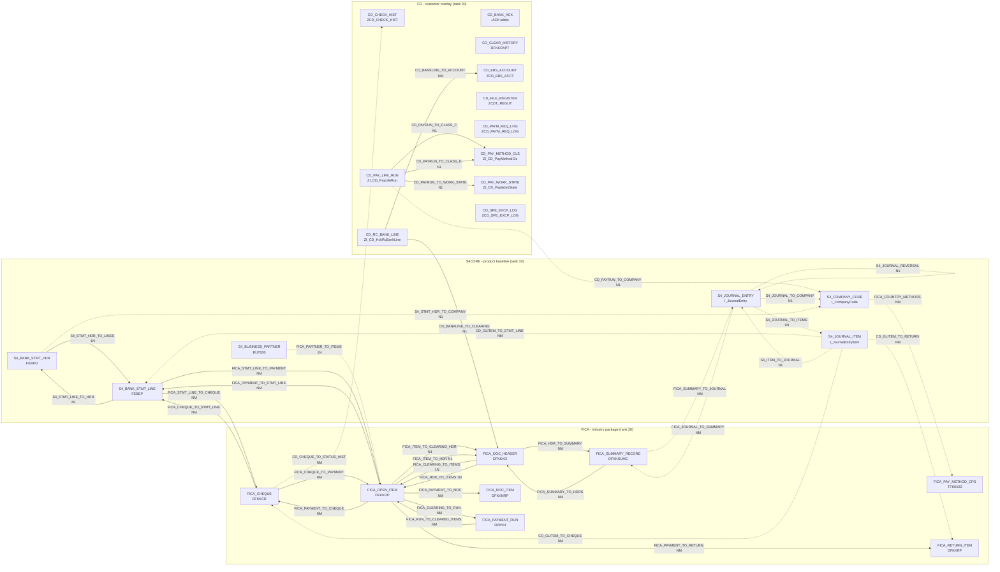

# Link registry of the ops suite (S4CORE, FICA, CD) - lineage

> Generated by `tools/link_registry.py` from the layer specs - never edit, regenerate.

Solid arrow = active link, dotted arrow = inactive (VERIFY item open, switched off or replaced); label = link ID and cardinality. Pending links (a field still a placeholder) are not drawn; the table of links lists them.

## Links

| Link | Layer | From | To | Cardinality | Quality | Conditions | Fallback of / replaces | Status |
|---|---|---|---|---|---|---|---|---|
| S4_ITEM_TO_JOURNAL | S4CORE | S4_JOURNAL_ITEM | S4_JOURNAL_ENTRY | N1 | C | I_JournalEntry-CompanyCode = I_JournalEntryItem-CompanyCode; I_JournalEntry-FiscalYear = I_JournalEntryItem-FiscalYear; I_JournalEntry-AccountingDocument = I_JournalEntryItem-AccountingDocument | - | inactive (VERIFY) V110 |
| S4_JOURNAL_REVERSAL | S4CORE | S4_JOURNAL_ENTRY | S4_JOURNAL_ENTRY | N1 | C | I_JournalEntry-CompanyCode = I_JournalEntry-CompanyCode; I_JournalEntry-FiscalYear = I_JournalEntry-ReverseDocumentFiscalYear; I_JournalEntry-AccountingDocument = I_JournalEntry-ReverseDocument | - | inactive (VERIFY) V110 |
| S4_JOURNAL_TO_COMPANY | S4CORE | S4_JOURNAL_ENTRY | S4_COMPANY_CODE | N1 | C | I_CompanyCode-CompanyCode = I_JournalEntry-CompanyCode | - | inactive (VERIFY) V110 |
| S4_JOURNAL_TO_ITEMS | S4CORE | S4_JOURNAL_ENTRY | S4_JOURNAL_ITEM | 1N | C | I_JournalEntryItem-CompanyCode = I_JournalEntry-CompanyCode; I_JournalEntryItem-FiscalYear = I_JournalEntry-FiscalYear; I_JournalEntryItem-AccountingDocument = I_JournalEntry-AccountingDocument | - | inactive (VERIFY) V110 |
| S4_STMT_HDR_TO_COMPANY | S4CORE | S4_BANK_STMT_HDR | S4_COMPANY_CODE | N1 | C | I_CompanyCode-CompanyCode = FEBKO-BUKRS | - | inactive (VERIFY) V110 V117 |
| S4_STMT_HDR_TO_LINES | S4CORE | S4_BANK_STMT_HDR | S4_BANK_STMT_LINE | 1N | C | FEBEP-KUKEY = FEBKO-KUKEY | - | active |
| S4_STMT_LINE_TO_HDR | S4CORE | S4_BANK_STMT_LINE | S4_BANK_STMT_HDR | N1 | C | FEBKO-KUKEY = FEBEP-KUKEY | - | active |
| FICA_CHEQUE_TO_PAYMENT | FICA | FICA_CHEQUE | FICA_OPEN_ITEM | NM | C | DFKKOP-AUGBL = DFKKCR-DOC1R | - | active |
| FICA_CHEQUE_TO_STMT_LINE | FICA | FICA_CHEQUE | S4_BANK_STMT_LINE | NM | C | FEBEP-CHECT = DFKKCR-ZTNUM (RIGHT 13) | - | active V117 |
| FICA_CLEARING_TO_ITEMS | FICA | FICA_DOC_HEADER | FICA_OPEN_ITEM | 1N | C | DFKKOP-AUGBL = DFKKKO-OPBEL | - | active |
| FICA_CLEARING_TO_RUN | FICA | FICA_OPEN_ITEM | FICA_PAYMENT_RUN | NM | C | DPAYH-DOC1R = DFKKOP-AUGBL | - | active |
| FICA_COUNTRY_METHODS | FICA | S4_COMPANY_CODE | FICA_PAY_METHOD_CFG | NM | C | TFK042Z-LAND1 = I_CompanyCode-Country | - | inactive (VERIFY) V110 V117 |
| FICA_HDR_TO_ITEMS | FICA | FICA_DOC_HEADER | FICA_OPEN_ITEM | 1N | C | DFKKOP-OPBEL = DFKKKO-OPBEL | - | active |
| FICA_HDR_TO_SUMMARY | FICA | FICA_DOC_HEADER | FICA_SUMMARY_RECORD | NM | C | DFKKSUMC-FIKEY = DFKKKO-FIKEY | - | active |
| FICA_ITEM_TO_CLEARING_HDR | FICA | FICA_OPEN_ITEM | FICA_DOC_HEADER | N1 | C | DFKKKO-OPBEL = DFKKOP-AUGBL | - | active |
| FICA_ITEM_TO_HDR | FICA | FICA_OPEN_ITEM | FICA_DOC_HEADER | N1 | C | DFKKKO-OPBEL = DFKKOP-OPBEL | - | active |
| FICA_JOURNAL_TO_SUMMARY | FICA | S4_JOURNAL_ENTRY | FICA_SUMMARY_RECORD | NM | C | DFKKSUMC-FIKEY = I_JournalEntry-OriginalReferenceDocument | - | inactive (VERIFY) V110 V117 |
| FICA_PARTNER_TO_ITEMS | FICA | S4_BUSINESS_PARTNER | FICA_OPEN_ITEM | 1N | C | DFKKOP-GPART = BUT000-PARTNER | - | inactive (VERIFY) V117 |
| FICA_PAYMENT_TO_CHEQUE | FICA | FICA_OPEN_ITEM | FICA_CHEQUE | NM | C | DFKKCR-DOC1R = DFKKOP-AUGBL | - | active |
| FICA_PAYMENT_TO_NOC | FICA | FICA_OPEN_ITEM | FICA_NOC_ITEM | NM | P | DFKKNRP-INFOF = DFKKOP-AUGBL | - | active |
| FICA_PAYMENT_TO_RETURN | FICA | FICA_OPEN_ITEM | FICA_RETURN_ITEM | NM | C | DFKKRP-SELW1 = DFKKOP-AUGBL | - | active |
| FICA_PAYMENT_TO_STMT_LINE | FICA | FICA_OPEN_ITEM | S4_BANK_STMT_LINE | NM | C | FEBEP-CHECT = DFKKOP-AUGBL | - | active |
| FICA_RUN_TO_CLEARED_ITEMS | FICA | FICA_PAYMENT_RUN | FICA_OPEN_ITEM | NM | C | DFKKOP-AUGBL = DPAYH-DOC1R | - | active |
| FICA_STMT_LINE_TO_CHEQUE | FICA | S4_BANK_STMT_LINE | FICA_CHEQUE | NM | P | DFKKCR-ZTNUM = FEBEP-CHECT | - | active V117 |
| FICA_STMT_LINE_TO_PAYMENT | FICA | S4_BANK_STMT_LINE | FICA_OPEN_ITEM | NM | C | DFKKOP-AUGBL = FEBEP-CHECT | - | active |
| FICA_SUMMARY_TO_HDRS | FICA | FICA_SUMMARY_RECORD | FICA_DOC_HEADER | NM | C | DFKKKO-FIKEY = DFKKSUMC-FIKEY | - | active |
| FICA_SUMMARY_TO_JOURNAL | FICA | FICA_SUMMARY_RECORD | S4_JOURNAL_ENTRY | NM | C | I_JournalEntry-OriginalReferenceDocument = DFKKSUMC-FIKEY; I_JournalEntry-ReferenceDocumentType = 'FKKSU' | - | inactive (VERIFY) V110 V117 |
| CD_BANKLINE_TO_ACCOUNT | CD | CD_RC_BANK_LINE | CD_EBS_ACCOUNT | NM | C | ZCD_EBS_ACCT-ACCOUNT_NO = ZI_CD_HckRcBankLine-PeAccount; ZCD_EBS_ACCT-ACTIVE = 'X' | - | active |
| CD_BANKLINE_TO_CLEARING | CD | CD_RC_BANK_LINE | FICA_DOC_HEADER | N1 | C | DFKKKO-OPBEL = ZI_CD_HckRcBankLine-BankReference | - | active |
| CD_CHEQUE_TO_STATUS_HIST | CD | FICA_CHEQUE | CD_CHECK_HIST | NM | C | ZCD_CHECK_HIST-ZTNUM = DFKKCR-ZTNUM | - | inactive (VERIFY) V121 |
| CD_GLITEM_TO_CHEQUE | CD | S4_JOURNAL_ITEM | FICA_CHEQUE | NM | P | DFKKCR-DOC1R = I_JournalEntryItem-AssignmentReference | - | inactive (VERIFY) V139 |
| CD_GLITEM_TO_RETURN | CD | S4_JOURNAL_ITEM | FICA_RETURN_ITEM | NM | P | DFKKRP-SELW1 = I_JournalEntryItem-AssignmentReference | - | inactive (VERIFY) V139 |
| CD_GLITEM_TO_STMT_LINE | CD | S4_JOURNAL_ITEM | S4_BANK_STMT_LINE | NM | P | FEBEP-CHECT = I_JournalEntryItem-AssignmentReference | - | inactive (VERIFY) V139 |
| CD_ITEM_TO_CLEAR_HIST | CD | FICA_OPEN_ITEM | CD_CLEAR_HISTORY | 1N | P | DFKKRAPT-‹item document field› = DFKKOP-OPBEL | - | pending (VERIFY) V100 |
| CD_ITEM_TO_REQUEST | CD | FICA_OPEN_ITEM | CD_PAYM_REQ_LOG | N1 | C | ZCD_PAYM_REQ_LOG-‹FIN number field› = DFKKOP-ZZ_FIN_TRANS_NUM; prefer ZCD_PAYM_REQ_LOG-ZZ_STATUS = 'SUCCESS' | - | pending (VERIFY) V82 |
| CD_PAYMENT_TO_ACK | CD | FICA_OPEN_ITEM | CD_BANK_ACK | NM | P | ‹ACK table›-‹payment key field› = DFKKOP-AUGBL | - | pending (VERIFY) V121 |
| CD_PAYRUN_TO_CLASS_C | CD | CD_PAY_LIFE_RUN | CD_PAY_METHOD_CLS | N1 | C | ZI_CD_PayMethodCls-Flow = 'C'; ZI_CD_PayMethodCls-PaymentMethod = ZI_CD_PayLifeRun-PaymentMethod | - | active |
| CD_PAYRUN_TO_CLASS_D | CD | CD_PAY_LIFE_RUN | CD_PAY_METHOD_CLS | N1 | C | ZI_CD_PayMethodCls-Flow = 'D'; ZI_CD_PayMethodCls-PaymentMethod = ZI_CD_PayLifeRun-PaymentMethod | - | active |
| CD_PAYRUN_TO_COMPANY | CD | CD_PAY_LIFE_RUN | S4_COMPANY_CODE | N1 | C | I_CompanyCode-CompanyCode = ZI_CD_PayLifeRun-CompanyCode | - | inactive (VERIFY) V110 |
| CD_PAYRUN_TO_WORK_STATE | CD | CD_PAY_LIFE_RUN | CD_PAY_WORK_STATE | N1 | C | ZI_CD_PayWorkState-ClearingDoc = ZI_CD_PayLifeRun-PaymentDocument | - | active |
| CD_REQ_TO_OPEN_ITEMS | CD | CD_PAYM_REQ_LOG | FICA_OPEN_ITEM | NM | C | DFKKOP-ZZ_FIN_TRANS_NUM = ZCD_PAYM_REQ_LOG-‹FIN number field› | - | pending (VERIFY) V82 |
| CD_REQ_TO_PARTNER | CD | CD_PAYM_REQ_LOG | S4_BUSINESS_PARTNER | NM | C | BUT000-BPEXT = ZCD_PAYM_REQ_LOG-ZZ_MEMBER_NO | CD_REQ_TO_PARTNER_SRC | pending (VERIFY) V121 |
| CD_REQ_TO_PARTNER_SRC | CD | CD_PAYM_REQ_LOG | S4_BUSINESS_PARTNER | NM | C | BUT000-BPEXT = ZCD_PAYM_REQ_LOG-ZZ_MEMBER_NO; BUT000-‹source field› = ZCD_PAYM_REQ_LOG-SOURCE | - | pending (VERIFY) V121 |
| CD_REQ_TO_STATUS_UPD | CD | CD_PAYM_REQ_LOG | CD_SPE_EXCP_LOG | NM | P | ZCD_SPE_EXCP_LOG-‹request key field› = ZCD_PAYM_REQ_LOG-‹FIN number field› | - | pending (VERIFY) V121 |
| CD_RUN_TO_FILE | CD | FICA_PAYMENT_RUN | CD_FILE_REGISTER | NM | C | ZCDT_REGUT-‹run date field› = DPAYH-LAUFD; ZCDT_REGUT-‹run ID field› = DPAYH-LAUFI; ZCDT_REGUT-‹house bank field› = DPAYH-HBKID | - | pending (VERIFY) V121 |

## Custom field flows

Fields a customer layer added (to its own or a standard object) and the links they flow through.

| Field | Layer | Flows through | Into |
|---|---|---|---|
| ‹ACK table›-‹payment key field› | CD | CD_PAYMENT_TO_ACK (pending (VERIFY)) | from DFKKOP-AUGBL |
| ZCD_CHECK_HIST-ZTNUM | CD | CD_CHEQUE_TO_STATUS_HIST (inactive (VERIFY)) | from DFKKCR-ZTNUM |
| DFKKRAPT-‹item document field› | CD | CD_ITEM_TO_CLEAR_HIST (pending (VERIFY)) | from DFKKOP-OPBEL |
| ZCD_EBS_ACCT-ACCOUNT_NO | CD | CD_BANKLINE_TO_ACCOUNT (active) | from ZI_CD_HckRcBankLine-PeAccount |
| ZCDT_REGUT-‹house bank field› | CD | CD_RUN_TO_FILE (pending (VERIFY)) | from DPAYH-HBKID |
| ZCDT_REGUT-‹run ID field› | CD | CD_RUN_TO_FILE (pending (VERIFY)) | from DPAYH-LAUFI |
| ZCDT_REGUT-‹run date field› | CD | CD_RUN_TO_FILE (pending (VERIFY)) | from DPAYH-LAUFD |
| ZCD_PAYM_REQ_LOG-SOURCE | CD | CD_REQ_TO_PARTNER_SRC (pending (VERIFY)) | BUT000-‹source field› |
| ZCD_PAYM_REQ_LOG-ZZ_MEMBER_NO | CD | CD_REQ_TO_PARTNER (pending (VERIFY)) | BUT000-BPEXT |
| ZCD_PAYM_REQ_LOG-ZZ_MEMBER_NO | CD | CD_REQ_TO_PARTNER_SRC (pending (VERIFY)) | BUT000-BPEXT |
| ZCD_PAYM_REQ_LOG-‹FIN number field› | CD | CD_ITEM_TO_REQUEST (pending (VERIFY)) | from DFKKOP-ZZ_FIN_TRANS_NUM |
| ZCD_PAYM_REQ_LOG-‹FIN number field› | CD | CD_REQ_TO_OPEN_ITEMS (pending (VERIFY)) | DFKKOP-ZZ_FIN_TRANS_NUM |
| ZCD_PAYM_REQ_LOG-‹FIN number field› | CD | CD_REQ_TO_STATUS_UPD (pending (VERIFY)) | ZCD_SPE_EXCP_LOG-‹request key field› |
| ZI_CD_PayLifeRun-CompanyCode | CD | CD_PAYRUN_TO_COMPANY (inactive (VERIFY)) | I_CompanyCode-CompanyCode |
| ZI_CD_PayLifeRun-PaymentDocument | CD | CD_PAYRUN_TO_WORK_STATE (active) | ZI_CD_PayWorkState-ClearingDoc |
| ZI_CD_PayLifeRun-PaymentMethod | CD | CD_PAYRUN_TO_CLASS_C (active) | ZI_CD_PayMethodCls-PaymentMethod |
| ZI_CD_PayLifeRun-PaymentMethod | CD | CD_PAYRUN_TO_CLASS_D (active) | ZI_CD_PayMethodCls-PaymentMethod |
| ZI_CD_PayMethodCls-PaymentMethod | CD | CD_PAYRUN_TO_CLASS_C (active) | from ZI_CD_PayLifeRun-PaymentMethod |
| ZI_CD_PayMethodCls-PaymentMethod | CD | CD_PAYRUN_TO_CLASS_D (active) | from ZI_CD_PayLifeRun-PaymentMethod |
| ZI_CD_PayWorkState-ClearingDoc | CD | CD_PAYRUN_TO_WORK_STATE (active) | from ZI_CD_PayLifeRun-PaymentDocument |
| ZI_CD_HckRcBankLine-BankReference | CD | CD_BANKLINE_TO_CLEARING (active) | DFKKKO-OPBEL |
| ZI_CD_HckRcBankLine-PeAccount | CD | CD_BANKLINE_TO_ACCOUNT (active) | ZCD_EBS_ACCT-ACCOUNT_NO |
| ZCD_SPE_EXCP_LOG-‹request key field› | CD | CD_REQ_TO_STATUS_UPD (pending (VERIFY)) | from ZCD_PAYM_REQ_LOG-‹FIN number field› |
| DFKKOP-ZZ_FIN_TRANS_NUM | CD | CD_ITEM_TO_REQUEST (pending (VERIFY)) | ZCD_PAYM_REQ_LOG-‹FIN number field› |
| DFKKOP-ZZ_FIN_TRANS_NUM | CD | CD_REQ_TO_OPEN_ITEMS (pending (VERIFY)) | from ZCD_PAYM_REQ_LOG-‹FIN number field› |
| BUT000-‹source field› | CD | CD_REQ_TO_PARTNER_SRC (pending (VERIFY)) | from ZCD_PAYM_REQ_LOG-SOURCE |
